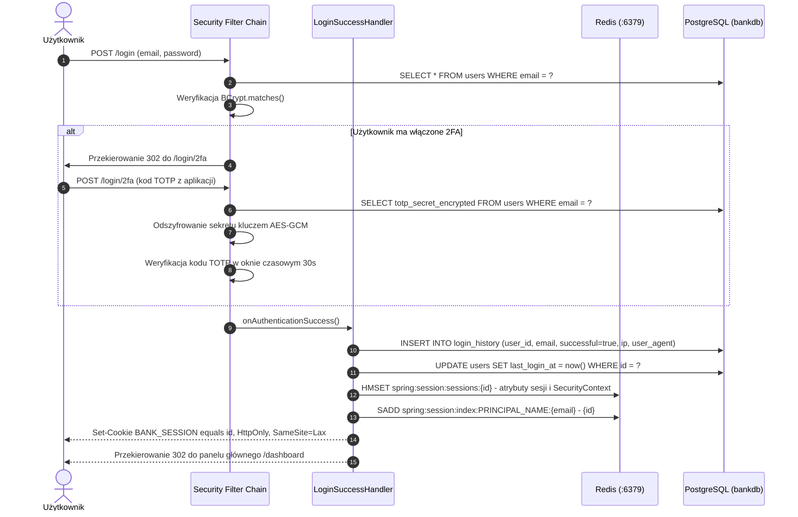
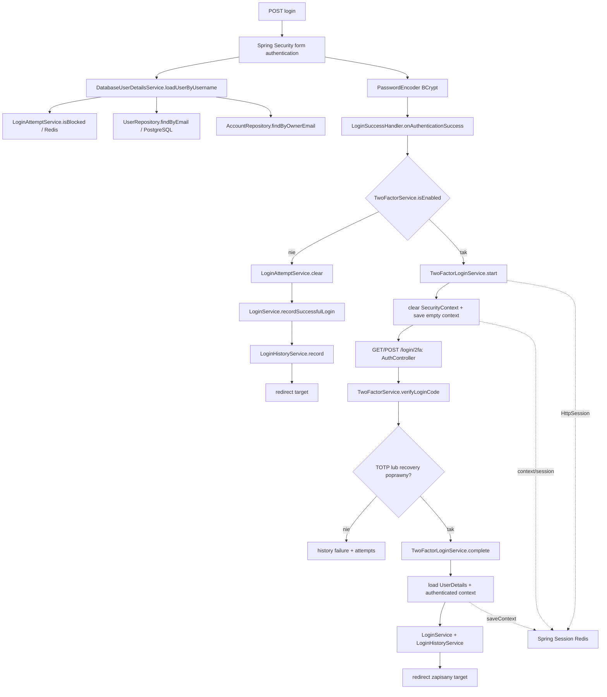
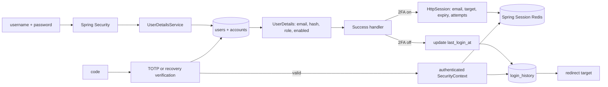
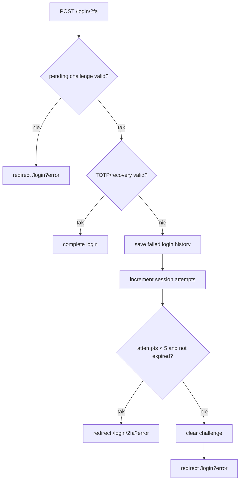

## Postęp analizy
- [x] Faza 0: rozbicie diagramu
- [x] Faza 1: mapowanie diagram → kod
- [x] Faza 2: trace per element
- [x] Faza 3: zmienne
- [x] Faza 4: warunki
- [x] Faza 5: moduły warunkowe
- [x] Faza 6: ścieżki błędów
- [x] Faza 7: porównanie z diagramem
- [x] Faza 8: diagramy pomocnicze
- [x] Faza 9: trace end-to-end
- [x] Faza 10: weryfikacja

# Dokumentacja przepływu logowania

> **Wynik końcowej analizy:** część „Weryfikacja kodu i rzeczywisty przebieg — wynik końcowy” poniżej jest miarodajna. Wstępne akapity oznaczone „Niezweryfikowane” powstały przed odzyskaniem dostępu do repozytorium; ich status zastępują ustalenia w części końcowej.

## 1. Cel analizy i przyjęte założenia
- Plik wyjściowy: `Bank-app2.md` (zgodnie z podaną ścieżką w katalogu repozytorium).
- Nazwa przepływu: logowanie, opcjonalne 2FA i utworzenie sesji.
- Zakres szczegółowości: pełny; język: polski.
- STACK i katalog projektu pozostawiono do ustalenia z kodu. Weryfikacja repozytorium jest obecnie niedostępna, więc nie przyjęto żadnego stosu jako faktu.
- Diagram jest wyłącznie mapą intencji. Wszystkie jego twierdzenia pozostają niepotwierdzone do czasu analizy kodu.

### Moduły warunkowe — status weryfikacji
- Security: do sprawdzenia
- Baza danych: do sprawdzenia
- Cache / Redis: do sprawdzenia
- Konfiguracja: do sprawdzenia
- Dependency Injection: do sprawdzenia
- Mechanizmy niewidoczne: do sprawdzenia

## 2. Diagram wejściowy



### Elementy
- E1 Użytkownik (aktor)
- E2 Security Filter Chain
- E3 LoginSuccessHandler
- E4 Redis (:6379)
- E5 PostgreSQL (bankdb)
- E6 alt: „Użytkownik ma włączone 2FA”
- E7 żądanie POST `/login` z email i password
- E8 odczyt użytkownika po email
- E9 weryfikacja BCrypt.matches()
- E10 redirect 302 do `/login/2fa`
- E11 żądanie POST `/login/2fa` z kodem TOTP
- E12 odczyt zaszyfrowanego sekretu TOTP
- E13 odszyfrowanie AES-GCM
- E14 weryfikacja TOTP w oknie 30 s
- E15 wywołanie `onAuthenticationSuccess()`
- E16 INSERT do login_history
- E17 UPDATE users.last_login_at
- E18 HMSET sesji w Redis
- E19 SADD indeksu principal w Redis
- E20 odpowiedź Set-Cookie BANK_SESSION
- E21 redirect 302 do `/dashboard`

### Połączenia
- K1 E1 → E2: POST `/login` (email, password)
- K2 E2 → E5: SELECT users po email
- K3 E2 → E2: BCrypt.matches()
- K4 E2 → E1: redirect 302 `/login/2fa` (gałąź 2FA)
- K5 E1 → E2: POST `/login/2fa` (kod TOTP)
- K6 E2 → E5: odczyt `totp_secret_encrypted`
- K7 E2 → E2: odszyfrowanie AES-GCM
- K8 E2 → E2: sprawdzenie TOTP (okno 30 s)
- K9 E2 → E3: `onAuthenticationSuccess()`
- K10 E3 → E5: INSERT `login_history`
- K11 E3 → E5: UPDATE `users.last_login_at`
- K12 E3 → E4: HMSET sesji i SecurityContext
- K13 E3 → E4: SADD indeksu principal
- K14 E3 → E1: Set-Cookie `BANK_SESSION`
- K15 E3 → E1: redirect 302 `/dashboard`

**Uwaga identyfikatorów:** diagram ma `autonumber`, ale nie zawiera numerów jawnie wypisanych przy komunikatach; K1–K15 nadano według kolejności 15 komunikatów. E6 jest konstrukcją `alt`, a nie dodatkową wiadomością.

## 3. Mapa Mermaid → kod
Niezweryfikowane — lokalne źródła projektu nie udały się odczytać w bieżącej sesji. Każdy wiersz wymaga sprawdzenia repozytorium; brak ścieżek i numerów linii uniemożliwia potwierdzenie.

| # | Element Mermaid | Implementacja | Plik:linia | Klasa | Metoda | Znaleziono? |
|---|---|---|---|---|---|---|
| E1 | Użytkownik | Niezweryfikowane | — | — | — | NIEZWERYFIKOWANE |
| E2 | Security Filter Chain | Niezweryfikowane | — | — | — | NIEZWERYFIKOWANE |
| E3 | LoginSuccessHandler | Niezweryfikowane | — | — | — | NIEZWERYFIKOWANE |
| E4 | Redis | Niezweryfikowane | — | — | — | NIEZWERYFIKOWANE |
| E5 | PostgreSQL | Niezweryfikowane | — | — | — | NIEZWERYFIKOWANE |
| E6 | Warunek 2FA | Niezweryfikowane | — | — | — | NIEZWERYFIKOWANE |
| E7–E21 | Żądania, operacje i odpowiedzi opisane wyżej | Niezweryfikowane | — | — | — | NIEZWERYFIKOWANE |

## 4. Architektura przepływu
Niezweryfikowane. Wymagane źródła: konfiguracja Security, endpointy, serwisy, repozytoria/encje/migracje, konfiguracja Redis i obsługa sesji.

## 5. Szczegółowy przepływ krok po kroku
Niedokończone: repozytorium nie zostało odczytane, zatem brak podstaw do opisu wykonania metod.

## 6. Call chain
Niezweryfikowane.

## 7. Przepływ danych
Niezweryfikowane.

## 8. Analiza warunków
Diagram sugeruje warunek 2FA, ale jego źródło i rzeczywiste gałęzie nie są potwierdzone w kodzie.

## 9. Źródła zmiennych
Niezweryfikowane. Nie można ustalić parametrów, pól ani zmiennych lokalnych bez kodu.

## 10. Opis klas i metod
Niezweryfikowane. Nazwy diagramu nie stanowią dowodu istnienia klas ani metod.

## 11. Ścieżki błędów
Niezweryfikowane. Brak dostępu do implementacji uniemożliwia potwierdzenie walidacji, wyjątków i ich obsługi.

## 12. Mermaid vs rzeczywista implementacja
Nie można porównać diagramu z implementacją bez dostępu do kodu. Wszystkie operacje pozostają niezweryfikowane.

## 13. Diagramy pomocnicze
Nie dodano diagramów opisujących kod, ponieważ kod nie został odczytany. Diagram oparty wyłącznie na wejściowej mapie fałszywie sugerowałby potwierdzenie implementacji.

## 14. Pełny trace end-to-end
Niedokończone: wymaga identyfikacji rzeczywistych klas, metod i źródeł danych.

## 15. Niepewności / elementy niezweryfikowane / niedokończone
- Całość implementacji pozostaje niezweryfikowana: każda klasa, metoda, tabela, klucz Redis, konfiguracja i zachowanie diagramu.
- Powód: polecenia systemowe nie uruchamiają się w bieżącym środowisku (`helper_unknown_error: setup refresh had errors`); nie udało się odczytać ani listy plików repozytorium.
- Potrzebne do dokończenia: ponowne udostępnienie działającego dostępu do workspace albo przekazanie plików źródłowych.

## 16. Podsumowanie — wstępny status zastąpiony poniższą analizą
Wstępny status odzwierciedlał chwilowy błąd narzędzia. Repozytorium zostało później odczytane, a wyniki końcowej analizy i trace znajdują się w dalszej części dokumentu.

---

# Weryfikacja kodu i rzeczywisty przebieg — wynik końcowy

Powyższy wstępny szkielet powstał, gdy terminal nie działał. Odzyskano dostęp i poniższa część zawiera właściwą analizę repozytorium. Twierdzenia oznaczone `[KOD]` mają ścieżkę oraz linie. Zachowano maskowanie wartości wrażliwych.

## Uzupełnione parametry i stos

- `[KOD]` Stos przepływu: Java, Spring Boot, Spring Security, Spring Data JPA/Hibernate, PostgreSQL, Spring Session Data Redis, Thymeleaf. Maven określa zależności w `pom.xml:1-100`; Redis Session starter jest wskazany przy `pom.xml:63-68`.
- Katalog projektu: root repozytorium `C:\Dysk D\stuff\Bank-demo`.
- Przepływ: logowanie hasłem, opcjonalne wyzwanie TOTP / kod odzyskiwania, zapis informacji logowania i redirect.
- Dokument wyjściowy: `Bank-app2.md` w root repozytorium.

## Moduły warunkowe

- Security: dotyczy (`src/main/java/org/demo/bankdemo/config/SecurityConfig.java:36-110`).
- Baza danych: dotyczy (`LoginService.java:18-21`, `LoginHistoryService.java:46-67`).
- Cache / Redis: dotyczy Spring Session i próby logowania (`application.yaml:13-22`, `LoginAttemptService.java:18-72`).
- Konfiguracja: dotyczy (`application.yaml:13-22, 95-108`; `SecurityConfig.java:36-110`).
- Dependency Injection: dotyczy; komponenty tworzy Spring przez `@Component`, `@Service`, `@Configuration` / `@Bean` i konstruktor (`LoginSuccessHandler.java:18-49`, `TwoFactorLoginService.java:20-51`, `SecurityConfig.java:32-44`).
- Mechanizmy niewidoczne: dotyczy Spring Security filters, Spring Session Redis, transakcje Spring/JPA i MVC mapowanie widoków (`SecurityConfig.java:91-110`, `application.yaml:19-22`).

## 3. Mapa Mermaid → kod (wyniki)

| Element | Implementacja / dowód | Wynik |
|---|---|---|
| E1 Użytkownik | Klient HTTP; aktor diagramu nie jest klasą aplikacji. | potwierdzona rola |
| E2 Security Filter Chain | Bean `SecurityConfig.securityFilterChain`; konfiguracja `formLogin`, publiczne `/login/2fa`, CSRF i session fixation (`SecurityConfig.java:36-110`). | znaleziono; diagram upraszcza jej udział |
| E3 `LoginSuccessHandler` | `onAuthenticationSuccess` (`LoginSuccessHandler.java:18-84`). | znaleziono, ale to handler sukcesu hasła; przy aktywnym 2FA nie kończy uwierzytelniania |
| E4 Redis | Spring Session Data Redis oraz `LoginAttemptService` (`application.yaml:13-22`, `LoginAttemptService.java:18-72`). | znaleziono; brak jawnego zapisu sesji w handlerze |
| E5 PostgreSQL | JPA `UserRepository`, `LoginHistoryRepository`, migracje Flyway (`UserRepository.java:1-14`, `LoginHistoryRepository.java:1-13`, migracje `V1`, `V8`, `V10`). | znaleziono; diagramowy SELECT nie jest wykonywany przez sam filter |
| E6 warunek 2FA | `TwoFactorService.isEnabled` oraz gałąź handlera (`TwoFactorService.java:60-62`, `LoginSuccessHandler.java:64-74`). | znaleziono; sprawdzane po poprawnym haśle |
| E7 POST `/login` | Domyślny processing Spring Security form login; login page jest jawnie `/login`, processing URL nie został nadpisany (`SecurityConfig.java:91-96`). Formularz używa domyślnego parametru `username`; diagram podaje `email`. | uproszczone / nazwa parametru niezgodna |
| E8 użytkownik po e-mailu | `DatabaseUserDetailsService.loadUserByUsername` normalizuje nazwę i wywołuje repozytorium (`DatabaseUserDetailsService.java:35-49`; `UserRepository.java:9-12`). | potwierdzone pośrednio; JPA generuje zapytanie |
| E9 BCrypt | Bean `BCryptPasswordEncoder` (`SecurityConfig.java:167-168`); Spring Security używa PasswordEncoder przy uwierzytelnianiu. | automatyzacja frameworka; diagramowe bezpośrednie `matches()` w filterze nie istnieje |
| E10 redirect do 2FA | `LoginSuccessHandler` uruchamia challenge, czyści kontekst i przekierowuje (`LoginSuccessHandler.java:64-74`). | potwierdzone, przedtem sesja challenge |
| E11 POST `/login/2fa` | `AuthController.verifyTwoFactor` (`AuthController.java:55-74`); formularz ma parametr `code` (`templates/auth/two-factor.html:38-40`). | potwierdzone |
| E12 odczyt sekretu | `TwoFactorService.verifyLoginCode` ładuje użytkownika, a `User.getTotpSecretEncrypted()` dostarcza zaszyfrowane pole (`TwoFactorService.java:126-146`, `User.java:67-68, 234-235`). | potwierdzone; nie osobny SELECT SQL napisany w kontrolerze |
| E13 AES-GCM | `TotpSecretCipher.decrypt` (`TotpSecretCipher.java:42-59`). | potwierdzone przy sprawdzaniu TOTP |
| E14 TOTP | `TwoFactorService.verifyTotp` używa SHA1, 6-cyfrowego kodu, okresu i dyskrepancji (`TwoFactorService.java:166-175`; stałe w `TwoFactorService.java:25-29`). | niezgodność: akceptuje bieżące okno ±1 krok (okres 30 s), a nie wyłącznie „okno 30s” |
| E15 handler sukcesu po 2FA | Drugi etap to `TwoFactorLoginService.complete`, nie ponowne wywołanie `LoginSuccessHandler` (`AuthController.java:72-73`, `TwoFactorLoginService.java:104-125`). | diagram niezgodny |
| E16 historia sukcesu | `LoginHistoryService.record(..., true, null)` po zakończeniu 2FA albo w ścieżce bez 2FA (`LoginSuccessHandler.java:76-79`, `TwoFactorLoginService.java:120-124`). | potwierdzone, lecz dane kolumn i logika różnią się od diagramu |
| E17 last login | `LoginService.recordSuccessfulLogin` ładuje encję i ustawia pole; zapis jest realizowany przez transakcję JPA/dirty checking (`LoginService.java:18-21`, `User.java:132-134`, `User.java:63-65`). | potwierdzone jako mutacja; diagramowe jawne `UPDATE ... now()` nie występuje |
| E18 Redis hash sesji | Kod aplikacji nie wywołuje `HMSET`; Spring Session serializuje/przechowuje sesję przez repository Redis. Szczegółowy wire format zależy od wersji Spring Session i konfiguracji. | konkretny klucz/komenda/serializer niezweryfikowane w źródłach projektu |
| E19 Redis principal index | `application.yaml:19-22` wybiera indexed session repository. Nazwa fizycznego klucza nie jest wpisana w kod projektu. | niezweryfikowane dokładne `SADD` i klucz; implementacja frameworka |
| E20 cookie | `BANK_SESSION`, HttpOnly i SameSite=Lax skonfigurowane (`application.yaml:95-108`). | potwierdzone konfiguracją; wysyłka/nadanie ID jest frameworkowe; `Secure` konfigurowane, nie przepisywano wartości sekretów |
| E21 `/dashboard` | Fallback handlera to `/dashboard`, lecz zapisane żądanie albo bezpieczny parametr kontynuacji może wybrać inny cel (`LoginSuccessHandler.java:57-62, 82-84`). Po 2FA target pochodzi z atrybutu sesji (`TwoFactorLoginService.java:53-60, 124`). | warunkowe; nie zawsze dashboard |

Połączenia K1–K15 są mapą kolejności diagramu, a nie bez wyjątku bezpośrednimi wywołaniami. K2/K3 są zachowaniem frameworka; K9 jest wywołaniem framework → handler dopiero po weryfikacji hasła. K12/K13 są utrwalaniem sesji przez framework, nie jawne calli handlera. K10/K11 w diagramie występują również po 2FA, ale aplikacja wykonuje je poprzez osobne serwisy po zakończeniu wyzwania.

## 4. Architektura i konfiguracja przepływu

1. `[KOD]` `SecurityConfig.securityFilterChain` publicznie dopuszcza `/login` i `/login/2fa`, konfiguruje form login z `LoginSuccessHandler` / `LoginFailureHandler`, pozostawia CSRF włączone dla formularzy (ignoruje jedynie `/api/**`), migruje sesję przy fixation i wskazuje `SecurityContextRepository` (`SecurityConfig.java:36-110`). Wstawione przed `UsernamePasswordAuthenticationFilter` filtry obejmują rate limit, ale ich pełna kolejność względem siebie wynika z kolejnych `addFilterBefore` (`SecurityConfig.java:160-164`); diagram ich pomija.
2. `[FRAMEWORK]` Spring Security przetwarza domyślny form-login processing endpoint i parametry `username` / `password`; w kodzie projektu nie ustawiono `usernameParameter("email")` ani `loginProcessingUrl` (`SecurityConfig.java:91-96`). W formularzu należy zatem podać pole `username` (szablon `templates/auth/login.html:...`; linia wymaga ostrożnego odczytu szablonu, patrz niepewności poniżej).
3. `[KOD]` `DatabaseUserDetailsService` normalizuje username, sprawdza blokadę w Redis, pobiera `User`, sprawdza konto bankowe i buduje `UserDetails` (`DatabaseUserDetailsService.java:35-51`).
4. `[FRAMEWORK]` Uwierzytelnienie hasła porównuje raw password z zapisanym password hash poprzez skonfigurowany `PasswordEncoder` BCrypt (`SecurityConfig.java:167-168`). Samo porównanie nie jest ręcznie wywołane w filtrze aplikacji.
5. `[KOD]` sukces uruchamia `LoginSuccessHandler`. Dla 2FA tworzy sesyjny challenge, czyści SecurityContext (żeby hasło samo nie nadawało zalogowanej sesji) i przekierowuje do formularza 2FA (`LoginSuccessHandler.java:64-74`).
6. `[KOD]` `AuthController` weryfikuje kod TOTP albo kod odzyskiwania; w razie sukcesu `TwoFactorLoginService.complete` tworzy uwierzytelniony Authentication, zapisuje context, usuwa atrybuty challenge, czyści licznik niepowodzeń, zapisuje last login i historię (`AuthController.java:62-73`, `TwoFactorLoginService.java:104-125`).
7. `[FRAMEWORK]` HttpSession jest zarządzana przez Spring Session Data Redis. Konfiguracja `spring.session.data.redis.repository-type: indexed` oraz Redis host/port są w `application.yaml:13-22`; timeout 30m i cookie w `application.yaml:95-108`. Nie ma bezpośredniego kodu `HMSET` ani `SADD` w tym przepływie.

### SecurityContext i sesja

`SecurityConfig.securityContextRepository()` zwraca `DelegatingSecurityContextRepository` z `RequestAttributeSecurityContextRepository` i `HttpSessionSecurityContextRepository` (`SecurityConfig.java:177-181`). W kroku pierwszego hasła, w przypadku 2FA, handler jawnie czyści `SecurityContextHolder` i zapisuje pusty kontekst przez repository (`LoginSuccessHandler.java:66-71`). Po poprawnym drugim czynniku `complete` tworzy pusty kontekst, ustawia authenticated token z authorities, instaluje go w holderze i zapisuje w repository (`TwoFactorLoginService.java:112-120`). Nie ustalono dokładnego momentu/komendy Redisowej dla flushu sesji; to zachowanie Spring Session.

### Baza danych

- `UserRepository.findByEmail` jest derived query JPA (`user/UserRepository.java:9-12`); tabela `users` i unikalny email są zdefiniowane w `V1__create_bank_schema.sql:1-19`.
- `totp_secret_encrypted`, `totp_enabled` i `totp_enabled_at` dodaje `V8__add_totp_mfa.sql:1-4`.
- `last_login_at` kolumna TIMESTAMPTZ jest w `V1...sql:13`; JPA mapuje ją w `User.java:63-65`.
- `LoginHistoryRepository` rozszerza `JpaRepository`; metody ostatnich 50 udanych oraz wszystkich logowań są w `audit/LoginHistoryRepository.java:7-12`.
- `login_history` z polami `user_id`, `email`, `ip_address`, `user_agent`, `successful`, `failure_reason`, `created_at` i FK `ON DELETE SET NULL` powstaje w `V10__add_email_verification_password_reset_and_login_history.sql:40-55`. Diagram wymienia pole `ip`, którego tabela nie ma; właściwa nazwa to `ip_address`. Wpis przechowuje również `failure_reason`.
- `LoginHistoryService.record` ma `@Transactional(REQUIRES_NEW)` (`LoginHistoryService.java:46`), oddzielając zapis od transakcji wywołującej. `LoginService.recordSuccessfulLogin` jest `@Transactional` (`LoginService.java:18`), a update pola odbywa się przez zarządzaną encję. Kod nie wykonuje literalnego SQL `UPDATE ... now()`.

### Redis

- `LoginAttemptService` używa `StringRedisTemplate`, prefiksu `bank:login-attempt:` i SHA-256 znormalizowanego emaila jako klucza (`LoginAttemptService.java:18-20, 61-72`). Przy pierwszym `INCR` ustawia TTL 15 minut (`LoginAttemptService.java:40-50`); zły format licznika powoduje usunięcie klucza (`LoginAttemptService.java:25-37`). Sukces usuwa klucz (`LoginAttemptService.java:53-58`).
- Sesje: Spring Session Redis indexed repository przez zależności i YAML. Projekt nie ustawia własnego serializera, namespace ani jawnego TTL sesji Redis w analizowanych plikach; ogólny timeout servlet session to 30 minut (`application.yaml:95-108`). Nie utożsamiamy tego z potwierdzonym czasem TTL klucza Redis.
- Wartości fizycznego klucza sesji, kodowanie SecurityContext, HMSET/SADD (lub równoważne operacje protokołu) zależą od wersji biblioteki i nie są deklarowane przez aplikację. Diagram podaje nazwy, których nie można potwierdzić źródłami projektu.

### Wstrzykiwanie zależności i transakcje

`LoginSuccessHandler` jest `@Component`, a `TwoFactorLoginService` / pozostałe serwisy są `@Service`; zależności przekazywane są konstruktorami (`LoginSuccessHandler.java:18-49`, `TwoFactorLoginService.java:20-51`). `SecurityConfig` dostarcza beany `PasswordEncoder`, `RequestCache` oraz `SecurityContextRepository` (`SecurityConfig.java:167-181`). `@Transactional` serwisów działa przez proxy Spring, jeśli wywołanie przechodzi przez bean proxy; szczegółów konfiguracji platform transaction manager nie ma potrzeby zakładać poza standardową integracją JPA z Boot.

## 5. Pełny rzeczywisty przepływ

### A. Poprawne hasło, konto bez 2FA

1. Klient przesyła formularz login do processing filtra Spring Security. Domyślne nazwy parametrów username/password wynikają z niezdefiniowania własnych nazw w `.formLogin` (`SecurityConfig.java:91-96`).
2. `DatabaseUserDetailsService.loadUserByUsername(username)` normalizuje email przez `RegistrationService.normalizeEmail`, wywołuje `LoginAttemptService.isBlocked`, odczytuje user po email, następnie stan konta po email. Buduje UserDetails z roli i disabled, gdy status użytkownika/konta nieaktywny albo email niezweryfikowany (`DatabaseUserDetailsService.java:35-51`).
3. Spring Security sprawdza hasło z PasswordEncoder BCrypt (`SecurityConfig.java:167-168`, konfiguracja form login `SecurityConfig.java:91-96`).
4. `LoginSuccessHandler.onAuthenticationSuccess` pobiera saved request, pobiera parametr `continue`, wybiera bezpieczny payment continuation albo zapisany redirect albo `/dashboard`, następnie usuwa saved request (`LoginSuccessHandler.java:57-62`).
5. `TwoFactorService.isEnabled(authentication.getName())` odczytuje rekord użytkownika i pole `totp_enabled` (`TwoFactorService.java:60-62`; `User.java:271-273`). Gdy false: `LoginAttemptService.clear`, `LoginService.recordSuccessfulLogin`, `LoginHistoryService.record(..., true, null)` i redirect do wybranego target (`LoginSuccessHandler.java:76-79`).

### B. Poprawne hasło, konto z 2FA

1. Handler `TwoFactorLoginService.start(request,email,target)` tworzy HttpSession i zapisuje znormalizowany email, target, timestamp wygaśnięcia oraz licznik 0 (`LoginSuccessHandler.java:64-65`, `TwoFactorLoginService.java:53-60`). Lifetime challenge wynosi 5 minut; limit 5 prób (`TwoFactorLoginService.java:27-28`).
2. Handler czyści SecurityContext i zapisuje pusty kontekst, po czym przekierowuje do `/login/2fa` (`LoginSuccessHandler.java:66-74`). W tym momencie `last_login_at` i udany login history nie są jeszcze aktualizowane.
3. GET `/login/2fa`: `AuthController.twoFactorForm` pyta `pending(session)`. Brak/wygaśnięcie/limit prób przekierowuje do `/login?error`; inaczej email trafia do Model i renderuje `auth/two-factor` (`AuthController.java:45-53`, `TwoFactorLoginService.java:62-88`).
4. POST `/login/2fa`: odczytuje `code` jako opcjonalny parametr, ponownie sprawdza pending (`AuthController.java:55-65`). `TwoFactorService.verifyLoginCode` pobiera User; gdy 2FA jest wyłączone zwraca true; w innym razie odszyfrowuje sekret i próbuje TOTP. Jeśli TOTP nie pasuje, normalizuje recovery code, blokuje pusty kod, pobiera niewykorzystane recovery codes pod blokadą i porównuje je z BCrypt; pasujący kod jest oznaczany jako użyty (`TwoFactorService.java:126-146`).
5. Niepoprawny kod: zapisuje nieudaną pozycję historii, zwiększa licznik w sesji; redirect wraca do 2FA przed piątą próbą, a po osiągnięciu limitu challenge jest czyszczone i redirect idzie do `/login?error` (`AuthController.java:66-70`, `TwoFactorLoginService.java:90-102`).
6. Poprawny kod: `complete` ponownie waliduje pending, ładuje `UserDetails`, buduje authenticated `UsernamePasswordAuthenticationToken`, ustawia i zapisuje SecurityContext, usuwa atrybuty challenge, czyści licznik prób logowania, aktualizuje last login i zapisuje wpis historii; zwraca zapisany target (`TwoFactorLoginService.java:104-125`). Kontroler odpowiada redirectem `redirect:` + target (`AuthController.java:72-73`).

## 6. Zmienne i parametry (w metodach przepływu)

Poniższa lista obejmuje parametry i zmienne lokalne metod bezpośrednio w głównym trace oraz w wywołanych metodach usługowych. Pola zależności opisane są po tabeli; logger/brak loggera nie wpływa na trace.

| Zmienna | Typ / utworzenie | Źródło i modyfikacje | Użycie / cel |
|---|---|---|---|
| `request`, `response`, `authentication` | servlet request/response i Spring `Authentication`; parametry callbacku | framework dostarcza do success handlera (`LoginSuccessHandler.java:52-56`) | session/request/response, nazwa principal i dalsze uwierzytelnienie |
| `savedRequest` | `SavedRequest`, lokalna | `requestCache.getRequest` (`LoginSuccessHandler.java:57`) | pierwotny URL, do którego zalogowany ma wrócić |
| `explicitTarget` | `String`, lokalna | request param `continue` (`:58`) | alternatywne przekierowanie |
| `targetUrl` | `String`, lokalna | bezpieczny `continue`, w przeciwnym razie saved request lub literal `/dashboard` (`:59-61`) | zachowuje miejsce powrotu, przekazywany do challenge/redirect |
| `email` | `String`, parametr metod 2FA | Authentication principal albo atrybut sesji | identyfikuje użytkownika; challenge email jest strip/lowercase |
| `session` | `HttpSession` | `request.getSession(true)` w start; MVC argument resolver w endpointach | challenge atrybuty oraz persistence sesji |
| `target` | `String`, parametr `start` | `targetUrl` handlera | zapisany redirect po drugim czynniku |
| `expiresAt` / `expiresAtValue` | `Instant` / `String` | clock + 5 minut, serializowane ISO; odczyt z atrybutu sesji | ogranicza czas życia challenge (`TwoFactorLoginService.java:57-58, 68-83`) |
| `attempts` / `value` / `number` | `int`, `Object`, pattern-bound `Number` | atrybut challenge; brak wartości liczony od 0 | ograniczenie do 5 prób (`TwoFactorLoginService.java:78-83, 137-140`) |
| `pending` | `Optional<PendingLogin>` | odczyt/walidacja session attributes | uniemożliwia dalszą autoryzację po braku/wygaśnięciu challenge |
| `userDetails` | `UserDetails` | ładowany ponownie po pending email | role/principal do uwierzytelnionego tokenu (`TwoFactorLoginService.java:111-117`) |
| `context` | `SecurityContext` | `createEmptyContext` | przechowuje utworzone Authentication do sesji (`:112-120`) |
| `code` | `String`, request param optional | form field `code`; może być `null` | TOTP lub recovery code (`AuthController.java:57-60`) |
| `normalizedEmail` | `String`, lokalna | email normalizowany do trim/lowercase | klucz spójny dla repository/history |
| `user` / `bankUser` | encja `User` | `UserRepository.findByEmail` | stan 2FA, hash, status, role, last login |
| `accountIsActive` | `boolean` | `AccountRepository.findByOwnerEmail`; brak account traktowany true w tej metodzie | ustawia disabled w UserDetails (`DatabaseUserDetailsService.java:44-49`) |
| `secret` | `String` | plaintext po `TotpSecretCipher.decrypt` | wejście biblioteki TOTP; nie utrwalany jako plaintext w DB |
| `normalized` | `String` | recovery code: usuwa spacje, trim, lowercase | sprawdzany z hashem BCrypt (`TwoFactorService.java:134-140`) |
| `now` | `Instant` | `Instant.now(clock)` | czas oznaczenia zużytego kodu odzyskiwania |
| `recoveryCode` | encja recovery | `findUnusedForUpdate(userId)` | BCrypt match i `markUsed(now)` |
| `normalizedEmail`, `ipAddress`, `userAgent`, `previousSuccessfulLogins`, `knownDevice`, `userId` | lokalne w `LoginHistoryService.record` | email trim/lower; IP z X-Forwarded-For albo remote address; UA z request; DB ostatnich wpisów; user ID z UserRepository | budują audyt, wykrywają nowe urządzenie; długości ograniczone (`LoginHistoryService.java:47-67, 98-113`) |

Pola wstrzykiwane: `LoginSuccessHandler` ma `loginService`, `loginAttemptService`, `requestCache`, `twoFactorService`, `twoFactorLoginService`, `securityContextRepository`, `loginHistoryService`; `redirectStrategy` tworzony lokalnie, `PAYMENT_CONTINUATION` stały pattern (`LoginSuccessHandler.java:21-31, 33-49`). `TwoFactorLoginService` ma user details, login attempts, login service, repository, clock, login history; challenge attributes i limity są stałymi klasowymi (`TwoFactorLoginService.java:23-35`). `AuthController` ma kilka zależności; w tym trace używa `twoFactorLoginService`, `twoFactorService`, `loginHistoryService` (`AuthController.java:25-43`).

## 7. Warunki, przypadki brzegowe i błędy

- `isSafePaymentContinuation`: target musi być nie-null i pasować do `^/shop/authorize/[A-Za-z0-9_-]+$`; w przeciwnym razie handler używa saved request lub dashboard (`LoginSuccessHandler.java:59-62, 82-84`). Powód: ograniczenie redirect target.
- `isEnabled`: jest polem `totp_enabled`; false prowadzi do natychmiastowego pełnego loginu, true do challenge (`TwoFactorService.java:60-62`, `LoginSuccessHandler.java:64-79`).
- `pending`: brak sesji/atrybutu, niepoprawny timestamp, expiry osiągnięty lub attempts >= 5 skutkują pustym Optional; expiry/limit oraz RuntimeException czyszczą atrybuty (`TwoFactorLoginService.java:62-88`).
- `verifyLoginCode`: brak TOTP włączonego dla pending user daje true; przy enabled najpierw TOTP, potem recovery; brak kodu lub kod niezgodny daje false. Błędy odszyfrowania mogą propagować jako IllegalStateException; metoda nie łapie ich lokalnie (`TwoFactorService.java:126-146`, `TotpSecretCipher.java:42-59`).
- TOTP: null lub inny niż 6 cyfr to false. `PERIOD_SECONDS` to 30; allowed discrepancy 1 oznacza bieżący przedział i jeden sąsiedni, czyli biblioteka dostaje tolerancję ± jeden krok czasu (`TwoFactorService.java:25-29, 166-175`). Dokładna interpretacja walidatora należy do wskazanej biblioteki.
- Kod recovery pobierany jest metodą JPQL `select code from TotpRecoveryCode code where code.user.id = :userId and code.usedAt is null` z `PESSIMISTIC_WRITE` (`profile/TotpRecoveryCodeRepository.java:11-15`); `@Transactional` na `verifyLoginCode` obejmuje blokadę i oznaczenie użycia (`TwoFactorService.java:125-145`).
- `LoginHistoryService.record`: brak X-Forwarded-For/blank daje `request.getRemoteAddr`; brak user/email mapuje do null/empty wg helperów; repository pozwala na null user_id, ale email nie może być null w DB (`LoginHistoryService.java:98-113`, migracja V10:40-52). `X-Forwarded-For` jest zaufany przez tę metodę, jeśli dostarczony; konfiguracja zaufanych proxy nie została potwierdzona tutaj.
- Nieudane hasło jest obsługiwane przez `LoginFailureHandler`, który zwiększa Redis counter, zapisuje historię i przekierowuje `/login?error` (`LoginFailureHandler.java:34-62`). W diagramie brak całej gałęzi błędu.
- Błędy DB/Redis/crypto podczas sukcesu nie są łapane w tych metodach i mogą przerwać odpowiedź. Szczegółowy status HTTP zależy od wyższej obsługi/frameworka; nie wyprowadzamy go bez testu/runtime.

## 8. Mermaid ↔ implementacja

### Zgodne

- Logowanie formularzem, sukces-handler, opcjonalny challenge 2FA, endpoint POST `/login/2fa`, audit loginów, aktualizacja last login, sesja Redis i redirect istnieją.

### Uproszczone lub niezgodne

- 2FA nie jest częścią metody filtra; to kontroler po sukcesie hasła. Handler na pierwszym etapie czyści Authentication i tylko zapisuje pending challenge.
- Brak wywołania `LoginSuccessHandler` po 2FA; kończenie odbywa się w `TwoFactorLoginService.complete`.
- Diagramowe dane wejściowe `email/password` nie odpowiadają jawnej konfiguracji: Spring form login nie zmienia domyślnego `username` na `email`.
- Weryfikacja BCrypt jest realizowana przez framework przy użyciu beana PasswordEncoder; nie znaleziono wywołania `BCrypt.matches()` w filterze aplikacji.
- Nie ma surowego SQL ani jawnego UPDATE/INSERT w handlerze. JPA repository i transakcje zapisują encje.
- Audyt zapisuje `ip_address`, nie `ip`; zapisuje także `failure_reason`; successful login wpis trafia dopiero po faktycznym 2FA.
- TOTP dopuszcza dyskrepancję jednego okresu w każdą stronę; dodatkowo istnieją recovery codes.
- Cookie jest konfigurowane przez `server.servlet.session.cookie`; handler nie ustawia go ręcznie.
- Konkretny HMSET/SADD i nazwy `spring:session:*` nie są określone przez kod projektu; diagram podaje szczegóły implementacyjne Redis, których źródła nie potwierdzają.
- Target redirect może być saved request albo allowlisted `/shop/authorize/{id}`; dashboard jest fallbackiem.

### Pominięte na diagramie

- Rate limit na logowanie i liczniki prób w Redis.
- Status użytkownika, status rachunku i email verification w `UserDetails`.
- CSRF token, session fixation protection, request cache, SecurityContext clear/save.
- Krótkotrwałe challenge (5 minut) i limit 5 prób; historia nieudanego kodu 2FA.
- Recovery codes, wykrywanie nowego urządzenia i opcjonalne powiadomienie.
- Failure handler dla złego hasła.

## 9. Diagramy pomocnicze oparte na kodzie

### Call chain



### Sekwencja

```mermaid
sequenceDiagram
  actor U as Użytkownik
  participant S as Spring Security
  participant D as DatabaseUserDetailsService
  participant DB as PostgreSQL/JPA
  participant H as LoginSuccessHandler
  participant C as AuthController
  participant T as TwoFactorService
  participant L as TwoFactorLoginService
  participant R as HttpSession/Spring Session Redis
  U->>S: POST form login (username, password, CSRF)
  S->>D: loadUserByUsername(username)
  D->>DB: user i rachunek
  S->>S: PasswordEncoder BCrypt
  S->>H: onAuthenticationSuccess
  H->>T: isEnabled(principal)
  alt 2FA wyłączone
    H->>DB: last_login_at + login_history
    H-->>U: redirect saved target lub /dashboard
  else 2FA włączone
    H->>L: start(session,email,target)
    L->>R: challenge attributes
    H->>S: clear + save empty SecurityContext
    H-->>U: redirect /login/2fa
    U->>C: POST /login/2fa (code)
    C->>L: pending(session)
    C->>T: verifyLoginCode(email,code)
    T->>DB: read user + unused recovery codes if needed
    T->>T: decrypt AES-GCM; check TOTP/recovery
    alt invalid
      C->>DB: record failed login
      C->>L: recordFailure(session)
      C-->>U: redirect challenge or /login
    else valid
      C->>L: complete(request,response,session)
      L->>DB: reload UserDetails; last login; login history
      L->>S: install authenticated context
      L->>R: save context/session (framework integration)
      C-->>U: redirect stored target
    end
  end
```

### Przepływ danych



### Ścieżka błędu 2FA



## 10. Trace end-to-end (sukces z 2FA)

1. Inicjator: użytkownik wysyła login; wejście: username/password i CSRF; źródło: formularz + request; wywołuje: filtry Security; efekt: uwierzytelnienie form-login.
2. Klasa/metoda: `DatabaseUserDetailsService.loadUserByUsername`; plik `src/main/java/org/demo/bankdemo/auth/DatabaseUserDetailsService.java:35-51`; dane wejściowe: username; wynik: UserDetails; źródła: Redis licznik, tabela users i rachunek; cel: pobrać principal i odmówić użytkownikom zablokowanym/nieaktywnym/niezweryfikowanym.
3. Klasa/metoda framework: DAO authentication + PasswordEncoder; konfiguracja `SecurityConfig.java:91-96, 167-168`; wejście: submitted password i UserDetails hash; wynik: success albo failure handler; cel: sprawdzić hasło BCrypt.
4. Klasa/metoda: `LoginSuccessHandler.onAuthenticationSuccess`; plik `.../auth/LoginSuccessHandler.java:52-80`; wejście: request/response/authentication; wynik: challenge albo redirect; zależności: RequestCache, TwoFactorService, TwoFactorLoginService, SecurityContextRepository; cel: kontynuacja requestu i ewentualne wymaganie 2FA.
5. Klasa/metoda: `TwoFactorService.isEnabled`; plik `.../profile/TwoFactorService.java:60-62`; wejście: principal name; dane: UserRepository/users.totp_enabled; wynik: boolean; cel: ustalić czy konieczny drugi czynnik.
6. Klasa/metoda: `TwoFactorLoginService.start`; plik `.../auth/TwoFactorLoginService.java:53-60`; wejście: request,email,target; wynik: HttpSession z czterema atrybutami; cel: ograniczyć challenge do użytkownika, celu, czasu i limitu.
7. Handler czyści Authentication i zapisuje pusty context, redirect `/login/2fa`; plik `.../auth/LoginSuccessHandler.java:66-74`; efekt: hasło samo nie daje chronionej sesji.
8. Klasa/metoda: `AuthController.twoFactorForm`; plik `.../auth/AuthController.java:45-53`; wejście: session; wynik: widok `auth/two-factor` lub redirect login; cel: pokazać challenge vetëm dla aktywnej sesji pending.
9. Klasa/metoda: `AuthController.verifyTwoFactor`; plik `.../auth/AuthController.java:55-74`; wejście: code, request/response/session; wywołuje pending, verify, record failure lub complete; wynik redirect; cel: bramka drugiego czynnika.
10. Klasa/metoda: `TwoFactorService.verifyLoginCode`; plik `.../profile/TwoFactorService.java:126-146`; wejście email/code; DB user + totp secret; odszyfrowanie i TOTP albo recovery hash; wynik boolean; cel: potwierdzić drugi czynnik.
11. Po poprawnym kodzie `TwoFactorLoginService.complete`; plik `.../auth/TwoFactorLoginService.java:104-125`; tworzy Authentication, zapisuje context, czyści pending/Redis failure counter, ustawia last login, tworzy login history i zwraca target.
12. Serwisy persistence: `LoginService.recordSuccessfulLogin` (`.../auth/LoginService.java:18-21`) i `LoginHistoryService.record` (`.../audit/LoginHistoryService.java:46-81`); źródła request, user, wcześniejsze loginy; efekt JPA commit / audit; cel zapisania czasu i śladu logowania.
13. Wynik: `AuthController` zwraca `redirect:` + target (`.../auth/AuthController.java:72-73`); framework emituje redirect i sesyjny cookie zgodnie z konfiguracją.

Ścieżka bez 2FA pomija kroki 6–10, lecz handler wywołuje login update/history bezpośrednio (step 4–5, następnie `LoginSuccessHandler.java:76-79`).

## 11. Niepewności / weryfikacja granic

- Fizyczne polecenia Redis, klucze i serializacja Spring Session: nie da się potwierdzić z kodu aplikacji; należałoby sprawdzić konkretną wersję zależności/frameworka lub obserwować runtime. Diagramowe `HMSET`/`SADD` i literalne klucze pozostają `[NIEZWERYFIKOWANE]`.
- Pełny dokładny porządek wszystkich frameworkowych filtrów Spring Security nie jest jawnie zadeklarowany w aplikacji; potwierdzono wstawianie trzech własnych filtrów przed `UsernamePasswordAuthenticationFilter` i ich kolejność w kodzie (`SecurityConfig.java:160-164`).
- Recovery-code query jest `select code from TotpRecoveryCode code where code.user.id = :userId and code.usedAt is null` z `PESSIMISTIC_WRITE` (`profile/TotpRecoveryCodeRepository.java:11-15`); blokuje wykorzystanie kodu równocześnie przez współbieżne żądania.
- Formularz login potwierdza `name="username"` oraz `name="password"` (`src/main/resources/templates/auth/login.html:101-110`), zgodnie z domyślnym form-login processing.
- Zachowanie statusu HTTP dla awarii zależności i szczegóły proxy JPA/Spring Session zależą od frameworka/runtime; lokalne metody nie łapią tych wyjątków.
- Oryginalny diagram zawiera 5 uczestników, 1 blok alt i 15 wiadomości. Lista E1–E21 obejmuje uczestników, konstrukcję alt oraz każdą wiadomość.

## 12. Status faz

- [x] Faza 0: diagram rozbity; oryginał, elementy i połączenia zapisane wyżej.
- [x] Faza 1: nazwy elementów zmapowane albo jawnie oznaczone jako automatyka frameworka / niezweryfikowane.
- [x] Faza 2: prześledzono wywołania aplikacyjne od uwierzytelnienia do redirectu.
- [x] Faza 3: parametry i zmienne metod przepływu zestawione w tabeli.
- [x] Faza 4: gałęzie 2FA, kodów, redirectów i błędów opisane.
- [x] Faza 5: Security, DB, Redis, konfiguracja, DI i mechanizmy niewidoczne przeanalizowane.
- [x] Faza 6: przypadki graniczne opisane; nieustalone źródła wymienione.
- [x] Faza 7: rozbieżności względem Mermaid wypisane.
- [x] Faza 8: call chain, sekwencja, data flow i błąd 2FA dodane z kodu.
- [x] Faza 9: trace end-to-end dodany dla sukcesu 2FA oraz wariantu bez 2FA.
- [x] Faza 10: odwołania sprawdzone przez wyszukiwanie źródeł i migracji; sekrety nie są cytowane.
