# Bank-app — techniczny i architektoniczny przewodnik po NovaBank i NovaTech Shop

> **Status dokumentu:** oficjalny podręcznik techniczno-architektoniczny platformy edukacyjnej.  
> Dokument opisuje środowisko lokalne (`dev`), zautomatyzowane (`test`) oraz profil utwardzony (`prod`).  
> Zawiera szczegółowy opis architektury, przepływów danych, integracji międzybankowych, mechanizmów współbieżności, kryptografii, baz danych oraz procedur operacyjnych.

Ten dokument odpowiada w sposób wyczerpujący na pytanie: **„Co dzieje się pod maską systemu od momentu uruchomienia kontenerów i serwisów, poprzez rejestrację klienta, logowanie z 2FA, przelewy, wymianę walut w kantorze, transakcje kartowe, aż po autoryzację zakupu w sklepie internetowym i nocną retencję danych?”**. Został przygotowany dla inżynierów oprogramowania, architektów, studentów kierunków informatycznych oraz osób chcących dogłębnie zrozumieć projektowanie bezpiecznych systemów transakcyjnych w środowisku Spring Boot 4 i Java 25.

---

## Spis treści

- [[#1. Projekt w jednym zdaniu]]
- [[#2. Z czego składa się środowisko]]
  - [[#2.1. Warstwy systemu]]
  - [[#2.2. Użyte technologie i biblioteki]]
- [[#3. Widok całej architektury]]
  - [[#3.1. Uproszczony widok ogólny]]
  - [[#3.2. Szczegółowa topologia baz, usług i powiązań sieciowych]]
  - [[#3.3. Wyjaśnienie powiązań i odsyłacze do mechanizmów]]
- [[#4. Najważniejsze zasady architektoniczne]]
  - [[#4.1. Izolacja danych i model Database-per-Service]]
  - [[#4.2. Brak współdzielenia encji JPA/JDBC między aplikacjami]]
  - [[#4.3. Transakcje lokalne vs rozproszony protokół autoryzacji płatności]]
  - [[#4.4. Zapobieganie zakleszczeniom (Deadlock Prevention) przy blokowaniu kont]]
  - [[#4.5. Idempotencja jako fundament operacji finansowych]]
- [[#5. Mapa portów, baz, sekretów i zależności]]
  - [[#5.1. Aplikacje Spring Boot i porty zarządzania]]
  - [[#5.2. Kontenery infrastruktury Docker]]
  - [[#5.3. Zmienne środowiskowe i zarządzanie sekretami]]
- [[#6. Zalecana kolejność uruchomienia całego środowiska]]
  - [[#6.1. Ścieżka automatyczna: NovaBank Control Center]]
  - [[#6.2. Ścieżka manualna: CLI / PowerShell / WSL]]
  - [[#6.3. Uruchamianie z poziomu IDE (IntelliJ IDEA)]]
- [[#7. Przepływ użytkownika — od konta bankowego do zakupów w sklepie]]
  - [[#7.1. Otwarcie rachunku i zasilenie początkowe]]
  - [[#7.2. Realizacja przelewu krajowego]]
  - [[#7.3. Zlecenia stałe (przelewy zaplanowane)]]
  - [[#7.4. Kantor walutowy i rachunki wielowalutowe]]
  - [[#7.5. Karta demonstracyjna i płatności internetowe]]
  - [[#7.6. Zakupy w NovaTech Shop i bramka autoryzacji bankowej]]
- [[#8. Bezpieczeństwo konta, sesje, 2FA/TOTP i limity]]
  - [[#8.1. Rejestracja, weryfikacja adresu e-mail i reset hasła]]
  - [[#8.2. Zarządzanie sesją: Redis Indexed Session vs JDBC Session]]
  - [[#8.3. Uwierzytelnianie dwuskładnikowe 2FA / TOTP (RFC 6238)]]
  - [[#8.4. Kody zapasowe (Recovery Codes) i szyfrowanie AES-GCM w spoczynku]]
  - [[#8.5. Limity transakcyjne użytkownika i banku]]
  - [[#8.6. Ochrona przed atakami Brute Force i rozproszony Rate Limiter]]
- [[#9. Karty poszczególnych modułów i domen]]
  - [[#9.1. Auth & Users Domain (NovaBank)]]
  - [[#9.2. Account & Balance Domain (NovaBank)]]
  - [[#9.3. Transfer & Scheduled Transfer Domain (NovaBank)]]
  - [[#9.4. Payment & Payment Authorization Gateway Domain (NovaBank)]]
  - [[#9.5. Demo Cards & Online Card Processing Domain (NovaBank)]]
  - [[#9.6. Multi-Currency Exchange Domain (NovaBank)]]
  - [[#9.7. History & PDF Export Domain (NovaBank)]]
  - [[#9.8. Audit, Login History & Data Retention Domain (NovaBank)]]
  - [[#9.9. Admin Management & Session Revocation Domain (NovaBank)]]
  - [[#9.10. Shop Catalog & PDF Export Domain (NovaTech Shop)]]
  - [[#9.11. Shop Cart & Customer Account Domain (NovaTech Shop)]]
  - [[#9.12. Shop Order & State Machine Domain (NovaTech Shop)]]
  - [[#9.13. Shop Payment Providers & Reconciliation Domain (NovaTech Shop)]]
- [[#10. Dane: co znajduje się gdzie]]
  - [[#10.1. Schemat relacyjny bazy NovaBank (bankdb)]]
  - [[#10.2. Schemat relacyjny bazy NovaTech Shop (shopdb)]]
  - [[#10.3. Struktury danych i klucze w pamięci podręcznej Redis]]
- [[#11. Odporność, spójność, współbieżność i transakcje]]
  - [[#11.1. Blokowanie pesymistyczne (SELECT ... FOR UPDATE) i porządkowanie identyfikatorów]]
  - [[#11.2. Blokowanie optymistyczne (@Version) w bilansach walutowych]]
  - [[#11.3. Wzorzec Idempotency-Key w przelewach, płatnościach i kantorze]]
  - [[#11.4. Distributed Fixed-Window Rate Limiting w Redisie z bezpiecznym fallbackiem]]
  - [[#11.5. Pętla uzgadniania statusów płatności (Payment Reconciliation Worker)]]
  - [[#11.6. Blokada doradcza PostgreSQL (Advisory Lock) w procesie retencji]]
- [[#12. Monitoring, metryki i diagnostyka]]
  - [[#12.1. Spring Boot Actuator i separacja portów zarządzania]]
  - [[#12.2. Prometheus Scraping i autoryzacja Basic Auth]]
  - [[#12.3. Wizualizacja w Grafanie i reguły Alertmanagera]]
  - [[#12.4. Dedykowane metryki domenowe platformy]]
- [[#13. Profile uruchomieniowe: dev, test i prod]]
  - [[#13.1. Profil dev (lokalny rozwój)]]
  - [[#13.2. Profil test (Testcontainers i Failsafe)]]
  - [[#13.3. Profil prod (Hardening, HashiCorp Vault AppRole i TLS)]]
- [[#14. Co jest demonstracją, a co przypomina system komercyjny]]
- [[#15. Krótka ściąga „co musi działać do danej funkcji”]]
- [[#16. Gdzie czytać kod, gdy chcesz zrozumieć konkretny mechanizm]]
- [[#17. Szybki start do nauki projektu]]
- [[#18. Komunikacja między aplikacjami — dokładna macierz połączeń]]
  - [[#18.1. Protokół autoryzacji biletowej (Ticket Flow: Authorize -> Callback -> Redeem)]]
  - [[#18.2. Bezpośrednie transakcje kartowe i kwotowanie walutowe]]
  - [[#18.3. Protokół zwrotów (Refunds API)]]
  - [[#18.4. Integracja ze Stripe Sandbox i weryfikacja podpisów HMAC-SHA256]]
- [[#19. Przepływy od wejścia użytkownika do zmian w bazie danych]]
  - [[#19.1. Rejestracja użytkownika, generowanie rachunku NRB i zasilenie początkowe]]
  - [[#19.2. Logowanie, wyzwanie 2FA i zapis sesji w Redisie]]
  - [[#19.3. Wykonanie przelewu krajowego z kontrolą limitów i challenge TOTP]]
  - [[#19.4. Zlecenie stałe i cykliczny scheduler przelewów]]
  - [[#19.5. Wymiana walut w kantorze z aktualizacją bilansów]]
  - [[#19.6. Płatność kartą demonstracyjną online z przeliczeniem waluty]]
  - [[#19.7. Pełny cykl zakupu w sklepie z płatnością NovaBank (Bilety, Kod i Redeem)]]
  - [[#19.8. Odzyskiwanie transakcji przez Reconciler przy porzuceniu przeglądarki]]
  - [[#19.9. Zwrot środków za zamówienie (Refund)]]
  - [[#19.10. Nocna retencja danych technicznych z advisory lockiem]]
- [[#20. Błędy napotkane podczas budowy i ich rozwiązania]]
- [[#21. Jak diagnozować błędy zamiast zgadywać]]
- [[#22. Najważniejsze wnioski architektoniczne]]
- [[#23. Centrala Kontrolna, konteneryzacja i Disaster Recovery]]
- [[#24. Słownik pojęć i wzorców architektonicznych (Glosariusz)]]

---

## 1. Projekt w jednym zdaniu

**NovaBank & NovaTech Shop** to dwuaplikacyjna platforma finansowo-handlowa zbudowana w oparciu o architekturę **Spring Boot 4 / Java 25**, demonstrująca bezpieczną współpracę niezależnego systemu bankowości internetowej z zewnętrznym sklepem e-commerce za pośrednictwem dedykowanego protokołu autoryzacji płatności (Ticket Flow), bezpośrednich transakcji kartowych, rozproszonych sesji w Redisie oraz mechanizmów spójności ewentualnej (*Eventual Consistency*).

Projekt składa się z dwóch odrębnych aplikacji biznesowych:
1. **NovaBank (`:8080`)** — system bankowy z rachunkami rozliczeniowymi (polski format NRB MOD 97), przelewami natychmiastowymi i zaplanowanymi, kartami płatniczymi, wielowalutowym kantorem FX, uwierzytelnianiem 2FA/TOTP z szyfrowaniem AES-GCM, panelem administracyjnym, eksportem potwierdzeń PDF oraz restrykcyjnym API autoryzacji transakcji.
2. **NovaTech Shop (`:8081`)** — sklep internetowy oferujący katalog produktów, koszyk zakupowy, niezależne konta klientów, proces składania zamówień oraz płatności realizowane przez NovaBank (bramka biletowa / karty demo) lub Stripe Sandbox.

Kluczowy model mentalny interakcji:

```text
Użytkownik / Przeglądarka
   |
   +---> [NovaTech Shop :8081]  (Katalog, Koszyk, Zamówienie)
   |            |
   |            | (1) POST /api/payment-authorizations (API-Key)
   |            v
   |     [NovaBank :8080]  (Rezerwacja biletu płatności, PENDING)
   |            |
   +--(2) Przekierowanie przeglądarki do Banku /shop/authorize/{id}
   |            |
   |     Klient loguje się w Banku i klika "Zatwierdź płatność"
   |            |
   |     NovaBank obciąża rachunek, generuje jednorazowy Auth Code
   |            |
   +--(3) Przekierowanie powrotne do Sklepu /payment/callback?code=...
   |            |
   |     Sklep w tle woła Bank: (4) POST /api/payment-authorizations/{id}/redeem
   |            |
   v     Sklep otrzymuje COMPLETED, oznacza zamówienie jako PAID i czyści koszyk
```

---

## 2. Z czego składa się środowisko

### 2.1. Warstwy systemu

Platforma została zorganizowana w ściśle odseparowane warstwy logiczne i fizyczne:

1. **Warstwa Prezentacji i Interfejsu (Frontend):**
   - **NovaBank:** renderowany po stronie serwera silnik **Thymeleaf**, zorganizowany w reużywalne fragmenty widoków (`app-layout`, `navbar`, `sidebar`, `footer`, `flash-messages`, `preloader`), wspierany biblioteką Bootstrap 5, ikonami Bootstrap Icons oraz wykresami wydatków generowanymi przez Chart.js.
   - **NovaTech Shop:** lekka, nowoczesna aplikacja klienta (HTML5 / Vanilla JavaScript / CSS), dynamicznie komunikująca się z backendem sklepu za pośrednictwem asynchronicznych zapytań `fetch()` do endpointów REST JSON.
2. **Warstwa Aplikacji Biznesowych (Backend):**
   - Dwa autonomiczne procesy Spring Boot 4.1.0 uruchamiane na maszynie wirtualnej **Java 25 (OpenJDK)** z włączonymi nowoczesnymi optymalizacjami JVM.
   - Bank zarządza logiką finansową, księgowością, walidacją limitów, autoryzacją i audytem.
   - Sklep zarządza koszykiem, stanem zamówienia i integracjami z operatorami płatności.
3. **Warstwa Danych Relacyjnych (PostgreSQL 18):**
   - `bank-postgres` (port `5300` $\rightarrow$ `5432`): baza `bankdb` przechowująca użytkowników, rachunki, transakcje, audyty, zlecenia stałe, karty i bilanse walutowe.
   - `shop-postgres` (port `5400` $\rightarrow$ `5432`): baza `shopdb` przechowująca produkty, koszyki, pozycje zamówień, profile klientów i sesje JDBC.
   - Wersjonowane migracje schematów realizowane są przy każdym starcie przez silnik **Flyway**.
4. **Warstwa Pamięci Podręcznej i Sesji (Redis 7.4-Alpine):**
   - Dedykowany kontener `bank-redis` (port `6379`).
   - W Banku: magazyn indeksowanych sesji użytkowników (`Spring Session Data Redis`), przechowywanie wyzwań dwuskładnikowych oraz rozproszony Rate Limiter.
   - W Sklepie: pomocniczy bufor rate limitera żądań checkoutu i webhooków.
5. **Warstwa Obserwowalności i Monitoringu:**
   - Dedykowane instancje **Prometheus (v3.5.0)**, **Grafana (v12.1.1)** oraz **Alertmanager (v0.28.1)**.
   - Separacja portów zarządzania (`:8082` dla Banku, `:8083` dla Sklepu) zabezpieczona uwierzytelnianiem Basic Auth.
6. **Warstwa Zarządzania Sekretami i Bezpieczeństwa:**
   - Profil `dev`: lokalny katalog `.novabank/env` chroniony uprawnieniami systemu plików (wykluczony z repozytorium).
   - Profil `prod`: menedżer sekretów **HashiCorp Vault** z autoryzacją **AppRole** oraz szyfrowana komunikacja TLS.
7. **Narzędzia Operacyjne (NovaBank Control Center):**
   - Skrypty powłoki (`control-center.sh`, `start.ps1`) zapewniające menu operacyjne, autodiagnostykę, zarządzanie profilami, generowanie certyfikatów i backupy.

### 2.2. Użyte technologie i biblioteki

| Obszar | Technologia / Biblioteka | Wersja / Standard | Rola w systemie |
|---|---|---|---|
| **Środowisko bazowe** | Java (JDK) | 25 (LTS preview) | Język bazowy backendu |
| **Framework bazowy** | Spring Boot | 4.1.0 | Kontener IoC, MVC, konfiguracja |
| **Bezpieczeństwo** | Spring Security | 6.x / 7.x | Filtry bezpieczeństwa, CSRF, BCrypt, autoryzacja |
| **Baza danych Banku** | PostgreSQL + Spring Data JPA / Hibernate | 18 / Hibernate 7 | Baza główna banku, mapowanie ORM, blokady |
| **Baza danych Sklepu** | PostgreSQL + Spring Data JDBC | 18 / Data JDBC | Baza sklepu, bezpośrednie zapytania SQL, szybkość |
| **Migracje baz** | Flyway | Community Edition | Wersjonowanie schematu SQL (V1..V19 bank, V1..V11 sklep) |
| **Zarządzanie sesjami** | Spring Session Redis & JDBC | Redis Indexed / JDBC | Stan sesji Banku w Redisie, Sklepu w PostgreSQL |
| **Pamięć i Limity** | Redis + Spring Data Redis | 7.4-alpine | Magazyn kluczy TTL, atomic INCR dla Rate Limitera |
| **Kryptografia TOTP** | SamStevens TOTP + ZXing | 1.7.1 | Generowanie QR, RFC 6238, recovery codes |
| **Szyfrowanie danych** | Java Cryptography Extension | AES-GCM (128-bit tag, 96-bit IV) | Szyfrowanie sekretów TOTP w spoczynku w bazie |
| **Generowanie PDF** | Apache PDFBox | 3.0.6 | Wektorowy eksport potwierdzeń przelewów i katalogu |
| **Dokumentacja API** | Springdoc OpenAPI | 3.0.3 / Swagger UI | Interaktywny katalog endpointów REST |
| **Metryki i Telemetria** | Micrometer + Prometheus Registry | 1.14+ | Zbieranie liczników, timerów i ekspozycja dla Prometheusa |
| **Infrastruktura kontenerów** | Docker Engine & Docker Compose | Compose v2 | Uruchamianie baz, Redisa i monitoringu |
| **Testy integracyjne** | Testcontainers | 2.0.1 | Izolowane bazy PostgreSQL i Redis w kontenerach na czas testów |
| **Płatności zewnętrzne** | Stripe Java SDK / HTTP REST | API v1 | Symulacja zewnętrznego procesora płatności kartowych |

---

## 3. Widok całej architektury

### 3.1. Uproszczony widok ogólny

Poniższy diagram przedstawia ogólny podział odpowiedzialności między klientem, systemem bankowym, sklepem internetowym oraz infrastrukturą bazodanowo-narzędziową:

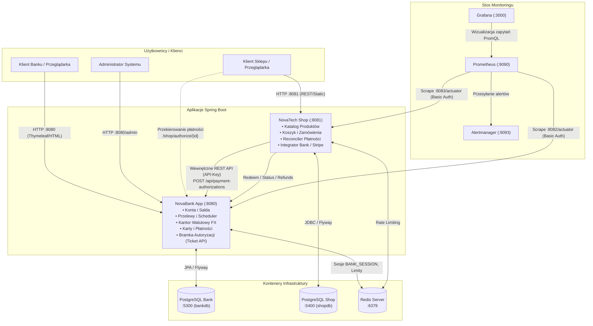

---

### 3.2. Szczegółowa topologia baz, usług i powiązań sieciowych

Poniższy diagram w sposób precyzyjny odzwierciedla granice kontekstów (*Bounded Contexts* w ujęciu Domain-Driven Design), dedykowane tabele bazy danych, przepływ zapytań HTTP i operacje kryptograficzne:

```mermaid
flowchart TB
    subgraph ClientLayer ["1. Warstwa Klienta & Przeglądarki"]
        Browser["Przeglądarka Internetowa"]
    end

    subgraph BankContext ["2. Kontekst Domenowy NovaBank (:8080)"]
        direction TB
        BankSecurity["Spring Security & BankRateLimitFilter<br/>(Ciasteczko BANK_SESSION, CSRF, Nagłówki CSP/HSTS)"]
        
        subgraph BankSubmodules ["Moduły Wewnętrzne Banku"]
            AuthModule["Auth & 2FA Service<br/>(BCrypt, TOTP, Recovery Codes, AES-GCM)"]
            AccountModule["Account & Balance Service<br/>(Generator NRB MOD 97, Salda)"]
            TransferModule["Transfer Service & Scheduler<br/>(Deadlock Prevention: Sorted Locks, Zlecenia Stałe)"]
            ExchangeModule["FX Currency Exchange Service<br/>(Cross-rates PLN/EUR/USD/GBP/CHF, @Version)"]
            CardModule["Demo Card Service<br/>(Luhn, Maskowanie, Autoryzacja Online)"]
            PaymentGatewayModule["Payment Authorization Service<br/>(Bilety UUID, Single-use Hash Code, State Token)"]
            AdminAuditModule["Admin & Retention Service<br/>(PostgreSQL Advisory Lock, Unieważnianie Sesji)"]
        end
    end

    subgraph ShopContext ["3. Kontekst Domenowy NovaTech Shop (:8081)"]
        direction TB
        ShopSecurity["Shop Security & ShopRateLimitFilter<br/>(Ciasteczko SHOP_SESSION, CSRF SHOP-XSRF-TOKEN)"]
        
        subgraph ShopSubmodules ["Moduły Wewnętrzne Sklepu"]
            CatalogModule["Product Catalog & PDF Service<br/>(Wyszukiwanie, Eksport PDFBox)"]
            CartModule["Cart & Customer Service<br/>(Konta, Adresy, Pozycje Koszyka)"]
            OrderModule["Order State Service<br/>(Maszyna Stanów: PENDING -> PAID -> FAILED)"]
            ReconcilerModule["Payment Reconciliation Worker<br/>(@Scheduled Background Sync, Auto-Recovery)"]
            ShopPaymentModule["BankAuthClient & StripeClient<br/>(REST HTTP, Weryfikacja Podpisów HMAC-SHA256)"]
        end
    end

    subgraph DataStorage ["4. Warstwa Magazynów Danych"]
        BankPostgres[("bank-postgres :5300<br/>• users, accounts<br/>• bank_transactions<br/>• payment_authorizations<br/>• currency_balances, exchange_rates<br/>• demo_cards, card_transactions<br/>• scheduled_transfers, notifications<br/>• operation_audits, retention_runs")]
        
        ShopPostgres[("shop-postgres :5400<br/>• shop_products<br/>• shop_carts, shop_cart_items<br/>• shop_orders, shop_order_items<br/>• shop_users, shop_user_addresses<br/>• shop_refunds<br/>• SPRING_SESSION")]
        
        RedisInstance[("bank-redis :6379<br/>• spring:session:sessions (Indexed)<br/>• bank:rate-limit:* (Fixed window)<br/>• shop:rate-limit:*")]
    end

    Browser -->|"1. Wejście na stronę banku"| BankSecurity
    Browser -->|"2. Wejście do sklepu"| ShopSecurity

    BankSecurity --> AuthModule
    BankSecurity --> AccountModule
    BankSecurity --> TransferModule
    BankSecurity --> ExchangeModule
    BankSecurity --> CardModule
    BankSecurity --> PaymentGatewayModule
    BankSecurity --> AdminAuditModule

    ShopSecurity --> CatalogModule
    ShopSecurity --> CartModule
    ShopSecurity --> OrderModule
    ShopSecurity --> ShopPaymentModule

    ShopPaymentModule -->|"HTTP POST /api/payment-authorizations<br/>Header: X-API-Key"| PaymentGatewayModule
    PaymentGatewayModule -.->|"Przekierowanie przeglądarki klienta"| Browser
    ShopPaymentModule -->|"HTTP POST /api/payment-authorizations/{id}/redeem"| PaymentGatewayModule
    ReconcilerModule -->|"HTTP GET /api/payment-authorizations/{id}/status"| PaymentGatewayModule

    BankSubmodules <-->|"JPA EntityManager / HikariCP"| BankPostgres
    ShopSubmodules <-->|"NamedParameterJdbcTemplate / HikariCP"| ShopPostgres

    AuthModule <-->|"Sesje bankowe i wyzwania"| RedisInstance
    BankSecurity <-->|"Rate limiting IP i konta"| RedisInstance
    ShopSecurity <-->|"Rate limiting żądań"| RedisInstance
```

---

### 3.3. Wyjaśnienie powiązań i odsyłacze do mechanizmów

1. **Bezwzględna separacja fizyczna baz danych:**
   - Bank i Sklep nie posiadają żadnych wspólnych tabel ani połączeń cross-database.
   - Bank komunikuje się wyłącznie z bazą `bankdb` na porcie `5300`, a Sklep z bazą `shopdb` na porcie `5400`.
   - Zmiany schematu bazy w Sklepie (np. dodanie tabeli adresów `shop_user_addresses`) nie mają żadnego wpływu na stabilność i schemat Banku.
   - 📖 *Szczegółowy opis schematów:* zobacz **[[#10. Dane: co znajduje się gdzie|Sekcja 10. Dane: co znajduje się gdzie]]**.

2. **Protokół biletowy autoryzacji płatności (Ticket Flow):**
   - Sklep nigdy nie pyta użytkownika o login i hasło do banku, ani o PIN do konta.
   - Komunikacja opiera się na wymianie biletów autoryzacyjnych (`PaymentAuthorization`) o unikalnym identyfikatorze UUID.
   - Bank realizuje transfer środków wewnątrz własnej domeny, generuje kryptograficzny, jednorazowy kod autoryzacji (*Authorization Code*), którego skrót SHA-256 zapisuje w bazie, a wartość jawną przekazuje przez przeglądarkę do Sklepu.
   - Sklep dokonuje operacji *Redeem* przez bezpośredni kanał serwer-serwer (REST) przy użyciu tajnego klucza API (`X-API-Key`).
   - 📖 *Szczegółowy opis protokołu:* zobacz **[[#18.1. Protokół autoryzacji biletowej (Ticket Flow: Authorize -> Callback -> Redeem)|Sekcja 18.1. Protokół autoryzacji biletowej]]** oraz **[[#19.7. Pełny cykl zakupu w sklepie z płatnością NovaBank (Bilety, Kod i Redeem)|Sekcja 19.7. Diagram sekwencji zakupu]]**.

3. **Odporność na przerwanie połączenia (Payment Reconciliation Worker):**
   - Jeśli po zatwierdzeniu płatności w banku przeglądarka klienta utraci zasilanie lub połączenie internetowe i nie trafi na adres powrotny (*Callback*), w Sklepie uruchamia się cykliczne zadanie w tle (`PaymentReconciliationJob`).
   - Reconciler odpytuje Bank o status biletu (`/status`), weryfikuje kwotę i numer referencyjny, oznacza zamówienie jako opłacone (`PAID`) i czyści koszyk klienta.
   - 📖 *Szczegółowy opis mechanizmu:* zobacz **[[#11.5. Pętla uzgadniania statusów płatności (Payment Reconciliation Worker)|Sekcja 11.5. Pętla uzgadniania statusów płatności]]**.

4. **Kryptografia w spoczynku i uwierzytelnianie dwuskładnikowe (2FA):**
   - Sekrety TOTP użytkowników nie są zapisywane w bazie jawnym tekstem. Komponent `TotpSecretCipher` szyfruje je symetrycznym algorytmem **AES-GCM (NoPadding)** z 96-bitowym losowym wektorem inicjalizującym (IV) generowanym dla każdego wpisu i 128-bitowym tagiem uwierzytelniającym.
   - Kody zapasowe (*Recovery Codes*) są haszowane algorytmem **BCrypt** przed zapisem do tabeli `totp_recovery_codes`.
   - 📖 *Szczegółowy opis kryptografii:* zobacz **[[#8.3. Uwierzytelnianie dwuskładnikowe 2FA / TOTP (RFC 6238)|Sekcja 8.3. Uwierzytelnianie dwuskładnikowe]]** oraz **[[#8.4. Kody zapasowe (Recovery Codes) i szyfrowanie AES-GCM w spoczynku|Sekcja 8.4. Kody zapasowe]]**.

---

## 4. Najważniejsze zasady architektoniczne

### 4.1. Izolacja danych i model Database-per-Service

NovaBank i NovaTech Shop funkcjonują jako dwa odrębne systemy. Każdy z nich zarządza własnym cyklem życia schematu bazy danych za pomocą Flywaya:
- Żadna kwerenda SQL z kodu sklepu nie trafia do bazy banku.
- Sklep nie posiada poświadczeń do bazy `bankdb`.
- Wszystkie informacje biznesowe (stan konta klienta, zatwierdzenie płatności, wycena karty walutowej) przekazywane są wyłącznie przez zdefiniowane kontrakty JSON HTTP REST.
- Identyfikatory obce (np. `merchant_account_number` w zamówieniu sklepu) są przechowywane jako zwykłe wartości tekstowe (*Reference by Identity*), bez kluczy obcych na poziomie silnika bazy.

### 4.2. Brak współdzielenia encji JPA/JDBC między aplikacjami

W repozytorium nie ma wspólnego modułu `common-entities.jar`:
- Bank korzysta ze **Spring Data JPA** (Hibernate), encji `@Entity` ze ścisłą walidacją `@Version`, `@CheckConstraint` i relacji `@OneToOne`, `@ManyToOne`.
- Sklep korzysta ze **Spring Data JDBC** i `NamedParameterJdbcTemplate`, co zapewnia brak ukrytego problemu zapytań N+1, natychmiastowe wykonanie SQL i pełną kontrolę nad transakcjami.
- Każda aplikacja definiuje własne modele DTO żądań i odpowiedzi, co zapobiega powstawaniu sztywnego powiązania technologicznego (*tight coupling*).

### 4.3. Transakcje lokalne vs rozproszony protokół autoryzacji płatności

W rozproszonych systemach finansowych nie stosuje się blokującego protokołu Two-Phase Commit (2PC / XA) ze względu na wysokie ryzyko blokowania zasobów i podatność na awarie sieciowe. Zamiast tego zastosowano:
1. **Lokalną atomowość ACID w Banku:** zmiana salda nadawcy, zmiana salda odbiorcy i zapis w tabeli `bank_transactions` odbywają się w jednej transakcji bazy danych.
2. **Lokalną atomowość ACID w Sklepie:** zmiana statusu zamówienia na `PAID` i rejestracja referencji płatności odbywają się w transakcji bazy sklepu.
3. **Spójność ewentualną (Eventual Consistency):** asynchroniczny Reconciler w Sklepie gwarantuje, że nawet w przypadku zerwania połączenia w trakcie przekierowania przeglądarki oba systemy osiągną stan spójny.

### 4.4. Zapobieganie zakleszczeniom (Deadlock Prevention) przy blokowaniu kont

W systemie bankowym przelew środków wymaga jednoczesnego zablokowania wiersza rachunku źródłowego oraz rachunku docelowego klauzulą `SELECT ... FOR UPDATE`.  
Gdyby użytkownik A wykonywał przelew do użytkownika B, a w tym samym ułamku sekundy użytkownik B wykonywał przelew do użytkownika A, standardowe blokowanie w kolejności operacji doprowadziłoby do zakleszczenia (*Deadlock*):
- Transakcja 1 blokuje konto A i czeka na konto B.
- Transakcja 2 blokuje konto B i czeka na konto A.
- Baza danych PostgreSQL przerywa jedną z transakcji błędem `deadlock detected`.

W NovaBank zaimplementowano **wzorzec deterministycznego porządkowania zasobów** (*Global Lock Ordering*). Identyfikatory kont są zawsze sortowane rosnąco przed wykonaniem blokady:

```java
// TransferService.java & PaymentService.java
var accountIds = List.of(sourceCandidate.getId(), destinationCandidate.getId())
        .stream()
        .sorted()
        .toList();
var lockedAccounts = accountRepository.findAllByIdForUpdate(accountIds);
```

Dzięki temu obie współbieżne transakcje zawsze próbują zablokować konto o niższym ID jako pierwsze, co matematycznie wyklucza możliwość powstania cyklu oczekiwania i eliminuje zakleszczenia w bazie danych!

### 4.5. Idempotencja jako fundament operacji finansowych

Wszystkie operacje finansowe zmieniające stan środków w banku oraz zamówień w sklepie wymagają unikalnego klucza `Idempotency-Key` (maks. 64 znaki).
- Ponowienie żądania przelewu lub płatności z tym samym kluczem i identycznymi parametrami nie wykonuje drugiego obciążenia konta, lecz natychmiast zwraca oryginalny wynik (`replayed = true`).
- Ponowienie żądania z tym samym kluczem, ale zmienioną kwotą lub odbiorcą, zostaje natychmiast odrzucone z błędem walidacji integralności.
- Unikalność klucza jest gwarantowana na najniższym poziomie przez unikalny indeks bazy danych (`uk_transactions_idempotency` w Banku oraz `uk_shop_orders_payment_key` w Sklepie).

---

## 5. Mapa portów, baz, sekretów i zależności

### 5.1. Aplikacje Spring Boot i porty zarządzania

| Usługa | Port Aplikacji | Port Actuator / Metryki | Profil DEV | Profil TEST | Profil PROD | Ścieżka główna |
|---|---|---|---|---|---|---|
| **NovaBank** | `8080` | `8082` | HTTP | Mock / Dynamic | HTTPS / TLS | `http://localhost:8080` |
| **NovaTech Shop** | `8081` | `8083` | HTTP | Mock / Dynamic | HTTPS / TLS | `http://localhost:8081/novatech_shop.html` |

> [!IMPORTANT]
> **Separacja portu biznesowego i zarządzania:**  
> Endpointy Actuatora (`/actuator/health`, `/actuator/prometheus`, `/actuator/metrics`) działają na dedykowanych portach (`8082` dla Banku, `8083` dla Sklepu) i nasłuchują domyślnie wyłącznie na interfejsie `127.0.0.1`. Dostęp do metryk wymaga uprawnień roli `ROLE_ADMIN` lub `ROLE_METRICS` i nagłówka Basic Auth.

### 5.2. Kontenery infrastruktury Docker

| Kontener | Port Hosta (Localhost) | Port Wewnętrzny Kontenera | Baza / Wolumen | Rola |
|---|---|---|---|---|
| `bank-postgres` | `5300` | `5432` | `bankdb` / `bank_pgdata` | Relacyjna baza danych NovaBank |
| `shop-postgres` | `5400` | `5432` | `shopdb` / `shop_pgdata` | Relacyjna baza danych NovaTech Shop |
| `bank-redis` | `6379` | `6379` | RAM + `bank_redis_data` (AOF) | Magazyn sesji i rate limitera |
| `bank-prometheus` | `9090` | `9090` | `prometheus_data` | Agregator metryk czasowych (TSDB) |
| `bank-grafana` | `3000` | `3000` | `grafana_data` | Dashboardy analityczne i metryki |
| `bank-alertmanager` | `9093` | `9093` | `alertmanager_data` | Grupowanie i wyciszanie alertów |

### 5.3. Zmienne środowiskowe i zarządzanie sekretami

W profilu `dev` konfiguracja przechowywana jest w plikach `.novabank/env/project.env` oraz `.novabank/env/dev.env` (tworzonych na podstawie szablonu `.env.example`).

Kluczowe zmienne środowiskowe:

```ini
# --- Bazy danych PostgreSQL ---
POSTGRES_PORT=5300
POSTGRES_DB=bankdb
POSTGRES_USER=bankuser
POSTGRES_PASSWORD=<wygenerowane_haslo_banku>

SHOP_POSTGRES_PORT=5400
SHOP_POSTGRES_DB=shopdb
SHOP_POSTGRES_USER=shopuser
SHOP_POSTGRES_PASSWORD=<wygenerowane_haslo_sklepu>

# --- Pamięć podręczna Redis ---
REDIS_HOST=localhost
REDIS_PORT=6379

# --- Integracja API Bank <-> Sklep ---
BANK_API_URL=http://localhost:8080
SHOP_PAYMENT_CALLBACK_URL=http://localhost:8081/payment/callback
BANK_API_KEY=dev-bank-api-key-1234567890abcdef
BANK_API_KEYS=legacy:dev-bank-api-key-1234567890abcdef:payments:write,payments:authorize,payments:status,payments:refund:2099-12-31T23:59:59Z
SHOP_MERCHANT_ACCOUNT_NUMBER=11222233334444555566667777

# --- Kryptografia i Bezpieczeństwo ---
TOTP_ENCRYPTION_KEY=<32_bajty_base64_dla_AES_GCM>
METRICS_USERNAME=metrics_user
METRICS_PASSWORD=<haslo_metryk_prometheus>
ADMIN_EMAIL=admin@novabank.local
```

> [!WARNING]
> W profilu `prod` mechanizm `ProductionConfigurationValidator` weryfikuje przy starcie, czy sekrety pochodzą z bezpiecznego skarbca **HashiCorp Vault**, czy włączono flagę `SESSION_COOKIE_SECURE=true` oraz czy adresy URL korzystają bezwzględnie z protokołu HTTPS. W przypadku wykrycia braków aplikacja przerywa start (*Fail-Fast*).

---

## 6. Zalecana kolejność uruchomienia całego środowiska

### 6.1. Ścieżka automatyczna: NovaBank Control Center

NovaBank Control Center to dedykowany panel tekstowy automatyzujący konfigurację, sprawdzanie zależności, start kontenerów oraz testy.

#### W systemie Linux / WSL 2 / macOS:
```bash
bash scripts/control-center/control-center.sh
```

#### W systemie Windows (PowerShell):
```powershell
.\scripts\control-center\start.ps1
```

Kroki w menu Centrali Kontrolnej:
1. Wybierz opcję **[1] Pierwsze uruchomienie** — skrypt zweryfikuje środowisko, utworzy katalog `.novabank`, wygeneruje bezpieczne losowe hasła i przygotuje pliki `.env`.
2. Wybierz opcję **[2] Uruchom infrastrukturę** — skrypt uruchomi kontenery `bank-postgres`, `shop-postgres` i `bank-redis`.
3. Wybierz opcję **[3] Uruchom aplikacje (DEV)** — Centrala skompiluje kod i uruchomi procesy Java Banku (`:8080`) oraz Sklepu (`:8081`).

---

### 6.2. Ścieżka manualna: CLI / PowerShell / WSL

Jeśli preferujesz bezpośrednie polecenia w terminalu:

1. **Generowanie konfiguracji developerskiej:**
   ```powershell
   .\scripts\generate-dev-env.ps1
   ```
2. **Start kontenerów baz danych i Redisa:**
   ```bash
   docker compose --env-file .novabank/env/project.env up -d postgres shop-postgres redis
   docker compose --env-file .novabank/env/project.env ps
   ```
   *Upewnij się, że kontenery baz mają status `healthy`, a Redis `running`.*
3. **Uruchomienie aplikacji NovaBank:**
   ```powershell
   .\mvnw.cmd spring-boot:run -Dspring-boot.run.profiles=dev
   ```
4. **Uruchomienie aplikacji NovaTech Shop:**
   ```powershell
   .\mvnw.cmd -f shop-app\pom.xml spring-boot:run -Dspring-boot.run.profiles=dev
   ```

---

### 6.3. Uruchamianie z poziomu IDE (IntelliJ IDEA)

Dla komfortowej pracy programistycznej i debugowania:
1. Otwórz projekt w IntelliJ IDEA jako projekt wielomodułowy Maven.
2. Zainstaluj wtyczkę **EnvFile**.
3. Utwórz konfigurację uruchomieniową dla `org.demo.bankdemo.BankDemoApplication`:
   - Active profiles: `dev`
   - Zakładka EnvFile: wskaż ścieżkę do `.novabank/env/dev.env` oraz `.novabank/env/project.env`.
4. Utwórz konfigurację uruchomieniową dla `org.demo.shopapp.ShopAppApplication`:
   - Active profiles: `dev`
   - Zakładka EnvFile: wskaż ścieżkę do `.novabank/env/dev.env` oraz `.novabank/env/project.env`.
5. Uruchamiaj aplikacje niezależnie za pomocą ikony Debug/Run.

---

## 7. Przepływ użytkownika — od konta bankowego do zakupów w sklepie

### 7.1. Otwarcie rachunku i zasilenie początkowe

1. Użytkownik otwiera stronę główną banku pod adresem `http://localhost:8080/register`.
2. Wypełnia formularz: imię, nazwisko, adres e-mail, PESEL/telefon oraz hasło.
3. System weryfikuje unikalność adresu e-mail, normalizuje go do małych liter (`ck_users_email_normalized`), haszuje hasło algorytmem BCrypt i zapisuje użytkownika w tabeli `users`.
4. Komponent `AccountNumberGenerator` losuje 24 cyfry BBAN, oblicza sumę kontrolną **MOD 97-10** (z kodem kraju `PL` = `2521`) i generuje unikalny 26-cyfrowy numer rachunku w standardzie **NRB**.
5. W ramach tej samej transakcji tworzony jest rachunek w tabeli `accounts` oraz wykonywana operacja zasilenia początkowego `INITIAL_CREDIT` (domyślnie **10 000,00 PLN**).
6. Użytkownik otrzymuje powiadomienie powitalne i może się zalogować.

### 7.2. Realizacja przelewu krajowego

1. Klient przechodzi do formularza `http://localhost:8080/transfer`.
2. Podaje dane odbiorcy: 26-cyfrowy numer rachunku docelowego, nazwę odbiorcy, tytuł i kwotę.
3. Kliknięcie „Dalej” wywołuje metodę `preview()` — weryfikowana jest poprawność sumy kontrolnej NRB, sprawdzane jest czy konto źródłowe i docelowe są różne oraz czy saldo wystarcza na pokrycie przelewu.
4. Na ekranie podsumowania generowany jest losowy identyfikator `idempotencyKey` osadzony w ukrytym polu formularza.
5. Kliknięcie „Wyślij przelew”:
   - Sprawdzany jest limit częstotliwości żądań użytkownika (`TransferRateLimitService`).
   - Weryfikowane są limity kwotowe (limit pojedynczego przelewu i limit dzienny).
   - Jeśli kwota przekracza próg 2FA (domyślnie `5 000,00 PLN`) lub próg zdefiniowany przez użytkownika, następuje przekierowanie do wyzwania TOTP (`TransferTotpChallengeService`).
   - Blokowane są oba rachunki w bazie z zachowaniem sortowania ID (`findAllByIdForUpdate`).
   - Następuje obciążenie nadawcy (`source.debit`), uznanie odbiorcy (`destination.credit`), zapis rekordu w `bank_transactions` i wysłanie powiadomienia wewnątrzbankowego.

### 7.3. Zlecenia stałe (przelewy zaplanowane)

1. W zakładce `http://localhost:8080/transfers/scheduled` użytkownik może zdefiniować zlecenie stałe.
2. Wybiera częstotliwość: `ONCE` (jednorazowo w przyszłości), `DAILY` (codziennie), `WEEKLY` (cotygodniowo) lub `MONTHLY` (comiesięcznie).
3. System zapisuje zlecenie w tabeli `scheduled_transfers` z datą `next_execution_at`.
4. W tle co minutę działa zadanie harmonogramu `@Scheduled`:
   ```java
   // ScheduledTransferService.java
   @Scheduled(fixedDelayString = "${app.transfer.scheduler-delay-ms:60000}")
   ```
5. Zadanie wyszukuje wszystkie aktywne zlecenia, których czas wykonania minął (`next_execution_at <= now`), wykonuje przelew za pośrednictwem `TransferService`, aktualizuje datę kolejnego wykonania lub dezaktywuje zlecenie jednorazowe.

### 7.4. Kantor walutowy i rachunki wielowalutowe

1. Klient otwiera kantor pod adresem `http://localhost:8080/exchange`.
2. Może wymieniać środki pomiędzy walutami: **PLN, EUR, USD, GBP, CHF**.
3. Kursy walut są przechowywane w tabeli `exchange_rates` (ze wskaźnikiem bazowym do PLN).
4. Przeliczenie kwotowe pomiędzy dowolnymi dwiema walutami obcymi (np. EUR $\rightarrow$ USD) odbywa się poprzez walutę bazową (PLN) z precyzją 8 miejsc po przecinku:
   $$\text{Kurs Przeliczenia} = \frac{\text{Kurs}_{\text{źródłowy}}}{\text{Kurs}_{\text{docelowy}}}$$
5. Salda walut obcych są przechowywane w powiązanej tabeli `currency_balances`. Jeśli użytkownik nie posiadał jeszcze subkonta w danej walucie, jest ono tworzone automatycznie.
6. Każdy bilans walutowy posiada pole `version` chroniące przed równoległą modyfikacją salda (*Optimistic Locking*).

### 7.5. Karta demonstracyjna i płatności internetowe

1. Klient przechodzi do zakładki `http://localhost:8080/cards`.
2. Może aktywować demonstracyjną kartę debetową powiązaną ze swoim rachunkiem.
3. Karta otrzymuje unikalny numer (generowany algorytmem Luhna), kod CVV, datę ważności oraz dzienny limit wydatków (domyślnie `5 000,00 PLN`).
4. Karta obsługuje automatyczne rozliczanie wielowalutowe:
   - Jeśli płatność następuje w EUR, a klient posiada wystarczające saldo na rachunku EUR, obciążane jest bezpośrednio subkonto EUR.
   - Jeśli saldo walutowe jest niewystarczające, następuje dynamiczne przewalutowanie po aktualnym kursie bankowym i obciążenie konta głównego PLN.

### 7.6. Zakupy w NovaTech Shop i bramka autoryzacji bankowej

1. Użytkownik wchodzi do sklepu `http://localhost:8081/novatech_shop.html`.
2. Przegląda katalog produktów, dodaje pozycje do koszyka i przechodzi do kasy (`checkout.html`).
3. Wybiera metodę płatności: **NovaBank (Szybki przelew bankowy)**.
4. Sklep tworzy zamówienie ze statusem `PENDING` i wysyła żądanie `POST /api/payment-authorizations` do Banku.
5. Bank wystawia bilet o unikalnym identyfikatorze `authorizationId` i zwraca adres przekierowania.
6. Przeglądarka klienta przechodzi na stronę Banku `http://localhost:8080/shop/authorize/{id}`.
7. Klient loguje się do banku (jeśli nie miał aktywnej sesji), widzi kwotę, odbiorcę (NovaTech Shop) oraz pozycje zamówienia i klika „Zatwierdź płatność”.
8. Bank wykonuje transakcję, generuje jednorazowy tajny kod autoryzacji (*Auth Code*) i przekierowuje klienta z powrotem do sklepu.
9. Sklep odbiera kod i w kanale serwer-serwer woła Bank metodą `redeem()`.
10. Po pomyślnej weryfikacji Sklep oznacza zamówienie jako opłacone (`PAID`), czyści koszyk i wyświetla potwierdzenie zakupu.

---

## 8. Bezpieczeństwo konta, sesje, 2FA/TOTP i limity

### 8.1. Rejestracja, weryfikacja adresu e-mail i reset hasła

- **Weryfikacja e-mail:** Po rejestracji generowany jest kryptograficzny token w tabeli `email_verification_tokens` (skrót SHA-256 z ważnością 24 godziny). W trybie deweloperskim link weryfikacyjny trafia do logów aplikacji (`EMAIL_MODE=log`).
- **Reset hasła:** Formularz `/password/forgot` generuje jednorazowy token w `password_reset_tokens`. Po zatwierdzeniu nowego hasła wszystkie aktywne sesje użytkownika w Redisie zostają natychmiast unieważnione (*Global Session Revocation*), co uniemożliwia osobie niepowołanej kontynuowanie przejętej sesji.

### 8.2. Zarządzanie sesją: Redis Indexed Session vs JDBC Session

- **NovaBank:** Sesje są zarządzane przez `spring-session-data-redis` z włączonym indeksem (`repository-type: indexed`). Ciasteczko nosi nazwę `BANK_SESSION` i posiada atrybuty `HttpOnly=true` oraz `SameSite=Lax`. Dzięki indeksowaniu po nazwie użytkownika (`findByPrincipalName`), administrator lub sam użytkownik może jednym kliknięciem unieważnić wszystkie inne aktywne logowania (np. na smartfonie lub innym komputerze).
- **NovaTech Shop:** Sesje sklepu są przechowywane w relacyjnej bazie danych za pośrednictwem `spring-session-jdbc` (`SHOP_SESSION`). Gwarantuje to niezależność działania sklepu nawet w przypadku restartu serwera Redis.

### 8.3. Uwierzytelnianie dwuskładnikowe 2FA / TOTP (RFC 6238)

System implementuje pełny standard **Time-based One-Time Password (TOTP)** zgodnie ze specyfikacją **RFC 6238**:
- Sekret generowany jest przy użyciu bezpiecznego generatora pseudolosowego (`SecureRandom`).
- Generowany jest kod QR w formacie Data URI (`data:image/png;base64,...`), który można zeskanować dowolną aplikacją uwierzytelniającą (Google Authenticator, Microsoft Authenticator, Aegis).
- Weryfikator sprawdza 6-cyfrowy kod w oknie czasowym 30 sekund, z tolerancją $\pm 1$ kroku czasowego (uwzględnienie dryfu zegara klienta).

Matematyczny model obliczania kodu TOTP:
$$T = \left\lfloor \frac{\text{Czas aktualny w sekundach}}{30} \right\rfloor$$
$$\text{HMAC} = \text{HMAC-SHA1}(\text{Klucz Sekretny}, T)$$
$$\text{Offset} = \text{HMAC}[19] \ \& \ 0x0F$$
$$\text{Code} = (\text{HMAC}[\text{Offset} \dots \text{Offset}+3] \ \& \ 0x7FFFFFFF) \pmod{10^6}$$

### 8.4. Kody zapasowe (Recovery Codes) i szyfrowanie AES-GCM w spoczynku

- **Szyfrowanie sekretu TOTP w bazie:**  
  Sekret TOTP nie jest składowany jawnym tekstem. Klasa `TotpSecretCipher` używa szyfrowania uwierzytelnionego **AES-GCM**:
  - Klucz szyfrujący pobierany jest ze zmiennej `TOTP_ENCRYPTION_KEY` (32 bajty w formacie Base64).
  - Dla każdej operacji losowany jest unikalny 12-bajtowy wektor IV.
  - Szyfrogram zapisywany jest w kolumnie `totp_secret_encrypted` jako `<Base64(IV)>.<Base64(Ciphertext+Tag)>`.
- **Kody zapasowe:**  
  Podczas aktywacji 2FA generowane jest 10 jednorazowych 8-znakowych kodów zapasowych. Przed zapisem do bazy każdy kod jest haszowany funkcją **BCrypt** (`totp_recovery_codes.code_hash`). Po użyciu kod otrzymuje znacznik czasowy `used_at` i nie może zostać użyty ponownie.

### 8.5. Limity transakcyjne użytkownika i banku

W systemie funkcjonuje dwupoziomowy model limitów kwotowych:
1. **Limity Globalne Banku (narzucone przez regulatora / politykę bezpieczeństwa):**
   - `app.transfer.single-limit`: maksymalna kwota jednego przelewu (domyślnie `50 000,00 PLN`).
   - `app.transfer.daily-limit`: maksymalna suma przelewów w ciągu 24 godzin (domyślnie `100 000,00 PLN`).
   - `app.transfer.totp-required-above`: próg kwotowy wymagający autoryzacji 2FA (domyślnie `5 000,00 PLN`).
2. **Indywidualne Limity Użytkownika:**
   - W profilu (`/profile/limits`) klient może zdefiniować własne, bardziej restrykcyjne limity pojedynczych przelewów, limitów dziennych oraz własny próg wymagania 2FA.
   - Walidator zawsze wybiera wartość ostrzejszą:
     $$\text{Limit Efektywny} = \min(\text{Limit Banku}, \text{Limit Użytkownika})$$

### 8.6. Ochrona przed atakami Brute Force i rozproszony Rate Limiter

Ochrona przed atakami słownikowymi i przeciążeniowymi realizowana jest przez filtr servletowy `BankRateLimitFilter` oraz serwis `DistributedRateLimitService`:
- **Algorytm:** Fixed-Window Counter oparty na poleceniach `INCR` i `EXPIRE` w Redisie.
- **Klucz w Redisie:** `bank:rate-limit:<scope>:<sha256(subject)>:<windowNumber>`.
- W przypadku awarii serwera Redis mechanizm automatycznie przełącza się na lokalną mapę pamięciową (`ConcurrentHashMap`), co zapobiega zablokowaniu serwisu.
- Zdarzenia przekroczenia limitu natychmiast rejestrują metrykę `bank.rate_limit.requests` i zwracają kod błędu **HTTP 429 (Too Many Requests)** z nagłówkiem `Retry-After`.

---

## 9. Karty poszczególnych modułów i domen

### 9.1. Auth & Users Domain (NovaBank)

- **Główne klasy:** `DatabaseUserDetailsService`, `LoginService`, `TwoFactorService`, `RegistrationService`, `LoginAttemptService`.
- **Encje i tabele:** `User` (`users`), `EmailVerificationToken` (`email_verification_tokens`), `PasswordResetToken` (`password_reset_tokens`), `TotpRecoveryCode` (`totp_recovery_codes`).
- **Kluczowe endpointy:** `GET/POST /login`, `GET/POST /register`, `GET/POST /login/2fa`, `GET /verify-email/**`, `GET/POST /password/reset`.
- **Odpowiedzialność:** uwierzytelnianie, haszowanie haseł BCryptem, zarządzanie wyzwaniami dwuskładnikowymi, rejestracja prób błędnych logowań.

### 9.2. Account & Balance Domain (NovaBank)

- **Główne klasy:** `Account`, `AccountRepository`, `AccountNumberGenerator`.
- **Encje i tabele:** `Account` (`accounts`).
- **Kluczowe reguły:** numer konta to dokładnie 26 cyfr spełniających polski algorytm NRB MOD 97; saldo nie może być ujemne (`CHECK (balance >= 0)`); pole `version` służy do wykrywania konfliktów współbieżnych.

### 9.3. Transfer & Scheduled Transfer Domain (NovaBank)

- **Główne klasy:** `TransferService`, `ScheduledTransferService`, `TransferRateLimitService`, `TransferTotpChallengeService`.
- **Encje i tabele:** `BankTransaction` (`bank_transactions`), `ScheduledTransfer` (`scheduled_transfers`), `SavedRecipient` (`saved_recipients`).
- **Kluczowe endpointy:** `GET/POST /transfer`, `POST /transfer/confirm`, `GET/POST /transfers/scheduled`.
- **Odpowiedzialność:** blokowanie kont bez zakleszczeń (`findAllByIdForUpdate`), weryfikacja limitów, obsługa wyzwań TOTP dla dużych kwot, cykliczne wykonywanie zleceń stałych.

### 9.4. Payment & Payment Authorization Gateway Domain (NovaBank)

- **Główne klasy:** `PaymentService`, `PaymentAuthorizationService`, `PaymentAuthorizationApiController`, `PaymentApiKeyFilter`.
- **Encje i tabele:** `PaymentAuthorization` (`payment_authorizations`), `BankTransaction` (`bank_transactions`).
- **Kluczowe endpointy:** `POST /api/payment-authorizations`, `GET /api/payment-authorizations/{id}/status`, `POST /api/payment-authorizations/{id}/redeem`, `GET/POST /shop/authorize/{id}`.
- **Odpowiedzialność:** wystawianie biletów autoryzacyjnych dla sklepów, weryfikacja nagłówka `X-API-Key`, interfejs potwierdzenia płatności dla klienta, wykupienie biletu (*Redeem*).

### 9.5. Demo Cards & Online Card Processing Domain (NovaBank)

- **Główne klasy:** `CardService`, `CardPaymentApiController`.
- **Encje i tabele:** `DemoCard` (`demo_cards`), `CardTransaction` (`card_transactions`).
- **Kluczowe endpointy:** `GET /cards`, `POST /cards/generate`, `POST /cards/limits`, `POST /api/card-payments`, `POST /api/card-payments/quote`.
- **Odpowiedzialność:** wirtualne karty płatnicze, generowanie numerów kart algorytmem Luhna, kwotowanie walutowe dla płatności kartowych, autoryzacja online z kontrolą CVV i daty ważności.

### 9.6. Multi-Currency Exchange Domain (NovaBank)

- **Główne klasy:** `ExchangeService`, `ExchangeController`.
- **Encje i tabele:** `ExchangeRate` (`exchange_rates`), `CurrencyBalance` (`currency_balances`), `ExchangeTransaction` (`exchange_transactions`).
- **Kluczowe endpointy:** `GET /exchange`, `POST /exchange/quote`, `POST /exchange/execute`.
- **Odpowiedzialność:** prezentacja tabeli kursów walut, wycena transakcji wymiany, atomowe obciążenie rachunku źródłowego i uznanie rachunku docelowego.

### 9.7. History & PDF Export Domain (NovaBank)

- **Główne klasy:** `HistoryService`, `HistoryExportService`, `HistoryController`.
- **Kluczowe endpointy:** `GET /history`, `GET /history/{id}`, `GET /history/export/csv`, `GET /history/export/pdf`.
- **Odpowiedzialność:** stronicowana historia operacji finansowych z filtrowaniem po dacie, typie i kwocie; eksport zestawień do pliku CSV (z BOM UTF-8 dla polskiego Excela) oraz generowanie profesjonalnych wektorowych dokumentów PDF z użyciem biblioteki Apache PDFBox.

### 9.8. Audit, Login History & Data Retention Domain (NovaBank)

- **Główne klasy:** `OperationAuditService`, `LoginHistoryService`, `RetentionExecutionService`, `RetentionJob`.
- **Encje i tabele:** `OperationAudit` (`operation_audits`), `LoginHistory` (`login_history`), `AdminStatusChange` (`admin_status_changes`), `RetentionRun` (`retention_runs`).
- **Kluczowe reguły:** audytowanie każdej próby logowania (sukces/porażka z adresem IP i User-Agentem), audyt zmian statusów kont przez administratora, nocne zadanie czyszczenia danych technicznych chronione blokadą doradczą PostgreSQL (`pg_try_advisory_xact_lock`).

### 9.9. Admin Management & Session Revocation Domain (NovaBank)

- **Główne klasy:** `AdminService`, `AdminController`, `UserSessionService`.
- **Kluczowe endpointy:** `GET /admin`, `POST /admin/accounts/{id}/block`, `POST /admin/accounts/{id}/unblock`, `POST /admin/users/{id}/reset-password`.
- **Odpowiedzialność:** panel zarządzania klientami i rachunkami, przegląd incydentów bezpieczeństwa, blokowanie kont podejrzanych o fraud, unieważnianie sesji użytkownika w Redisie.

### 9.10. Shop Catalog & PDF Export Domain (NovaTech Shop)

- **Główne klasy:** `ProductService`, `ProductCatalogPdfService`, `ProductController`.
- **Encje i tabele:** `ShopProduct` (`shop_products`).
- **Kluczowe endpointy:** `GET /api/products`, `GET /api/products/{id}`, `GET /api/products/catalog.pdf`.
- **Odpowiedzialność:** katalog asortymentu sklepu, dynamiczne generowanie cennika i katalogu w formacie PDF.

### 9.11. Shop Cart & Customer Account Domain (NovaTech Shop)

- **Główne klasy:** `CartService`, `ShopAccountService`, `CartController`, `ShopAccountController`.
- **Encje i tabele:** `ShopCart` (`shop_carts`), `ShopCartItem` (`shop_cart_items`), `ShopUser` (`shop_users`), `ShopUserAddress` (`shop_user_addresses`).
- **Kluczowe endpointy:** `GET/POST /api/cart`, `DELETE /api/cart/items/{id}`, `GET/PUT /api/account/profile`, `GET/PUT /api/account/address`.
- **Odpowiedzialność:** zarządzanie koszykiem zakupowym klienta, profile klientów sklepu i adresy doręczeń.

### 9.12. Shop Order & State Machine Domain (NovaTech Shop)

- **Główne klasy:** `OrderService`, `OrderStateService`, `OrderCartCleanupService`, `OrderController`.
- **Encje i tabele:** `ShopOrder` (`shop_orders`), `ShopOrderItem` (`shop_order_items`).
- **Kluczowe endpointy:** `POST /api/orders`, `GET /api/orders`, `GET /api/orders/{id}`.
- **Maszyna stanów zamówienia:**
  ```text
  [NOWE ZAMÓWIENIE] ---> PENDING ---> PAID ---> [ZREALIZOWANE / WYSŁANE]
                            |
                            +--------> FAILED (Odrzucone / Wygasłe)
  ```

### 9.13. Shop Payment Providers & Reconciliation Domain (NovaTech Shop)

- **Główne klasy:** `BankAuthorizationClient`, `StripeCheckoutClient`, `PaymentReconciliationJob`, `RefundService`, `CheckoutController`, `StripeWebhookController`.
- **Encje i tabele:** `ShopRefund` (`shop_refunds`).
- **Kluczowe endpointy:** `POST /api/checkout/bank`, `POST /api/checkout/card`, `POST /api/payments/stripe/webhook`, `POST /api/orders/{id}/refund`.
- **Odpowiedzialność:** integracja z API NovaBank oraz Stripe, obsługa webhooków HMAC-SHA256, uzgadnianie statusów płatności w tle i procedowanie zwrotów.

---

## 10. Dane: co znajduje się gdzie

### 10.1. Schemat relacyjny bazy NovaBank (bankdb)

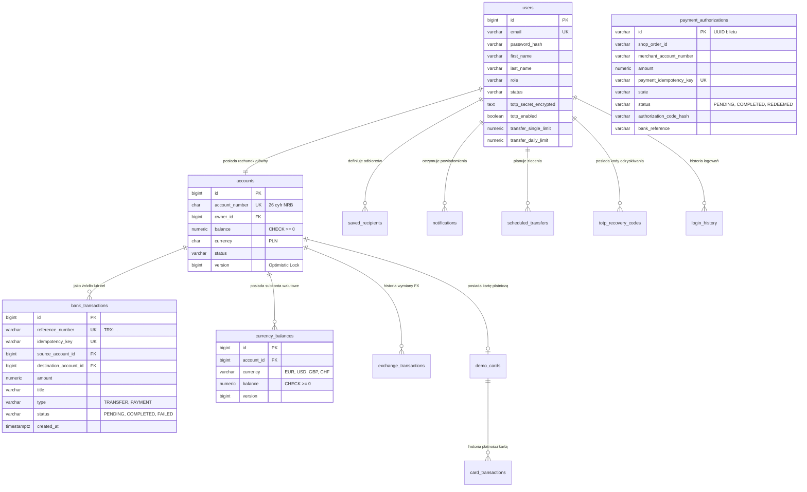

### 10.2. Schemat relacyjny bazy NovaTech Shop (shopdb)

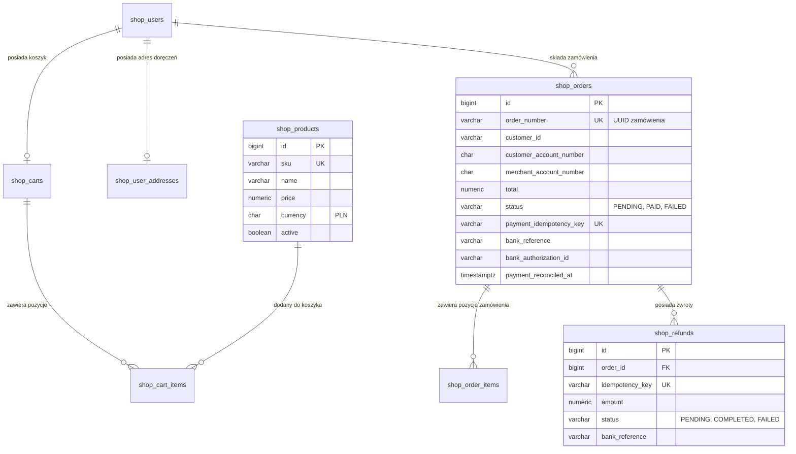

### 10.3. Struktury danych i klucze w pamięci podręcznej Redis

| Prefiks / Maska Klucza | Typ Danych | TTL (Czas Życia) | Przeznaczenie |
|---|---|---|---|
| `spring:session:sessions:<session-id>` | Hash | 30 minut (odnawiany) | Zserializowane atrybuty sesji użytkownika Banku (`SecurityContext`, dane użytkownika) |
| `spring:session:expirations:<timestamp>` | Set | 30 minut | Indeks wygasania sesji dla sprzątacza Spring Session |
| `spring:session:index:org.springframework.session.FindByIndexNameSessionRepository.PRINCIPAL_NAME_INDEX_NAME:<email>` | Set | 30 minut | Indeks wszystkich aktywnych sesji danego adresu e-mail (pozwala na unieważnienie jednym poleceniem) |
| `bank:rate-limit:<scope>:<sha256(subject)>:<windowNumber>` | String (Integer) | Rozmiar okna + 5s | Licznik zapytań dla Rate Limitera (np. logowanie, przelewy, autoryzacje) |

---

## 11. Odporność, spójność, współbieżność i transakcje

### 11.1. Blokowanie pesymistyczne (SELECT ... FOR UPDATE) i porządkowanie identyfikatorów

Kluczowe operacje modyfikujące środki finansowe w NovaBank korzystają z blokowania pesymistycznego na poziomie wierszy bazy danych:

```java
// AccountRepository.java
@Lock(LockModeType.PESSIMISTIC_WRITE)
@Query("select a from Account a where a.id in :ids")
List<Account> findAllByIdForUpdate(@Param("ids") Collection<Long> ids);
```

**Matematyczny dowód braku zakleszczeń:**
Niech relacja porządku na zasobach będzie zdefiniowana jako naturalny porządek liczb całkowitych:
$$ID_1 < ID_2 < \dots < ID_n$$
Każdy proces żądający jednoczesnego zablokowania zbioru rachunków $\{A, B\}$ wykonuje blokadę w sekwencji:
$$\min(ID_A, ID_B) \longrightarrow \max(ID_A, ID_B)$$
Ponieważ graf zależności oczekiwania na zasoby (*Wait-For Graph*) staje się acyklicznym grafem skierowanym (DAG), powstanie cyklu $T_1 \to T_2 \to T_1$ jest niemożliwe. Zakleszczenie nigdy nie wystąpi.

### 11.2. Blokowanie optymistyczne (@Version) w bilansach walutowych

Subkonta walutowe (`CurrencyBalance`) oraz rachunek główny (`Account`) posiadają atrybut `@Version`:
- Przy każdym zapisie Hibernate wykonuje zapytanie:
  ```sql
  UPDATE currency_balances 
  SET balance = ?, version = version + 1 
  WHERE id = ? AND version = ?
  ```
- W przypadku równoległej próby modyfikacji salda bez blokady pesymistycznej, transakcja, która spróbuje zapisać nieaktualną wersję, zostanie wycofana z wyjątkiem `OptimisticLockException`, zapobiegając nadpisaniu danych (*Lost Update Problem*).

### 11.3. Wzorzec Idempotency-Key w przelewach, płatnościach i kantorze

Wszystkie metody wykonujące operacje finansowe weryfikują unikalność klucza idempotencji:
1. Sprawdzenie, czy klucz istnieje w bazie danych (`findByIdempotencyKey`).
2. Jeśli rekord istnieje:
   - Weryfikacja, czy parametry transakcji (kwota, rachunek źródłowy, rachunek docelowy, waluta) są identyczne jak w zapisanym rekordzie.
   - Jeśli tak: zwrócenie poprzedniego wyniku z flagą `replayed = true`.
   - Jeśli nie: rzucenie wyjątku `PaymentException("Klucz operacji został już wykorzystany dla innych danych")`.
3. Jeśli rekord nie istnieje: bezpieczne wykonanie operacji i zapis rekordu w ramach tej samej transakcji bazy.

### 11.4. Distributed Fixed-Window Rate Limiting w Redisie z bezpiecznym fallbackiem

Usługa `DistributedRateLimitService` implementuje atomowy algorytm ograniczania częstotliwości żądań:
- Obliczenie bieżącego numeru okna czasowego: $\text{windowNumber} = \frac{\text{epochSeconds}}{\text{windowSeconds}}$.
- Wywołanie `opsForValue().increment(key)`.
- Jeśli licznik wynosi `1` (pierwsze żądanie w danym oknie), ustawiany jest czas wygaśnięcia `expire(key, windowSeconds + 5)`.
- Jeśli baza Redis jest niedostępna (np. awaria sieciowa), błąd jest rejestrowany w logach, a serwis przełącza się na lokalny algorytm pamięciowy, gwarantując ciągłość działania aplikacji (*Graceful Degradation*).

### 11.5. Pętla uzgadniania statusów płatności (Payment Reconciliation Worker)

Zadanie `PaymentReconciliationJob` w Sklepie działa w cyklu ciągłym:
- Co 30 sekund (`reconciliation-interval-ms`) pobiera z bazy paczkę zamówień (`reconciliation-batch-size = 50`) o statusie `PENDING` posiadających powiązany `bank_authorization_id`, których stan nie zmienił się od co najmniej 10 sekund.
- Wywołuje bezpieczne API Banku `GET /api/payment-authorizations/{id}/status`.
- Jeśli bilet w banku ma status `COMPLETED` lub `REDEEMED`:
  - Sklep oznacza zamówienie jako opłacone (`PAID`).
  - Zapisuje numer referencyjny transakcji bankowej.
  - Asynchronicznie usuwa zakupione towary z koszyka klienta (`cleanupPaidOrder`).
- Jeśli bilet w banku ma status `FAILED`:
  - Sklep oznacza zamówienie jako nieudane (`FAILED`) wraz z podaniem przyczyny (np. brak środków, anulowanie przez klienta).

### 11.6. Blokada doradcza PostgreSQL (Advisory Lock) w procesie retencji

Proces nocnego usuwania danych technicznych (`RetentionExecutionService`) musi być zabezpieczony przed równoległym uruchomieniem na wielu instancjach aplikacji:
- Zastosowano transakcyjną blokadę doradczą silnika PostgreSQL:
  ```sql
  SELECT pg_try_advisory_xact_lock(7319204111);
  ```
- Funkcja zwraca `true` tylko dla jednej instancji. Wszystkie pozostałe instancje natychmiast omijają wykonanie i rejestrują w audycie wpis o stanie `SKIPPED`.
- Blokada jest automatycznie zwalniana przez silnik PostgreSQL w momencie zatwierdzenia lub wycofania transakcji (`COMMIT` / `ROLLBACK`).

---

## 12. Monitoring, metryki i diagnostyka

### 12.1. Spring Boot Actuator i separacja portów zarządzania

Obie aplikacje wystawiają endpointy telemetryczne na odseparowanych portach sieciowych:
- **NovaBank Actuator:** nasłuchuje pod adresem `http://127.0.0.1:8082`.
- **NovaTech Shop Actuator:** nasłuchuje pod adresem `http://127.0.0.1:8083`.
- Dostępne ścieżki:
  - `/actuator/health` — stan aplikacji, połączenia z PostgreSQL i Redisem (publicznie dostępny dla sond Kubernetes/Docker).
  - `/actuator/prometheus` — surowe metryki w formacie OpenMetrics / Prometheus (wymaga Basic Auth).
  - `/actuator/metrics` — lista zarejestrowanych mierników Micrometer.

### 12.2. Prometheus Scraping i autoryzacja Basic Auth

Plik konfiguracyjny `.novabank/monitoring/prometheus.yml` konfiguruje cykliczne pobieranie metryk (co 10 sekund):

```yaml
scrape_configs:
  - job_name: 'novabank-app'
    metrics_path: '/actuator/prometheus'
    scheme: 'http'
    basic_auth:
      username: 'metrics_user'
      password: '${METRICS_PASSWORD}'
    static_configs:
      - targets: ['127.0.0.1:8082']

  - job_name: 'novatech-shop'
    metrics_path: '/actuator/prometheus'
    scheme: 'http'
    basic_auth:
      username: 'metrics_user'
      password: '${METRICS_PASSWORD}'
    static_configs:
      - targets: ['127.0.0.1:8083']
```

### 12.3. Wizualizacja w Grafanie i reguły Alertmanagera

- Grafana (`:3000`) posiada automatycznie ładowane dashboardy (*Provisioning*):
  - **NovaBank Executive Dashboard:** salda operacyjne, tempo transakcji na sekundę (TPS), czas odpowiedzi API, użycie puli połączeń HikariCP, zużycie pamięci JVM Heap.
  - **Shop Business Dashboard:** liczba złożonych zamówień, współczynnik konwersji, statusy płatności, opóźnienia reconcilera.
- Alertmanager (`:9093`) definiuje alerty krytyczne:
  - `DatabaseDown` — brak łączności z bazą danych przez ponad 30 sekund.
  - `HighPaymentFailureRate` — ponad 10% odrzuconych płatności w oknie 5 minut.
  - `RateLimitSpike` — gwałtowny wzrost odrzuceń HTTP 429 wskazujący na potencjalny atak DDoS.

### 12.4. Dedykowane metryki domenowe platformy

W kodzie aplikacji zarejestrowano niestandardowe liczniki i zegary:
- `bank.rate_limit.requests` (tagi: `scope`, `result = allowed | rejected | backend_unavailable`) — monitorowanie obciążenia limitera.
- `bank.retention.deleted` — liczba rekordów usuniętych podczas nocnego czyszczenia.
- `bank.retention.errors` — liczba błędów podczas operacji retencji.
- `shop.orders.created` / `shop.orders.paid` — liczba utworzonych i pomyślnie opłaconych zamówień.

---

## 13. Profile uruchomieniowe: dev, test i prod

### 13.1. Profil dev (lokalny rozwój)

- Domyślny profil uruchamiany przez programistę na stacji roboczej.
- Wykorzystuje kontenery Docker na porcie `5300`, `5400` i `6379`.
- Komunikacja między serwisami odbywa się po jawnym protokole HTTP.
- E-maile weryfikacyjne są wypisywane w konsoli aplikacji (`EMAIL_MODE=log`).
- Swagger UI dostępny jest bez konieczności logowania pod adresem `/swagger-ui.html`.

### 13.2. Profil test (Testcontainers i Failsafe)

- Uruchamiany automatycznie w pipeline CI/CD GitHub Actions oraz podczas wykonywania poleceń:
  ```bash
  ./mvnw -Pintegration-tests verify
  ```
- Nie wymaga wcześniejszego uruchamiania żadnych kontenerów w Docker Compose.
- Biblioteka **Testcontainers** automatycznie pobiera i uruchamia tymczasowe, całkowicie odizolowane kontenery PostgreSQL i Redis na losowych wolnych portach, wykonuje migracje Flywaya, przeprowadza testy E2E i usuwa kontenery po zakończeniu pracy.

### 13.3. Profil prod (Hardening, HashiCorp Vault AppRole i TLS)

- Środowisko utwardzone produkcyjnie.
- **Brak haseł w plikach tekstowych:** aplikacja łączy się ze skarbcem **HashiCorp Vault** przy użyciu mechanizmu **AppRole** (`VAULT_ROLE_ID` oraz `VAULT_SECRET_ID`) przez bezpieczny kanał TLS (`VAULT_SSL_TRUST_STORE`).
- **Wymuszenie HTTPS:** flagi `server.servlet.session.cookie.secure=true`, nagłówek **HSTS** (*Strict-Transport-Security*) z czasem `max-age=31536000` (1 rok) oraz blokada uruchomienia jeśli adresy callbacków nie zaczynają się od `https://`.
- **Rotacja kluczy API:** komponent `ProductionApiKeyRotationValidator` sprawdza obecność aktywnych, niewygasłych kluczy z odpowiednimi uprawnieniami (*Scopes*).
- **Certyfikaty:** komponent `CertificateExpiryJob` cyklicznie sprawdza datę wygaśnięcia certyfikatów X.509 w magazynie PKCS12 i ostrzega o konieczności odnowienia.

---

## 14. Co jest demonstracją, a co przypomina system komercyjny

Dla zachowania pełnej przejrzystości inżynierskiej poniższa tabela zestawia elementy demonstracyjne oraz komercyjne platformy:

| Funkcjonalność | Jak zrobiono w projekcie (Wariant Demo) | Jak działa w rzeczywistym banku komercyjnym |
|---|---|---|
| **Rozliczenia międzybankowe** | Przelew jest natychmiastowy, ponieważ konta nadawcy i odbiorcy znajdują się w jednej bazie danych (`bankdb`). | Wymiana komunikatów ISO 20022 przez izby rozliczeniowe (np. Krajowa Izba Rozliczeniowa — systemy **ELIXIR**, **Express ELIXIR**, **SORBNET2** lub europejski **SEPA**). |
| **Karty płatnicze** | Numery generowane algorytmem Luhna, transakcje przetwarzane bezpośrednio przez serwis `CardService`. | Integracja z organizacjami płatniczymi (**Visa**, **Mastercard**) przez dedykowane procesory kartowe (np. Fiserv, Wordline), protokół **3D-Secure 2.0**. |
| **Bramka płatności sklepu** | Dedykowany protokół biletowy REST HTTP symulujący mechanizm szybkich płatności bankowych (Pay-By-Link). | Integratorzy płatności (np. PayU, Przelewy24, Tpay, Stripe) lub bezpośrednie API otwartej bankowości w standardzie **PSD2 / PolishAPI**. |
| **Płatności mobilne** | Symulacja płatności kartowych i autoryzacji biletowej. | Standard płatności mobilnych **BLIK** (weryfikacja 6-cyfrowego kodu jednorazowego generowanego z serwera PSP i autoryzacja push w aplikacji mobilnej). |
| **Kryptografia haseł i 2FA** | **BCrypt** dla haseł, **AES-GCM** dla sekretów TOTP, **RFC 6238** dla kodów mobilnych — **standard w pełni produkcyjny**. | Taki sam standard kryptograficzny, często wspierany przez sprzętowe moduły bezpieczeństwa **HSM** (*Hardware Security Module*). |
| **Zapobieganie deadlockom** | Sortowanie identyfikatorów przed `SELECT FOR UPDATE` — **standard w pełni produkcyjny**. | Identyczny wzorzec stosowany w komercyjnych systemach transakcyjnych SQL. |
| **Księga główna (General Ledger)** | Tabela `bank_transactions` rejestrująca obciążenia i uznania w modelu uproszczonym. | Pełna księgowość podwójnego zapisu (*Double-entry Bookkeeping*), konta bilansowe, pozabilansowe i plany kont zgodne z prawem bankowym. |

---

## 15. Krótka ściąga „co musi działać do danej funkcji”

| Chcesz przetestować... | Wymagane kontenery | Wymagane aplikacje | Domyślny adres URL / Wejście |
|---|---|---|---|
| **Rejestrację i logowanie w banku** | `bank-postgres`, `bank-redis` | NovaBank (`:8080`) | `http://localhost:8080/register` |
| **Przelew między kontami** | `bank-postgres`, `bank-redis` | NovaBank (`:8080`) | `http://localhost:8080/transfer` |
| **Wymianę walut w kantorze** | `bank-postgres`, `bank-redis` | NovaBank (`:8080`) | `http://localhost:8080/exchange` |
| **Aktywację i płatność kartą demo** | `bank-postgres`, `bank-redis` | NovaBank (`:8080`) | `http://localhost:8080/cards` |
| **Panel administratora i blokady** | `bank-postgres`, `bank-redis` | NovaBank (`:8080`) | `http://localhost:8080/admin` (Konto: `admin@novabank.local`) |
| **Katalog i koszyk w sklepie** | `shop-postgres` | NovaTech Shop (`:8081`) | `http://localhost:8081/novatech_shop.html` |
| **Pełny zakup z płatnością bankiem** | `bank-postgres`, `shop-postgres`, `bank-redis` | NovaBank (`:8080`) **ORAZ** NovaTech Shop (`:8081`) | `http://localhost:8081/checkout.html` |
| **Płatność kartą przez Stripe Sandbox** | `shop-postgres`, `bank-redis`, `stripe-cli` (opcja) | NovaTech Shop (`:8081`) | Wybór opcji „Karta (Stripe)” w kasie sklepu |
| **Metryki, Prometheus i Grafanę** | Wszystkie bazy + `bank-prometheus`, `bank-grafana` | Obie aplikacje (`:8080`, `:8081`) | `http://localhost:3000` (Grafana) |

---

## 16. Gdzie czytać kod, gdy chcesz zrozumieć konkretny mechanizm

| Mechanizm | Plik źródłowy | Kluczowa metoda / symbol |
|---|---|---|
| **Generowanie numeru konta NRB MOD 97** | `src/main/java/org/demo/bankdemo/account/AccountNumberGenerator.java` | `generate()`, `isValid()` |
| **Blokowanie kont bez zakleszczeń (Deadlock Prevention)** | `src/main/java/org/demo/bankdemo/transfer/TransferService.java` | `execute()` |
| **Bramka autoryzacji biletowej (Ticket Flow)** | `src/main/java/org/demo/bankdemo/payment/authorization/PaymentAuthorizationService.java` | `create()`, `approve()`, `redeem()` |
| **Wykupienie biletu ze strony sklepu** | `shop-app/src/main/java/org/demo/shopapp/web/ShopPaymentCallbackController.java` | `callback()` |
| **Pętla reconcilera płatności w tle** | `shop-app/src/main/java/org/demo/shopapp/order/PaymentReconciliationJob.java` | `reconcilePendingPayments()` |
| **Szyfrowanie sekretów TOTP (AES-GCM)** | `src/main/java/org/demo/bankdemo/security/TotpSecretCipher.java` | `encrypt()`, `decrypt()` |
| **Rozproszony Rate Limiter w Redisie** | `src/main/java/org/demo/bankdemo/config/DistributedRateLimitService.java` | `tryAcquire()` |
| **Automatyczny scheduler zleceń stałych** | `src/main/java/org/demo/bankdemo/transfer/ScheduledTransferService.java` | `processDueTransfers()` |
| **Blokada doradcza retencji danych** | `src/main/java/org/demo/bankdemo/retention/RetentionExecutionService.java` | `execute()` |
| **Generowanie wektorowego PDF potwierdzenia** | `src/main/java/org/demo/bankdemo/history/HistoryExportService.java` | `pdf()` |
| **Walidacja startowa profilu produkcyjnego** | `src/main/java/org/demo/bankdemo/config/ProductionConfigurationValidator.java` | `validate()` |
| **Weryfikacja podpisów webhooków Stripe** | `shop-app/src/main/java/org/demo/shopapp/payment/StripeWebhookVerifier.java` | `isValid()` |

---

## 17. Szybki start do nauki projektu

1. **Uruchom infrastrukturę bazodanową i Redisa:**
   ```powershell
   .\scripts\control-center\start.ps1
   ```
   Wybierz opcję pierwszego uruchomienia i wystartuj kontenery.
2. **Uruchom obie aplikacje w trybie DEV** (np. w IntelliJ IDEA lub skryptem `start-dev.ps1`).
3. **Zarejestruj pierwsze konto bankowe:**  
   Otwórz `http://localhost:8080/register`, załóż konto dla Jana Kowalskiego. Zwróć uwagę na wygenerowany numer konta i saldo początkowe 10 000 PLN.
4. **Zarejestruj drugie konto bankowe:**  
   Otwórz nowe okno incognito i zarejestruj konto dla Anny Nowak. Skopiuj jej numer rachunku.
5. **Wykonaj przelew krajowy:**  
   Z konta Jana wyślij 500 PLN na rachunek Anny. Sprawdź natychmiastową aktualizację sald, historię operacji oraz pobierz potwierdzenie w formacie PDF.
6. **Włącz 2FA:**  
   W profilu Jana wejdź w zakładkę bezpieczeństwa, zeskanuj kod QR aplikacją w telefonie, podaj kod 6-cyfrowy i zapisz 10 kodów zapasowych.
7. **Wykonaj zakupy w NovaTech Shop:**  
   Otwórz `http://localhost:8081/novatech_shop.html`, dodaj produkt do koszyka i wybierz płatność NovaBank. Zobacz jak następuje przekierowanie do banku, zatwierdzenie i automatyczny powrót z oznaczeniem zamówienia jako opłacone.

---

## 18. Komunikacja między aplikacjami — dokładna macierz połączeń

### 18.1. Protokół autoryzacji biletowej (Ticket Flow: Authorize -> Callback -> Redeem)

| Etap | Nadawca | Odbiorca | Metoda i Ścieżka | Parametry / Nagłówki | Odpowiedź |
|---|---|---|---|---|---|
| **1. Rezerwacja biletu** | NovaTech Shop | NovaBank API | `POST /api/payment-authorizations` | `Header: X-API-Key`<br/>Body: `shopOrderId`, `amount`, `currency`, `state`, `returnUrl` | `HTTP 200`<br/>Body: `authorizationId`, `redirectUrl`, `expiresAt` |
| **2. Prezentacja zgody** | Przeglądarka | NovaBank UI | `GET /shop/authorize/{id}` | Identyfikator biletu w ścieżce | Renderowany ekran Thymeleaf z podsumowaniem zamówienia |
| **3. Zatwierdzenie** | Przeglądarka | NovaBank UI | `POST /shop/authorize/{id}/approve` | Sesja bankowa `BANK_SESSION`, token CSRF | Przekierowanie `302 Found` na adres `returnUrl` Sklepu z kodem |
| **4. Odbiór powrotu** | Przeglądarka | NovaTech Shop | `GET /payment/callback` | Query: `authorizationId`, `state`, `status=approved`, `code` | Przetwarzanie serwerowe i przekierowanie do widoku zamówienia |
| **5. Wykupienie (Redeem)** | NovaTech Shop | NovaBank API | `POST /api/payment-authorizations/{id}/redeem` | `Header: X-API-Key`<br/>Body: `state`, `code` | `HTTP 200`<br/>Body: `status=COMPLETED`, `bankReference` |
| **6. Sprawdzenie statusu** | NovaTech Shop (Worker) | NovaBank API | `GET /api/payment-authorizations/{id}/status` | `Header: X-API-Key` | `HTTP 200`<br/>Body: `status`, `bankReference`, `customerAccount` |

---

### 18.2. Bezpośrednie transakcje kartowe i kwotowanie walutowe

- **Kwotowanie kursu (`POST /api/card-payments/quote`):**  
  Sklep wysyła zapytanie z kwotą bazową w PLN i oczekiwaną walutą karty (np. EUR). Bank zwraca przeliczoną kwotę, zastosowany kurs oraz gwarantowany czas ważności wyceny (120 sekund).
- **Obciążenie karty online (`POST /api/card-payments`):**  
  Sklep przesyła numer karty, kod CVV, datę ważności, kwotę oraz nagłówek `Idempotency-Key`. Bank autoryzuje transakcję, obciąża odpowiednie subkonto walutowe i zwraca status `COMPLETED` z unikalnym numerem referencyjnym transakcji.

---

### 18.3. Protokół zwrotów (Refunds API)

Gdy klient sklepu zażąda zwrotu za opłacone zamówienie (`POST /api/orders/{id}/refund`), Sklep wysyła żądanie zwrotu do Banku:
- **Ścieżka:** `POST /api/payments/refunds`.
- **Nagłówek:** `Idempotency-Key: <klucz_zwrotu>`, `X-API-Key: <klucz_api>`.
- **Treść żądania:**
  ```json
  {
    "orderId": "SHOP-ORD-12345",
    "merchantAccountNumber": "11222233334444555566667777",
    "originalReferenceNumber": "TRX-abcdef0123456789...",
    "amount": 149.99,
    "currency": "PLN",
    "reason": "Zwrot towaru w terminie 14 dni"
  }
  ```
- Bank weryfikuje oryginalną transakcję płatności, upewnia się, że konto sklepu posiada wystarczające środki, po czym wykonuje odwrotny przelew: obciąża konto sklepu i uznaje rachunek klienta, zwracając status `COMPLETED`.

---

### 18.4. Integracja ze Stripe Sandbox i weryfikacja podpisów HMAC-SHA256

W przypadku wybrania dostawcy `SHOP_PAYMENT_PROVIDER=stripe`:
- Sklep tworzy sesję Stripe Checkout (`POST /v1/checkout/sessions`).
- Zdarzenia płatności przychodzą asynchronicznie na endpoint `POST /api/payments/stripe/webhook`.
- Klasa `StripeWebhookVerifier` weryfikuje nagłówek `Stripe-Signature`:
  - Pobiera znacznik czasu $t$ i sygnaturę $v1$.
  - Sprawdza, czy różnica czasu $|now - t| \le 300$ sekund (ochrona przed atakiem powtórzeniowym *Replay Attack*).
  - Oblicza oczekiwany skrót: $\text{HMAC-SHA256}(\text{webhookSecret}, t + "." + payload)$.
  - Porównuje sygnatury w czasie stałym (`MessageDigest.isEqual`), co zapobiega atakom czasowym (*Timing Attacks*).

---

## 19. Przepływy od wejścia użytkownika do zmian w bazie danych

### 19.1. Rejestracja użytkownika, generowanie rachunku NRB i zasilenie początkowe

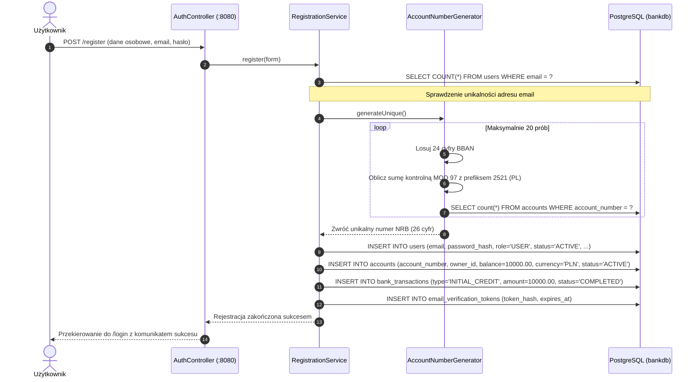

---

### 19.2. Logowanie, wyzwanie 2FA i zapis sesji w Redisie

```mermaid
sequenceDiagram
    autonumber
    actor U as Użytkownik
    participant F as Security Filter Chain
    participant LH as LoginSuccessHandler
    participant R as Redis (:6379)
    participant DB as PostgreSQL (bankdb)

    U->>F: POST /login (email, password)
    F->>DB: SELECT * FROM users WHERE email = ?
    F->>F: Weryfikacja BCrypt.matches()
    
    alt Użytkownik ma włączone 2FA
        F->>U: Przekierowanie 302 do /login/2fa
        U->>F: POST /login/2fa (kod TOTP z aplikacji)
        F->>DB: SELECT totp_secret_encrypted FROM users WHERE email = ?
        F->>F: Odszyfrowanie sekretu kluczem AES-GCM
        F->>F: Weryfikacja kodu TOTP w oknie czasowym 30s
    end

    F->>LH: onAuthenticationSuccess()
    LH->>DB: INSERT INTO login_history (user_id, email, successful=true, ip, user_agent)
    LH->>DB: UPDATE users SET last_login_at = now() WHERE id = ?
    LH->>R: HMSET spring:session:sessions:<id> (atrybuty sesji, SecurityContext)
    LH->>R: SADD spring:session:index:PRINCIPAL_NAME:<email> <id>
    LH-->>U: Set-Cookie: BANK_SESSION=<id>; HttpOnly; SameSite=Lax
    LH-->>U: Przekierowanie 302 do panelu głównego /dashboard
```

---

### 19.3. Wykonanie przelewu krajowego z kontrolą limitów i challenge TOTP

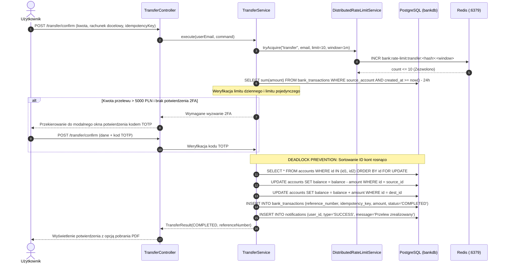

---

### 19.4. Zlecenie stałe i cykliczny scheduler przelewów

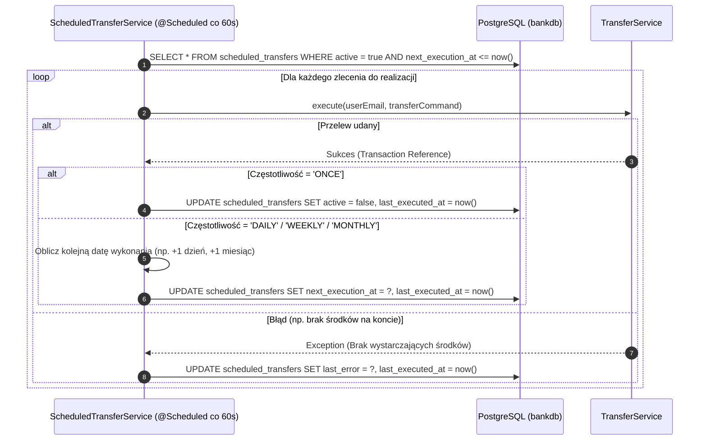

---

### 19.5. Wymiana walut w kantorze z aktualizacją bilansów

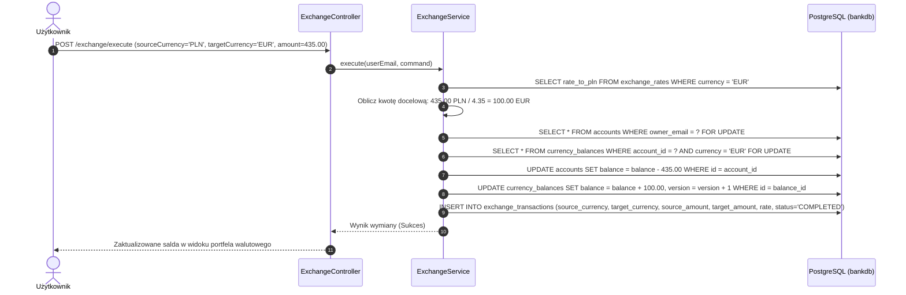

---

### 19.6. Płatność kartą demonstracyjną online z przeliczeniem waluty

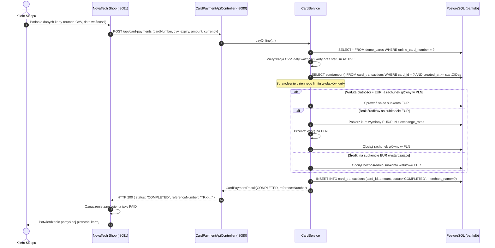

---

### 19.7. Pełny cykl zakupu w sklepie z płatnością NovaBank (Bilety, Kod i Redeem)

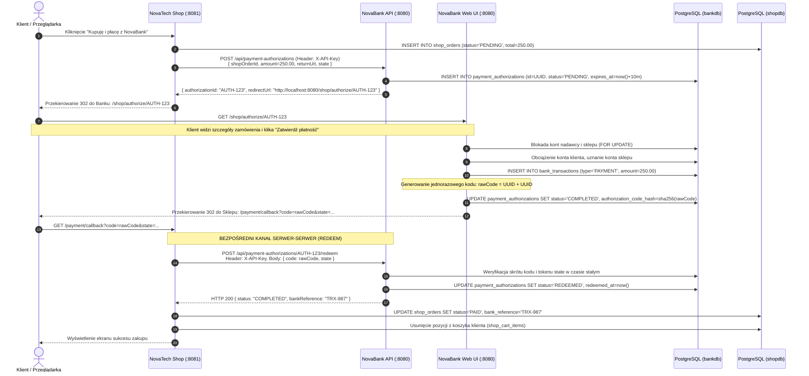

---

### 19.8. Odzyskiwanie transakcji przez Reconciler przy porzuceniu przeglądarki

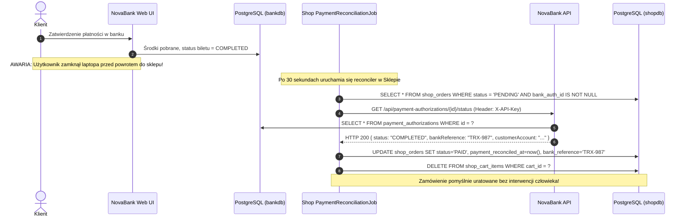

---

### 19.9. Procedura zwrotu zamówienia (Refund)

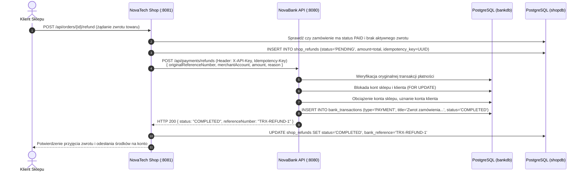

---

### 19.10. Nocna retencja danych technicznych z advisory lockiem

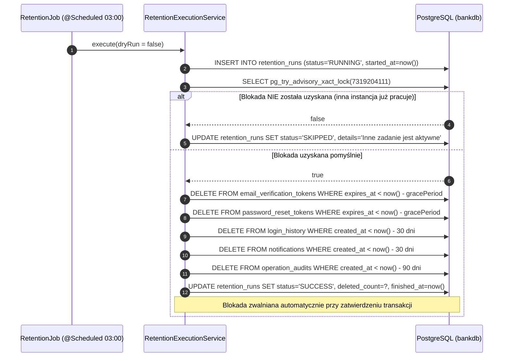

---

## 20. Błędy napotkane podczas budowy i ich rozwiązania

### 20.1. Zakleszczenia bazodanowe przy współbieżnych przelewach (Deadlocks)
- **Objaw:** W testach wielowątkowych współbieżne przelewy między dwoma użytkownikami rzucały wyjątek `PSQLException: ERROR: deadlock detected`.
- **Przyczyna:** Wątek 1 blokował konto A i czekał na B, a wątek 2 blokował B i czekał na A.
- **Rozwiązanie:** Posortowanie listy identyfikatorów kont przed wykonaniem zapytania `SELECT FOR UPDATE` w `TransferService` i `PaymentService`. Obie transakcje blokują zasoby w identycznej kolejności numerycznej.

### 20.2. Wyciek wrażliwych danych w logach i sesji
- **Objaw:** W logach deweloperskich pojawiały się wygenerowane hasze oraz sekrety TOTP.
- **Rozwiązanie:** Wdrożenie komponentu `TotpSecretCipher` szyfrującego sekrety algorytmem AES-GCM przed jakimkolwiek zapisem oraz czyszczenie atrybutu sesji `BANK_TOTP_SETUP_SECRET` natychmiast po potwierdzeniu konfiguracji 2FA.

### 20.3. Problem utraconego powrotu z bramki płatności (Orphaned Payments)
- **Objaw:** Klient płacił w banku, ale zamykał okno przeglądarki przed powrotem do sklepu. Środki znikały z konta klienta, a zamówienie w sklepie wisiało jako `PENDING`.
- **Rozwiązanie:** Zaimplementowanie w Sklepie asynchronicznego pracownika w tle `PaymentReconciliationJob`, który cyklicznie odpytuje endpoint `/status` Banku i samodzielnie domyka transakcję w sklepie.

### 20.4. Niezgodność sum kontrolnych numerów kont bankowych
- **Objaw:** Przyjmowanie błędnych numerów kont wprowadzanych przez użytkowników powodowało błędy w późniejszych etapach transakcji.
- **Rozwiązanie:** Wdrożenie algorytmu walidacji **MOD 97-10** (zgodnego ze standardem ISO 7064) bezpośrednio w generatorze `AccountNumberGenerator.isValid()`.

---

## 21. Jak diagnozować błędy zamiast zgadywać

### 21.1. Przegląd kodów błędów HTTP i ich znaczenia

| Kod HTTP | Prawdopodobna przyczyna w platformie | Gdzie szukać źródła problemu |
|---|---|---|
| **400 Bad Request** | Błędny format danych wejściowych (np. niepoprawny numer NRB, kwota $\le 0$, nieprawidłowy token stanu `state`). | Logi aplikacji, adnotacje `@Valid` w kontrolerach. |
| **401 Unauthorized** | Brak aktywnej sesji `BANK_SESSION`, wygaśnięcie sesji w Redisie, brak lub błędny klucz `X-API-Key`. | Sprawdź ciasteczka w przeglądarce oraz konfigurację `BANK_API_KEYS`. |
| **403 Forbidden** | Próba dostępu do panelu `/admin` bez roli `ROLE_ADMIN` lub brak tokenu CSRF w żądaniu POST. | Tabela `users.role`, obecność pola `_csrf` w formularzu Thymeleaf. |
| **409 Conflict** | Naruszenie reguły idempotencji (użycie tego samego `Idempotency-Key` dla innej kwoty) lub jednorazowy kod autoryzacji został już wykupiony. | Sprawdź nagłówek `Idempotency-Key` i tabelę `payment_authorizations`. |
| **429 Too Many Requests** | Przekroczono limit prób logowania lub przelewów z danego adresu IP. | Klucze w Redisie `bank:rate-limit:*`, nagłówek `Retry-After`. |
| **500 Internal Error** | Niespójność bazy, brak połączenia z bazą danych lub błąd krytyczny JVM. | Sprawdź pliki `hs_err_pid*.log` lub logi kontenerów PostgreSQL. |

---

### 21.2. Przydatne komendy diagnostyczne w terminalu

#### Sprawdzenie stanu kontenerów:
```bash
docker ps --format "table {{.Names}}\t{{.Status}}\t{{.Ports}}"
```

#### Podgląd kluczy sesji i limitera w Redisie:
```bash
docker exec -it bank-redis redis-cli KEYS "*"
docker exec -it bank-redis redis-cli HGETALL "spring:session:sessions:<session_id>"
```

#### Bezpośrednie zapytanie do bazy banku przez `psql`:
```bash
docker exec -it bank-postgres psql -U bankuser -d bankdb -c "SELECT email, role, status FROM users;"
docker exec -it bank-postgres psql -U bankuser -d bankdb -c "SELECT reference_number, amount, status FROM bank_transactions ORDER BY id DESC LIMIT 5;"
```

#### Sprawdzenie stanu zdrowia aplikacji przez Actuator:
```bash
curl -s http://127.0.0.1:8082/actuator/health | jq .
curl -s http://127.0.0.1:8083/actuator/health | jq .
```

---

## 22. Najważniejsze wnioski architektoniczne

1. **Autonomia baz danych to klucz do niezawodności:** Fizyczne rozdzielenie `bankdb` i `shopdb` uniemożliwia powstanie niewidocznych powiązań w kodzie i pozwala na niezależne skalowanie oraz wdrażanie serwisów.
2. **Kompensacja i Reconciler zamiast blokującego 2PC:** W systemach rozproszonych spójność ewentualna (*Eventual Consistency*) wspierana przez mechanizmy idempotencji oraz tła jest wielokrotnie bardziej odporna na awarie sieciowe niż protokoły dwufazowe.
3. **Kryptografia w spoczynku musi być standardem:** Hasła haszowane silnym algorytmem BCrypt oraz sekrety 2FA szyfrowane w bazie authenticated cypherem AES-GCM chronią dane klientów nawet w przypadku wycieku całego zrzutu bazy danych (*Database Dump Leak*).
4. **Determinizm blokowania eliminuje zakleszczenia:** Zastosowanie prostego sortowania identyfikatorów przed blokowaniem zasobów w PostgreSQL całkowicie rozwiązuje problem deadlocków współbieżnych transakcji finansowych.

---

## 23. Centrala Kontrolna, konteneryzacja i Disaster Recovery

### 23.1. Rola NovaBank Control Center

NovaBank Control Center (`scripts/control-center/control-center.sh` oraz `start.ps1`) pełni rolę centralnego pulpitu operacyjnego:
- Uruchamia i zatrzymuje usługi z uwzględnieniem poprawnych plików środowiskowych.
- Posiada wbudowany **Smoke Test E2E** (`scripts/e2e-smoke.sh`), który automatycznie emuluje pełną ścieżkę klienta: rejestrację, logowanie, zasilenie, dodanie do koszyka i opłacenie zamówienia przez bramkę API.

### 23.2. Procedury tworzenia i odtwarzania kopii zapasowych (Disaster Recovery)

W katalogu `scripts/backup/` zaimplementowano skrypty automatyzacji backupu:
- **Tworzenie kopii:** Wykonanie zrzutu bazy PostgreSQL (`pg_dump`) z kompresją oraz opcjonalnym szyfrowaniem kluczem publicznym GPG/age.
- **Odtwarzanie:** Skrypt weryfikuje sumy kontrolne SHA-256 archiwum, odtwarza schemat i dane za pomocą narzędzia `pg_restore` w izolowanym środowisku testowym.

---

## 24. Słownik pojęć i wzorców architektonicznych (Glosariusz)

### 1. Wzorce transakcyjne i spójność
- **ACID (Atomicity, Consistency, Isolation, Durability):** Zbiór właściwości gwarantujących poprawne przetwarzanie transakcji w relacyjnej bazie danych.
- **Deadlock Prevention (Global Lock Ordering):** Technika unikania zakleszczeń polegająca na wymuszeniu globalnego, deterministycznego porządku blokowania zasobów (np. sortowanie identyfikatorów numerycznych przed blokadą).
- **Optimistic Locking:** Wzorzec wykrywania konfliktów współbieżnych przy użyciu kolumny z wersją rekordu (`@Version`), bez blokowania wierszy na czas odczytu.
- **Pessimistic Locking (`SELECT ... FOR UPDATE`):** Wzorzec wyłącznego blokowania wierszy w bazie danych na czas trwania transakcji w celu ochrony przed równoległym zapisem.
- **Idempotent Consumer / Idempotency Key:** Wzorzec projektowy gwarantujący, że wielokrotne odebranie tego samego żądania wywoła dokładnie taki sam skutek biznesowy jak wykonanie go jeden raz.
- **Eventual Consistency (Spójność Ewentualna):** Model spójności w systemach rozproszonych, w którym dane w różnych węzłach mogą chwilowo różnić się od siebie, ale docelowo bez nowych aktualizacji staną się identyczne.

### 2. Bezpieczeństwo i tożsamość
- **TOTP (Time-based One-Time Password, RFC 6238):** Algorytm generowania jednorazowych haseł na podstawie współdzielonego sekretu oraz bieżącego czasu w oknach 30-sekundowych.
- **AES-GCM (Galois/Counter Mode):** Tryb pracy szyfru blokowego zapewniający jednocześnie poufność (szyfrowanie) i integralność danych (uwierzytelnianie) za pomocą 128-bitowego tagu kryptograficznego.
- **BCrypt:** Funkcja skrótu haseł bazująca na szyfrze Blowfish, posiadająca wbudowaną sól kryptograficzną oraz adaptacyjny parametr kosztu obliczeniowego chroniący przed atakami GPU/ASIC.
- **Fail-Fast Configuration Validation:** Wzorzec przerywania startu aplikacji na najwcześniejszym możliwym etapie cyklu życia w przypadku wykrycia nieprawidłowości lub braku wymaganych zmiennych produkcyjnych.
- **AppRole (HashiCorp Vault):** Mechanizm uwierzytelniania maszynowego w skarbcu Vault oparty na parach poświadczeń: `RoleID` (odpowiednik loginu) oraz `SecretID` (odpowiednik hasła).

### 3. Architektura i integracja
- **Ticket Flow (Protokół biletowy):** Wzorzec bezpiecznej autoryzacji płatności, w którym sklep rezerwuje unikalny bilet transakcyjny, a użytkownik potwierdza płatność bezpośrednio na zaufanej domenie banku, nie ujawniając poświadczeń sklepowi.
- **Database-per-Service:** Wzorzec architektoniczny mikroserwisów, w którym każda usługa posiada wyłączny dostęp do własnej bazy danych i nie współdzieli jej z innymi usługami.
- **Single Source of Truth (SSoT):** Zasada projektowa mówiąca, że dana informacja biznesowa (np. saldo konta) posiada dokładnie jedno autorytatywne źródło w systemie.
- **Reconciler Pattern (Pętla uzgadniania):** Mechanizm ciągłego porównywania stanu pożądanego ze stanem faktycznym i podejmowania akcji naprawczych w celu ich wyrównania (wzorzec spopularyzowany m.in. przez Kubernetes).
- **NRB (Numer Rachunku Bankowego):** Polski standard identyfikacji rachunków bankowych oparty na 26 cyfrach, w którym dwie pierwsze cyfry stanowią sumę kontrolną wyliczaną algorytmem MOD 97-10 zgodnym z normą ISO 7064.
