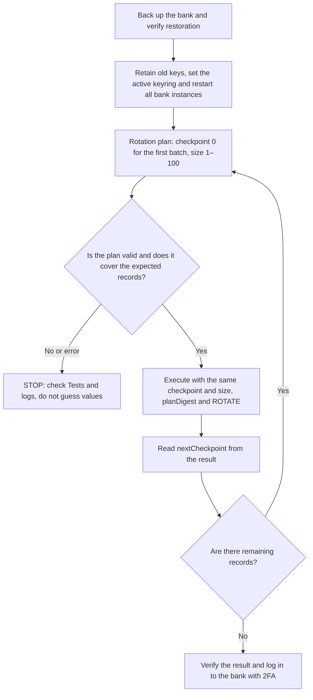
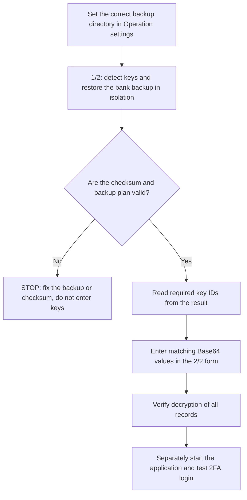
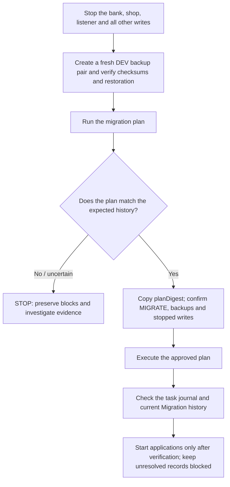
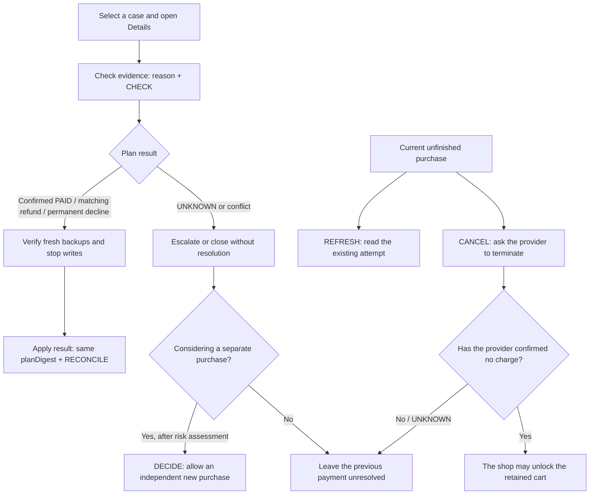
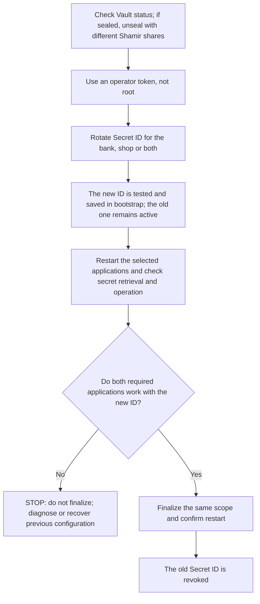

# NovaBank and NovaTech Shop

[Polish version](General_Instruction.pl.md)

## General setup and operations guide

This document describes the complete local project workflow: WSL 2, Docker Engine, PostgreSQL, Redis, Spring/Maven profiles, IntelliJ IDEA, HashiCorp Vault, TLS/HTTPS, monitoring, Stripe, tests, auditing and backups.

**DEV configuration split (2026-10-14):** `project.env` owns non-sensitive infrastructure hosts, ports, names and usernames; `dev.env` owns database passwords, keys and DEV application settings. Compose requires both `--env-file` arguments. Do not copy the entire historical `.env.example` into project.env. The wizard and WSL generator `python3 -B scripts/control-center/web/dev_env_layout.py prepare` create the files with the correct ownership split. Conflicting duplicate values stop a normal save; see the [report](dev-env-deduplication-report.md). TEST/PROD do not inherit these DEV secrets.

This is a locally run educational environment, not a production bank or a real payment operator. The Stripe variant uses a Stripe test account; bank-demo simulates transfers in the application databases.

> **Important: use your own project path.** Examples may use
> `C:\Dysk D\stuff\Bank-demo` and `/mnt/c/Dysk D/stuff/Bank-demo`. These are paths
> from the author's environment, not application requirements. Before running a command,
> replace them with your repository location. This applies to PowerShell,
> WSL/Linux/macOS, IntelliJ IDEA, EnvFile files, Control Center,
> monitoring, Vault and backups. Detailed path-conversion instructions,
> including paths containing spaces, are in **Replace the example path with your own**
> under **Extended procedures and your own project path**.

### One main guide

`General_Instruction.md` is the main, and ultimately the only, project user manual. It contains first-run procedures, working with `dev`, `test` and `prod`, IntelliJ configuration, Docker/WSL, Vault, TLS, monitoring, backups, tests, payments and NovaBank Control Center. All commands needed for daily operations are described in the following chapters.

The other Markdown files under `docs` are currently retained as source materials and working copies. They are not required for normal application startup or Control Center operation. They may later be moved or removed after further verification, because current operational references lead to this main guide.

## Start here: the guide and NovaBank Control Center

Start the operator panel **from a WSL/Bash terminal**, in the project directory:

```bash
bash ./scripts/start.sh
```

The panel opens at `http://127.0.0.1:18110`. It requires Python 3.10+ in WSL; starting DEV applications from the panel also requires JDK 25 in WSL. Terminal menu: `bash ./scripts/start.sh --cli`. Do not run `.ps1` commands in Bash. Details: [Panel operations](control-center-web.md).

**Files and secrets** edits only the designated DEV/TEST files, with confirmation and a 45-second reveal. Saving does not change PostgreSQL/Grafana passwords, migrate TOTP or restart applications. Since 2026-10-14, **Operations → Vault** covers local status, unsealing with one Shamir share, AppRole and bank/shop Secret ID rotation/finalization; bootstrap, PROD builds and local TLS keystores without PowerShell have also been added. Every PROD task requires a warning, checkbox and typing PROD, enforced by the API as well. Vault is limited to HTTPS 127.0.0.1:8200 with the project CA and an operator token, never root. There is no business-KV editor, init/rekey, remote production or automatic PROD startup/deployment. The panel also provides a guide, IntelliJ preview, bounded cleanup of generated artifacts and PL/EN navigation/action names. Enter sudo passwords outside the web interface. Details, operator-policy requirements and boundaries: [Panel operations](control-center-web.md#vault-i-jawne-procedury-prod--2026-10-14).

For your first run, start with the interactive guide. It shows the architecture, application screens, startup order, `dev`, `test` and `prod`, monitoring, Vault, backups and the basic bank/shop flows.

From the project directory in WSL, Linux or macOS, run:

```bash
bash scripts/control-center/interactive-guide.sh
```

## How to read this guide

The numbered path `1-20` is the main operational sequence. Unnumbered sections
contain the technical introduction, extended procedures and final additions;
they are not extra stages that must be performed after chapter `20`.

**Working order:**

1. Read chapters `1-4` and prepare WSL, Docker, data, accounts and roles.
2. Choose an environment: `5. The dev profile`, `6. The test profile` or `9-12. The prod profile`.
3. Enable `7. DEV monitoring` only after both applications are running.
4. For daily operations, use `14. PostgreSQL backup` and `16. Checklist after a break`.
5. For problems, go to `17. Common problems`, then `19. NovaBank Control Center`.

## Contents

- `1-4`: architecture, secrets, infrastructure, accounts and roles
- `5-8`: dev/test profiles, monitoring and payments
- `9-12`: prod, Vault, TLS and key rotation
- `13-15`: retention, backup, CI/CD, OpenAPI and Postman
- `16-20`: checklist, problems, startup sequence, Control Center and installation
- `Quick project guide`: components, E2E, Vault, monitoring and backups
- `Extended procedures and your own project path`: paths, configuration and operational procedures
- `Final supplements`: first run, local directory, retention and operational reference

## Quick project guide

This chapter consolidates procedures from the other project notes into one operational path. Other Markdown files remain in the repository as detailed documentation, but you can work through the entire project using this chapter alone.

### What you run and what each component does

The project contains two independent Spring Boot applications:

1. NovaBank runs on port 8080 by default.
2. NovaTech Shop runs on port 8081 by default.

The bank handles users, accounts, balances, transfers, recipients, cards, currencies, 2FA, history, administration and the payment-authorization API.

The shop handles the product catalog, product details, customer accounts, carts, orders, bank-demo or Stripe payments and refunds.

Supporting infrastructure:

- WSL 2 provides Linux on Windows.
- Docker Engine and Docker Compose run PostgreSQL, Redis and monitoring. Docker Desktop is not required.
- PostgreSQL stores bank data in bankdb and shop data in shopdb.
- Redis stores bank sessions, limits, short-lived challenges, rate-limiting data and selected workflow state.
- Shop-app also uses JDBC sessions, so not every shop session is in Redis.
- Flyway applies versioned schema migrations when the applications start.
- HashiCorp Vault stores PROD secrets and issues AppRole credentials.
- Prometheus scrapes metrics, Grafana displays dashboards and Alertmanager groups alerts.
- Stripe CLI is an optional DEV webhook tunnel for Stripe payments.
- IntelliJ IDEA runs the bank/shop as Java processes and lets you select a profile and EnvFile.
- GitHub Actions runs tests/builds according to .github/workflows/ci.yml.

Important distinction: Docker runs infrastructure services, while local applications may run as IntelliJ processes. Containers can therefore be active while port 8080 or 8081 remains unavailable until the corresponding Spring Boot configuration is started.

### First run of a new project copy

Once WSL, Docker and the JDK are ready, configure standard local DEV in the browser: `bash ./scripts/start.sh` → **DEV configuration**. The form creates missing `project.env`/`dev.env`, accepts database/Redis settings, ports and the shop merchant account, and generates missing secrets without rotating existing valid values. Buttons in the same tab start databases/Redis, build the bank, build the shop and start DEV applications—each separately after confirmation. If a database/volume already exists, keep its previous credentials; changing a file secret does not reset PostgreSQL's password. Details and limitations: [Control Center configuration wizard](control-center-web.md).

The following additional interactive CLI variant is also used for broader prerequisite diagnostics and advanced procedures:

First open WSL in the project directory. Convert the Windows path to a WSL path, for example:

~~~bash
cd "/mnt/c/Dysk D/stuff/Bank-demo"
pwd
~~~

Start Control Center:

~~~bash
bash scripts/control-center/control-center.sh
~~~

On Windows, you can use the adapter:

~~~powershell
.\scripts\control-center\start.ps1
~~~

Choose First run. Control Center will:

1. check the system, Bash, Docker, Compose, Java, keytool, curl, jq, OpenSSL and GPG;
2. create the local .novabank directory;
3. prepare .novabank/env/project.env from the example;
4. generate missing local database passwords without replacing existing values;
5. prepare .novabank/env/dev.env;
6. show the files required for PROD and the secret locations;
7. create DEV monitoring configuration when you choose that option;
8. show missing components and how to install them.

Do not add .novabank files to the repository or commits. This local data may contain passwords, tokens, certificates, logs or bootstrap files.

If the project is elsewhere, run scripts from its directory. Scripts derive PROJECT_ROOT from their own location. Do not hard-code C:\Dysk D\stuff\Bank-demo into environment files. In IntelliJ, set Working directory to the project directory and point EnvFile to the current repository.

### PostgreSQL, Redis and infrastructure startup

Before starting applications, check containers:

~~~bash
docker ps
~~~

Start the required services using configuration prepared for this project copy:

~~~bash
docker compose --env-file .novabank/env/project.env --env-file .novabank/env/dev.env up -d postgres shop-postgres redis
~~~

Check status:

~~~bash
docker compose --env-file .novabank/env/project.env --env-file .novabank/env/dev.env ps
~~~

Expect healthy for bank-postgres/shop-postgres and running for bank-redis. If a container is missing, check docker-compose.yaml, .env.example and .novabank/env/project.env. Do not run FLUSHALL on Redis or delete databases just because an application cannot find a Maven library.

Local ports:

- bank-postgres: 127.0.0.1:5300 -> PostgreSQL 5432;
- shop-postgres: 127.0.0.1:5400 -> PostgreSQL 5432;
- bank-redis: 127.0.0.1:6379 -> Redis 6379.

For database diagnostics, use the username from project.env and password from dev.env. Do not assume a postgres role exists in the container. This project often uses a dedicated POSTGRES_USER value. Example query:

~~~bash
docker exec -e PGPASSWORD="$POSTGRES_PASSWORD" bank-postgres \
  psql -U "$POSTGRES_USER" -d bankdb -c \
  "select version, checksum, success from flyway_schema_history order by installed_rank;"
~~~

Variable names must match the current project.env. If they are not loaded in the current shell, read them from the file locally only, or run the command through a Control Center script.

### Accounts and test data

A basic test requires at least:

1. a regular bank user with an active PLN account;
2. a bank administrator with the administrator role;
3. a shop customer account, registered independently of the bank account;
4. an active bank account for the shop, used as the merchant account;
5. optionally, a technical metrics account;
6. optionally, a Stripe sandbox account when testing Stripe.

Shop registration uses email and a password, not a bank account number. With NovaBank checkout, the customer signs into the bank and selects or has an active account. The merchant account must exist in the bank, be ACTIVE and have its number configured in the shop.

The bank administrator uses normal bank login; authorization comes from the database role. Knowing /admin is not enough. Sign out and back in after changing the role.

For a quick shop test:

1. open the catalog;
2. register a shop customer;
3. sign in;
4. add a product to the cart;
5. go to checkout;
6. choose NovaBank or bank-demo card payment;
7. check the order status and the customer/merchant account balances.

Do not use real passwords, card numbers or production data. The bank-profile card number is a demonstration card; the bank-demo provider form should not retain the full number, CVV or expiry after authorization ends.

### DEV, TEST and PROD profiles

#### DEV

DEV is the everyday local-development profile. Secrets are in .novabank/env/dev.env; applications are started from IntelliJ.

For Bank DEV, set:

- Active profiles: dev;
- Working directory: repository directory;
- Enable EnvFile: enabled;
- EnvFile: .novabank/env/dev.env;
- application port: 8080;
- Actuator server port: 8082.

Use the same settings for Shop DEV, except:

- application port: 8081;
- Actuator server port: 8083.

You can start both processes through the NovaBank DEV compound configuration. Do not simultaneously start another bank/shop on the same ports.

After changing BANK_API_KEY, BANK_API_URL, database passwords, TOTP keys, Stripe or monitoring settings, stop and restart both processes. A browser refresh does not reload Java process environment variables.

#### TEST

TEST is for automated tests. Test dependencies include PostgreSQL and Redis started by Testcontainers. Never use production databases, keys, AppRole credentials or certificates in this profile.

Integration tests may download container images, so Docker Engine must be running. If CI cannot access images, the test fails because of infrastructure, not application logic.

#### PROD

PROD requires:

1. running Vault with an active TLS certificate;
2. Vault unsealed with three of five Shamir shares;
3. bank-prod/shop-prod policies and AppRoles;
4. current Role IDs and Secret IDs;
5. a truststore containing the certificate of Vault's active listener;
6. bank-server.p12 and shop-server.p12 keystores;
7. secret values stored in Vault;
8. separate Bank PROD/Shop PROD IntelliJ configurations;
9. HTTPS and secure cookies.

Do not use .novabank/env/dev.env in PROD. Keep only the values needed to connect to Vault in prod.bank.env/prod.shop.env bootstrap files, according to the secret map. Database passwords, BANK_API_KEYS, TOTP_ENCRYPTION_KEY, payment-provider keys and keystore passwords should come from Vault or a secure launch mechanism.

### CI/CD, Maven and Testcontainers

The bank and shop-app are independent Maven projects. The bank uses the root wrapper; the shop uses its own pom.xml and wrapper or the root wrapper, according to the current repository structure.

Local bank unit tests:

~~~powershell
.\mvnw.cmd -Punit-tests test
~~~

Local shop unit tests:

~~~powershell
.\mvnw.cmd -f shop-app\pom.xml -Punit-tests test
~~~

Bank integration tests:

~~~powershell
.\mvnw.cmd -Pintegration-tests verify
~~~

Shop integration tests:

~~~powershell
.\mvnw.cmd -f shop-app\pom.xml -Pintegration-tests verify
~~~

WSL equivalents:

~~~bash
./mvnw -Punit-tests test
./mvnw -f shop-app/pom.xml -Punit-tests test
./mvnw -Pintegration-tests verify
./mvnw -f shop-app/pom.xml -Pintegration-tests verify
~~~

If Maven reports a missing JAVA_HOME, check:

~~~bash
java -version
echo "$JAVA_HOME"
which java
~~~

In PowerShell, check:

~~~powershell
java -version
$env:JAVA_HOME
Test-Path "$env:JAVA_HOME\bin\java.exe"
~~~

Maven profiles are not Spring profiles. A Maven profile selects build/test behavior; a Spring profile selects application configuration. For example, Spring dev can run from IntelliJ while unit-tests is a Maven profile.

GitHub Actions in .github/workflows/ci.yml:

1. runs bank/shop unit tests;
2. runs integration tests using PostgreSQL/Redis through Testcontainers;
3. runs the HTTP test for both services;
4. builds and stores JAR artifacts.

The workflow runs on push, pull request and manually through workflow_dispatch. CI/CD does not automatically deploy PROD, use production secrets or replace the Vault procedure.

### What the E2E test checks

scripts/e2e-smoke.sh tests the bank–shop flow against running local applications. It is not merely a port-availability check.

The script:

1. waits for bank/shop-app healthchecks;
2. opens the bank login page;
3. fetches a product from the public shop catalog;
4. obtains a CSRF token and registers a test shop user;
5. signs the user in over HTTP;
6. adds a product to the cart and creates an order;
7. invokes shop payment;
8. repeats that payment with the identical Idempotency-Key;
9. verifies that the repeat does not create a second bank authorization;
10. verifies that the shop created an authorization in the actually running bank;
11. reads its PENDING status;
12. stops before actual transfer approval, so the test should not move demonstration funds.

Run locally:

~~~bash
bash scripts/e2e-smoke.sh
~~~

Run with explicit test values:

~~~bash
BANK_URL=http://127.0.0.1:8080 SHOP_URL=http://127.0.0.1:8081 \
BANK_HEALTH_URL=http://127.0.0.1:8082/actuator/health \
SHOP_HEALTH_URL=http://127.0.0.1:8083/actuator/health \
BANK_API_KEY=ci-bank-key BANK_API_KEY_ID=legacy bash scripts/e2e-smoke.sh
~~~

E2E prerequisites:

- bank on 8080;
- shop-app on 8081;
- accessible health endpoints;
- installed curl and jq;
- the bank API accepts the test key;
- the shop allows a test account/session to be created.

Interpretation:

- healthy means the server responds;
- successful registration/login confirms working shop CSRF and sessions;
- the same authorization after a second request confirms idempotency;
- PENDING means authorization was created, but no funds were collected;
- 401 suggests a key/profile/endpoint-protection problem;
- 429 indicates rate limiting;
- timeout indicates an unavailable process, incorrect address or WSL/Windows issue;
- inspect both application logs for bank–shop communication errors.

### HTTP test and manual API checks

Bank/shop health:

~~~powershell
Invoke-WebRequest -UseBasicParsing http://localhost:8082/actuator/health
Invoke-WebRequest -UseBasicParsing http://localhost:8083/actuator/health
~~~

Metrics use separate ports:

~~~text
http://localhost:8082/actuator/prometheus
http://localhost:8083/actuator/prometheus
~~~

In DEV they may require Basic Auth. Example PowerShell check:

~~~powershell
$pair = "metrics-reader:<METRICS_PASSWORD>"
$basic = [Convert]::ToBase64String([Text.Encoding]::ASCII.GetBytes($pair))
Invoke-WebRequest -UseBasicParsing -Headers @{ Authorization = "Basic $basic" } http://localhost:8082/actuator/prometheus
~~~

200 with Prometheus series means the connection works. 401 means missing/incorrect Basic Auth. 404 usually means the wrong port, a disabled management endpoint or another profile running.

Older PowerShell may not provide RandomNumberGenerator.Fill. Use compatible generation:

~~~powershell
$bytes = New-Object byte[] 32
$rng = [System.Security.Cryptography.RandomNumberGenerator]::Create()
$rng.GetBytes($bytes)
$metricsPassword = [Convert]::ToBase64String($bytes).TrimEnd('=').Replace('+','-').Replace('/','_')
$rng.Dispose()
~~~


### Monitoring: Prometheus, Grafana and Alertmanager

Monitoring is a separate container stack. Start the bank and shop in IntelliJ IDEA first, because Prometheus reads their Actuator endpoints.

For DEV, prepare both processes with:

~~~text
MANAGEMENT_SERVER_ADDRESS=0.0.0.0
METRICS_USERNAME=metrics-reader
METRICS_PASSWORD=<the same long password>
BANK_MANAGEMENT_PORT=8082
SHOP_MANAGEMENT_PORT=8083
~~~

In IntelliJ IDEA, enable EnvFile .novabank/env/dev.env for both configurations. Stop and restart both processes after changing values.

Then run the central monitoring script in WSL:

~~~bash
cd "/mnt/c/Dysk D/stuff/Bank-demo"
bash scripts/monitoring/monitoring.sh setup
bash scripts/monitoring/monitoring.sh start --profile dev
bash scripts/monitoring/monitoring.sh status --profile dev
~~~

It prepares .novabank/monitoring/.env.monitoring and the Prometheus configuration, starts three containers and checks readiness. You can also run Compose directly:

~~~bash
docker compose --env-file .novabank/monitoring/.env.monitoring -f docker-compose.monitoring.yaml up -d
~~~

Check:

~~~text
Prometheus:   http://localhost:9090
Grafana:       http://localhost:3000
Alertmanager:  http://localhost:9093
Bank metrics:  http://localhost:8082/actuator/prometheus
Shop metrics:  http://localhost:8083/actuator/prometheus
~~~

In Prometheus, choose Status -> Target health. Expect:

~~~text
bank-demo: UP
shop-app:  UP
~~~

401 means mismatched Basic Auth credentials; connection refused means the application is not listening on the management port; context deadline exceeded indicates a network problem between WSL and the Windows process. Do not blindly change host.docker.internal: Prometheus uses localhost in the current network mode. For another WSL mode, check the address as described in monitoring-preparation.md.

In Grafana, open the NovaBank service-overview dashboard (NovaBank - przegląd usług). Empty panels may mean no traffic in the selected time range, not an outage. In Alertmanager, check active alerts:

- BankOrShopDown — an application or metrics endpoint is unavailable;
- HighHttp5xxRate — increased HTTP 5xx responses;
- HighJvmMemoryUsage — high JVM memory usage;
- PrometheusTargetErrors — Prometheus cannot scrape metrics;
- RetentionJobFailed — retention job failure;
- CertificateExpiryWarning — a certificate is approaching expiry.

Logs and shutdown:

~~~bash
bash scripts/monitoring/monitoring.sh logs
bash scripts/monitoring/monitoring.sh logs prometheus
bash scripts/monitoring/monitoring.sh stop
~~~

Monitoring does not automatically start after a computer restart unless you configure Compose autostart. In DEV, it can run only while you work. In PROD, restrict Actuator endpoints to the monitoring network and technical account. Keep Grafana/metrics passwords and script-generated files outside the repository.

On Windows with WSL, the script opens the guide in the default Windows browser. If that does not happen, it prints the exact path to `docs/interactive-guide.html`.

Then start NovaBank Control Center:

```bash
bash scripts/control-center/control-center.sh
```

On Windows, PowerShell is also available:

```powershell
.\scripts\control-center\start.ps1
```

Choose `First run` (`Pierwsze uruchomienie`) in Control Center. This checks prerequisites and guides preparation of local configuration files, containers and the profile. `Installation and requirements` checks/installs components; other sections run specific operations such as monitoring, backup, Vault, tests and diagnostics.

Important responsibility split:

- Control Center can detect the environment, create local directories/templates, generate DEV secrets and run controlled operations after confirmation.
- You must secure passwords, the five Vault unseal shares and root token yourself, and fill in PROD secrets as instructed. Never put them in the repository or screenshots.
- Start bank/shop applications from IntelliJ IDEA using the prepared `NovaBank DEV`, `NovaBank PROD`, `Bank DEV`, `Bank PROD`, `Shop DEV` and `Shop PROD` configurations.

For `dev` alone, Vault and Stripe CLI are not required. Docker Engine with Compose, Compose-managed PostgreSQL/Redis, `.novabank/env/project.env`, `.novabank/env/dev.env` and an IntelliJ configuration with active profile `dev` are sufficient.

### Vault, TLS and AppRole: the complete workflow

Vault stores secrets used by `prod`, including database passwords, API keys, payment-provider settings, TOTP keys and keystore passwords. It is not an application database and does not replace PostgreSQL. After restarting the computer, Vault may be running but remain sealed until three different shares are supplied.

Check the service and prepare the current WSL session:

~~~bash
sudo systemctl status vault --no-pager
export VAULT_ADDR="https://127.0.0.1:8200"
unset VAULT_CAPATH
unset VAULT_SKIP_VERIFY
export VAULT_CACERT="/mnt/c/Dysk D/stuff/Bank-demo/.novabank/tls/vault/vault.crt"
vault status
~~~

`VAULT_ADDR` points to Vault; `VAULT_CACERT` points to the certificate used to verify its HTTPS listener. Exports apply only to the current WSL window. Control Center sets these values for its own operations; set them again in each new session when running `vault` directly.

For `certificate signed by unknown authority`, compare fingerprints:

~~~bash
echo | openssl s_client -connect 127.0.0.1:8200 -servername localhost 2>/dev/null | openssl x509 -noout -fingerprint -sha256 -subject
sudo openssl x509 -in /opt/vault/tls/tls.crt -noout -fingerprint -sha256 -subject
sudo openssl x509 -in /opt/vault/tls/vault.crt -noout -fingerprint -sha256 -subject
~~~

Copy the certificate whose fingerprint matches the listener into your local repository workspace, outside version-controlled secrets. A typical variant for the documented installation:

~~~bash
sudo chmod 0755 /opt/vault/tls
sudo chmod 0644 /opt/vault/tls/tls.crt
sudo cp /opt/vault/tls/tls.crt "/mnt/c/Dysk D/stuff/Bank-demo/.novabank/tls/vault/vault.crt"
sudo chown "$(id -u):$(id -g)" "/mnt/c/Dysk D/stuff/Bank-demo/.novabank/tls/vault/vault.crt"
export VAULT_CACERT="/mnt/c/Dysk D/stuff/Bank-demo/.novabank/tls/vault/vault.crt"
vault status
~~~

Do not set `VAULT_SKIP_VERIFY`. If WSL cannot read `/opt/vault/tls`, this is a file/directory-permission problem, not a Vault-password problem. Change permissions deliberately and only for the local educational environment.

Possible `vault status` results:

- `Initialized false`: Vault has not been initialized;
- `Sealed true`: unsealing is required;
- `Sealed false`: secrets/AppRole can be used;
- TLS error: check `VAULT_CACERT`, fingerprints and certificate permissions;
- `503 Vault is sealed`: unseal the store first.

Initialization keys are encrypted in `vault-init.json.gpg`. The GPG password is the password selected when encrypting that file; it need not match a Vault-user password. Read keys/tokens locally only:

~~~bash
export RECOVERY_DIR="/mnt/e/Vault-Recovery"
gpg --quiet --pinentry-mode loopback \
  --decrypt "$RECOVERY_DIR/vault-init.json.gpg" |
  jq -e '(.unseal_keys_b64 | length) == 5 and (.root_token | length) > 0'
~~~

GPG asks for the file password. Use that password whenever reading the encrypted file; never put it in `.env` or the repository. Then supply three different shares, one at a time:

~~~bash
vault operator unseal
vault operator unseal
vault operator unseal
~~~

Each command asks for a different `unseal key`. Do not use the `root token` here. Root is for initial administration, such as `vault login`, policy and AppRole setup. Log the token out afterwards and never pass it to applications.

AppRole separates bank/shop access: `bank-prod` for the bank and `shop-prod` for the shop. The application receives `VAULT_ROLE_ID` and a short-lived `VAULT_SECRET_ID`, then fetches only secrets allowed by policy. Secret ID is not a root token. Its current lifetime/use count is limited; rotate it before expiry:

~~~bash
bash scripts/vault/approle-secret-id.sh bank-prod
bash scripts/vault/approle-secret-id.sh shop-prod
~~~

You can also select the corresponding rotation in NovaBank Control Center. Afterwards, update local PROD environment files, test connectivity, and only then invalidate the old Secret ID. Never show Secret IDs in logs/screenshots.

`VAULT_SSL_TRUST_STORE_PASSWORD` is set when creating the truststore. `keytool -importcert ...` prompts you to choose its password, not retrieve a pre-existing one. Pass that same password to applications in `.novabank/env/prod.bank.env` and `.novabank/env/prod.shop.env`. `scripts/generate-prod-tls-keystores.ps1` also requests separate bank/shop keystore passwords. Keep them outside the repository. The trust certificate/keystores must match the active listener and the profile being started.

### Payments: bank-demo versus Stripe

The shop has two payment modes selected by `SHOP_PAYMENT_PROVIDER`:

- `bank-demo` directs the user to the bank, checks the session, account, status, balance, currency and limits, then makes a demonstration transfer from the customer to the shop account. It tests full shop-app/bank communication;
- `stripe` creates a test payment in Stripe's external environment. Stripe CLI forwards webhooks to shop-app and updates order status; it neither debits a NovaBank account nor credits the shop account in the bank database.

`bank-demo` does not require Stripe CLI. For Stripe, prepare the test API key, webhook secret, merchant settings and bank connection in `.novabank/env/dev.env`. The complete variable list, Control Center workflow and test cards are in [sections 8.5–8.8](#stripe-test-dev). Then run a separate listener:

~~~bash
stripe listen --forward-to http://localhost:8081/api/payments/stripe/webhook
~~~

`Ready!` and `whsec_...` mean the CLI is running. Add that `whsec_...` value to shop-app configuration and restart the shop. `payment_intent.succeeded`, `charge.succeeded` and `checkout.session.completed` logs show Stripe events. Each should receive HTTP `200`; for `400`, check the webhook secret, session ID and event handler. `connection refused` means shop-app is not running on 8081.

Both modes protect orders with idempotency. Repeating an identical request with the same `Idempotency-Key` should not collect funds or create a second authorization. `PENDING`, `PAID` and `FAILED` are confirmed by the webhook, bank or reconciliation job. Refunds use a separate idempotency key.

### OpenAPI, Swagger UI and Postman

OpenAPI documents the HTTP contract; Postman runs/repeats manual requests. Swagger does not version code or the database: API versioning is expressed through the contract, paths, tags and change history.

Local addresses:

~~~text
Bank Swagger UI:  http://localhost:8080/swagger-ui/index.html
Bank OpenAPI:     http://localhost:8080/v3/api-docs
Shop Swagger UI: http://localhost:8081/swagger-ui/index.html
Shop OpenAPI:    http://localhost:8081/v3/api-docs
~~~

In `dev`/`test`, documentation is accessible without an administrator role. In `prod`, it requires `ROLE_ADMIN` because it describes application endpoints.

Example bank-login check in Postman:

1. Create `POST http://localhost:8080/login`.
2. Select `Body` → `x-www-form-urlencoded`.
3. Add `username`, `password` and `_csrf`.
4. First obtain `_csrf` from the login-page HTML or cookie/response, according to the current form configuration.
5. Enable cookies for `localhost` and check the dashboard redirect. A CSRF error means a stale token or missing session cookies.

For shop APIs, always use an authenticated session, a CSRF header on state-changing methods and `Idempotency-Key` when starting payments. Never log card numbers, CVV or expiry dates. Use only the application's demonstration data with `bank-demo`.

### PostgreSQL backup, Disaster Recovery and retention

PostgreSQL is the source of financial/business data. Redis holds sessions, temporary state and cache; a PostgreSQL backup is not a Redis backup. Start `postgres`, `shop-postgres` and `redis` before backing up, then run:

~~~bash
cd "/mnt/c/Dysk D/stuff/Bank-demo"
bash scripts/backup/backup.sh create
~~~

The script asks for an output directory. Each run creates a new UTC date/time subdirectory, without overwriting previous backups. It checks the environment, dumps bank/shop databases, computes SHA-256, restores into temporary databases and writes `backup-report.log`. Success requires `OK` for backup, checksums and restore testing. The report always includes the full output path.

Useful variants:

~~~bash
bash scripts/backup/backup.sh create --backup-dir /mnt/e/Bank-demo-backups/postgres
bash scripts/backup/backup.sh create --skip-restore-test
bash scripts/backup/backup.sh prune
bash scripts/backup/backup.sh dr-test --backup-dir /mnt/e/Bank-demo-backups/postgres
~~~

`dr-test` selects the newest backup, restores it into an isolated environment, checks migrations/HTTP tests and saves a report. Run it regularly, preferably weekly, and check that the report does not end in `BLAD`. Retention removes only configured technical/audit data, not cards, balances, transfers, orders or refunds.

In `dev`, begin with `RETENTION_DRY_RUN=true`. Enable deletion (`RETENTION_DRY_RUN=false`) only after reviewing the report. Administration page:

~~~text
http://localhost:8080/admin/data-retention
~~~

The panel records the outcome in the audit. Also monitor `bank_retention_deleted_total`, `bank_retention_errors_total` and `RetentionJobFailed`.

### Profiles and choosing your daily environment

`dev` is for manual IntelliJ work. Start PostgreSQL/Redis through WSL, load `.novabank/env/dev.env`, activate `dev` for both applications, then start `NovaBank DEV` or the two processes separately. Monitoring and Stripe are optional.

`test` is for automated tests. Use the Maven wrapper with `unit-tests`/`integration-tests`; integration tests use Testcontainers, not `dev` account data:

~~~bash
./mvnw -Punit-tests test
./mvnw -Pintegration-tests verify
./mvnw -f shop-app/pom.xml -Punit-tests test
./mvnw -f shop-app/pom.xml -Pintegration-tests verify
~~~

`prod` starts with TLS and Vault. Vault, PostgreSQL and Redis must be running, Vault unsealed, and AppRole/secrets available. Use `NovaBank PROD`/`Shop PROD`, not the dev file. Keystores, truststore, `VAULT_ROLE_ID`, `VAULT_SECRET_ID`, `VAULT_SSL_TRUST_STORE_PASSWORD` and `TLS_TERMINATION=app` or a suitably prepared reverse proxy are also required.

Changing the IntelliJ profile does not start dependencies automatically. Order:

1. start WSL/Compose infrastructure;
2. prepare the selected profile's environment file;
3. for `prod`, check Vault, TLS and AppRole;
4. select the profile/EnvFile in IntelliJ;
5. start the bank and shop-app;
6. check health/logs before payments or tests.

### NovaBank Control Center as the operations hub

Control Center is not another business application: it is a menu invoking existing scripts and displaying results. WSL startup:

~~~bash
bash scripts/control-center/control-center.sh
~~~

PowerShell startup:

~~~powershell
.\scripts\control-center\start.ps1
~~~

Main menu groups: `First run`, `Environments and applications`, `Installation and requirements`, `Monitoring`, `PostgreSQL backups`, `Disaster Recovery`, `Vault and AppRole`, `TLS and generated documents`, `Application tests`, `Instructions`, `Environment diagnostics` and `Application maintenance`.

Before execution, Control Center shows the command and main guide. Type `t` to confirm; Enter alone cancels. Afterwards, read the report, record the log path and press Enter to return. `exit` closes Control Center. Activity logs are in `.novabank/control-center`.

`First run` checks the project path, creates `.novabank`, prepares `project.env`, `dev.env`, PROD/monitoring templates and displays the secret map. DEV can be generated automatically. For PROD, Control Center creates files, but you enter passwords/keys yourself; they must never enter the repository.

Do not blindly retry a failed operation. First inspect its command, guide, exit code and log. Typical next steps:

- metrics `401`: check shared `METRICS_USERNAME`/`METRICS_PASSWORD`;
- `context deadline exceeded`: check the WSL/Windows address and management port;
- `JAVA_HOME ... not defined correctly`: run Control Center where a JDK is installed, or point `JAVA_HOME` to a JDK, not just a JRE;
- `Vault is sealed`: supply three unseal shares, then retry;
- Vault certificate error: compare the listener fingerprint and `VAULT_CACERT`;
- `ModuleNotFoundError: reportlab`: install `scripts/requirements-pdf.txt` in the Python environment used for PDFs;
- `connection refused` on 8080/8081: start the application in IntelliJ and inspect its logs;
- failed backup: preserve the report and backup directory until diagnosis is complete.

### Project path on another computer

Examples containing `/mnt/c/Dysk D/stuff/Bank-demo` refer to the current installation. On another path/system, first enter your repository, then run relative commands, for example `bash scripts/control-center/control-center.sh`. Control Center and the interactive guide derive the project directory from their own location. Replace fixed `/mnt/c/...` paths only in commands run directly from WSL, IntelliJ, Prometheus or Vault configuration.


## 1. Architecture and tools

The project contains two Spring Boot services:

| Service | Features | Application port | Actuator port |
|---|---|---:|---:|
| Bank-demo | users, accounts, balances, transfers, cards, currency exchange, 2FA, administration | 8080 | 8082 |
| shop-app | products, cart, orders, checkout, refunds | 8081 | 8083 |

Infrastructure:

| Container | Purpose | Host port |
|---|---|---:|
| bank-postgres | bankdb database, bankuser user | 5300 |
| shop-postgres | shopdb database, shopuser user | 5400 |
| bank-redis | bank sessions, rate limiting, temporary data | 6379 |

WSL 2 provides Linux on Windows 11. Docker Engine, docker compose, Vault and Stripe CLI are used from WSL. The project path in WSL is:

    /mnt/c/Dysk D/stuff/Bank-demo

Docker Compose:

- docker-compose.yaml starts PostgreSQL and Redis;
- docker-compose.monitoring.yaml starts Prometheus, Grafana and Alertmanager;
- the two files are independent;
- this environment does not use Docker Desktop.

PostgreSQL stores business data. The bank and shop have separate databases. Redis stores sessions, rate limits and short-lived challenges; it is not a PostgreSQL backup.

Flyway applies migrations at startup. Migration directories:

    src/main/resources/db/migration
    shop-app/src/main/resources/db/migration

Migration history is recorded in flyway_schema_history. Never manually delete this table or use docker compose down -v without deliberately deciding to delete data.

Maven compiles code and runs tests. The project uses Spring Web, Thymeleaf, Spring Security, JPA/JDBC, Spring Session, PostgreSQL, Flyway, Actuator, Micrometer, OpenAPI, Vault, TOTP, PDFBox and Testcontainers, among other libraries.

Vault stores prod secrets. Prometheus scrapes metrics, Grafana provides dashboards and Alertmanager displays alerts. CI/CD in .github/workflows/ci.yml builds both services and runs automated tests.

## 2. Information you must save

Do not enter these values in this guide, Git or screenshots. Keep them in a password manager or encrypted store:

1. bank-postgres and shop-postgres database passwords.
2. Vault recovery-file password.
3. All 5 Vault unseal shares. Unsealing needs 3 different shares, but retain all 5.
4. Vault root token, for Vault administration—not application runtime.
5. BANK_ROLE_ID, BANK_SECRET_ID, SHOP_ROLE_ID and SHOP_SECRET_ID.
6. VAULT_SSL_TRUST_STORE_PASSWORD.
7. bank-server.p12 and shop-server.p12 keystore passwords.
8. TOTP_ENCRYPTION_KEY.
9. BANK_API_KEYS and the key used by the shop.
10. METRICS_USERNAME and the shared METRICS_PASSWORD.
11. Grafana administrator password.
12. SHOP_PAYMENT_API_KEY and SHOP_PAYMENT_WEBHOOK_SECRET if using Stripe.
13. The dedicated active merchant-account number.
14. Key IDs and expiry dates.

### 2.1. Local files ignored by Git

These files must not be committed, but are required for particular startup variants:

| File | When required | How to create |
|---|---|---|
| .novabank/env/project.env | always for docker-compose.yaml; contains database passwords | DEV configuration form; alternatively CLI or a copy of .env.example |
| .novabank/env/dev.env | dev started from IntelliJ or the WSL panel | DEV configuration form or CLI First run |
| .novabank/env/prod.bank.env | bank prod | create from placeholders and enter AppRole settings |
| .novabank/env/prod.shop.env | shop prod | create from placeholders and enter AppRole settings |
| .novabank/monitoring/.env.monitoring | Grafana and dev monitoring | generate with scripts/monitoring/monitoring.sh setup |
| .novabank/monitoring/prometheus.yml | Prometheus using the shared metrics password | generate with scripts/monitoring/monitoring.sh setup |
| .novabank/tls/vault/vault.crt | trust for local Vault HTTPS | generate or copy the Vault certificate |
| .novabank/tls/vault/vault-truststore.p12 | Java-to-Vault HTTPS | create with keytool |
| .novabank/tls/prod/bank-server.p12 | bank prod HTTPS | generate with the TLS script |
| .novabank/tls/prod/shop-server.p12 | shop prod HTTPS | generate with the TLS script |
| backup directory | PostgreSQL backups | set BACKUP_DIR outside the repository |

### 2.2. Demonstration screenshots

Screenshots in this guide may contain example users, accounts, transactions and payment data. They are for the local DEMO environment only.

Treat a displayed Google Authenticator QR code/manual secret as a secret: do not reuse it after restoring the environment or in PROD, and create a new 2FA pairing after sharing a screenshot. Screenshots must not contain real customer/card data or production secrets.

Initial main-environment-file setup in WSL:

    cd "/mnt/c/Dysk D/stuff/Bank-demo"
    mkdir -p .novabank/env
    cp .env.example .novabank/env/project.env
    chmod 600 .novabank/env/project.env

Then change at least `POSTGRES_PASSWORD` and `SHOP_POSTGRES_PASSWORD` in `.novabank/env/project.env`. They must match Docker Compose configuration. Do not start `docker-compose.yaml` using example `change-me` values.

PowerShell copy:

    New-Item -ItemType Directory -Force ".novabank\env" | Out-Null
    Copy-Item ".env.example" ".novabank\env\project.env"

Create .novabank/env/dev.env with:

    .\scripts\generate-dev-env.ps1

The dev script does not generate prod files. Fill those using local Vault bootstrap, without copying Vault-managed business secrets into them.

Create dev monitoring files only when setting up monitoring:

    bash scripts/monitoring/monitoring.sh setup

The script preserves existing valid secrets and target addresses. Do not run `setup --force` unless you intend to rotate local metrics/Grafana passwords.

`.novabank/env/*.env`, local `prometheus.yml`, Vault TLS material, prod keystores and backups are covered by `.gitignore`. Only examples, scripts, secret-free configuration and documentation belong in the repository.

## 3. First WSL and container startup

Open WSL from PowerShell:

    wsl

In WSL, check:

    uname -a
    docker version
    docker compose version

Enter the project:

    cd "/mnt/c/Dysk D/stuff/Bank-demo"

Start databases and Redis:

    docker compose --env-file .novabank/env/project.env --env-file .novabank/env/dev.env up -d postgres shop-postgres redis

Check:

    docker compose ps
    docker ps
    docker exec bank-postgres pg_isready -U bankuser -d bankdb
    docker exec shop-postgres pg_isready -U shopuser -d shopdb
    docker exec bank-redis redis-cli ping

Expected responses: accepting connections, accepting connections and PONG.

WSL ports:

    ss -ltnp | grep -E ':5300|:5400|:6379'

PowerShell ports:

    Get-NetTCPConnection -LocalPort 5300,5400,6379 -State Listen

Stop without deleting data:

    docker compose stop

Remove containers but retain volumes:

    docker compose down

Do not use docker compose down -v unless you intend to delete data.

## 4. Accounts and roles

### 4.1. Bank user account

Registration:

    http://localhost:8080/register

Login:

    http://localhost:8080/login?logout

Create an account with email, password and the required details. In dev, emails are logged by default. A bank account used for transfers/payments must be ACTIVE. BLOCKED prevents login/operations. CLOSED closes the account while preserving its data.

### 4.2. Bank administrator

Registration creates USER. AdminRoleInitializer assigns ADMIN based on the exact email configured as ADMIN_EMAIL.

Dev sequence:

1. Register the administrator at /register.
2. Set ADMIN_EMAIL to that exact address in bank configuration.
3. Restart the bank.
4. Sign out and back in.
5. Open administration:

    http://localhost:8080/admin

In prod, ADMIN_EMAIL must come from Vault. The account should exist before initialization; otherwise restart the bank after creating it.

Administration supports user search, account blocking/activation/closure, invalidating user sessions, exchange rates, auditing and retention.

### 4.3. Shop account

A shop account is separate from a bank account. Registration:

    http://localhost:8081/shop-register.html

Login:

    http://localhost:8081/shop-login.html

Registration requires email, password and password confirmation. A bank account number is needed only at checkout.

### 4.4. Shop administrator

Shop roles are CUSTOMER and ADMIN. New accounts receive CUSTOMER. In dev, assign an administrator with SQL:

    docker exec -it shop-postgres psql -U shopuser -d shopdb

In psql:

    UPDATE shop_users SET role = 'ADMIN'
    WHERE email = LOWER(BTRIM('admin@example.test'));

    SELECT email, role, active FROM shop_users
    WHERE email = LOWER(BTRIM('admin@example.test'));

Exit with \q, then sign out and back in. Use shopuser; do not assume a postgres role exists.

### 4.5. Merchant account

bank-demo requires a dedicated NovaBank account:

- it must exist in the bank;
- its status must be ACTIVE;
- preferably reserve it exclusively for the merchant;
- its number must match SHOP_MERCHANT_ACCOUNT_NUMBER.

Do not use a customer's private account as the shop account.

## 5. The dev profile

dev uses local WSL databases, HTTP, Redis and .novabank/env/dev.env. Do not put spring.profiles.active in application.yaml.

### 5.1. Generating secrets

PowerShell:

    Set-Location "C:\Dysk D\stuff\Bank-demo"
    .\scripts\generate-dev-env.ps1

Local-key rotation:

    .\scripts\generate-dev-env.ps1 -Force

The script replaces the local key in .novabank/env/dev.env. Restart bank/shop afterwards. For dev using a single BANK_API_KEY, do not append semicolon-separated entries to BANK_API_KEYS.

### 5.2. Bank in IntelliJ

Under Run | Edit Configurations | BankDemoApplication, set:

1. class org.demo.bankdemo.BankDemoApplication;
2. active Spring profile dev;
3. Enable EnvFile;
4. .novabank/env/dev.env;
5. project working directory;
6. port 8080.

### 5.3. Shop in IntelliJ

For ShopAppApplication, set:

1. class org.demo.shopapp.ShopAppApplication;
2. active Spring profile dev;
3. Enable EnvFile;
4. the same .novabank/env/dev.env;
5. project working directory;
6. port 8081.

Start the bank first, then shop-app. You can create a Compound configuration.

Alternatively, start the panel from a WSL/Bash terminal:

```bash
bash ./scripts/start.sh
```

Run **Build bank**, **Build shop**, then **Start DEV applications**. This requires JDK 25 in WSL and current JARs. **Stop panel applications** stops only panel-started processes; IntelliJ applications are unaffected.

### 5.4. Dev links

Bank:

    http://localhost:8080/login?logout
    http://localhost:8080/register
    http://localhost:8080/dashboard
    http://localhost:8080/profile
    http://localhost:8080/profile/limits
    http://localhost:8080/profile/2fa
    http://localhost:8080/profile/password
    http://localhost:8080/admin
    http://localhost:8080/admin/data-retention

Shop:

    http://localhost:8081/novatech_shop.html
    http://localhost:8081/shop-login.html
    http://localhost:8081/shop-register.html
    http://localhost:8081/product.html?id=<PRODUCT_ID>

Swagger/OpenAPI:

    http://localhost:8080/swagger-ui/index.html
    http://localhost:8080/v3/api-docs
    http://localhost:8081/swagger-ui/index.html
    http://localhost:8081/v3/api-docs

Bank Actuator:

    http://localhost:8082/actuator/health
    http://localhost:8082/actuator/health/liveness
    http://localhost:8082/actuator/health/readiness
    http://localhost:8082/actuator/info
    http://localhost:8082/actuator/metrics
    http://localhost:8082/actuator/prometheus

Shop Actuator:

    http://localhost:8083/actuator/health
    http://localhost:8083/actuator/health/liveness
    http://localhost:8083/actuator/health/readiness
    http://localhost:8083/actuator/info
    http://localhost:8083/actuator/metrics
    http://localhost:8083/actuator/prometheus

Use curl.exe in PowerShell because curl is an Invoke-WebRequest alias:

    curl.exe http://localhost:8082/actuator/health
    curl.exe http://localhost:8081/novatech_shop.html
    Invoke-RestMethod -UseBasicParsing http://localhost:8082/actuator/health

### 5.5. Bank features

Typical flow:

1. Sign in.
2. Check the balance/account.
3. Add or select a recipient.
4. Make a transfer.
5. Below the threshold, use the transaction PIN if configured.
6. For a new recipient/device or an amount above the threshold, use a Google Authenticator code.
7. Check history and download CSV/PDF.

The maximum configurable application TOTP threshold is 5000.00 PLN. A normal new session on a recognized device should not itself force TOTP. Password changes, account blocking or closure invalidate sessions.

### 5.6. Shop features

Typical flow:

1. Open novatech_shop.html.
2. Sign into the shop.
3. Open a product and add it to the cart.
4. Proceed to checkout.
5. Choose NovaBank or card payment.
6. For NovaBank, sign into the bank and approve.
7. For bank-demo, select a currency and use the internal card form.
8. For Stripe, open hosted checkout and use a test card.
9. On success, the order becomes PAID and the cart is emptied.

### 5.7. What each profile enables and disables

| Area | dev | test | prod |
|---|---|---|---|
| Secret source | .novabank/env/dev.env and IntelliJ EnvFile | test values/Testcontainers | Vault through AppRole |
| Vault | disabled | disabled | required and unsealed |
| Databases | WSL bankdb/shopdb | temporary test databases | prod databases from Vault |
| Redis | required for sessions/rate limiting | Testcontainers or test Redis | required |
| HTTP/TLS | HTTP, Secure cookie disabled | HTTP, random ports | HTTPS, Secure cookie enabled |
| Stripe | optional | usually disabled | optional, Vault secret |
| bank-demo | default provider | default test provider | selection stored in Vault |
| rate limiting | enabled | limits raised/disabled in tests | enabled |
| retention | disabled, dry-run | disabled | enable deliberately |
| monitoring | optional | usually unnecessary | recommended, restricted Actuator |
| Swagger | available locally | available for tests | administrator only |
| session cookies | HttpOnly, SameSite, not Secure | HttpOnly, SameSite, not Secure | HttpOnly, SameSite and Secure |

Enable `.novabank/env/dev.env` in dev. Do not enable the dev file in test, which could accidentally expose the local database to tests. In prod, enable `.novabank/env/prod.bank.env` or `.novabank/env/prod.shop.env`; business secrets come from Vault. Never run two Spring profiles simultaneously in one process.

## 6. The test profile


test is for automation, not daily use of the dev database. It uses random ports, test databases, disabled/raised rate limits and Testcontainers.

Unit tests:

    .\mvnw.cmd -Punit-tests test
    .\mvnw.cmd -f shop-app/pom.xml -Punit-tests test

Integration tests:

    .\mvnw.cmd -Pintegration-tests verify
    .\mvnw.cmd -f shop-app/pom.xml -Pintegration-tests verify

Docker Engine must be running in WSL. Testcontainers downloads PostgreSQL/Redis images and creates an isolated environment. Never point tests at the dev bankdb/shopdb.

The E2E script is scripts/e2e-smoke.sh. It waits for healthchecks, registers a shop account, adds a product, creates an order and checks HTTP. It uses no production secrets and makes no real transfer.

The Maven prod profile builds an artifact; it does not itself activate Spring prod.

## 7. DEV monitoring

The automatic setup path is described in chapter `7`. Shortest dev sequence:

    bash scripts/monitoring/monitoring.sh setup
    # restart the bank and shop-app in IntelliJ with EnvFile .novabank/env/dev.env
    bash scripts/monitoring/monitoring.sh start
    bash scripts/monitoring/monitoring.sh status

The script generates missing local secrets, synchronizes application/Prometheus configuration and verifies both targets are UP. `setup --force` rotates dev passwords; restart both applications afterwards. prod is deliberately reserved for later Vault Agent integration and does not write production secrets locally.

Automation currently covers only `dev`. Bank and shop IntelliJ configurations must share `.novabank/env/dev.env`; the script adds `MANAGEMENT_SERVER_ADDRESS`, `METRICS_USERNAME` and `METRICS_PASSWORD` itself.

PowerShell operations are equivalent to WSL:

    .\scripts\monitoring\monitoring.ps1 setup
    .\scripts\monitoring\monitoring.ps1 start
    .\scripts\monitoring\monitoring.ps1 status
    .\scripts\monitoring\monitoring.ps1 logs -Service prometheus
    .\scripts\monitoring\monitoring.ps1 stop

Dashboards:

    Prometheus: http://localhost:9090
    Grafana: http://localhost:3000
    Alertmanager: http://localhost:9093

Sign into Grafana as admin using GRAFANA_ADMIN_PASSWORD. In Prometheus, open Status | Target health. Bank and shop should be UP.

For a DOWN target, check application processes, ports 8082/8083, MANAGEMENT_SERVER_ADDRESS, WSL-to-Windows access and matching metrics passwords.

Current alerts include BankOrShopDown, HighHttp5xxRate, HighJvmMemoryUsage, PrometheusTargetErrors and RetentionJobFailed.

Stop monitoring:

    bash scripts/monitoring/monitoring.sh stop

Monitoring does not magically start after restarting the computer. Start the containers again or configure autostart.


## 8. Payments: bank-demo and Stripe

SHOP_PAYMENT_PROVIDER=bank-demo selects the internal demonstration provider. The bank checks the card status, limit, currency subaccount and balance, then updates the buyer's balance and the shop account. This variant demonstrates shop–bank communication.

SHOP_PAYMENT_PROVIDER=stripe selects an external test provider. Stripe handles a hosted session and webhook. It does not charge NovaBank balances or cards, so it does not transfer funds between the bank's accounts. In the current code, the shop still requests a payment quote from NovaBank before creating a Stripe session, including for PLN. The bank, its API and merchant mapping must therefore work. The order status in shopdb is reconciled through a verified webhook or a provider status lookup, not merely through the browser returning.

Stripe CLI is required only for the stripe provider, not for bank-demo.

### 8.1. Installing Stripe CLI in WSL

The preferred workflow is **Control Center → DEV → Operations → Stripe TEST**: “Stripe CLI status”, “Install Stripe CLI” if missing, then “Connect Stripe CLI”. Start the panel with `bash ./scripts/start.sh`. [Section 8.6](#86-preparation-and-startup-through-control-center) describes the order for preparing variables and the listener.

Manual equivalent in the WSL terminal:

    sudo apt update
    sudo apt install -y nodejs npm
    sudo npm install -g @stripe/cli
    stripe --version

Log in to the test account, usually once:

    stripe login

Approve access only if the browser code matches the terminal code.

### 8.2. Webhook listener

Start shop-app and leave the Stripe terminal running:

    stripe listen --forward-to http://localhost:8081/api/payments/stripe/webhook

Variant with an event filter:

    stripe listen --events checkout.session.completed,checkout.session.async_payment_succeeded --forward-to http://localhost:8081/api/payments/stripe/webhook

The CLI displays a new whsec_.... Enter it in .novabank/env/dev.env:

    SHOP_PAYMENT_PROVIDER=stripe
    SHOP_PAYMENT_API_KEY=***
    SHOP_PAYMENT_WEBHOOK_SECRET=***

`***` denotes a hidden value in this guide, not a value to paste into the file. `sk_test_...` / `rk_test_...` and `whsec_...` are different secrets. Restart shop-app after changing it. The listener terminal must remain running throughout the test. Ctrl+C stops listening. In CC, the separate “Save Stripe TEST webhook secret” operation saves the secret without printing its value.

### 8.3. WSL and a Windows application

First try:

    curl -sS -o /dev/null -w "%{http_code}\n" http://localhost:8081/novatech_shop.html

If localhost does not work:

    WIN_HOST=$(ip route show default | awk '{print $3}')
    echo "$WIN_HOST"
    curl "http://$WIN_HOST:8081/novatech_shop.html"
    stripe listen --forward-to "http://$WIN_HOST:8081/api/payments/stripe/webhook"

PowerShell:

    Get-NetTCPConnection -LocalPort 8081 -State Listen | Select-Object LocalAddress,LocalPort

If .wslconfig contains the unsupported wsl2.hostAddressLoopback option, remove it and run:

    wsl --shutdown

### 8.4. Stripe test

Proceed through the cart, select “Pay by card”, the currency and the button to continue to secure payment. The NovaBank/card selection form still appears — `SHOP_PAYMENT_PROVIDER=stripe` selects the card provider rather than bypassing the entire checkout. Enter the data from [section 8.7](#87-public-stripe-test-cards) only on the hosted Stripe page, not in the bank's demonstration card form.

A successful log should contain:

    --> checkout.session.completed [evt_...]
    <-- [200] POST http://localhost:8081/api/payments/stripe/webhook [evt_...]

For a 400 response, check the shop-app log, whsec, order identifier and whether the listener is current. Diagnostics:

    stripe events list --limit 10
    stripe events retrieve evt_<ID>
    stripe events resend evt_<ID>

`Ready!` confirms listener readiness. HTTP `200` alone can also mean that the application ignored an event. Verify the flow for the correct order: its corresponding Stripe session has payment status `paid`, the event is handled correctly, and “My orders” shows `PAID` / “Paid”. The `/api/payments/stripe/success` redirect alone does not set this status.

`stripe trigger payment_intent.succeeded` does not create a valid shop payment attempt. A synthetic transport event does not replace a payment initiated in checkout, whose session contains `attemptId`, `merchantId`, `orderNumber` and `client_reference_id`.

<a id="stripe-test-dev"></a>

### 8.5. Variables required to test the shop with Stripe

This procedure applies to the **Spring `dev` profile with Stripe in test/sandbox mode**. It does not mean switching the application to the Spring `test` profile: automated Maven/Testcontainers tests are a separate mechanism and do not replace testing against an actual Stripe TEST account.

Prepare the normal DEV environment: `project.env` and `dev.env`, the bank and shop databases, Redis and both application processes. Infrastructure names, hosts and ports for databases/Redis remain in `project.env`; enter the following application settings in **CC → DEV → Files and secrets → dev.env**. Do not copy secrets into `project.env`, the repository, screenshots or issues.

| Variable in `dev.env` | What to prepare / where it comes from | Purpose |
| --- | --- | --- |
| `SHOP_PAYMENT_PROVIDER` | `stripe` | Enables hosted Stripe checkout for “Pay by card”; also required by the listener tile. |
| `SHOP_PAYMENT_API_KEY` | `***` — a test key from the selected Stripe account/sandbox, `sk_test_…` or `rk_test_…`. A restricted key must be allowed to create and read the Checkout sessions in use. | Authenticates the shop backend and CLI adapter. It is neither a NovaBank key nor a webhook secret. |
| `SHOP_PAYMENT_WEBHOOK_SECRET` | `***` — the `whsec_…` secret of the correct local listener; use CC's “Save Stripe TEST webhook secret” operation. | Verifies webhook signatures. Do not replace it with an API key or the secret of another Dashboard endpoint. |
| `SHOP_MERCHANT_ID` | A stable merchant identifier in this application, consistent with existing orders. For a new integration, for example `novatech-shop`. | Not an email address, shop customer ID, API key or Stripe account ID. Allowed characters: `[A-Za-z0-9_-]`, length 1–64. |
| `SHOP_MERCHANT_ACCOUNT_NUMBER` | The shop's actual receiving account in NovaBank: exactly 26 digits, without `PL`, spaces or hyphens. | Required when creating an order, including with Stripe; keep the number local — this guide does not provide the actual value. |
| `BANK_API_URL` | The local address of the running bank, normally `http://localhost:8080`. | The shop uses a bank quote before creating Stripe Checkout. |
| `BANK_API_KEY` | `***` — the existing shared shop–NovaBank integration secret, not `SHOP_PAYMENT_API_KEY`. | The bank must accept the key sent by the shop. Do not rotate it merely to fix merchant mapping. |
| `BANK_API_KEY_ID` | The identifier of the key in use; defaults to `legacy` for a single `BANK_API_KEY`. | Sent by the shop as `X-API-Key-Id`; it must match the bank-side key. It is not a secret or a customer account ID. |
| `BANK_API_KEY_MERCHANTS` | `key-id=merchant-id`, for example `legacy=novatech-shop`, if those are the actual IDs. | Associates an accepted NovaBank key with a merchant. The left side is the key ID, not its secret or an email address. |
| `BANK_PAYMENT_MERCHANTS` | `merchant-id=account`; the right side is the shop's actual 26-digit account, matching `SHOP_MERCHANT_ACCOUNT_NUMBER`. | Lists accounts allowed for the merchant. Use the same merchant ID as above and in `SHOP_MERCHANT_ID`. |

An absent `BANK_API_KEYS` is not an error if the bank uses a matching single `BANK_API_KEY`. If an API keyring is already configured, preserve its identifiers, expiry and permissions; card quotes require the `payments:card` scope. Do not put a Stripe key into the bank keyring. The current hosted Checkout integration does not require adding a `pk_test_…` publishable key to the shop frontend.

Example **only for a new integration** with merchant ID `novatech-shop` and key `legacy`:

```dotenv
SHOP_MERCHANT_ID=novatech-shop
BANK_API_KEY_ID=legacy
BANK_API_KEY_MERCHANTS=legacy=novatech-shop
```

Add `BANK_PAYMENT_MERCHANTS` separately: enter `BANK_PAYMENT_MERCHANTS` in **Name**, and `novatech-shop=` immediately followed by the actual 26 account digits in **Value**. Do not enter angle brackets `<…>`, the word “account”, spaces or the variable name again in its value. For existing orders, first confirm the stored merchant ID; an absent variable does not prove that a new merchant identity may be assigned.

Additional settings when changing the default addresses:

| Variable | Default / when to set it |
| --- | --- |
| `SHOP_APP_PORT` | `8081`; CC uses it for local webhook forwarding. Must match the shop's actual port. |
| `SHOP_PAYMENT_API_BASE_URL` | Defaults to `https://api.stripe.com`; retain the official address when testing with a Stripe account. |
| `SHOP_PAYMENT_SUCCESS_URL` | Defaults to `http://localhost:8081/api/payments/stripe/success?order={ORDER_NUMBER}&session_id={CHECKOUT_SESSION_ID}`. Set the correct address for a different port; preserve both brace-delimited placeholders. |
| `SHOP_PAYMENT_CANCEL_URL` | Defaults to `http://localhost:8081/api/payments/stripe/cancel?order={ORDER_NUMBER}`. Adjust the address for a different port; preserve the order placeholder. |

Project configuration and behaviour sources: `shop-app/src/main/resources/application-dev.yaml`, `shop-app/src/main/resources/application.yaml`, `src/main/resources/application.yaml`, `CheckoutController.quote()`, `ExternalCardPaymentService.createCheckout()`, `StripeCheckoutClient.create()`, `PaymentApiKeyFilter` and `PaymentApiProperties.merchantForKey()`. Key types explained: [Stripe — API keys](https://docs.stripe.com/keys).

### 8.6. Preparation and startup through Control Center

1. Select the correct Stripe sandbox/test environment. The backend key and listener must use the same account/sandbox. Never use an `sk_live_…` / `rk_live_…` key or a real card here.
2. Finish any active CC task that blocks the editor. Select **DEV → Files and secrets → dev.env** and complete the table in 8.5, except for the webhook secret obtained in step 4. For a new variable: enter its name and value → **Add to form** → verify the new tile → select the save confirmation and, when changing existing credentials, the risk confirmation if applicable → **Save changes**. You do not need to reveal secrets with “Show for 45 s” to change them.
3. Check the message **above the editor** and the saved field names after reading the file again. A tile appearing does not mean it has been saved to disk. The message “Mapowanie rachunków: merchant-id=rachunek…” means format rejection, not a successful save. Leaving an existing secret blank preserves it; deletion requires “Remove field”.
4. **Operations → Stripe TEST → Stripe CLI status**. Prepare the CLI in WSL if missing; use **Connect Stripe CLI** if needed. Then run **Save Stripe TEST webhook secret**: CC calls `stripe listen --print-secret` and saves the returned secret in `dev.env` without revealing it. CLI authorization alone does not populate the application's API key.
5. Start the databases and Redis, then restart the bank and shop with the `dev` profile and current `dev.env` EnvFile (for IntelliJ, follow section 4). If running from the IDE, restart those processes — stopping CC-owned applications does not replace that. Refreshing a page does not reload the Java environment.
6. Start **Stripe TEST webhook listener**. Expected log: `Ready! … webhook signing secret is ***`. CC forwards events to `http://localhost:SHOP_APP_PORT/api/payments/stripe/webhook`. Do not publish the actual `whsec_…` from a manual terminal. `Ready!` does not yet mean the payment test passed.
7. The listener occupies CC's single task queue until **Cancel** or the one-hour limit. Complete configuration, secret retrieval and CC restarts **before** starting it. If settings need correction, stop the listener, save changes, restart the dependent process, then start the listener again.
8. Log in to the shop, add products to the cart, proceed to checkout and select card payment. After the quote, continue to hosted Stripe payment, use the data in 8.7 and verify the result as described in 8.4. Confirm that the corresponding test checkout appears in the selected Stripe environment.

If using a manual listener instead of CC, use the same account/sandbox and the correct listener secret. Do not start a second listener to bypass an error. Diagnose WSL → Windows shop connectivity according to 8.3; CC intentionally forwards only to localhost, not an arbitrary remote address. Command documentation: [Stripe CLI](https://docs.stripe.com/cli).

### 8.7. Public Stripe test cards

The numbers below are **public Stripe simulation data**, not real customer cards. Use them only with test Stripe. Source, checked on 19.10.2026: [Stripe — Testing](https://docs.stripe.com/testing).

Basic successful test: **Visa `4242 4242 4242 4242`**, expiry **`12/34`**, CVC/CVV **`123`**, name for example **Jan Testowy**. This card simulates a successful payment. If the form requires other data, use test data matching its format; do not provide a real person's details.

| Scenario | Test card number |
| --- | --- |
| Success — Visa | `4242 4242 4242 4242` |
| Success — Visa issued in Poland | `4000 0061 6000 0005` |
| Success — Mastercard | `5555 5555 5555 4444` |
| Payment declined — generic decline | `4000 0000 0000 0002` |
| Insufficient funds | `4000 0000 0000 9995` |
| 3D Secure authentication required | `4000 0000 0000 3220` |

For all six cards you can enter `12/34` and `123`. The date must still be in the future on the test date. For the 3D Secure card, complete Stripe's test challenge to succeed; the card alone does not guarantee success without that step. This is not a NovaBank TOTP code.

A Stripe card decline does not automatically mean terminal `FAILED` in the shop. Checkout may remain open and an unresolved result may still block a new attempt. Do not bypass the block with a new key or a SQL status change; determine the existing session's result first. This is a limitation of the application's current reconciliation, not a description of Stripe cards themselves.

### 8.8. Common Stripe TEST preparation problems

| Symptom | What to check / safe action |
| --- | --- |
| Generic listener tile error | Set `SHOP_PAYMENT_PROVIDER=stripe`, check the CLI in the same WSL as CC, test key format and authorization. The adapter hides details of some exceptions, so the message alone does not prove an incorrect password. |
| `Ready!` and a newer CLI notice | The listener is ready; the update notice alone is not a payment error. Still verify event delivery and the order result. |
| NovaBank/card selection still appears | Intentional. Stripe starts only on the card path. The running shop exposes its provider choice through authenticated `GET /api/checkout/card-provider`; expect `provider=stripe`, `hosted=true`. If it reports the old variant, check EnvFile and restart the correct process. |
| `Bank authorization was rejected.` | A generic bank-client message, not necessarily a card decline. The bank is required for quotes. Distinguish HTTP statuses: 401 — key/ID/expiry, 403 — scope, 429 — rate limit, 503 — configuration or dependency. `Payment merchant mapping is not configured or invalid.` requires checking both merchant mappings, not regenerating a key. |
| `Mapowanie rachunków: merchant-id=rachunek…` when saving | `BANK_PAYMENT_MERCHANTS` must contain a merchant ID, `=` and 26 account digits. No `PL`, spaces, quotes or placeholders. The error appears above the editor; data is not saved. |
| Webhook HTTP 400 | Check the local listener secret, shop restart and existing attempt context. The code requires a valid signature; for a supported session it also verifies identifiers and payment data. Do not disable signature verification. |
| HTTP 409 / missing or mismatched attempt | The event must refer to a session created by the shop's current checkout. A random `stripe trigger` does not replace a valid order attempt. Do not manually add metadata to an unrelated payment. |
| “The previous payment requires reconciliation…” | The account has an unresolved attempt or a historical order without an assigned merchant ID. Correct Stripe configuration does not migrate history. “My orders” shows the status/reason but does not repair it. Reconcile the result; historical `FAILED` alone is not proof of no charge. |
| Nothing changes after three checking errors | The scheduler suspends reconciliation for that attempt while preserving the new-payment block. Historical records without a new attempt are not automatically imported by the scheduler. The existing historical payment review is not yet a write-capable migrator. |

The current implementation boundaries are defined by `OrderService.create()`, `OrderRepository.hasUnresolvedCardPayment()`, `PaymentAttemptRepository.candidates()`, `PaymentReconciliationJob`, `PaymentResolutionService.acceptStripe()` and `StripeWebhookController`. This chapter documents preparation and manual testing; it does not confirm historical data migration or successful execution of all scenarios on the operator's account.


## 9. The prod profile and HashiCorp Vault

The prod profile requires a running, unsealed Vault. Changing the IntelliJ profile alone is insufficient: prepare Vault, AppRole, the truststore, TLS certificates and secrets.

### 9.1. Installing and starting Vault in WSL

If Vault is not installed:

    wget -O - https://apt.releases.hashicorp.com/gpg | sudo gpg --dearmor -o /usr/share/keyrings/hashicorp-archive-keyring.gpg
    echo "deb [signed-by=/usr/share/keyrings/hashicorp-archive-keyring.gpg] https://apt.releases.hashicorp.com $(lsb_release -cs) main" | sudo tee /etc/apt/sources.list.d/hashicorp.list
    sudo apt update
    sudo apt install -y vault
    vault version

After configuring /etc/vault.d/vault.hcl:

    sudo chown root:vault /etc/vault.d/vault.hcl
    sudo chmod 0640 /etc/vault.d/vault.hcl
    sudo systemctl enable vault
    sudo systemctl restart vault
    sudo systemctl status vault
    sudo journalctl -u vault -n 100 --no-pager

Set the address and certificate:

    export VAULT_ADDR="https://127.0.0.1:8200"
    export VAULT_CACERT="/opt/vault/tls/tls.crt"

If the Vault service is active (running) but vault status returns:

    failed to read environment: Error loading CA File: open /opt/vault/tls/tls.crt: permission denied

this indicates a WSL user's certificate permissions problem, not a Vault failure. Do not broadly relax TLS private-key permissions. Use a copy of the public certificate in the project:

    unset VAULT_CACERT
    export VAULT_ADDR="https://127.0.0.1:8200"
    export VAULT_CACERT="/mnt/c/Dysk D/stuff/Bank-demo/.novabank/tls/vault/vault.crt"
    vault status

If the copy is missing, copy the current certificate with administrator privileges:

    sudo cp /opt/vault/tls/tls.crt "/mnt/c/Dysk D/stuff/Bank-demo/.novabank/tls/vault/vault.crt"
    sudo chmod 644 "/mnt/c/Dysk D/stuff/Bank-demo/.novabank/tls/vault/vault.crt"

Run vault status again. Initialized true and Sealed true mean Vault works but must be unsealed with three different keys. TLS handshake error messages usually indicate that a client did not trust the certificate; they do not necessarily mean service failure.

### 9.2. Initialization and five keys

Initialize only once for a given store. Prepare an encrypted directory outside the repository:

    export RECOVERY_DIR="/mnt/e/Vault-Recovery"
    mkdir -p "$RECOVERY_DIR"
    chmod 700 "$RECOVERY_DIR"
    umask 077

Create a temporary file:

    vault operator init -key-shares=5 -key-threshold=3 -format=json > /tmp/vault-init.json

Vault returns five unseal_keys_b64 values and root_token. Encrypt the file:

    gpg --pinentry-mode loopback --symmetric --cipher-algo AES256 --output "$RECOVERY_DIR/vault-init.json.gpg" /tmp/vault-init.json

GPG prompts for a password. Choose a strong recovery password and save it away from the project computer. Check the file:

    gpg --quiet --pinentry-mode loopback --decrypt "$RECOVERY_DIR/vault-init.json.gpg" | jq -e '(.unseal_keys_b64 | length) == 5 and (.root_token | length) > 0'

### Accessing the recovery file

`vault-init.json.gpg` is encrypted and should not be opened with `cat`. Set the path and check that the file exists first:

    export RECOVERY_DIR="/mnt/e/Vault-Recovery"
    ls -lh "$RECOVERY_DIR/vault-init.json.gpg"

Then check its contents:

    gpg --quiet \
      --pinentry-mode loopback \
      --decrypt "$RECOVERY_DIR/vault-init.json.gpg" |
      jq -e '(.unseal_keys_b64 | length) == 5 and (.root_token | length) > 0'

GPG prompts for a password. Use exactly the password created when running `gpg --symmetric` to encrypt the file. It may informally be called the Vault recovery password, but it is not a password for the Vault service.

Do not enter:

- the Vault root token;
- an unseal key;
- the `sudo` user's password;
- the Vault truststore password.

After successful decryption, read the unseal keys:

    gpg --quiet \
      --pinentry-mode loopback \
      --decrypt "$RECOVERY_DIR/vault-init.json.gpg" |
      jq -r '.unseal_keys_b64[]'

Or read the root token:

    gpg --quiet \
      --pinentry-mode loopback \
      --decrypt "$RECOVERY_DIR/vault-init.json.gpg" |
      jq -r '.root_token'

Display keys and the token only locally; do not save them to a plaintext file or include them in screenshots.

After verification, remove the unencrypted file:

    rm -f /tmp/vault-init.json

Use three different keys to unseal:

    vault operator unseal
    vault operator unseal
    vault operator unseal

Paste a different key after each command. Do not enter the same key three times. Check:

    vault status

Expected: Initialized true and Sealed false.

### 9.3. Root token and normal startup

A root token is not generated at every computer startup. It is issued during one-time initialization and serves Vault administration, not application startup.

Read the token from the encrypted file:

    gpg --quiet --pinentry-mode loopback --decrypt "$RECOVERY_DIR/vault-init.json.gpg" | jq -r '.root_token'

Administrative login:

    vault login

Paste the token only after starting vault login. Ordinary bank and shop startup does not require vault login. The applications use AppRole.

Checks:

    vault operator raft list-peers
    vault audit list
    vault secrets list
    vault auth list

### 9.4. Bank and shop AppRole

The script is scripts/vault/setup-prod-approles.sh; policies are in:

    infra/vault/policies/bank-prod.hcl
    infra/vault/policies/shop-prod.hcl

After configuring AppRole, retrieve separately:

    vault read -field=role_id auth/approle/role/bank-prod/role-id
    vault write -f -field=secret_id auth/approle/role/bank-prod/secret-id
    vault read -field=role_id auth/approle/role/shop-prod/role-id
    vault write -f -field=secret_id auth/approle/role/shop-prod/secret-id

Save four values: BANK_ROLE_ID, BANK_SECRET_ID, SHOP_ROLE_ID and SHOP_SECRET_ID. The bank and shop have separate roles. Do not swap values between applications.

### 9.5. Data in Vault

Paths:

    secret/Bank-demo/prod
    secret/shop-app/prod

Bank example with placeholders:

    vault kv put secret/Bank-demo/prod POSTGRES_HOST=localhost POSTGRES_PORT=5300 POSTGRES_DB=bankdb POSTGRES_USER=bankuser POSTGRES_PASSWORD='<BANK_DATABASE_PASSWORD>' REDIS_HOST=localhost REDIS_PORT=6379 BANK_API_URL=https://localhost:8080 SHOP_PAYMENT_CALLBACK_URL=https://localhost:8081/payment/callback BANK_API_KEYS='<ID>|<SECRET_KEY>|payments:write,payments:authorize|<EXPIRY_DATE>' TOTP_ENCRYPTION_KEY='<BASE64_KEY>' TLS_TERMINATION=app SERVER_SSL_ENABLED=true SERVER_SSL_KEY_STORE='file:C:/Dysk D/stuff/Bank-demo/.novabank/tls/prod/bank-server.p12' SERVER_SSL_KEY_STORE_PASSWORD='<BANK_KEYSTORE_PASSWORD>' SERVER_SSL_KEY_STORE_TYPE=PKCS12 SERVER_SSL_KEY_ALIAS=bank-local ADMIN_EMAIL='admin@example.test'

Shop example:

    vault kv put secret/shop-app/prod SHOP_POSTGRES_HOST=localhost SHOP_POSTGRES_PORT=5400 SHOP_POSTGRES_DB=shopdb SHOP_POSTGRES_USER=shopuser SHOP_POSTGRES_PASSWORD='<SHOP_DATABASE_PASSWORD>' BANK_API_URL=https://localhost:8080 BANK_API_KEY='<SECRET_KEY_USED_BY_SHOP>' BANK_API_KEY_ID='<KEY_ID>' SHOP_MERCHANT_ACCOUNT_NUMBER='<SHOP_ACCOUNT_26_DIGITS>' SHOP_PAYMENT_PROVIDER=bank-demo SERVER_SSL_ENABLED=true SERVER_SSL_KEY_STORE='file:C:/Dysk D/stuff/Bank-demo/.novabank/tls/prod/shop-server.p12' SERVER_SSL_KEY_STORE_PASSWORD='<SHOP_KEYSTORE_PASSWORD>' SERVER_SSL_KEY_STORE_TYPE=PKCS12 SERVER_SSL_KEY_ALIAS=shop-local TLS_TERMINATION=app

If prod will use Stripe, also save SHOP_PAYMENT_PROVIDER=stripe, SHOP_PAYMENT_API_KEY, SHOP_PAYMENT_WEBHOOK_SECRET, SHOP_PAYMENT_SUCCESS_URL and SHOP_PAYMENT_CANCEL_URL in the shop path.

vault kv put replaces the entire record. Use vault kv patch for a single change. Field names without displaying secrets:

    vault kv get -format=json secret/Bank-demo/prod | jq -r '.data.data | keys[]'
    vault kv get -format=json secret/shop-app/prod | jq -r '.data.data | keys[]'

### 9.6. VAULT_SSL_TRUST_STORE_PASSWORD

The application must trust Vault's HTTPS certificate. The Vault truststore is different from the bank and shop HTTPS keystore.

If keytool is not in PATH:

    $keytool = "C:\Program Files\Java\jdk-25.0.2\bin\keytool.exe"

Create the truststore:

    & $keytool -importcert -noprompt -alias local-vault -file "C:\Dysk D\stuff\Bank-demo\infra\vault\tls\vault.crt" -keystore "C:\Dysk D\stuff\Bank-demo\infra\vault\tls\vault-truststore.p12" -storetype PKCS12

This command creates `vault-truststore.p12`. When creating it for the first time, `keytool` asks for a new truststore password and its confirmation. You create the password protecting the truststore at this point. Neither Vault nor the application generates it automatically.

Save the password created in this step as `VAULT_SSL_TRUST_STORE_PASSWORD`. Enter the same password in `.novabank/env/prod.bank.env` and `.novabank/env/prod.shop.env`, because the bank and shop open the same `vault-truststore.p12` when connecting to Vault:

    VAULT_SSL_TRUST_STORE=file:C:/Dysk D/stuff/Bank-demo/.novabank/tls/vault/vault-truststore.p12
    VAULT_SSL_TRUST_STORE_PASSWORD=<THE_SAME_TRUSTSTORE_PASSWORD>
    VAULT_SSL_TRUST_STORE_TYPE=PKCS12

Check:

    & $keytool -list -v -keystore "C:\Dysk D\stuff\Bank-demo\infra\vault\tls\vault-truststore.p12" -storetype PKCS12

The Vault certificate is for application-to-Vault connections, not for the bank website.

### 9.7. Application HTTPS keystores

PowerShell:

    Set-Location "C:\Dysk D\stuff\Bank-demo"
    .\scripts\generate-prod-tls-keystores.ps1

The script requests separate passwords for bank-server.p12 and shop-server.p12. Enter them in the appropriate Vault secrets as SERVER_SSL_KEY_STORE_PASSWORD.

Intentional rotation:

    .\scripts\generate-prod-tls-keystores.ps1 -Force

## 10. IntelliJ and prod startup

### 10.1. Bootstrap files

.novabank/env/prod.bank.env contains the information needed to locate Vault and the bank AppRole. .novabank/env/prod.shop.env contains the corresponding shop information.

Bank:

    VAULT_ADDR=https://127.0.0.1:8200
    VAULT_ROLE=bank-prod
    VAULT_ROLE_ID=<BANK_ROLE_ID>
    VAULT_SECRET_ID=<BANK_SECRET_ID>
    VAULT_SSL_TRUST_STORE=file:C:/Dysk D/stuff/Bank-demo/.novabank/tls/vault/vault-truststore.p12
    VAULT_SSL_TRUST_STORE_PASSWORD=<TRUSTSTORE_PASSWORD>
    VAULT_SSL_TRUST_STORE_TYPE=PKCS12
    VAULT_APPROLE_PATH=approle

For the shop, change VAULT_ROLE to shop-prod and use SHOP_ROLE_ID and SHOP_SECRET_ID.

### 10.2. IntelliJ Run/Debug

BankDemoApplication: Spring profile prod, Enable EnvFile, .novabank/env/prod.bank.env, project directory and port 8080.

ShopAppApplication: Spring profile prod, Enable EnvFile, .novabank/env/prod.shop.env, project directory and port 8081.

Do not enable `.novabank/env/dev.env` and `.novabank/env/prod.*.env` simultaneously. Do not put prod secrets into YAML.

### 10.3. Startup order

1. Start PostgreSQL and Redis.
2. Start Vault.
3. Check vault status.
4. If Sealed true, enter three different unseal keys.
5. Check AppRole, the truststore and keystores.
6. Start the bank with the prod profile.
7. Start shop-app with the prod profile.
8. Check Vault, Flyway, TLS and database logs.
9. Test login and a sample purchase.

## 11. Prod HTTPS and the Windows 11 certificate

### 11.1. Application TLS

Local variant:

    TLS_TERMINATION=app
    SERVER_SSL_ENABLED=true

Links:

    https://localhost:8080/login?logout
    https://localhost:8081/novatech_shop.html

Reverse proxy variant:

    TLS_TERMINATION=proxy
    SERVER_SSL_ENABLED=false

The proxy accepts HTTPS, holds the certificate, forwards HTTP to the application and sets X-Forwarded-Proto=https. Restrict application ports to the internal network. Locally, TLS_TERMINATION=app is simplest for this project.

### 11.2. Certificate in Windows 11

Browsers do not automatically trust a self-signed certificate. Import the application certificate, not vault.crt.

Export the bank certificate:

    & $keytool -exportcert -rfc -alias bank-local -keystore "C:\Dysk D\stuff\Bank-demo\infra\prod\tls\bank-server.p12" -storetype PKCS12 -file "C:\Dysk D\stuff\Bank-demo\infra\prod\tls\bank-local.crt"

Export the shop certificate similarly, using alias shop-local and file shop-server.p12.

Import:

1. Run certmgr.msc.
2. Open Trusted Root Certification Authorities.
3. Open Certificates.
4. Select Action | All Tasks | Import.
5. Select bank-local.crt and shop-local.crt.
6. Place the certificates in the current user's store.
7. Restart the browser.

The certificate should include localhost in SAN. If HTTPS is crossed out, check the alias, keystore, expiry date and Windows store.

Prod links:

    https://localhost:8080/login?logout
    https://localhost:8081/novatech_shop.html
    https://localhost:8082/actuator/prometheus
    https://localhost:8083/actuator/prometheus

If Actuator remains on HTTP on a separate port, use http://localhost:8082 and http://localhost:8083. Do not expose these ports publicly.

## 12. Key rotation

### 12.1. BANK_API_KEYS

Format:

    id|secret|scope1,scope2|expiresAt;id-next|secret-next|scope1,scope2|expiresAt

Procedure:

1. Generate a new secret with openssl rand -hex 32.
2. Add a new entry next to the old one, separated by a semicolon.
3. Update the shop's BANK_API_KEY and BANK_API_KEY_ID.
4. Save the data in Vault for prod or .novabank/env/dev.env for dev.
5. Restart the bank and shop.
6. Test a payment.
7. Remove the old entry after the test.

For prod, a 90-day rotation interval and a short key overlap can be adopted. Revoke a key immediately if a leak is suspected.

### 12.2. AppRole and TLS

Perform AppRole rotation in two stages from WSL:

    bash scripts/vault/approle-secret-id.sh rotate all
    # restart the bank and shop with the prod profile and verify startup
    bash scripts/vault/approle-secret-id.sh finalize all

The first command generates and tests new Secret IDs and atomically updates local bootstrap files without displaying secrets. The second revokes previous identifiers using the saved accessors. The login test consumes one of the new Secret ID's five uses.

#### 12.2.1. How the script works with Vault

The script does not replace Vault. It is an administrative client that automates the safe replacement of AppRole data.

Responsibilities:

- Vault generates Secret IDs, stores application secrets and issues short-lived tokens.
- The script requests a new Secret ID from Vault, tests it and updates the local bootstrap file.
- The bank and shop use Role ID and Secret ID to log in through AppRole and retrieve their own Vault secrets.
- `.novabank/env/prod.bank.env` and `.novabank/env/prod.shop.env` contain bootstrap information for connecting to Vault. They should not contain business secrets stored in Vault KV and must not enter Git.

Complete procedure after starting the computer:

1. Check the Vault service in WSL:

       sudo systemctl status vault --no-pager

2. Set the address and CA certificate:

       export VAULT_ADDR="https://127.0.0.1:8200"
       export VAULT_CACERT="/mnt/c/Dysk D/stuff/Bank-demo/.novabank/tls/vault/vault.crt"

3. Check store status:

       vault status

4. If Vault returns `Sealed: true`, unseal it with three different unseal shares:

       vault operator unseal
       vault operator unseal
       vault operator unseal

5. Log in as an operator authorized to manage AppRole:

       vault login

   Prepare a restricted rotation-operator policy for the target environment. Treat the root token only as an emergency and bootstrap credential.

6. Enter the project directory and perform the first rotation stage:

       cd "/mnt/c/Dysk D/stuff/Bank-demo"
       bash scripts/vault/approle-secret-id.sh rotate all

   The command generates new Secret IDs in Vault, performs a test AppRole login, checks access to the appropriate KV path, revokes the test token and updates bootstrap files. The old Secret ID temporarily remains active as a fallback.

7. Restart both applications in IntelliJ with the `prod` profile and correct EnvFiles:

       Bank:  .novabank/env/prod.bank.env
       Shop:  .novabank/env/prod.shop.env

8. Check startup logs, healthchecks, Vault access and a basic bank and shop operation.

9. After a successful test, revoke the previous Secret IDs:

       bash scripts/vault/approle-secret-id.sh finalize all

Roles can be rotated separately:

    bash scripts/vault/approle-secret-id.sh rotate bank
    bash scripts/vault/approle-secret-id.sh finalize bank

    bash scripts/vault/approle-secret-id.sh rotate shop
    bash scripts/vault/approle-secret-id.sh finalize shop

The script refuses rotation if Vault is stopped or sealed, the `VAULT_CACERT` certificate is unavailable, the operator has not run `vault login`, the token lacks permissions, or a previous rotation of that role has not been completed with `finalize`.

Do not run this rotation directly from a schedule using a saved root token. Full production automation should later use Vault Agent, response wrapping or a dedicated rotation identity with a minimal policy.

For keystore rotation:

1. Run generate-prod-tls-keystores.ps1 -Force.
2. Choose new bank-server.p12 and shop-server.p12 passwords.
3. Update Vault.
4. Export new CRT files.
5. Import them again in Windows.
6. Restart the applications.

When rotating the Vault certificate, create a new truststore, choose a new VAULT_SSL_TRUST_STORE_PASSWORD, update both bootstrap files and restart the applications.

Do not rotate TOTP_ENCRYPTION_KEY during routine rotation. Changing it can prevent decryption of existing 2FA secrets. The root token is not a runtime key.


## 13. Retention, audit and sessions

Panel:

    http://localhost:8080/admin/data-retention

Retention covers technical and audit data: login history, notifications, operation and administrative audits. It does not remove accounts, balances, transactions, orders, refunds or the model's card data.

Configuration:

    RETENTION_ENABLED=false
    RETENTION_DRY_RUN=true
    RETENTION_SCHEDULE=0 0 3 * * *
    RETENTION_BATCH_SIZE=500
    RETENTION_GRACE_PERIOD_DAYS=7
    RETENTION_LOGIN_HISTORY_DAYS=30
    RETENTION_NOTIFICATION_DAYS=30
    RETENTION_OPERATION_AUDIT_DAYS=90
    RETENTION_ADMIN_AUDIT_DAYS=365
    RETENTION_RUN_DAYS=365

Use Run preview first. Preview does not delete data. Only after checking the result should you enable retention and run cleanup. Results appear in the panel and in bank_retention_deleted_total and bank_retention_errors_total metrics.

Blocking or closing an account, or changing a password, invalidates sessions. The user must log in again.

Redis dev diagnostics:

    docker exec -it bank-redis redis-cli

In redis-cli:

    SCAN 0 MATCH spring:session:* COUNT 100

Do not use KEYS * in a running environment. After checking a specific key, DEL can be used. FLUSHDB is allowed only in dev because it logs everyone out and removes Redis data. Never use it in prod.

## 14. PostgreSQL backup and restore

Backup covers bankdb and shopdb. Redis is not a substitute for PostgreSQL backup.

The mechanism supports Windows 11 with WSL 2, native Linux and macOS. The project directory is detected automatically; container names can be set with `BANK_POSTGRES_CONTAINER` and `SHOP_POSTGRES_CONTAINER`.

Recommended launch from PowerShell opens a separate WSL window:

    cd "C:\Dysk D\stuff\Bank-demo"
    .\scripts\backup\start.ps1

In the new window, choose the destination directory. Each run creates a separate UTC-timestamped directory and `backup-report.log`. Enter `exit` after reading the summary.

On Linux or macOS, run:

    bash ./scripts/backup/backup.sh

The launcher opens a separate terminal if the desktop environment permits; otherwise it performs the procedure in the current terminal.

Enter a WSL-format path, for example `/mnt/e/Bank-demo-backups/postgres`, not `E:\Bank-demo-backups\postgres`. Specify the base directory without a filename or date. Do not add quotes when answering the interactive form. Full rules and examples are provided in this chapter.

An example Linux path is `/srv/backups/Bank-demo/postgres`; on macOS, `/Volumes/Backup/Bank-demo/postgres`. Always provide an absolute path in the format of the system running Bash.

Direct launch in WSL:

    cd "/mnt/c/Dysk D/stuff/Bank-demo"
    docker compose up -d postgres shop-postgres redis
    bash ./scripts/backup/backup.sh create

The script creates custom-format dumps and SHA256 files, checks pg_restore --list and performs a test restore of both databases.

Optional cleanup: older directories are removed only when you deliberately use --prune.

    BACKUP_DIR=/mnt/e/Bank-demo-backups/postgres BACKUP_RETENTION_DAYS=30 bash ./scripts/backup/backup.sh prune

Restore test:

    BACKUP_DIR=/mnt/e/Bank-demo-backups/postgres bash ./scripts/backup/backup.sh restore-test

The restore test uses temporary databases and removes them after checking. Store backups outside the repository in an encrypted, isolated location. Test restoration regularly.

### Automatic recurring backup without Windows Task Scheduler

The script can prepare an operating-system schedule: a `systemd` timer in WSL/Linux or a `launchd` agent on macOS. Start with a preview, which installs nothing:

    cd "/mnt/c/Dysk D/stuff/Bank-demo"
    bash ./scripts/backup/backup.sh schedule-install \
      --daily-at 02:00 \
      --backup-dir /mnt/e/Bank-demo-backups/postgres \
      --dry-run

Then install the schedule:

    bash ./scripts/backup/backup.sh schedule-install \
      --daily-at 02:00 \
      --backup-dir /mnt/e/Bank-demo-backups/postgres

In WSL, run this once so the user timer continues after closing the terminal:

    sudo loginctl enable-linger "$USER"
    loginctl show-user "$USER" -p Linger

Expect `Linger=yes`. The timer has `Persistent=true`, so a task missed while the entire WSL distribution was shut down runs after the distribution starts again. Docker and PostgreSQL containers must then be available.

Schedule management:

    bash ./scripts/backup/backup.sh schedule-status
    bash ./scripts/backup/backup.sh schedule-run-now
    bash ./scripts/backup/backup.sh schedule-logs
    bash ./scripts/backup/backup.sh schedule-remove

The scheduled procedure creates both backups, checks SHA-256, restores them for testing and removes backups older than `BACKUP_RETENTION_DAYS` only after success. Each run saves `backup-report.log` in a new UTC-timestamped directory. Running `schedule-install` again changes the time or destination. This chapter contains the detailed description.

### Weekly full disaster recovery test

The daily test restores data into temporary databases. Once a week, run the stronger `dr-test`, which creates completely separate PostgreSQL, Redis and a Docker network, builds both applications, runs Flyway migrations and HTTP tests.

First manual attempt:

    bash ./scripts/backup/backup.sh dr-test \
      --backup-dir /mnt/e/Bank-demo-backups/postgres

Install only after a manual `SUKCES` result:

    bash ./scripts/backup/backup.sh dr-schedule-install \
      --weekday SUN \
      --at 04:00 \
      --backup-dir /mnt/e/Bank-demo-backups/postgres \
      --dry-run

    bash ./scripts/backup/backup.sh dr-schedule-install \
      --weekday SUN \
      --at 04:00 \
      --backup-dir /mnt/e/Bank-demo-backups/postgres

Management:

    bash ./scripts/backup/backup.sh dr-schedule-status
    bash ./scripts/backup/backup.sh dr-schedule-run-now
    bash ./scripts/backup/backup.sh dr-schedule-logs
    bash ./scripts/backup/backup.sh dr-schedule-remove

The report and logs are saved in `BACKUP_DIR/disaster-recovery/<UTC-time>/`. The test does not modify dev/prod databases and removes isolated containers on completion. The first run may take several minutes; later runs use cached images. This chapter contains the complete description, requirements and report interpretation.

## 15. CI/CD, OpenAPI, Swagger and Postman

CI/CD after a push or pull request:

1. checks out the code;
2. builds the bank and shop;
3. runs unit tests;
4. starts Testcontainers PostgreSQL and Redis;
5. checks HTTP communication and smoke E2E;
6. reports the result;
7. should not receive local prod secrets.

The pipeline does not replace manual payment, Vault, certificate and restore tests.

Swagger:

    http://localhost:8080/swagger-ui/index.html
    http://localhost:8081/swagger-ui/index.html

OpenAPI JSON:

    http://localhost:8080/v3/api-docs
    http://localhost:8081/v3/api-docs

Swagger presents the contract and allows endpoint calls. Postman provides collections, variables, CSRF, cookies and regression testing. Swagger does not itself version the application; contract and code versioning use OpenAPI, Git and the agreed API path.

In prod, Swagger and OpenAPI require the administrator role.

## 16. Checklist after a break

### Dev

1. Open WSL and enter the project directory.
2. Start PostgreSQL and Redis.
3. Check docker compose ps, pg_isready and redis-cli ping.
4. Check .novabank/env/dev.env.
5. If needed, run generate-dev-env.ps1 -Force.
6. Set the dev profile and EnvFile in IntelliJ.
7. Start the bank, then the shop.
8. Check health, the bank and the shop.
9. Optionally start monitoring.

### Test

1. Start Docker Engine in WSL.
2. Do not use dev data.
3. Run .\mvnw.cmd -Punit-tests test.
4. Run .\mvnw.cmd -Pintegration-tests verify.
5. Check Testcontainers and Flyway.

### Prod

1. Start PostgreSQL and Redis.
2. Start Vault.
3. Check vault status.
4. Unseal with three different keys.
5. Do not generate a new root token at every startup.
6. Check AppRole and the truststore.
7. Check keystores and passwords in Vault.
8. In IntelliJ, set prod and `.novabank/env/prod.bank.env` or `.novabank/env/prod.shop.env`.
9. Start the bank and shop.
10. Check HTTPS, Flyway, Vault, health and shop–bank communication.
11. Start prod monitoring with restricted Actuator access.

## 17. Common problems

package org.springframework... does not exist: refresh the Maven project, check the module and JDK. Run mvnw.cmd from the directory containing the appropriate pom.xml.

connection refused on 8080/8081: the process is not running, the port is occupied or the wrong profile is selected.

Prometheus DOWN: check the applications, ports 8082/8083, MANAGEMENT_SERVER_ADDRESS=0.0.0.0, the metrics password and WSL access to Windows.

Vault Sealed true: enter three different unseal keys. If keys are missing, use the encrypted GPG file.

Prod fails to start because of Vault: check VAULT_ADDR, VAULT_ROLE, VAULT_ROLE_ID, VAULT_SECRET_ID, the truststore, PKCS12 type, truststore password, Vault status and AppRole permissions.

Crossed-out HTTPS: import bank-local.crt and shop-local.crt into Windows Trusted Root Certification Authorities. Importing vault.crt only establishes application trust in Vault.

Stripe 400 or PENDING: check stripe listen, port 8081, the current whsec and the shop log. checkout.session.completed must receive 200.

FATAL role postgres does not exist: use:

    docker exec -it bank-postgres psql -U bankuser -d bankdb
    docker exec -it shop-postgres psql -U shopuser -d shopdb

Empty cart after returning from payment: check the order status in shopdb, payment log and idempotency key. Do not retry payment before checking the previous attempt.

## 18. Minimum complete startup order

    0. Interactive guide: bash scripts/control-center/interactive-guide.sh
    1. NovaBank Control Center and the First run item
    2. WSL 2
    3. Docker Engine
    4. PostgreSQL and Redis from docker-compose.yaml
    5. Vault, only for prod
    6. Profile and EnvFile in IntelliJ
    7. Bank
    8. Shop-app
    9. Stripe CLI, only for provider=stripe
    10. Monitoring, if needed
    11. Test health, pages, payments, Swagger and logs

## 19. NovaBank Control Center

The shared entry point for administrative scripts is:

```powershell
.\scripts\control-center\start.ps1
```

or in WSL, Linux and macOS:

```bash
bash scripts/control-center/control-center.sh
```

Control Center prepares local files, containers and supporting tools. Then start the applications in IntelliJ using the prepared `NovaBank DEV` or `NovaBank PROD` configuration. The complete guide to menus, `.run` configuration, confirmations and safety rules is in sections `19. NovaBank Control Center` and `20. Installation and requirements through NovaBank Control Center`.

Control Center does not require installation in a specific location. Run it from the repository; it determines the project path relative to the script. When changing computers, check manually saved paths in IntelliJ, `prometheus.yml`, EnvFiles and Vault configuration.

Key rule: dependencies first, then the profile, then the bank and shop, and supporting tools last. In prod, Vault must be available and unsealed before either application starts.

### 19.1. First run

After obtaining the project, start `NovaBank Control Center` and select `First run`. This is the main preparation path for a new installation.

In order:

1. Check required components or install missing ones in `Installation and requirements`.
2. Create or complete `.novabank/env/project.env` from `.env.example`. Control Center automatically generates local database passwords if valid values are absent.
3. Start PostgreSQL `postgres:18` and Redis `redis:7.4-alpine` through Compose.
4. For DEV, create `.novabank/env/dev.env`; for PROD, create `.novabank/env/prod.bank.env` and `.novabank/env/prod.shop.env`.
5. For PROD, first configure Vault, the CA certificate, truststore and TLS keystores. PROD bootstrap files require Role ID, Secret ID and the truststore password.
6. Prepare DEV monitoring only if you want to run Prometheus, Grafana and Alertmanager.
7. Start the appropriate IntelliJ configuration: `NovaBank DEV` or `NovaBank PROD`.

`.novabank/env/*.env` and `.novabank/monitoring/.env.monitoring` are local and must not enter the repository. Control Center does not generate Vault root tokens or unseal keys; these come from the particular Vault installation and must be stored outside the repository.

The detailed first-run procedure is in this chapter. Chapters `19` and `20` contain the complete description of menus, confirmations and safety rules.

## 20. Installation and requirements through NovaBank Control Center

Control Center includes `Installation and requirements`. Use it to check the environment and run selected installations step by step. Every operation requiring a download or `sudo` requires confirmation with `t`.

The menu contains:

1. Environment completeness check.
2. Vault installation in WSL.
3. WSL tools installation: `jq`, OpenSSL, GPG, `curl` and `wget`.
4. Docker Engine and Compose check.
5. JDK and `keytool` check.
6. Optional Stripe CLI installation through npm.
7. Database startup through Docker Compose.
8. Dependency recheck.

### PostgreSQL and Redis

The project uses these containers:

```text
postgres:18       -> bank-postgres and shop-postgres
redis:7.4-alpine  -> bank-redis
```

Control Center does not install PostgreSQL or Redis directly in WSL. The database startup option runs:

```bash
docker compose --project-directory "/mnt/c/Dysk D/stuff/Bank-demo" \
  -f "/mnt/c/Dysk D/stuff/Bank-demo/docker-compose.yaml" \
  up -d postgres shop-postgres redis
```

The project's `.novabank/env/project.env` with database passwords is required before startup.

### Application maintenance

The main menu's `Application maintenance` also provides:

1. status, start, restart, stop, logs and validation of `docker-compose.yaml`;
2. `flyway_schema_history` diagnostics for the bank and shop;
3. Stripe CLI status, login and webhook listener;
4. local builds of the bank, shop, both applications and PROD artifacts;
5. safe inspection and invalidation of `BANK_SESSION` sessions in Redis.

Session invalidation affects only `spring:session:*` keys and requires confirmation. It does not execute `FLUSHALL`. The shop uses JDBC `SHOP_SESSION` sessions, so the Redis operation does not remove them.

### After an operation

Control Center displays a report after every menu item. Enter returns to the menu; entering `exit` closes Control Center. Cancelling with Enter at `Pobierz i zainstaluj? [t/N]` makes no changes.

Installations can also be performed manually using the appropriate chapters of this guide. Control Center is an operational shortcut; it does not replace Vault configuration, certificate creation, EnvFiles or IntelliJ configuration.

Do not install Docker Desktop as a project prerequisite. This configuration uses Docker Engine in WSL 2.


## Extended procedures and your own project path

This chapter supplements the main guide with operational commands from production-security.md, postgres-backup-restore.md, monitoring-preparation.md and ci-cd.md. The remaining .md files stay in the repository as detailed documentation.

### Replace the example path with your own

Throughout the documentation, the example path is:

    C:\Dysk D\stuff\Bank-demo
    /mnt/c/Dysk D/stuff/Bank-demo

This is the author's environment path, not a fixed application requirement. Replace it with your own project location before running any command.

Example for a project in C:\Projekty\Bank-demo:

    PowerShell:
    $ProjectWin = 'C:\Projekty\Bank-demo'
    $ProjectWsl = '/mnt/c/Projekty/Bank-demo'
    Set-Location $ProjectWin

    WSL:
    PROJECT_WSL='/mnt/c/Projekty/Bank-demo'
    cd "$PROJECT_WSL"

For a project on D:, use /mnt/d/...; for E:, use /mnt/e/.... Always quote paths containing spaces:

    cd "/mnt/d/Moje projekty/Bank-demo"

Convert paths with:

    wslpath -u 'C:\Projekty\Bank-demo'
    wslpath -w '/mnt/c/Projekty/Bank-demo'

In IntelliJ, set the same project directory as Working directory and point EnvFiles to your own location. Do not copy the author's paths unchanged. NovaBank Control Center detects the project directory, but manual IntelliJ entries and manually executed commands must still point to the correct directory.

### PROD profile security

The prod profile requires external secrets and should not start with example values. Requirements include PostgreSQL passwords, Redis credentials, bank API keys, Vault AppRole data, the TOTP encryption key and TLS certificates.

#### TLS: application or reverse proxy

Choose one variant.

    TLS_TERMINATION=proxy
    SERVER_SSL_ENABLED=false

In the proxy variant, the reverse proxy terminates HTTPS and the application receives internal HTTP traffic. The reverse proxy then owns the certificate, HTTP-to-HTTPS redirection and TLS headers.

Second variant:

    TLS_TERMINATION=app
    SERVER_SSL_ENABLED=true
    SERVER_SSL_KEY_STORE=<path to bank-server.p12 or shop-server.p12>
    SERVER_SSL_KEY_STORE_PASSWORD=<keystore password>
    SERVER_SSL_KEY_STORE_TYPE=PKCS12
    SERVER_SSL_KEY_ALIAS=bank-local

In the app variant, each application handles HTTPS itself. For the shop, use the shop keystore, correct alias and shop port. Store prod values in Vault; locally, use only ignored bootstrap files if Vault is not yet connected.

#### Secure cookies and required secrets

Enable Secure cookies in prod. Sessions must not travel over HTTP. Cookies remain HttpOnly and use SameSite=Lax unless the proxy architecture requires another value. In dev and test, Secure=false is allowed only for local HTTP.

Missing required secrets should stop application startup. Do not put them in application-prod.yaml, code, IntelliJ history or the repository. Place prod values in:

    <PROJECT_WSL>/.novabank/env/prod.bank.env
    <PROJECT_WSL>/.novabank/env/prod.shop.env

or in Vault, according to the profile configuration.

#### BANK_API_KEYS format and rotation

In prod, the bank accepts keys in this format:

    id|secret|scope1,scope2|expiresAt;id-next|secret-next|scope1,scope2|expiresAt

Rotation:

1. Generate a new long secret and add an entry alongside the old one.
2. Switch shop-app to the new BANK_API_KEY and BANK_API_KEY_ID.
3. Test communication and a payment.
4. Remove the expired entry only after confirmation.

A 90-day interval is a training practice; the deadline may instead follow team policy. For a leak, rotate immediately and revoke the old key.

### Vault, AppRole and certificates

Vault must be running before prod applications start. Check the service in WSL:

    sudo systemctl status vault --no-pager
    export VAULT_ADDR='https://127.0.0.1:8200'
    export VAULT_CACERT='<PROJECT_WSL>/infra/vault/tls/vault.crt'
    vault status

If the application reports a certificate error, do not use VAULT_SKIP_VERIFY=true. Compare fingerprints:

    echo | openssl s_client -connect 127.0.0.1:8200 -servername localhost 2>/dev/null | openssl x509 -noout -fingerprint -sha256 -subject
    sudo openssl x509 -in /opt/vault/tls/tls.crt -noout -fingerprint -sha256 -subject
    sudo openssl x509 -in /opt/vault/tls/vault.crt -noout -fingerprint -sha256 -subject

VAULT_CACERT must point to a certificate with the same fingerprint as the active Vault listener. If the WSL user cannot read it, fix permissions and copy the correct certificate into the ignored project directory:

    sudo chmod 0755 /opt/vault/tls
    sudo chmod 0644 /opt/vault/tls/tls.crt
    sudo cp /opt/vault/tls/tls.crt "<PROJECT_WSL>/infra/vault/tls/vault.crt"
    sudo chown "$USER:$USER" "<PROJECT_WSL>/infra/vault/tls/vault.crt"
    export VAULT_CACERT="<PROJECT_WSL>/infra/vault/tls/vault.crt"

After a computer restart, Vault can be running but still sealed. Sealed=true means the application cannot retrieve secrets. Three of the five unseal keys are needed:

    vault operator unseal
    vault operator unseal
    vault operator unseal
    vault status

Do not provide the root token as an unseal key. The root token is for administration, policies and AppRole, not daily unsealing.

If recovery data was saved as /mnt/e/Vault-Recovery/vault-init.json.gpg:

    export RECOVERY_DIR='/mnt/e/Vault-Recovery'
    gpg --quiet --pinentry-mode loopback --decrypt "$RECOVERY_DIR/vault-init.json.gpg" | jq -e '(.unseal_keys_b64 | length) == 5 and (.root_token | length) > 0'

The GPG password does not have to equal the Vault password. It must be the same password used to encrypt vault-init.json.gpg. Read the root token only when administering Vault:

    gpg --quiet --pinentry-mode loopback --decrypt "$RECOVERY_DIR/vault-init.json.gpg" | jq -r '.root_token'
    vault login

Role ID and Secret ID are separate AppRole values. Secret ID can have a limited lifetime and use count, so rotate it without generating a new root token. After rotation, enter new values in:

    <PROJECT_WSL>/.novabank/env/prod.bank.env
    <PROJECT_WSL>/.novabank/env/prod.shop.env

### DEV monitoring: complete configuration

Monitoring runs in a separate Compose stack. Start the bank and shop with the dev profile in IntelliJ; start Prometheus, Grafana and Alertmanager in WSL.

Set a shared technical account in both applications' EnvFiles:

    MANAGEMENT_SERVER_ADDRESS=0.0.0.0
    METRICS_USERNAME=metrics-reader
    METRICS_PASSWORD=<one long password>
    BANK_MANAGEMENT_PORT=8082
    SHOP_MANAGEMENT_PORT=8083

Then, in WSL from your own project directory:

    cd "<PROJECT_WSL>"
    bash scripts/monitoring/monitoring.sh setup
    bash scripts/monitoring/monitoring.sh start --profile dev
    bash scripts/monitoring/monitoring.sh status --profile dev

The script creates or updates local files:

    <PROJECT_WSL>/.novabank/monitoring/.env.monitoring
    <PROJECT_WSL>/.novabank/monitoring/prometheus.yml

Do not commit them. For manual configuration, Prometheus needs the endpoint, Basic Auth and fixed labels:

    global:
      scrape_interval: 15s

    scrape_configs:
      - job_name: bank-demo
        metrics_path: /actuator/prometheus
        basic_auth:
          username: metrics-reader
          password: <METRICS_PASSWORD>
        static_configs:
          - targets: ['localhost:8082']
            labels:
              service: bank
              environment: dev
      - job_name: shop-app
        metrics_path: /actuator/prometheus
        basic_auth:
          username: metrics-reader
          password: <METRICS_PASSWORD>
        static_configs:
          - targets: ['localhost:8083']
            labels:
              service: shop
              environment: dev

Do not enter <METRICS_PASSWORD> literally; replace it with the same password as in both applications and .novabank/monitoring/.env.monitoring. In WSL 2 with networkingMode=mirrored and network_mode: host, localhost:8082 and localhost:8083 are correct. For Docker bridge, use host.docker.internal; do not mix these approaches.

Check the stack:

    Prometheus:  http://localhost:9090
    Grafana:     http://localhost:3000
    Alertmanager: http://localhost:9093
    Bank metrics: http://localhost:8082/actuator/prometheus
    Shop metrics: http://localhost:8083/actuator/prometheus

Prometheus targets must be UP. 401 means missing or incorrect basic_auth; connection refused means a stopped application or incorrect address; context deadline exceeded means a WSL-to-Windows access problem. Manual PowerShell test:

    $pair = "metrics-reader:<METRICS_PASSWORD>"
    $basic = [Convert]::ToBase64String([Text.Encoding]::ASCII.GetBytes($pair))
    Invoke-WebRequest -UseBasicParsing -Headers @{ Authorization = "Basic $basic" } http://localhost:8082/actuator/prometheus

For the shop, change the port to 8083. A 200 response with Prometheus series confirms correct configuration. In prod, the endpoint requires HTTPS, the correct CA and a technical account with secrets retrieved from Vault.

### PostgreSQL backup: manual, scheduled and disaster recovery

Backup creates a new UTC-dated directory for every run. It does not overwrite earlier backups, and the latest directory is not automatically used for restoration without explicitly starting a restore procedure.

In WSL, set your own directory outside the repository:

    export BACKUP_DIR=/mnt/e/Bank-demo-backups/postgres
    mkdir -p "$BACKUP_DIR"

This is only an example. Replace /mnt/e/Bank-demo-backups/postgres with your own absolute directory. Windows E:\Bank-demo-backups\postgres normally corresponds to /mnt/e/Bank-demo-backups/postgres. Do not save backups in the repository, a temporary directory or a container directory.

Start the databases and create a backup:

    PROJECT_WSL='/mnt/c/Projekty/Bank-demo'
    cd "$PROJECT_WSL"
    docker compose --env-file "$PROJECT_WSL/.novabank/env/project.env" --env-file "$PROJECT_WSL/.novabank/env/dev.env" up -d postgres shop-postgres redis
    bash "$PROJECT_WSL/scripts/backup/backup.sh" create --backup-dir "$BACKUP_DIR"

You can also use the Windows launcher:

    Set-Location 'C:\Projekty\Bank-demo'
    .\scripts\backup\start.ps1

Each backup receives a directory such as:

    <BACKUP_DIR>/20260810T123750Z/
      bank_20260810T123750Z.dump
      bank_20260810T123750Z.dump.sha256
      shop_20260810T123750Z.dump
      shop_20260810T123750Z.dump.sha256
      backup-report.log

The report should confirm Backup PostgreSQL: OK, Sumy SHA-256: OK and Test odtwarzania: OK, and show the full locations of both files.

Run integrity testing and retention:

    BACKUP_DIR="$BACKUP_DIR" bash "$PROJECT_WSL/scripts/backup/backup.sh" restore-test
    BACKUP_DIR="$BACKUP_DIR" BACKUP_RETENTION_DAYS=30 bash "$PROJECT_WSL/scripts/backup/backup.sh" prune

The restore test uses temporary bank_restore_* and shop_restore_* databases, checks Flyway migrations and then removes the test databases. It does not modify production databases.

The WSL/Linux schedule uses systemd user:

    bash "$PROJECT_WSL/scripts/backup/backup.sh" schedule-install --daily-at 02:00 --backup-dir "$BACKUP_DIR" --dry-run
    bash "$PROJECT_WSL/scripts/backup/backup.sh" schedule-install --daily-at 02:00 --backup-dir "$BACKUP_DIR"
    sudo loginctl enable-linger "$USER"
    loginctl show-user "$USER" -p Linger
    bash "$PROJECT_WSL/scripts/backup/backup.sh" schedule-status
    bash "$PROJECT_WSL/scripts/backup/backup.sh" schedule-run-now
    bash "$PROJECT_WSL/scripts/backup/backup.sh" schedule-logs
    bash "$PROJECT_WSL/scripts/backup/backup.sh" schedule-remove

Run an isolated DR test once a week:

    bash "$PROJECT_WSL/scripts/backup/backup.sh" dr-test --backup-dir "$BACKUP_DIR"
    bash "$PROJECT_WSL/scripts/backup/backup.sh" dr-report --backup-dir "$BACKUP_DIR"

The DR test creates a separate network and temporary containers, restores the latest backup, runs migrations and HTTP tests, then saves a report. The weekly schedule uses dr-schedule-install --weekday SUN --at 04:00. Run --dry-run first.

### CI/CD, Maven and the full E2E test

Workflow .github/workflows/ci.yml builds the bank and shop-app, runs tests and checks basic change quality. Locally:

    Set-Location 'C:\Projekty\Bank-demo'
    .\mvnw.cmd -Punit-tests test
    .\mvnw.cmd -Pintegration-tests verify
    .\mvnw.cmd -f shop-app\pom.xml -Punit-tests test
    .\mvnw.cmd -f shop-app\pom.xml -Pintegration-tests verify

Script scripts/e2e-smoke.sh:

1. waits for bank and shop-app healthchecks;
2. opens the bank login page;
3. retrieves a product from the shop's public catalogue;
4. retrieves a CSRF token and registers a test shop user;
5. logs the user in over HTTP;
6. adds a product to the cart and creates an order;
7. invokes shop payment;
8. repeats the same payment with the identical Idempotency-Key and checks that the bank authorization remains the same;
9. checks that the shop created an authorization in the actually running bank;
10. reads the authorization status as PENDING.

Each run generates its own payment idempotency key. This allows repeated tests against a persistent DEV database without colliding with an earlier order. Override the key with `E2E_PAYMENT_IDEMPOTENCY_KEY` for a controlled replay scenario.

Run:

    cd "<PROJECT_WSL>"
    bash scripts/e2e-smoke.sh

If the test stops at a healthcheck, check ports, the active profile, EnvFile and whether the bank and shop are actually running. If Maven reports missing JAVA_HOME, set the JDK in WSL or run the test through IntelliJ on Windows.

### Order after moving the project

1. Set ProjectWin and ProjectWsl to your own directory.
2. Start Control Center from the project directory, not C:\Windows\System32.
3. Select First run and create local .novabank/env files.
4. Check Docker Engine, PostgreSQL, Redis, the JDK and WSL tools.
5. Set Working directory, profile and EnvFile in IntelliJ.
6. For DEV, start the bank and shop, then monitoring.
7. For TEST, run tests and Testcontainers.
8. For PROD, start Vault, unseal it with three keys, set CA and AppRole, then start the applications.
9. Place backup and report paths outside the repository.
10. Check that Git ignores local secret files.

Quote project paths containing spaces. If Control Center shows the author's path, do not copy it unchanged: replace it with the path detected by your own WSL or IntelliJ environment.

## Interactive introduction to the entire project

After obtaining the repository, run:

```bash
bash scripts/control-center/interactive-guide.sh
```

In WSL, the guide opens in the Windows browser. In NovaBank Control Center select `Instructions -> Interactive project introduction`. The guide shows startup order, DEV/TEST/PROD profiles, bank and shop features, monitoring, Vault, backups and key addresses. The QR screenshot and TOTP secret are not included.


## Final supplements

This chapter consolidates key information from `first-run.md`, `runtime-layout.md` and `data-retention.md`. The original files remain detailed documentation. If they differ, first check actual project configuration, `.novabank` files, the active profile and the NovaBank Control Center message.

### First run from scratch

Before starting, determine the project path in both environments. The values below are examples for the current computer. Replace them with your own paths for another location.

In PowerShell:

```powershell
$PROJECT_WIN = 'C:\Dysk D\stuff\Bank-demo'
Set-Location $PROJECT_WIN
```

In WSL:

```bash
export PROJECT_WSL='/mnt/c/Dysk D/stuff/Bank-demo'
cd "$PROJECT_WSL"
```

The project uses Docker Engine and Docker Compose running in WSL 2. Docker Desktop is not required. Required or optional components:

- Bash, `curl`, `jq`, OpenSSL and GPG;
- Docker Engine and Compose;
- PostgreSQL `postgres:18` and Redis `redis:7.4-alpine`, started through Compose;
- JDK 25, `keytool` and Maven Wrapper;
- Vault for the `prod` profile;
- Prometheus, Grafana and Alertmanager for monitoring;
- Stripe CLI only with `SHOP_PAYMENT_PROVIDER=stripe`.

Start Control Center from the project directory:

```bash
cd "$PROJECT_WSL"
bash scripts/control-center/control-center.sh
```

or from PowerShell:

```powershell
Set-Location $PROJECT_WIN
.\scripts\control-center\start.ps1
```

Select `First run -> Check first-run completeness`. Control Center checks components, identifies missing items and points to the appropriate installation option. Installations requiring `sudo` always require user confirmation. Do not automatically install Docker Desktop.

#### Local `.novabank` directory

Create one Git-ignored directory for generated files and secrets:

```bash
cd "$PROJECT_WSL"
mkdir -p .novabank/env .novabank/monitoring .novabank/tls/vault .novabank/tls/prod
python3 -B scripts/control-center/web/dev_env_layout.py prepare
chmod 600 .novabank/env/project.env
```

Alternatively, select the corresponding `First run` item; Control Center creates missing directories and files. Complete `project.env` with local values. Do not replace existing PostgreSQL container passwords with new values without a data migration plan.

Start the databases and Redis:

```bash
docker compose --env-file "$PROJECT_WSL/.novabank/env/project.env" --env-file "$PROJECT_WSL/.novabank/env/dev.env" up -d postgres shop-postgres redis
docker ps
docker inspect --format '{{.Name}} {{.State.Status}} {{if .State.Health}}{{.State.Health.Status}}{{end}}' \
  bank-postgres shop-postgres bank-redis
```

The expected database status is `healthy`; Redis should be `running`.

#### DEV profile

Select `First run -> Create .novabank/env/dev.env` or `Environments and applications -> Prepare DEV`. Control Center generates local `BANK_API_KEY` and `TOTP_ENCRYPTION_KEY` values if missing. Do not save them in the repository.

In IntelliJ, configure `Bank DEV` and `Shop DEV` with:

1. active profile `dev`;
2. `Enable EnvFile`;
3. file `$PROJECT_WIN\.novabank\env\dev.env`;
4. working directory `$PROJECT_WIN`;
5. JDK 25.

Start both services together. The bank runs on `8080`, the shop on `8081`, and the metrics management servers on `8082` and `8083`.

#### DEV monitoring

Select `Monitoring -> Prepare DEV monitoring configuration` or run:

```bash
bash scripts/monitoring/monitoring.sh prepare --profile dev
```

Configuration is saved in `.novabank/monitoring/.env.monitoring` and `.novabank/monitoring/prometheus.yml`. `METRICS_PASSWORD` must match in application files and Prometheus configuration. Restart the bank and shop after changing it.

Start monitoring:

```bash
bash scripts/monitoring/monitoring.sh start --profile dev
```

Check:

- Prometheus: `http://localhost:9090`;
- Grafana: `http://localhost:3000`;
- Alertmanager: `http://localhost:9093`;
- bank metrics: `http://localhost:8082/actuator/prometheus`;
- shop metrics: `http://localhost:8083/actuator/prometheus`.

Targets `bank-demo` and `shop-app` must be `UP`. `401` means missing or incorrect Basic Auth; `connection refused` usually means a stopped application or incorrect management port.

#### TEST profile

The `test` profile is intended for automated tests. Docker must be running because Testcontainers starts temporary PostgreSQL and Redis instances. You do not need to start the bank and shop manually if the test starts its own containers.

```bash
./mvnw -Punit-tests test
./mvnw -Pintegration-tests verify
./mvnw -f shop-app/pom.xml -Punit-tests test
./mvnw -f shop-app/pom.xml -Pintegration-tests verify
```

#### PROD profile and Vault

The `prod` profile requires a running Vault, a correct CA certificate, AppRole and bootstrap files. Start Vault in WSL first; set the address and active listener certificate:

```bash
export VAULT_ADDR='https://127.0.0.1:8200'
export VAULT_CACERT="$PROJECT_WSL/.novabank/tls/vault/vault.crt"
unset VAULT_CAPATH
unset VAULT_SKIP_VERIFY
vault status
```

If status reports a certificate error, copy the certificate used by `tls_cert_file` in `/etc/vault.d/vault.hcl` into `.novabank/tls/vault/vault.crt` and compare SHA-256 fingerprints. Do not enable `VAULT_SKIP_VERIFY`. If Vault is sealed, enter three of the five unseal keys. The root token serves administration, not daily application startup.

Select `Vault and AppRole -> Configure PROD policies and AppRole`, then create or complete:

```text
.novabank/env/prod.bank.env
.novabank/env/prod.shop.env
```

These files contain, among other values, `VAULT_ROLE`, `VAULT_ROLE_ID`, `VAULT_SECRET_ID`, `VAULT_ADDR`, `VAULT_CACERT`, `VAULT_SSL_TRUST_STORE`, `VAULT_SSL_TRUST_STORE_PASSWORD` and the truststore type. Role ID and Secret ID come from the specific Vault installation. Keep the three unseal keys, root token and recovery-file GPG password outside the repository, preferably in an encrypted recovery directory.

In IntelliJ, select `Bank PROD` or `Shop PROD`, set profile `prod`, the correct EnvFile and working directory. Start applications only after checking `vault status`, unsealing and successfully testing AppRole.

### Unified local file directory

The target structure for locally generated files is:

```text
.novabank/
  env/
    project.env
    dev.env
    prod.bank.env
    prod.shop.env
  monitoring/
    .env.monitoring
    prometheus.yml
  tls/
    vault/
      vault.crt
      vault-truststore.p12
    prod/
      bank-server.p12
      shop-server.p12
  control-center/
    activity.log
    artifacts-archive/
  pdf-venv/
```

| File or directory | Purpose |
|---|---|
| `.novabank/env/project.env` | Compose variables and local database passwords |
| `.novabank/env/dev.env` | DEV profile, local keys and IntelliJ settings |
| `.novabank/env/prod.*.env` | Application-to-Vault connection bootstrap |
| `.novabank/monitoring/` | Monitoring passwords and generated scrape configuration |
| `.novabank/tls/` | Vault CA, truststore and HTTPS keystores |
| `.novabank/control-center/` | Control Center journal and artifact archive |
| `.novabank/pdf-venv/` | Local ReportLab dependencies for PDF generation |

Files required by the build and application remain in the repository: `pom.xml`, `shop-app/pom.xml`, Maven Wrapper, code, tests, Flyway migrations, `application*.yaml`, Compose files, Vault policies, `.example` templates, documentation and scripts. Do not move Spring/Maven files required at build time into `.novabank`.

After moving the repository:

1. set `PROJECT_WIN` and `PROJECT_WSL`;
2. start Control Center from the new project directory;
3. select `First run` and check `.novabank`;
4. update Working directory and EnvFile in IntelliJ;
5. use `docker compose --env-file .novabank/env/project.env --env-file .novabank/env/dev.env`;
6. check that Git ignores local files.

Do not copy `C:\Dysk D\stuff\Bank-demo` or `/mnt/c/Dysk D/stuff/Bank-demo` unchanged into a new installation. In WSL, the path must match the actual drive mount; in Windows, it must match the project directory.

### Technical data retention and audit

`RetentionJob` removes only supporting technical and audit data after configured periods. It does not remove or modify accounts, balances, transactions, cards, card history, orders, payments, refunds or data required for financial history. Full card numbers, CVV and expiry dates must not enter logs, administrator audits, metrics or alerts; the card payment model remains unchanged.

Example settings:

```text
RETENTION_ENABLED=false
RETENTION_DRY_RUN=true
RETENTION_SCHEDULE=0 0 3 * * *
RETENTION_BATCH_SIZE=500
RETENTION_GRACE_PERIOD_DAYS=7
RETENTION_LOGIN_HISTORY_DAYS=30
RETENTION_NOTIFICATION_DAYS=30
RETENTION_OPERATION_AUDIT_DAYS=90
RETENTION_ADMIN_AUDIT_DAYS=365
RETENTION_RUN_DAYS=365
```

Modes:

- `RETENTION_ENABLED=false` disables the job and deletes nothing;
- `RETENTION_ENABLED=true` with `RETENTION_DRY_RUN=true` only counts records eligible for deletion;
- `RETENTION_ENABLED=true` with `RETENTION_DRY_RUN=false` deletes according to approved periods.

Restart the bank after changing variables. Start with dry-run in `dev`. The administrator panel is at:

```text
http://localhost:8080/admin/data-retention
```

The panel requires a logged-in administrator, valid CSRF and enabled retention. It shows periods, schedule activity and recent runs. `Dry-run` does not modify data. Actual cleanup should be preceded by a backup and restore test. PostgreSQL blocks concurrent runs; the result is recorded in `retention_runs` and the administrator audit.

Safe PROD order:

1. approve retention periods;
2. back up both databases;
3. test backup restoration;
4. run dry-run and check counters;
5. review the audit and report;
6. set `RETENTION_DRY_RUN=false`;
7. monitor `bank_retention_deleted_total`, `bank_retention_errors_total` and alert `RetentionJobFailed`.

### Operational quick reference

**Daily DEV:** start WSL/Docker Engine, Control Center, databases, both services in IntelliJ and optionally monitoring. Check logs and Prometheus targets.

**TEST:** run Maven tests and Testcontainers. For `JAVA_HOME` errors, check the WSL JDK or run tests from IntelliJ.

**PROD:** start Vault, set `VAULT_ADDR` and `VAULT_CACERT`, check status, unseal with three keys, check AppRole, then start the bank and shop PROD configurations. Do not use the root token as an application secret.

Detailed sources remain available:

- `docs/first-run.md`;
- `docs/runtime-layout.md`;
- `docs/data-retention.md`;
- `docs/VAULT-PROD-INSTRUKCJA.md`;
- `docs/production-security.md`;
- `docs/monitoring-preparation.md`;
- `docs/postgres-backup-restore.md`;
- `docs/ci-cd.md`;
- `docs/control-center.md`.

If an example differs from local settings, follow the actual profile, `.novabank`, Compose configuration, IntelliJ configuration and Control Center message. Example passwords, keys, Role IDs, Secret IDs, tokens and paths are not values to copy into the environment.

### Forms for selected web Control Center operations

This supplement explains operation fields whose values come from other steps. It applies to browser-based Control Center; CLI menus in §19–20 describe the separate terminal mode. It does not change any script's behaviour. Always check the active profile and task name. Run financial, key and Vault operations only in an environment whose backups and configuration you recognize. Do not put passwords, tokens, keys or card data into reason fields.

#### Planning and executing a TOTP encryption rotation batch

Find `TOTP encryption rotation plan` and `Execute approved TOTP batch` in `Operations → Security`. This is not generating a new TOTP code or resetting users' 2FA. The tool decrypts the existing seed and saves it again under the active keyring key; the 2FA secret itself remains the same.

Before starting, back up the bank and test restoration. Configure complete `TOTP_ENCRYPTION_KEYS` and `TOTP_ENCRYPTION_ACTIVE_ID` in `dev.env`; retain all previous keys, including any legacy `TOTP_ENCRYPTION_KEY`. Build the current bank in CC (`Build bank`), then restart **every** running bank instance so all use the new configuration. Saving the file alone does not reload a process. Do not remove old keys: they may still be needed to read older records and backups.

Field meanings:

- **Checkpoint — ID after the last approved batch** — the identifier of the last user record checked in the previous approved batch. Enter `0` on the first run. This is not a batch number, record count or secret. After successfully executing a subsequent batch, copy `nextCheckpoint` exactly from its result. The query searches for record IDs **greater than** the checkpoint, so do not add `1`.
- **Batch size** — the maximum number of records with a stored TOTP secret checked in one run; range `1–100`, default `100`. A smaller value means more runs but a smaller individual batch.
- **planDigest** — the 64-character SHA-256 digest from the current plan result in `Tests and logs`. It binds approval to the specific checkpoint, batch size, data and key configuration. Do not enter a digest from an older or different plan.
- **Operation confirmation** — enter exactly `ROTATE`; do not enter a key or key identifier here.
- **Scope confirmation** — select only after checking the backup, retaining old keys and restarting all bank instances with the new keyring.

`Plan` writes nothing; it shows, among other fields, `inspected` (records in scope), `requiringMigration` (records requiring re-encryption), `nextCheckpoint` and `activeKeyId`. If `inspected` is `0`, the range is empty. Stop for a decryption error, conflict or unclear result — do not guess the next checkpoint. After each approved batch, use `nextCheckpoint` and generate another plan. Finish when planning has covered all records. Then perform a controlled bank login with 2FA. Retain old keys for as long as data or backups encrypted under their identifiers exist.

**Important: `Execute approved TOTP batch` must receive the same checkpoint and batch size as the plan you just checked.** For example, if a plan used checkpoint `0` and returned `nextCheckpoint: 5`, still enter `0` when approving that batch (with the same size and the plan's `planDigest`). Only after successful execution should you use `5` as the checkpoint of the **next plan**. Do not enter `5` when executing the current batch — that changes the range relative to the plan and could skip records.

**If you cannot remember whether planning or execution already ran:** planning is a preview and can be repeated without changing data. In `Tests and logs`, check the `Execute approved TOTP batch` task: `replayed: false` means the batch was executed; `replayed: true` means the same approved `planDigest`, checkpoint, size and configuration were already applied, so the replay returned the stored result without re-encrypting. CC keeps a local history of up to 60 tasks and shows the plan result, including its digest and `nextCheckpoint`, in the log, but it has no separate current-rotation-progress view and does not preserve the form's checkpoint and size as resume data. The bank database durably records executed batches, but CC currently has no read view for that record.

If you cannot find the previous result and do not know the last approved checkpoint, **do not guess**. After checking the backup, active keyring and operation of all bank instances, start a fresh scan from checkpoint `0`: generate a new plan, then execute it with the same checkpoint `0`, size and new `planDigest`. Records already encrypted with the current key are recognized and skipped; they are not re-encrypted. After successfully executing successive batches, continue from the `nextCheckpoint` returned by execution. Do not remove old keys — the scan may encounter records or backups requiring them for decryption.



#### 2FA decryption test from a backup — two separate operations

In `Operations → Backup DEV`, run `2FA recovery test — 1/2: key detection`. The tool selects the newest complete pair of bank and shop backups with SHA-256 checksums, but restores **the bank database backup** in a separate container for this test. It does not attach it to the application, change the current database, rotate keys or test HTTP login. A local `postgres:18` image, JDK 25 and current bank JAR are required.

After success, the result shows the selected backup, checksum and key identifiers detected in encrypted records. In the opened form, enter **the Base64 key value** corresponding to each listed identifier:

- `legacy` — the existing `TOTP_ENCRYPTION_KEY` value;
- another identifier — the value assigned to that ID in `TOTP_ENCRYPTION_KEYS` (configuration format: `ID=Base64,OTHER_ID=Base64`). Enter only that field's key value, not the whole list.

Keys must come from a secure, independent location and correspond to **this backup**. Do not generate new keys to complete the form. Stop if any required key is unavailable — without it, the backup cannot demonstrate recoverability. Select the backup-test confirmation and run `2FA recovery test — 2/2: decryption`. The form accepts only identifiers found in the current plan; the plan is valid for 20 minutes. Repeat detection after a panel restart or plan expiry. Entered keys are used transiently only, not saved to files or history.

Passing confirms backup record decryption, **not** successful user login. K1 finishes only after separately starting the application with recovered configuration and verifying bank login with 2FA.



#### Historical payment migration — plan before writing

This operation is exclusively for local DEV. It links old orders to unambiguous evidence of a successful charge; it sends no new charge or refund. Missing evidence, contradictory data, declines and ambiguous cases remain blocked for separate investigation. Do not try paying again to bypass a block.

First check `Migration history` in `Tests and logs`: the shop database requires at least migration V14 (which introduces the migration journal), and the JAR and database must match the current project. V14 is this operation's minimum requirement, not a statement that newer migrations do not exist. In `Operation settings`, also check that the directory contains a current, complete DEV backup pair. Stop the bank, shop, Stripe listener and any other processes writing to either database; only then create fresh backups, check their checksums and restore them in isolation. A SHA-256 message alone does not replace this check.

1. Run `Historical payment migration — plan`. There are no manual mapping fields or SQL to enter. The plan shows the count and list of records with confirmed results, and blocked items.
2. Review the plan and verify that it matches the expected backups and scope. Read `planDigest` from the task result in `Tests and logs`; generate a new plan after changes to backups, configuration or data.
3. With writes still stopped, select `Historical payment migration — execute`. Enter the exact `planDigest`, enter `MIGRATE`, confirm fresh backups created after stopping writes and their verified restoration, and confirm all writes are stopped.
4. Check the task journal afterward and run `Migration history` again. Task success confirms procedure execution; it does not itself mean every historical item was recognized as paid. Blocked items must remain unresolved.

Do not create a new backup pair between planning and execution. If backups, data or the plan have changed, stop and generate a fresh plan. The procedure writes to separate bank and shop databases, so it is not one global transaction; the journal supports resuming an approved run after interruption. For an uncertain result, use the same approved plan and read the history — do not create an alternative plan to bypass a block.



#### Payment reconciliation and the current purchase

`Payment reconciliation` works only in DEV and requires a current shop JAR and V16 schema. First search for the case by order ID/number or customer ID, then select `Details`. The operation belongs to that case — you do not enter an order ID in the decision form. The list filter alone changes nothing. If planning to `Apply confirmed result`, first create and verify restoration of a fresh DEV backup pair; stop writes before applying and retain that same pair. A new backup or data change after checking evidence invalidates plan consistency — check evidence again before approval.

- **Check evidence** — enter a reason of 8–1000 characters and `CHECK`. Explain why the case is being checked; do not paste secrets or card data. Control Center reads bank/shop/Stripe evidence and saves a plan and audit event. It does not charge a card or refund money, nor does this step alone resolve the case.
- **Apply confirmed result** — available only when the current plan confirms `PAID`, a matching full `REFUNDED`, or a permanent `DECLINED`. Enter a reason and `RECONCILE`; confirm a fresh verified backup pair and stopped writes. Control Center supplies the case ID and selected plan digest. If the plan is `APPLYING` after interruption, resume the same operation; do not create a new request or decision. This action sends no charge or refund.
- **Operator decision** — select `Escalate`, `Close without resolution`, `Allow independent new purchase` or `Revoke new-purchase permission`, enter a reason and `DECIDE`. It changes only case handling or permission for an independent purchase. It does not change the financial result, balance or old order. Permission for a new purchase does not mean the previous payment was declined; the customer must explicitly start a new purchase.
- **Current unfinished purchase — Check provider status** — enter a reason and `REFRESH`. Reads the existing attempt from the provider; sends no new payment and does not cancel the purchase.
- **Current unfinished purchase — Cancel purchase** — enter a reason and `CANCEL`. Records a cancellation request and checks the provider result. Products stay in the cart; the cart unlocks only after confirmed completion without a charge. It does not force `UNKNOWN` to a decline or issue a refund. If the provider confirms a charge, the case requires further reconciliation.

`UNKNOWN` means no certain result, not a decline. Do not manually reconcile based on local `FAILED`, closing the payment page, Stripe Checkout expiry or no response alone.



#### Adding or subtracting funds in a DEV account

In `Operations → DEV balances`, select `Add funds to account` or `Subtract funds from account`. Select an active PLN account and enter a **positive amount** from `0.01` to `999999999.99`, with at most two decimal places. For subtraction, do not enter a negative value — the selected operation determines direction. Subtraction cannot take the balance below zero. Before confirming, check the owner, masked account number and balance in the summary.

This is an audited test-balance adjustment, not a transfer, customer cash deposit or shop payment posting. It works only on the local DEV database. The panel generates the adjustment UUID; you do not enter it. Check the result in `Tests and logs`. For an uncertain result, check task history and balance first — do not blindly repeat an adjustment.

#### Backup, retention and schedule settings

Select DEV or TEST in `Operation settings`. DEV additionally offers the directory, backup retention and schedules; TEST provides only artifact and temporary-file retention. Enter `backupAt` and `drAt` in local WSL time as `HH:MM`; `drWeekday` is the weekday. Backup and report retention ranges from 1–3650 days, temporary files from 1–365 days. The default directory is `.novabank/backups/dev`; alternatively choose a subdirectory of `.novabank/backups` or a separate dedicated WSL directory named `novabank-dev-backups[-name]`. Do not select the project directory, `env`, the home directory or a folder containing other people's backups.

Save and confirm settings first. **Saving does not install or modify an existing timer.** Then separately run `Install DEV backup schedule` or `Install DEV DR schedule` and check timer status. If an old CLI timer is still running, obtain and review its migration plan in `Operation settings`; changing the schedule requires separate confirmation. `backupRetentionDays` defines the limit for the separate `DEV backup with retention` operation — saving settings alone does not remove old backups. DR buttons run an isolated restoration test, not a restore of the production/current database.

#### Vault and PROD operation fields

Switch to `PROD` only when intentionally working with local Vault and PROD files. Every operation requires selecting confirmation and entering exactly `PROD`. This confirms scope; it is not a password.

- **Unseal Vault — one share:** enter one Shamir key in the share field. On the next run, provide a different share until Vault reports the required threshold. Do not enter a root token or repeat the same share.
- **Configure policies and AppRole / Rotate Secret ID:** provide a Vault operator token with required permissions, not a root token. `bank`, `shop` or `all` selects the application scope. Rotation creates and tests a new Secret ID and updates bootstrap; the old one remains valid until finalization.
- **Finalize rotation:** use only after restarting the selected application or both applications and verifying that they work with the new Secret ID. Enter the operator token again, confirm restart and correct operation, and enter `PROD`. Finalization revokes the previous Secret ID.
- **Prepare PROD bootstrap:** all fields are optional; fill only missing values. A blank field preserves the existing value. `truststorePassword` is the existing Vault truststore password (at least 6 characters); `bankRoleId`/`shopRoleId` come from the correct AppRole, and `bankSecretId`/`shopSecretId` from a secure Vault issuance/rotation procedure. Do not invent identifiers. The operation does not create a truststore, CA certificate, KV business secrets or databases.
- **Generate/Renew local PROD TLS keystores:** enter separate `bankPassword` and `shopPassword` values, each at least 16 characters. Each is the password for its PKCS12 file, not a Vault token. Secure them, update the respective `SERVER_SSL_KEY_STORE_PASSWORD` in Vault outside the form, and restart both affected applications. `Generate` does not overwrite existing keystores; `Renew` replaces them while preserving `.previous` files.

For AppRole rotation, preserve this order: generate and test a new ID → restart the selected application → verify operation → finalize and revoke the old ID. Do not finalize before a successful restart. If the application fails, stop and use the retained previous credential according to the Vault procedure.



The remaining Stripe and shop API key fields and values are covered in chapters `8. Stripe TEST` and `12. Key rotation`. The `USUN` field applies only to permanent deletion of expired artifacts within a restricted scope; do not use it for source files, secrets, databases or backups.
