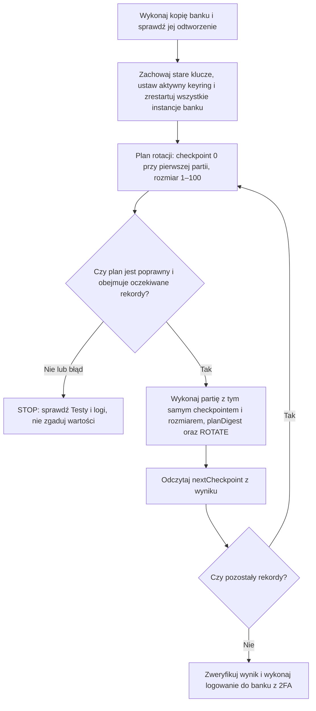
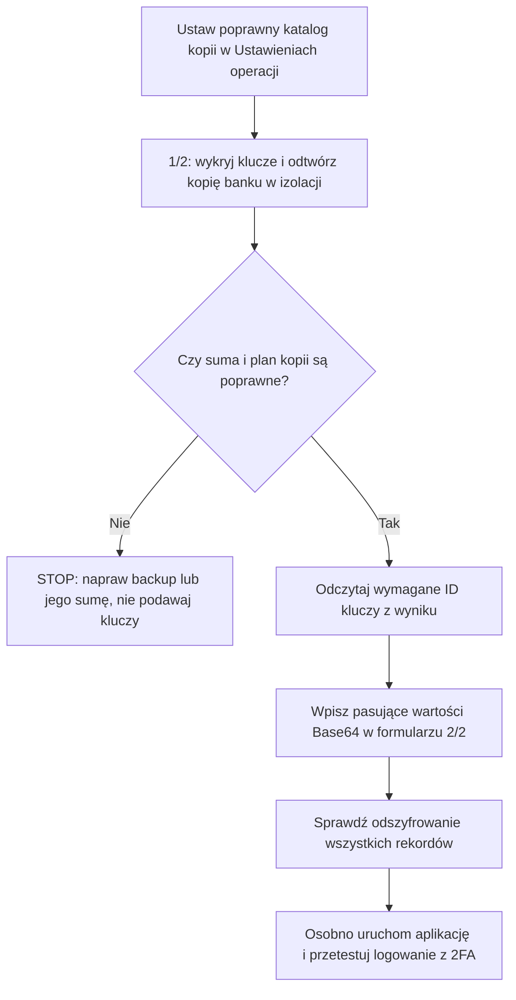
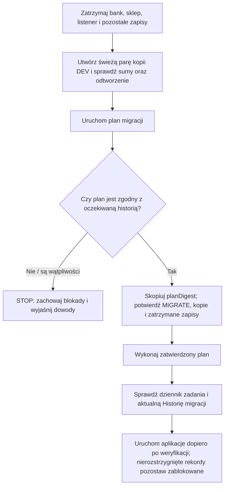
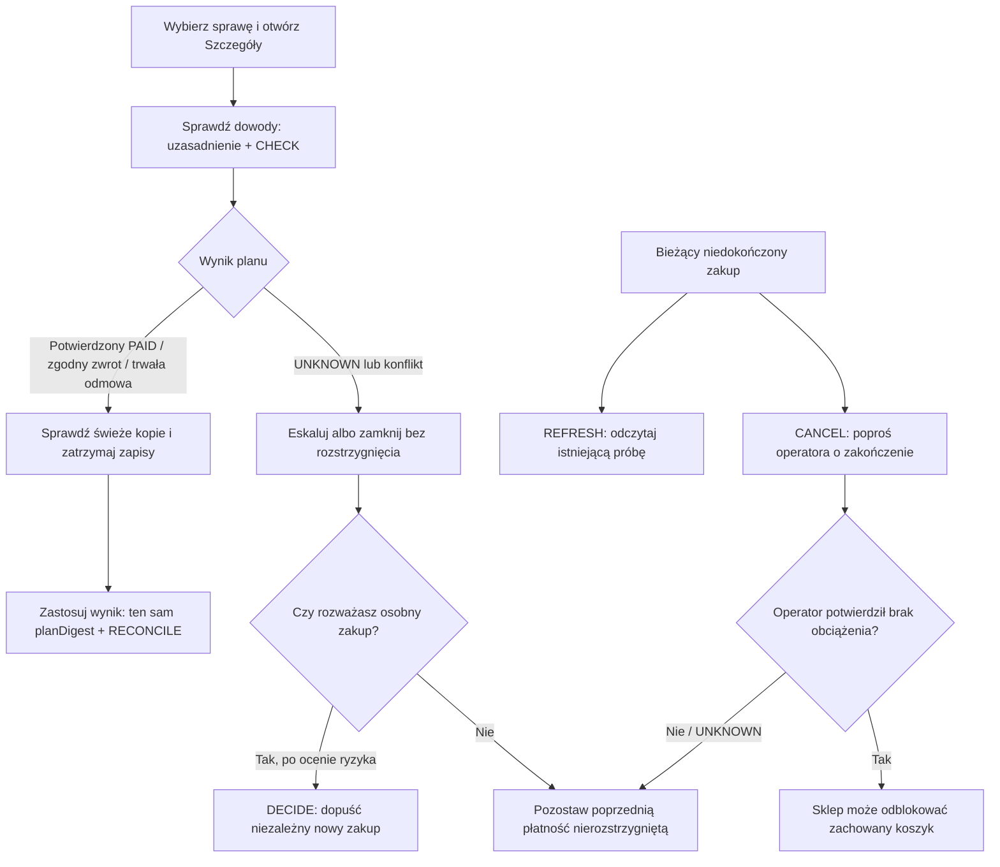
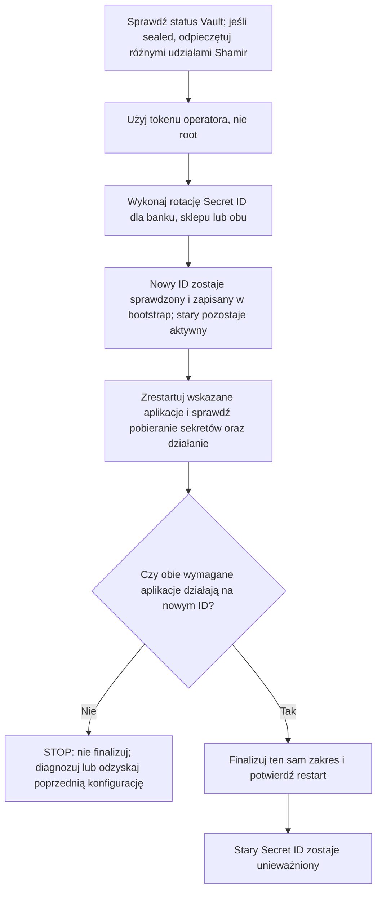

# NovaBank i NovaTech Shop

[English version](General_Instruction.md)

## Generalna instrukcja uruchomienia i obsługi

Ten dokument opisuje pełny lokalny przepływ pracy z projektem: WSL 2, Docker Engine, PostgreSQL, Redis, profile Spring/Maven, IntelliJ IDEA, HashiCorp Vault, TLS/HTTPS, monitoring, Stripe, testy, audyt i kopie zapasowe.

**Podział konfiguracji DEV (2026-10-14):** `project.env` jest właścicielem niewrażliwych hostów/portów/nazw/użytkowników infrastruktury, a `dev.env` — haseł baz, kluczy i ustawień aplikacji DEV. Compose wymaga obu `--env-file`. Nie kopiuj całego historycznego `.env.example` do project.env. Kreator i generator WSL `python3 -B scripts/control-center/web/dev_env_layout.py prepare` tworzą pliki we właściwym podziale. Różne wartości duplikatów zatrzymują zwykły zapis; patrz [procedurę uzgadniania konfiguracji](#manual-conflict). TEST/PROD nie dziedziczą tych sekretów DEV.

To środowisko edukacyjne uruchamiane lokalnie. Nie jest produkcyjnym bankiem ani operatorem prawdziwych płatności. Wariant Stripe używa testowego konta Stripe, a wariant bank-demo symuluje przelewy w bazach aplikacji.

> **Ważne: użyj własnej ścieżki projektu.** W instrukcji mogą występować przykłady
> `C:\Dysk D\stuff\Bank-demo` oraz `/mnt/c/Dysk D/stuff/Bank-demo`. Są to ścieżki
> środowiska autora i nie są wymagane przez aplikację. Przed uruchomieniem komendy
> zamień je na lokalizację, w której użytkownik ma repozytorium. Dotyczy to
> PowerShell, WSL/Linux/macOS, IntelliJ IDEA, plików EnvFile, Control Center,
> monitoringu, Vault oraz backupów. Szczegółową instrukcję konwersji ścieżek,
> także dla katalogów zawierających spacje, znajdziesz w sekcji **Zastąp
> przykładową ścieżkę własną** w części **Procedury rozszerzone i własna
> ścieżka projektu**.

### Jedna instrukcja główna

`General_Instruction.pl.md` i `General_Instruction.md` są dwiema równoważnymi wersjami językowymi pełnego podręcznika obsługi całej platformy: NovaBank, NovaTech Shop i Control Center. Zawiera procedury pierwszego uruchomienia, pracy z profilami `dev`, `test` i `prod`, konfiguracji IntelliJ, Docker/WSL, Vault, TLS, monitoringu, backupów, testów, płatności i NovaBank Control Center. Wszystkie komendy potrzebne do codziennej obsługi są opisane w kolejnych rozdziałach tego dokumentu.

Katalog `docs` zawiera wyłącznie te dwie instrukcje. Pomoc dla powiadomień i procedury operacyjne są częścią tego podręcznika. Opcjonalne wprowadzenie graficzne jest zasobem aplikacji w `scripts/control-center/guide`, uruchamianym przez `bash scripts/control-center/interactive-guide.sh`; nie zastępuje instrukcji. [English version](General_Instruction.md).

## Zacznij tutaj: przewodnik i NovaBank Control Center

Panel operatorski uruchamiaj **z terminala WSL/Bash**, z katalogu projektu:

```bash
bash ./scripts/start.sh
```

Panel otwiera się pod adresem `http://127.0.0.1:18110`. Wymaga Python 3.10+ w WSL; start aplikacji DEV z panelu wymaga także JDK 25 w WSL. Menu terminalowe: `bash ./scripts/start.sh --cli`. Nie używaj komend `.ps1` w Bash. Szczegóły: [Obsługa panelu](#control-center).

Zakładka **Pliki i sekrety** edytuje wyłącznie wskazane pliki DEV/TEST, z potwierdzeniem i podglądem na 45 s. Zapis nie zmienia haseł PostgreSQL/Grafany, nie migruje TOTP ani nie restartuje aplikacji. Od 2026-10-14 **Operacje → Vault** obejmuje lokalny status, odpieczętowanie pojedynczym udziałem Shamir, AppRole oraz rotację/finalizację Secret ID banku/sklepu; dodano też bootstrap, buildy PROD i lokalne keystore TLS bez PowerShella. Każde zadanie PROD ma ostrzeżenie, checkbox i wpisanie PROD, wymuszone także przez API. Vault: wyłącznie HTTPS 127.0.0.1:8200 z CA projektu i token operatora, nigdy root. Nie ma edytora biznesowych KV, init/rekey, zdalnej produkcji ani automatycznego startu/deploy PROD. Panel zawiera również przewodnik, podgląd IntelliJ, ograniczone porządkowanie wygenerowanych artefaktów i PL/EN dla nawigacji/nazw operacji. Hasło sudo nadal podaje się poza WWW. Szczegóły, wymagania polityki operatora oraz granice: [Obsługa panelu](#control-center-prod).

Jeżeli uruchamiasz projekt pierwszy raz, zacznij od interaktywnego przewodnika. Pokazuje on architekturę, ekrany aplikacji, kolejność uruchomienia, profile `dev`, `test` i `prod`, monitoring, Vault, backupy oraz podstawowe przepływy banku i sklepu.

W WSL, Linuxie albo macOS uruchom z katalogu projektu:

```bash
bash scripts/control-center/interactive-guide.sh
```

## Jak czytać instrukcję

Numerowana ścieżka `1-20` jest główną kolejnością operacyjną. Sekcje bez numerów
zawierają wprowadzenie techniczne, procedury rozszerzone i końcowe uzupełnienia;
nie są dodatkowymi etapami do wykonania po rozdziale `20`.

**Kolejność pracy:**

1. Przeczytaj rozdziały `1-4` i przygotuj WSL, Docker, dane, konta oraz role.
2. Wybierz środowisko: `5. Profil dev`, `6. Profil test` albo `9-12. Profil prod`.
3. Włącz `7. Monitoring dev` dopiero po uruchomieniu obu aplikacji.
4. Do codziennej pracy używaj `14. Backup PostgreSQL` i `16. Checklista po przerwie`.
5. Przy problemach przejdź do `17. Najczęstsze problemy`, a następnie do `19. NovaBank Control Center`.

## Spis treści

- `1-4`: architektura, sekrety, infrastruktura, konta i role
- `5-8`: profile dev/test, monitoring i płatności
- `9-12`: profil prod, Vault, TLS i rotacja kluczy
- `13-15`: retencja, backup, CI/CD, OpenAPI i Postman
- `16-20`: checklista, problemy, kolejność startu, Control Center i instalacja
- `Szybki przewodnik po projekcie`: komponenty, E2E, Vault, monitoring i backupy
- `Procedury rozszerzone i własna ścieżka projektu`: ścieżki, konfiguracje i procedury operacyjne
- `Uzupełnienia końcowe`: pierwszy start, katalog lokalny, retencja i operacyjna ściąga

## Szybki przewodnik po projekcie

Ten rozdział zbiera procedury w jedną ścieżkę operacyjną. Szczegóły znajdują się w kolejnych rozdziałach tej instrukcji; dodatkowe dokumenty w `docs` nie są wymagane.

### Co uruchamiasz i za co odpowiadają komponenty

Projekt składa się z dwóch niezależnych aplikacji Spring Boot:

1. Bank NovaBank działa domyślnie na porcie 8080.
2. NovaTech Shop działa domyślnie na porcie 8081.

Bank obsługuje użytkowników, rachunki, salda, przelewy, odbiorców, karty, waluty, 2FA, historię, administrację i API autoryzacji płatności.

Sklep obsługuje katalog produktów, szczegóły produktu, konto klienta, koszyk, zamówienia, płatności przez bank-demo lub Stripe oraz refundacje.

Infrastruktura pomocnicza:

- WSL 2 zapewnia środowisko Linux na Windowsie.
- Docker Engine i Docker Compose uruchamiają PostgreSQL, Redis oraz monitoring. Docker Desktop nie jest wymagany.
- PostgreSQL przechowuje dane banku w bankdb oraz dane sklepu w shopdb.
- Redis przechowuje sesje banku, limity, krótkotrwałe wyzwania, rate limiting i stan wybranych procesów.
- Shop-app używa również sesji JDBC, dlatego nie każda sesja sklepu znajduje się w Redisie.
- Flyway wykonuje wersjonowane migracje schematu przy starcie aplikacji.
- HashiCorp Vault przechowuje sekrety profilu PROD i wydaje poświadczenia AppRole.
- Prometheus pobiera metryki, Grafana pokazuje dashboardy, a Alertmanager grupuje alerty.
- Stripe CLI jest opcjonalnym tunelem webhooków dla płatności Stripe w profilu DEV.
- IntelliJ IDEA uruchamia bank i sklep jako procesy Java oraz pozwala wybrać profil i plik EnvFile.
- GitHub Actions wykonuje testy i budowanie na podstawie pliku .github/workflows/ci.yml.

Ważne rozróżnienie: Docker uruchamia usługi infrastrukturalne, ale lokalne aplikacje mogą działać jako procesy IntelliJ. Dlatego kontenery mogą być aktywne, a port 8080 lub 8081 nadal niedostępny, dopóki nie uruchomisz odpowiedniej konfiguracji Spring Boot.

### Pierwsze uruchomienie nowej kopii projektu

Po przygotowaniu WSL, Docker i JDK standardowy lokalny DEV można skonfigurować w przeglądarce: `bash ./scripts/start.sh` → **Konfiguracja DEV**. Formularz tworzy brakujące `project.env`/`dev.env`, pozwala uzupełnić dane baz, Redis, porty i rachunek sklepu oraz generuje brakujące sekrety bez rotacji istniejących prawidłowych wartości. W tej samej zakładce przyciski kolejnych kroków uruchamiają bazy/Redis, build banku, build sklepu i aplikacje DEV — każdy osobno po potwierdzeniu. Jeśli baza/wolumen już istnieje, zachowaj poprzednie poświadczenia; sekret w pliku nie resetuje hasła w PostgreSQL. Szczegóły i ograniczenia: [Konfigurator Control Center](#control-center).

Poniżej opisano dodatkowy wariant interaktywnego CLI, używany także do szerszej diagnostyki wymagań i zaawansowanych procedur:

Najpierw otwórz WSL w katalogu projektu. Ścieżka Windows jest zamieniana na ścieżkę WSL, na przykład:

~~~bash
cd "/mnt/c/Dysk D/stuff/Bank-demo"
pwd
~~~

Uruchom Centralę:

~~~bash
bash scripts/control-center/control-center.sh
~~~

Na Windowsie możesz użyć adaptera:

~~~powershell
.\scripts\control-center\start.ps1
~~~

Wybierz Pierwsze uruchomienie. Centrala:

1. sprawdzi system, Bash, Docker, Compose, Java, keytool, curl, jq, OpenSSL i GPG;
2. utworzy lokalny katalog .novabank;
3. przygotuje .novabank/env/project.env na podstawie przykładu;
4. wygeneruje brakujące lokalne hasła baz, ale nie zastąpi istniejących wartości;
5. przygotuje .novabank/env/dev.env;
6. pokaże pliki wymagane dla PROD i lokalizację sekretów;
7. utworzy konfigurację monitoringu DEV, gdy wybierzesz tę opcję;
8. pokaże brakujące komponenty i przejście do ich instalacji.

Nie przenoś plików .novabank do repozytorium i nie dodawaj ich do commitów. Są to dane lokalne, które mogą zawierać hasła, tokeny, certyfikaty, logi lub pliki bootstrap.

Jeżeli projekt jest w innej lokalizacji, uruchamiaj skrypty z katalogu projektu. Skrypty wyliczają PROJECT_ROOT na podstawie własnej lokalizacji. Nie wpisuj na stałe C:\Dysk D\stuff\Bank-demo do plików środowiskowych. W IntelliJ ustaw Working directory na katalog projektu, a EnvFile wskaż przez ścieżkę do bieżącego repozytorium.

### PostgreSQL, Redis, Mailpit i start infrastruktury

Przed uruchomieniem aplikacji sprawdź kontenery:

~~~bash
docker ps
~~~

Uruchom wymagane usługi z konfiguracją przygotowaną dla bieżącej kopii projektu:

~~~bash
docker compose --env-file .novabank/env/project.env --env-file .novabank/env/dev.env up -d postgres shop-postgres redis mailpit
~~~

Sprawdź stan:

~~~bash
docker compose --env-file .novabank/env/project.env --env-file .novabank/env/dev.env ps
~~~

Oczekiwany stan to healthy dla bank-postgres, shop-postgres i bank-mailpit oraz running dla bank-redis. Jeżeli kontenera nie ma, sprawdź pliki docker-compose.yaml, .env.example i .novabank/env/project.env. Nie wykonuj FLUSHALL na Redisie i nie usuwaj baz tylko dlatego, że aplikacja nie widzi biblioteki Maven.

Porty lokalne:

- bank-postgres: 127.0.0.1:5300 -> PostgreSQL 5432;
- shop-postgres: 127.0.0.1:5400 -> PostgreSQL 5432;
- bank-redis: 127.0.0.1:6379 -> Redis 6379;
- bank-mailpit (SMTP): 127.0.0.1:11026 -> Mailpit SMTP 1025;
- bank-mailpit (skrzynka WWW): http://localhost:18026 -> Mailpit HTTP 8025.

Kontrola dostępności SMTP i skrzynki Mailpit:

~~~bash
docker exec bank-mailpit /mailpit readyz
curl -fsS http://127.0.0.1:18026/livez
~~~

W PowerShell dostępność portów SMTP i WWW sprawdzisz poleceniem:

~~~powershell
Get-NetTCPConnection -LocalPort 11026,18026 -State Listen
~~~

#### Poczta i aktywacja konta bankowego przez Mailpit (DEV)

W profilu `dev` NovaBank wysyła wiadomości e-mail przez SMTP (`EMAIL_MODE=smtp`, `MAIL_HOST=localhost`, `MAIL_PORT=11026`, bez loginu, hasła i TLS) do dedykowanego kontenera `bank-mailpit` z własnym wolumenem `bank_mailpit_data`. Treść wiadomości ani tokeny weryfikacyjne nie są wypisywane w logach IDE/konsoli (brak awaryjnego powrotu do logowania treści w logach).

- **Lokalna skrzynka testowa:** każda wiadomość wysłana przez bank w `dev` (nawet zaadresowana np. na zewnętrzną domenę Gmail) trafia wyłącznie do lokalnego panelu Mailpit pod adresem <http://localhost:18026>, a nie do zewnętrznej skrzynki.
- **Aktywacja konta:** po rejestracji logowanie na nowe konto bankowe jest zablokowane do czasu potwierdzenia adresu e-mail. Otwórz <http://localhost:18026>, otwórz wiadomość „Potwierdź adres e-mail NovaBank” i kliknij przycisk **„Aktywuj konto bankowe”**. Link jest jednorazowy i ważny przez 24 godziny.
- **Błąd wysyłki i ponowne wysłanie linku:** jeżeli podczas rejestracji kontener `bank-mailpit` był zatrzymany, konto zostanie utworzone jako nieaktywne, a ekran `/verify-email/sent` wyświetli komunikat o błędzie wysyłki SMTP. Po uruchomieniu `bank-mailpit` kliknij przycisk **„Wyślij ponownie”** na stronie `/verify-email/sent`, aby wygenerować nowy jednorazowy link (poprzednie tokeny dla tego konta są unieważniane) i dostarczyć wiadomość do Mailpit.
- **Restart po zmianie ustawień:** zmiana ustawień poczty lub portów banku w `.novabank/env/dev.env` lub `project.env` wymaga restartu aplikacji banku (`Bank DEV` / `NovaBank DEV`).

Przy diagnostyce bazy używaj użytkownika z project.env oraz hasła z dev.env. Nie zakładaj, że rola postgres istnieje w kontenerze. W tym projekcie często używana jest dedykowana wartość POSTGRES_USER. Przykład zapytania:

~~~bash
docker exec -e PGPASSWORD="$POSTGRES_PASSWORD" bank-postgres \
  psql -U "$POSTGRES_USER" -d bankdb -c \
  "select version, checksum, success from flyway_schema_history order by installed_rank;"
~~~

Nazwy zmiennych muszą odpowiadać aktualnemu project.env. Jeżeli nie są załadowane do bieżącej powłoki, odczytaj je z pliku tylko lokalnie albo wykonaj polecenie przez skrypt Centrali.

### Konta, rachunki i dane testowe

Do podstawowego testu potrzebujesz co najmniej:

1. zwykłego konta użytkownika banku z aktywnym rachunkiem PLN;
2. konta administratora banku z rolą administratora;
3. konta klienta sklepu, rejestrowanego niezależnie od konta bankowego;
4. aktywnego rachunku bankowego sklepu jako rachunku kupca;
5. opcjonalnie konta technicznego do metryk;
6. opcjonalnie konta Stripe sandbox, jeżeli testujesz operatora Stripe.

Rejestracja sklepu używa e-maila i hasła. Numer rachunku bankowego nie jest częścią rejestracji sklepu. Przy zakupie przez NovaBank klient loguje się do banku i wskazuje lub posiada aktywny rachunek. Rachunek kupca musi istnieć w banku, mieć status ACTIVE i mieć numer ustawiony w konfiguracji sklepu.

Administrator banku wchodzi do panelu przez zwykłe logowanie bankowe, a uprawnienie wynika z roli zapisanej w bazie. Nie wystarczy znać adresu /admin. Po zmianie roli wyloguj się i zaloguj ponownie.

Do szybkiego testu sklepu:

1. otwórz katalog;
2. zarejestruj konto klienta sklepu;
3. zaloguj się;
4. dodaj produkt do koszyka;
5. przejdź do kasy;
6. wybierz NovaBank albo płatność kartą bank-demo;
7. sprawdź status zamówienia, saldo rachunku klienta i saldo rachunku sklepu.

Nie używaj prawdziwych haseł, numerów kart ani danych produkcyjnych. Numer karty w profilu banku służy do demonstracji karty, a formularz operatora bank-demo nie powinien zapisywać pełnego numeru, CVV ani daty ważności po zakończeniu autoryzacji.

### Profile DEV, TEST i PROD

#### DEV

DEV jest profilem codziennej pracy lokalnej. Sekrety znajdują się w .novabank/env/dev.env, a aplikacje uruchamiasz z IntelliJ.

W konfiguracji Bank DEV ustaw:

- Active profiles: dev;
- Working directory: katalog repozytorium;
- Enable EnvFile: włączone;
- EnvFile: .novabank/env/dev.env;
- port aplikacji: 8080;
- port serwera Actuator: 8082.

W konfiguracji Shop DEV ustaw te same elementy, ale:

- port aplikacji: 8081;
- port serwera Actuator: 8083.

Możesz uruchomić oba procesy przez konfigurację złożoną NovaBank DEV. Nie uruchamiaj równolegle drugiego banku lub drugiego sklepu na tych samych portach.

Po zmianie BANK_API_KEY, BANK_API_URL, ustawień poczty SMTP (EMAIL_MODE, MAIL_HOST, MAIL_PORT, MAILPIT_UI_URL), haseł baz, kluczy TOTP, danych Stripe lub danych monitoringu zatrzymaj i uruchom oba procesy ponownie. Sam refresh przeglądarki nie przeładowuje zmiennych środowiskowych procesu Java.

#### TEST

TEST jest przeznaczony do testów automatycznych. Zależności testowe obejmują PostgreSQL i Redis uruchamiane przez Testcontainers. Nie używaj w nim produkcyjnych baz, kluczy, AppRole ani certyfikatów.

Testy integracyjne mogą pobierać obrazy kontenerów, dlatego Docker Engine musi działać. Jeżeli środowisko CI nie ma dostępu do obrazów, test zakończy się błędem infrastruktury, a nie błędem logiki aplikacji.

#### PROD

PROD wymaga:

1. działającego Vault z aktywnym certyfikatem TLS;
2. odpieczętowania Vault trzema z pięciu kluczy Shamir;
3. polityk i AppRole bank-prod oraz shop-prod;
4. aktualnych Role ID i Secret ID;
5. truststore zawierającego certyfikat aktywnego listenera Vault;
6. keystore bank-server.p12 i shop-server.p12;
7. wartości sekretów przechowywanych w Vault;
8. osobnych konfiguracji IntelliJ Bank PROD i Shop PROD;
9. ustawionego HTTPS i bezpiecznych cookies.

W PROD nie używaj .novabank/env/dev.env. W plikach bootstrap prod.bank.env i prod.shop.env trzymaj tylko wartości potrzebne do połączenia z Vault, zgodnie z mapą sekretów. Hasła baz, BANK_API_KEYS, TOTP_ENCRYPTION_KEY, klucze operatora płatności i hasła keystore powinny być odczytywane z Vault albo przekazywane przez bezpieczny mechanizm uruchomieniowy.

### CI/CD, Maven i Testcontainers

Bank i shop-app są dwoma niezależnymi projektami Maven. Bank używa wrappera w katalogu głównym, a sklep własnego pom.xml i wrappera lub wrappera projektu głównego zgodnie z aktualną strukturą repozytorium.

Lokalne testy jednostkowe banku:

~~~powershell
.\mvnw.cmd -Punit-tests test
~~~

Lokalne testy jednostkowe sklepu:

~~~powershell
.\mvnw.cmd -f shop-app\pom.xml -Punit-tests test
~~~

Testy integracyjne banku:

~~~powershell
.\mvnw.cmd -Pintegration-tests verify
~~~

Testy integracyjne sklepu:

~~~powershell
.\mvnw.cmd -f shop-app\pom.xml -Pintegration-tests verify
~~~

W WSL odpowiedniki mają postać:

~~~bash
./mvnw -Punit-tests test
./mvnw -f shop-app/pom.xml -Punit-tests test
./mvnw -Pintegration-tests verify
./mvnw -f shop-app/pom.xml -Pintegration-tests verify
~~~

Jeżeli Maven zgłasza brak JAVA_HOME, sprawdź:

~~~bash
java -version
echo "$JAVA_HOME"
which java
~~~

W PowerShell sprawdź:

~~~powershell
java -version
$env:JAVA_HOME
Test-Path "$env:JAVA_HOME\bin\java.exe"
~~~

Mavenowe profile nie są tym samym co profile Spring. Profil Maven wybiera sposób budowania i testowania, a Spring profile wybiera konfigurację aplikacji. Przykład: Spring dev może być uruchomiony z IntelliJ, a unit-tests może działać jako profil Maven.

GitHub Actions z .github/workflows/ci.yml:

1. uruchamia testy jednostkowe banku i sklepu;
2. uruchamia testy integracyjne z PostgreSQL i Redis przez Testcontainers;
3. uruchamia test HTTP obu serwisów;
4. buduje i zapisuje artefakty JAR.

Workflow uruchamia się dla push, pull request i ręcznie przez workflow_dispatch. CI/CD nie wdraża automatycznie profilu PROD, nie używa sekretów produkcyjnych i nie zastępuje procesu Vault.

### Co dokładnie sprawdza test E2E

Skrypt scripts/e2e-smoke.sh wykonuje test przepływu bank-sklep na działających lokalnie aplikacjach. To nie jest tylko test dostępności portu.

Skrypt:

1. czeka na healthcheck banku i shop-app;
2. otwiera stronę logowania banku;
3. pobiera produkt z publicznego katalogu sklepu;
4. pobiera token CSRF i rejestruje testowego użytkownika sklepu;
5. loguje użytkownika przez HTTP;
6. dodaje produkt do koszyka i tworzy zamówienie;
7. wywołuje płatność sklepu;
8. ponawia tę samą płatność z identycznym Idempotency-Key;
9. sprawdza, że ponowienie nie tworzy drugiej bankowej autoryzacji;
10. sprawdza, że sklep utworzył autoryzację w rzeczywiście uruchomionym banku;
11. odczytuje stan autoryzacji jako PENDING;
12. zatrzymuje się przed faktycznym potwierdzeniem przelewu, dlatego test nie powinien przenosić środków demonstracyjnych.

Uruchomienie lokalne:

~~~bash
bash scripts/e2e-smoke.sh
~~~

Uruchomienie z jawnymi wartościami testowymi:

~~~bash
BANK_URL=http://127.0.0.1:8080 SHOP_URL=http://127.0.0.1:8081 \
BANK_HEALTH_URL=http://127.0.0.1:8082/actuator/health \
SHOP_HEALTH_URL=http://127.0.0.1:8083/actuator/health \
BANK_API_KEY=ci-bank-key BANK_API_KEY_ID=legacy bash scripts/e2e-smoke.sh
~~~

Wymagania E2E:

- bank działa na 8080;
- shop-app działa na 8081;
- endpointy health są dostępne;
- curl i jq są zainstalowane;
- bank API przyjmuje klucz testowy;
- sklepowi można utworzyć testowe konto i sesję.

Interpretacja wyniku:

- zielony health oznacza, że serwer odpowiada;
- pomyślna rejestracja i logowanie oznaczają poprawny CSRF oraz sesję sklepu;
- ta sama autoryzacja po drugim żądaniu oznacza poprawną idempotencję;
- PENDING oznacza, że utworzono autoryzację, ale nie pobrano środków;
- błąd 401 wskazuje na klucz, profil lub ochronę endpointu;
- błąd 429 wskazuje na rate limiting;
- timeout oznacza niedostępny proces, zły adres lub problem WSL/Windows;
- błąd w komunikacji bank-sklep należy sprawdzać w logach obu aplikacji.

### Test HTTP i ręczne API

Health banku i sklepu:

~~~powershell
Invoke-WebRequest -UseBasicParsing http://localhost:8082/actuator/health
Invoke-WebRequest -UseBasicParsing http://localhost:8083/actuator/health
~~~

Metryki są na oddzielnych portach:

~~~text
http://localhost:8082/actuator/prometheus
http://localhost:8083/actuator/prometheus
~~~

W DEV mogą wymagać Basic Auth. Przykład sprawdzenia w PowerShell:

~~~powershell
$pair = "metrics-reader:<METRICS_PASSWORD>"
$basic = [Convert]::ToBase64String([Text.Encoding]::ASCII.GetBytes($pair))
Invoke-WebRequest -UseBasicParsing -Headers @{ Authorization = "Basic $basic" } http://localhost:8082/actuator/prometheus
~~~

Kod 200 i tekst z seriami Prometheus oznaczają poprawne połączenie. Kod 401 oznacza brak lub błędny Basic Auth. Kod 404 zwykle oznacza zły port, wyłączony management endpoint albo uruchomienie innego profilu.

W starszym PowerShell metoda RandomNumberGenerator.Fill może nie istnieć. Użyj kompatybilnej generacji:

~~~powershell
$bytes = New-Object byte[] 32
$rng = [System.Security.Cryptography.RandomNumberGenerator]::Create()
$rng.GetBytes($bytes)
$metricsPassword = [Convert]::ToBase64String($bytes).TrimEnd('=').Replace('+','-').Replace('/','_')
$rng.Dispose()
~~~

### Monitoring: Prometheus, Grafana i Alertmanager

Monitoring jest osobnym zestawem kontenerów. Bank i sklep muszą najpierw działać
w IntelliJ IDEA, ponieważ Prometheus odczytuje ich endpointy Actuatora.

W profilu DEV przygotuj oba procesy z:

~~~text
MANAGEMENT_SERVER_ADDRESS=0.0.0.0
METRICS_USERNAME=metrics-reader
METRICS_PASSWORD=<to samo dlugie haslo>
BANK_MANAGEMENT_PORT=8082
SHOP_MANAGEMENT_PORT=8083
~~~

W IntelliJ IDEA włącz EnvFile .novabank/env/dev.env dla konfiguracji banku
i sklepu. Po zmianie wartości zatrzymaj i uruchom ponownie oba procesy.

Następnie w WSL uruchom centralny skrypt monitoringu:

~~~bash
cd "/mnt/c/Dysk D/stuff/Bank-demo"
bash scripts/monitoring/monitoring.sh setup
bash scripts/monitoring/monitoring.sh start --profile dev
bash scripts/monitoring/monitoring.sh status --profile dev
~~~

Skrypt przygotowuje .novabank/monitoring/.env.monitoring oraz konfigurację
Prometheusa, uruchamia trzy kontenery i sprawdza gotowość usług. Można też
uruchomić Compose bezpośrednio:

~~~bash
docker compose --env-file .novabank/monitoring/.env.monitoring -f docker-compose.monitoring.yaml up -d
~~~

Sprawdź:

~~~text
Prometheus:   http://localhost:9090
Grafana:       http://localhost:3000
Alertmanager:  http://localhost:9093
Bank metrics:  http://localhost:8082/actuator/prometheus
Shop metrics:  http://localhost:8083/actuator/prometheus
~~~

W Prometheus wybierz Status -> Target health. Oczekiwany wynik to:

~~~text
bank-demo: UP
shop-app:  UP
~~~

401 oznacza niezgodne dane Basic Auth, connection refused oznacza, że
aplikacja nie słucha na porcie management, a context deadline exceeded
oznacza problem z siecią między WSL i procesem uruchomionym w Windows.
Nie zmieniaj na ślepo host.docker.internal: przy bieżącym trybie sieci
Prometheus korzysta z localhost, a przy innym trybie WSL trzeba sprawdzić
adres zgodnie z rozdziałem 7 tej instrukcji dotyczącym monitoringu.

W Grafanie otwórz dashboard NovaBank - przegląd usług. Puste panele mogą
oznaczać brak ruchu w wybranym zakresie czasu, a nie awarię. W Alertmanagerze
sprawdzaj aktywne alerty:

- BankOrShopDown - aplikacja lub endpoint metrics jest niedostępny;
- HighHttp5xxRate - wzrost odpowiedzi HTTP 5xx;
- HighJvmMemoryUsage - wysoki poziom pamięci JVM;
- PrometheusTargetErrors - Prometheus nie może pobrać metryk;
- RetentionJobFailed - błąd zadania retencji;
- CertificateExpiryWarning - zbliża się termin wygaśnięcia certyfikatu.

Logi i zatrzymanie:

~~~bash
bash scripts/monitoring/monitoring.sh logs
bash scripts/monitoring/monitoring.sh logs prometheus
bash scripts/monitoring/monitoring.sh stop
~~~

Monitoring nie uruchamia się sam po restarcie komputera, chyba że użytkownik
skonfiguruje autostart Compose. W DEV można go uruchamiać tylko na czas pracy.
W PROD endpointy Actuatora muszą być ograniczone do sieci monitoringu i konta
technicznego. Hasło Grafany, hasło metrics i pliki wygenerowane przez skrypt
pozostają poza repozytorium.

Na Windows z WSL skrypt otworzy przewodnik w domyślnej przeglądarce Windows. Jeżeli przeglądarka nie uruchomi się automatycznie, skrypt poda dokładną ścieżkę do pliku `scripts/control-center/guide/index.html`.

Następnie uruchom NovaBank Control Center:

```bash
bash scripts/control-center/control-center.sh
```

Na Windows można użyć także PowerShell:

```powershell
.\scripts\control-center\start.ps1
```

W Centrali wybierz `Pierwsze uruchomienie`. Ta sekcja sprawdza wymagania i prowadzi przez przygotowanie lokalnych plików konfiguracyjnych, kontenerów oraz profilu. `Instalacja i wymagania` służy do sprawdzania lub instalowania komponentów, a pozostałe sekcje uruchamiają konkretne operacje, takie jak monitoring, backup, Vault, testy i diagnostyka.

Ważny podział odpowiedzialności:

- Control Center może wykryć środowisko, utworzyć lokalne katalogi i pliki szablonowe, wygenerować sekrety DEV oraz uruchomić kontrolowane operacje po potwierdzeniu użytkownika.
- Użytkownik musi samodzielnie zabezpieczyć hasła, pięć kluczy unseal i root token Vault oraz uzupełnić sekrety PROD zgodnie z instrukcją. Nie zapisuj ich w repozytorium ani w zrzutach ekranu.
- Aplikacje banku i sklepu uruchamia się z IntelliJ IDEA przez gotowe konfiguracje `NovaBank DEV`, `NovaBank PROD`, `Bank DEV`, `Bank PROD`, `Shop DEV` i `Shop PROD`.

Jeżeli korzystasz wyłącznie z profilu `dev`, nie musisz konfigurować Vault ani Stripe CLI. Wystarczą Docker Engine z Compose, PostgreSQL i Redis uruchomione przez Compose, plik `.novabank/env/project.env`, plik `.novabank/env/dev.env` oraz konfiguracja IntelliJ z aktywnym profilem `dev`.

### Vault, TLS i AppRole: pełny przebieg

Vault jest magazynem sekretów używanych przez profil `prod`. Przechowuje między innymi
hasła baz, klucze API, dane operatora płatności, klucze TOTP oraz hasła do keystore.
Nie jest bazą aplikacji i nie zastępuje PostgreSQL. Po restarcie komputera usługa Vault
może działać, ale magazyn pozostaje zapieczętowany, dopóki nie zostanie odpieczętowany
trzema różnymi udziałami klucza.

Sprawdź usługę i przygotuj bieżącą sesję WSL:

~~~bash
sudo systemctl status vault --no-pager
export VAULT_ADDR="https://127.0.0.1:8200"
unset VAULT_CAPATH
unset VAULT_SKIP_VERIFY
export VAULT_CACERT="/mnt/c/Dysk D/stuff/Bank-demo/.novabank/tls/vault/vault.crt"
vault status
~~~

`VAULT_ADDR` wskazuje adres serwera Vault, a `VAULT_CACERT` plik certyfikatu,
którym klient ma zweryfikować listener HTTPS. Eksport działa tylko w bieżącym
oknie WSL. Control Center ustawia te wartości dla własnych operacji, ale przy
bezpośrednim użyciu polecenia `vault` należy je ustawić ponownie w nowej sesji.

Jeżeli pojawi się `certificate signed by unknown authority`, porównaj odciski:

~~~bash
echo | openssl s_client -connect 127.0.0.1:8200 -servername localhost 2>/dev/null | openssl x509 -noout -fingerprint -sha256 -subject
sudo openssl x509 -in /opt/vault/tls/tls.crt -noout -fingerprint -sha256 -subject
sudo openssl x509 -in /opt/vault/tls/vault.crt -noout -fingerprint -sha256 -subject
~~~

Certyfikat, którego odcisk odpowiada odciskowi listenera, skopiuj do repozytorium
lokalnego poza kontrolą sekretów. Typowy wariant dla instalacji opisanej w projekcie:

~~~bash
sudo chmod 0755 /opt/vault/tls
sudo chmod 0644 /opt/vault/tls/tls.crt
sudo cp /opt/vault/tls/tls.crt "/mnt/c/Dysk D/stuff/Bank-demo/.novabank/tls/vault/vault.crt"
sudo chown "$(id -u):$(id -g)" "/mnt/c/Dysk D/stuff/Bank-demo/.novabank/tls/vault/vault.crt"
export VAULT_CACERT="/mnt/c/Dysk D/stuff/Bank-demo/.novabank/tls/vault/vault.crt"
vault status
~~~

Nie ustawiaj `VAULT_SKIP_VERIFY`. Jeżeli WSL nie może odczytać `/opt/vault/tls`,
problem dotyczy uprawnień do katalogu lub pliku, a nie hasła Vault. Zmianę uprawnień
wykonuj świadomie i tylko dla lokalnego środowiska edukacyjnego.

Możliwe wyniki `vault status`:

- `Initialized false` oznacza, że Vault nie został jeszcze zainicjalizowany;
- `Sealed true` oznacza, że trzeba wykonać odpieczętowanie;
- `Sealed false` oznacza, że można używać sekretów i AppRole;
- błąd TLS oznacza problem z `VAULT_CACERT`, odciskiem lub prawami do certyfikatu;
- błąd `503 Vault is sealed` oznacza, że najpierw trzeba odpieczętować magazyn.

Klucze startowe są przechowywane zaszyfrowane w pliku `vault-init.json.gpg`.
Hasło GPG jest hasłem ustalonym podczas szyfrowania tego pliku; nie musi być takie
jak hasło użytkownika Vault. Odczyt kluczy i tokena wykonuj tylko lokalnie:

~~~bash
export RECOVERY_DIR="/mnt/e/Vault-Recovery"
gpg --quiet --pinentry-mode loopback \
  --decrypt "$RECOVERY_DIR/vault-init.json.gpg" |
  jq -e '(.unseal_keys_b64 | length) == 5 and (.root_token | length) > 0'
~~~

GPG poprosi o hasło do pliku. To samo hasło należy podać przy każdym odczycie
zaszyfrowanego pliku, ale nie należy wpisywać go do `.env` ani do repozytorium.
Następnie odpieczętuj Vault trzema różnymi udziałami, jeden po drugim:

~~~bash
vault operator unseal
vault operator unseal
vault operator unseal
~~~

Każde polecenie prosi o inny `unseal key`. Nie używaj do tego `root token`.
Root token służy do pierwszej administracji, na przykład `vault login`, konfiguracji
polityk i AppRole. Po zakończeniu administracji wyloguj token i nie przekazuj go
aplikacjom.

AppRole rozdziela dostęp banku i sklepu. Bank korzysta z roli `bank-prod`, a sklep
z `shop-prod`. Aplikacja otrzymuje `VAULT_ROLE_ID` i krótkotrwały
`VAULT_SECRET_ID`, a następnie pobiera z Vault tylko sekrety dozwolone polityką.
Secret ID nie jest root tokenem. W bieżącej konfiguracji ma ograniczony czas życia
i liczbę użyć, więc rotuj go przed wygaśnięciem:

~~~bash
bash scripts/vault/approle-secret-id.sh bank-prod
bash scripts/vault/approle-secret-id.sh shop-prod
~~~

Można też wybrać odpowiednią rotację w NovaBank Control Center. Po rotacji wpisz
nowe wartości do lokalnych plików środowiskowych PROD, wykonaj test połączenia,
a dopiero potem zakończ ważność starego Secret ID. Nigdy nie wyświetlaj Secret ID
w logu ani na screenie.

`VAULT_SSL_TRUST_STORE_PASSWORD` powstaje podczas tworzenia truststore. Uruchomienie
komendy `keytool -importcert ...` poprosi o hasło: jest to moment ustalenia hasła
dla pliku truststore, a nie odczyt wcześniej istniejącego hasła. To samo hasło
trzeba potem przekazać aplikacji w odpowiednim pliku `.novabank/env/prod.bank.env`
i `.novabank/env/prod.shop.env`. Skrypt `scripts/generate-prod-tls-keystores.ps1`
również poprosi o osobne hasła dla keystore banku i sklepu. Zachowaj te wartości
poza repozytorium. Certyfikat zaufania i keystore muszą odpowiadać aktywnemu
listenerowi oraz profilowi, który uruchamiasz.

### Płatności i różnica między `bank-demo` a Stripe

Sklep ma dwa tryby płatności wybierane przez `SHOP_PAYMENT_PROVIDER`:

- `bank-demo` kieruje użytkownika do banku, weryfikuje sesję, rachunek, status,
  saldo, walutę i limity, a następnie wykonuje demonstracyjny transfer z rachunku
  klienta na rachunek sklepu. Ten tryb sprawdza pełną komunikację shop-app z bankiem;
- `stripe` tworzy testową płatność w zewnętrznym środowisku Stripe. Stripe CLI
  przekazuje webhooki do shop-app i aktualizuje status zamówienia, ale nie pobiera
  środków z rachunku NovaBank ani nie zasila rachunku sklepu w bankowej bazie.

Tryb `bank-demo` nie wymaga Stripe CLI. Dla Stripe przygotuj w `.novabank/env/dev.env`
testowy klucz API, sekret webhooka oraz konfigurację sprzedawcy i połączenia z bankiem.
Pełna lista zmiennych, procedura przez Control Center i karty testowe są w
[sekcjach 8.5–8.8](#stripe-test-dev). Następnie uruchom osobne nasłuchiwanie:

~~~bash
stripe listen --forward-to http://localhost:8081/api/payments/stripe/webhook
~~~

Wynik `Ready!` i `whsec_...` oznacza, że CLI działa. Wartość `whsec_...` wpisz
do konfiguracji shop-app i uruchom sklep ponownie. Logi `payment_intent.succeeded`,
`charge.succeeded` i `checkout.session.completed` pokazują zdarzenia Stripe.
Każde zdarzenie powinno kończyć się odpowiedzią HTTP `200`; `400` wymaga sprawdzenia
sekretu webhooka, identyfikatora sesji lub obsługi danego typu zdarzenia, a
`connection refused` oznacza, że shop-app nie działa na porcie 8081.

W obu trybach zamówienie jest chronione idempotencją. Ponowienie tego samego żądania
z identycznym `Idempotency-Key` nie powinno pobrać środków ani utworzyć drugiej
autoryzacji. Statusy `PENDING`, `PAID` i `FAILED` są potwierdzane przez webhook,
bank albo zadanie uzgadniania. Przy refundacji używany jest osobny klucz idempotencji.

### OpenAPI, Swagger UI i Postman

Dokumentacja OpenAPI pomaga poznać kontrakt HTTP, a Postman służy do ręcznego
wykonywania i powtarzania zapytań. Swagger nie wersjonuje kodu ani bazy danych;
wersjonowanie API odbywa się przez kontrakt, ścieżki, tagi i historię zmian.

Adresy lokalne:

~~~text
Bank Swagger UI:  http://localhost:8080/swagger-ui/index.html
Bank OpenAPI:     http://localhost:8080/v3/api-docs
Sklep Swagger UI: http://localhost:8081/swagger-ui/index.html
Sklep OpenAPI:    http://localhost:8081/v3/api-docs
~~~

W `dev` i `test` dokumentacja jest dostępna bez roli administratora. W `prod`
wymaga `ROLE_ADMIN`, ponieważ opisuje endpointy aplikacji.

Przykładowe sprawdzenie logowania banku w Postmanie:

1. Utwórz żądanie `POST http://localhost:8080/login`.
2. W `Body` wybierz `x-www-form-urlencoded`.
3. Dodaj pola `username`, `password` i `_csrf`.
4. Token `_csrf` pobierz wcześniej z HTML strony logowania albo z ciasteczka/
   odpowiedzi zgodnie z aktualną konfiguracją formularza.
5. Włącz przechowywanie cookies dla hosta `localhost` i sprawdź przekierowanie
   do dashboardu. Błąd CSRF oznacza nieaktualny token lub brak cookies sesji.

Dla API sklepu zawsze używaj zalogowanej sesji, nagłówka CSRF dla metod zmieniających
stan oraz `Idempotency-Key` przy tworzeniu płatności. Nie wpisuj numerów kart,
CVV ani dat ważności do logów. W trybie `bank-demo` używaj wyłącznie danych
demonstracyjnych opisanych w aplikacji.

### Backup PostgreSQL, Disaster Recovery i retencja

PostgreSQL jest źródłem danych finansowych i biznesowych. Redis przechowuje sesje,
stan tymczasowy i cache, dlatego backup PostgreSQL nie jest backupem Redis.
Przed kopią uruchom kontenery `postgres`, `shop-postgres` i `redis`, a następnie:

~~~bash
cd "/mnt/c/Dysk D/stuff/Bank-demo"
bash scripts/backup/backup.sh create
~~~

Skrypt poprosi o katalog zapisu. Każde uruchomienie tworzy nowy podkatalog z datą
i czasem UTC, więc nie nadpisuje poprzedniej kopii. Wykonuje kolejno kontrolę
środowiska, dump banku i sklepu, sumy SHA-256, testowe odtworzenie do tymczasowych
baz oraz raport `backup-report.log`. Sukces wymaga statusów `OK` dla backupu, sum
i testu odtworzenia. Raport zawsze pokazuje pełną ścieżkę zapisu.

Przydatne warianty:

~~~bash
bash scripts/backup/backup.sh create --backup-dir /mnt/e/Bank-demo-backups/postgres
bash scripts/backup/backup.sh create --skip-restore-test
bash scripts/backup/backup.sh prune
bash scripts/backup/backup.sh dr-test --backup-dir /mnt/e/Bank-demo-backups/postgres
~~~

`dr-test` wybiera najnowszą kopię, odtwarza ją w odseparowanym środowisku,
sprawdza migracje i testy HTTP, a wynik zapisuje w raporcie. Uruchamiaj go
cyklicznie, najlepiej raz w tygodniu, i kontroluj, czy raport nie kończy się
statusem `BLAD`. Retencja usuwa tylko dane techniczne i audytowe zgodnie z
konfiguracją; nie usuwa kart, sald, przelewów, zamówień ani refundacji.

W profilu `dev` najpierw używaj `RETENTION_DRY_RUN=true`. Dopiero po sprawdzeniu
raportu można świadomie włączyć usuwanie (`RETENTION_DRY_RUN=false`). Panel
administracyjny znajduje się pod adresem:

~~~text
http://localhost:8080/admin/data-retention
~~~

Panel zapisuje wynik w audycie. Kontroluj także metryki `bank_retention_deleted_total`
i `bank_retention_errors_total` oraz alert `RetentionJobFailed`.

### Profile i codzienny wybór środowiska

`dev` służy do ręcznej pracy w IntelliJ. Uruchamiaj PostgreSQL i Redis przez WSL,
ładuj `.novabank/env/dev.env`, ustaw aktywny profil `dev` dla banku i sklepu,
a następnie uruchom konfigurację `NovaBank DEV` lub oba procesy osobno.
Monitoring i Stripe są opcjonalne.

`test` służy do automatycznych testów. Profile Maven `unit-tests` i
`integration-tests` uruchamiaj przez wrappera Maven; testy integracyjne używają
Testcontainers i nie powinny korzystać z danych konta `dev`:

~~~bash
./mvnw -Punit-tests test
./mvnw -Pintegration-tests verify
./mvnw -f shop-app/pom.xml -Punit-tests test
./mvnw -f shop-app/pom.xml -Pintegration-tests verify
~~~

`prod` służy do uruchomienia z TLS i Vault. Przed startem muszą działać Vault,
PostgreSQL i Redis, Vault musi być odpieczętowany, a role AppRole i sekrety muszą
być dostępne. Używaj konfiguracji `NovaBank PROD`/`Shop PROD`, nie pliku dev.
Wymagane są również keystore, truststore, `VAULT_ROLE_ID`, `VAULT_SECRET_ID`,
`VAULT_SSL_TRUST_STORE_PASSWORD` i konfiguracja `TLS_TERMINATION=app` albo
reverse proxy zgodnie z przygotowaniem profilu.

Zmiana profilu w IntelliJ nie uruchamia automatycznie zależności. Kolejność to:

1. uruchom infrastrukturę WSL/Compose;
2. przygotuj plik środowiskowy wybranego profilu;
3. dla `prod` sprawdź Vault, TLS i AppRole;
4. ustaw profil i EnvFile w konfiguracji IntelliJ;
5. uruchom bank i shop-app;
6. sprawdź health, logi i dopiero potem wykonuj płatności lub testy.

### NovaBank Control Center jako centrum obsługi

Control Center nie jest kolejną aplikacją biznesową. Jest menu uruchamiającym
istniejące skrypty i pokazującym ich wynik. Start z WSL:

~~~bash
bash scripts/control-center/control-center.sh
~~~

Start z PowerShell:

~~~powershell
.\scripts\control-center\start.ps1
~~~

Najważniejsze grupy menu to: `Pierwsze uruchomienie`, `Środowiska i aplikacje`,
`Instalacja i wymagania`, `Monitoring`, `Kopie zapasowe PostgreSQL`,
`Disaster Recovery`, `Vault i AppRole`, `TLS i dokumenty generowane`, `Testy
aplikacji`, `Instrukcje`, `Diagnostyka całego środowiska` i `Utrzymanie aplikacji`.

Przed wykonaniem operacji Centrala pokazuje komendę i dokument główny. Wpisz `t`,
aby potwierdzić; sam Enter anuluje operację. Po zakończeniu przeczytaj raport,
zapisz ścieżkę dziennika i naciśnij Enter, aby wrócić do menu. `exit` kończy
pracę Centrali. Dziennik aktywności znajduje się w `.novabank/control-center`.

`Pierwsze uruchomienie` sprawdza ścieżkę projektu, tworzy katalog `.novabank`,
przygotowuje szablony `project.env`, `dev.env`, pliki PROD i monitoring oraz
wyświetla mapę sekretów. DEV może zostać wygenerowany automatycznie. W PROD
Centrala tworzy pliki, ale użytkownik sam wpisuje hasła i klucze; nie powinny
one nigdy trafić do repozytorium.

Jeżeli operacja kończy się błędem, nie ponawiaj jej w ciemno. Najpierw odczytaj
komendę, plik instrukcji, kod zakończenia i dziennik. Typowe następne kroki:

- `401` przy metrykach: sprawdź wspólne `METRICS_USERNAME`/`METRICS_PASSWORD`;
- `context deadline exceeded`: sprawdź adres WSL/Windows i port management;
- `JAVA_HOME ... not defined correctly`: uruchom Centralę w środowisku z JDK
  albo ustaw `JAVA_HOME` wskazujący na JDK, nie na samo JRE;
- `Vault is sealed`: odpieczętuj trzy udziały i ponów operację;
- błąd certyfikatu Vault: sprawdź odcisk listenera i `VAULT_CACERT`;
- `ModuleNotFoundError: reportlab`: zainstaluj zależności z
  `scripts/requirements-pdf.txt` w środowisku Python używanym do PDF;
- `connection refused` na 8080/8081: uruchom aplikację w IntelliJ i sprawdź logi;
- nieudany backup: zachowaj raport i nie usuwaj katalogu kopii do czasu diagnozy.

### Ścieżka projektu na innym komputerze

Przykłady zawierające `/mnt/c/Dysk D/stuff/Bank-demo` odnoszą się do bieżącej instalacji. Jeżeli repozytorium znajduje się w innym katalogu lub na innym systemie, najpierw przejdź do jego katalogu, a następnie uruchamiaj polecenia względne, na przykład `bash scripts/control-center/control-center.sh`. Skrypty Control Center i interaktywny przewodnik wyznaczają katalog projektu na podstawie własnego położenia. Stałe ścieżki `/mnt/c/...` trzeba podmienić tylko w poleceniach, które są uruchamiane bezpośrednio z konfiguracji WSL, IntelliJ, Prometheusa albo Vault.

## 1. Architektura i używane narzędzia

Projekt zawiera dwa serwisy Spring Boot:

| Serwis | Funkcje | Port aplikacji | Port Actuatora |
|---|---|---:|---:|
| Bank-demo | konta, rachunki, salda, przelewy, karty, kantor, 2FA, administracja | 8080 | 8082 |
| shop-app | produkty, koszyk, zamówienia, checkout, refundacje | 8081 | 8083 |

Infrastruktura:

| Kontener | Funkcja | Port hosta |
|---|---|---:|
| bank-postgres | baza bankdb, użytkownik bankuser | 5300 |
| shop-postgres | baza shopdb, użytkownik shopuser | 5400 |
| bank-redis | sesje banku, rate limiting, dane tymczasowe | 6379 |
| bank-mailpit | lokalny serwer SMTP i skrzynka WWW dla NovaBank (wolumen bank_mailpit_data) | 11026 (SMTP), 18026 (WWW) |

WSL 2 zapewnia środowisko Linux na Windows 11. Docker Engine, docker compose, Vault oraz Stripe CLI są używane z WSL. Projekt po stronie WSL znajduje się w:

    /mnt/c/Dysk D/stuff/Bank-demo

Docker Compose:

- docker-compose.yaml uruchamia PostgreSQL i Redis;
- docker-compose.monitoring.yaml uruchamia Prometheus, Grafanę i Alertmanager;
- oba pliki są niezależne;
- w tym środowisku nie używamy Docker Desktop.

PostgreSQL przechowuje dane biznesowe. Bank i sklep mają osobne bazy. Redis przechowuje sesje, rate limiting i krótkotrwałe wyzwania, ale nie jest kopią danych PostgreSQL.

Flyway wykonuje migracje przy starcie aplikacji. Migracje znajdują się w:

    src/main/resources/db/migration
    shop-app/src/main/resources/db/migration

Historia migracji jest zapisywana w flyway_schema_history. Nie usuwaj tej tabeli ręcznie i nie używaj docker compose down -v bez świadomej decyzji o skasowaniu danych.

Maven kompiluje kod i uruchamia testy. Projekt korzysta między innymi z Spring Web, Thymeleaf, Spring Security, JPA/JDBC, Spring Session, PostgreSQL, Flyway, Actuator, Micrometer, OpenAPI, Vault, TOTP, PDFBox i Testcontainers.

Vault przechowuje sekrety profilu prod. Prometheus pobiera metryki, Grafana tworzy dashboardy, a Alertmanager pokazuje alerty. CI/CD z pliku .github/workflows/ci.yml buduje oba serwisy i uruchamia testy automatyczne.

## 2. Dane, które trzeba zapisać

Nie wpisuj poniższych wartości do tej instrukcji, Git ani zrzutów ekranu. Przechowuj je w menedżerze haseł lub zaszyfrowanym magazynie:

1. Hasła baz bank-postgres i shop-postgres.
2. Hasło do pliku odzyskiwania Vault.
3. Wszystkie 5 kluczy unseal Vault. Do odpieczętowania potrzebne są 3 różne klucze, ale trzeba zachować wszystkie 5.
4. Root token Vault. Służy do administracji Vault, nie do runtime aplikacji.
5. BANK_ROLE_ID, BANK_SECRET_ID, SHOP_ROLE_ID i SHOP_SECRET_ID.
6. VAULT_SSL_TRUST_STORE_PASSWORD.
7. Hasła keystore bank-server.p12 i shop-server.p12.
8. TOTP_ENCRYPTION_KEY.
9. BANK_API_KEYS oraz klucz używany przez sklep.
10. METRICS_USERNAME i wspólne METRICS_PASSWORD.
11. Hasło administratora Grafany.
12. SHOP_PAYMENT_API_KEY i SHOP_PAYMENT_WEBHOOK_SECRET, jeżeli używasz Stripe.
13. Numer dedykowanego, aktywnego rachunku sklepu.
14. Identyfikatory kluczy oraz daty ich wygaśnięcia.

### 2.1. Pliki lokalne, ignorowane przez Git

Poniższe pliki nie powinny być commitowane, ale są potrzebne w konkretnych wariantach uruchomienia:

| Plik | Kiedy potrzebny | Jak utworzyć |
|---|---|---|
| .novabank/env/project.env | zawsze do docker-compose.yaml, zawiera hasła baz | formularz Konfiguracja DEV w panelu; alternatywnie CLI lub kopia .env.example |
| .novabank/env/dev.env | dev uruchamiany z IntelliJ lub panelu w WSL | formularz Konfiguracja DEV w panelu albo Pierwsze uruchomienie w CLI |
| .novabank/env/prod.bank.env | prod banku | utwórz z placeholderów i wpisz dane AppRole |
| .novabank/env/prod.shop.env | prod sklepu | utwórz z placeholderów i wpisz dane AppRole |
| .novabank/monitoring/.env.monitoring | uruchomienie Grafany i monitoringu dev | wygeneruj przez scripts/monitoring/monitoring.sh setup |
| .novabank/monitoring/prometheus.yml | Prometheus ze wspólnym hasłem metryk | wygeneruj przez scripts/monitoring/monitoring.sh setup |
| .novabank/tls/vault/vault.crt | zaufanie do lokalnego HTTPS Vault | wygeneruj lub skopiuj certyfikat Vault |
| .novabank/tls/vault/vault-truststore.p12 | połączenie Java z Vault po HTTPS | utwórz przez keytool |
| .novabank/tls/prod/bank-server.p12 | HTTPS banku w prod | wygeneruj skryptem TLS |
| .novabank/tls/prod/shop-server.p12 | HTTPS sklepu w prod | wygeneruj skryptem TLS |
| katalog backupów | kopie PostgreSQL | ustaw BACKUP_DIR poza repozytorium |

### 2.2. Zrzuty ekranu demonstracyjnego

Zrzuty ekranu dołączone do instrukcji mogą przedstawiać przykładowe konta, rachunki,
transakcje i dane płatności. Są przeznaczone wyłącznie do lokalnego środowiska DEMO.

Kod QR oraz ręczny sekret Google Authenticator widoczny na zrzucie należy traktować
jak sekret: nie używaj go ponownie po odtworzeniu środowiska, nie stosuj go w profilu
PROD i po udostępnieniu zrzutu wygeneruj nowe powiązanie 2FA. Zrzuty nie mogą zawierać
prawdziwych danych klientów, kart ani sekretów produkcyjnych.

Pierwsza konfiguracja głównego pliku środowiskowego w WSL:

    cd "/mnt/c/Dysk D/stuff/Bank-demo"
    mkdir -p .novabank/env
    cp .env.example .novabank/env/project.env
    chmod 600 .novabank/env/project.env

Następnie w `.novabank/env/project.env` zmień co najmniej `POSTGRES_PASSWORD` i `SHOP_POSTGRES_PASSWORD`. Te hasła muszą odpowiadać konfiguracji używanej przez Docker Compose. Nie uruchamiaj `docker-compose.yaml` z przykładowymi wartościami `change-me`.

W PowerShell kopię można wykonać tak:

    New-Item -ItemType Directory -Force ".novabank\env" | Out-Null
    Copy-Item ".env.example" ".novabank\env\project.env"

Plik .novabank/env/dev.env utwórz poleceniem:

    .\scripts\generate-dev-env.ps1

Pliki prod nie są generowane przez skrypt dev. Wypełnia się je lokalnym bootstrapem Vault, bez wpisywania do nich sekretów biznesowych przechowywanych w Vault.

Pliki monitoringu dev utwórz tylko przy konfiguracji monitoringu:

    bash scripts/monitoring/monitoring.sh setup

Skrypt zachowuje istniejące poprawne sekrety i adresy targetów. Nie uruchamiaj `setup --force`, jeżeli nie chcesz obrócić lokalnych haseł metryk i Grafany.

Pliki `.novabank/env/*.env`, lokalny `prometheus.yml`, materiały TLS Vault, keystory prod i backupy są objęte `.gitignore`. W repozytorium powinny pozostać tylko pliki przykładowe, skrypty, konfiguracja bez sekretów i dokumentacja.

## 3. Pierwszy start WSL i kontenerów

W PowerShell otwórz WSL:

    wsl

W WSL sprawdź:

    uname -a
    docker version
    docker compose version

Przejdź do projektu:

    cd "/mnt/c/Dysk D/stuff/Bank-demo"

Uruchom bazy, Redis i Mailpit:

    docker compose --env-file .novabank/env/project.env --env-file .novabank/env/dev.env up -d postgres shop-postgres redis mailpit

Sprawdź:

    docker compose ps
    docker ps
    docker exec bank-postgres pg_isready -U bankuser -d bankdb
    docker exec shop-postgres pg_isready -U shopuser -d shopdb
    docker exec bank-redis redis-cli ping
    docker exec bank-mailpit /mailpit readyz

Oczekiwane odpowiedzi to accepting connections, accepting connections, PONG oraz kod wyjścia 0 dla readyz.

Porty w WSL:

    ss -ltnp | grep -E ':5300|:5400|:6379|:11026|:18026'

Porty w PowerShell:

    Get-NetTCPConnection -LocalPort 5300,5400,6379,11026,18026 -State Listen

Zatrzymanie bez kasowania danych:

    docker compose stop

Usunięcie kontenerów z pozostawieniem wolumenów:

    docker compose down

Nie używaj docker compose down -v, jeśli nie chcesz usunąć danych.

## 4. Konta i role

### 4.1. Konto bankowe użytkownika

Rejestracja:

    http://localhost:8080/register

Logowanie:

    http://localhost:8080/login?logout

Utwórz konto z e-mailem, hasłem i wymaganymi danymi. W dev e-maile są domyślnie logowane. Rachunek używany do przelewów i płatności musi mieć status ACTIVE. BLOCKED blokuje logowanie i operacje. CLOSED zamyka rachunek, ale dane pozostają zachowane.

### 4.2. Administrator banku

Rejestracja (`/register`) tworzy standardowe konto z rolą `USER`. Rola `ADMIN` nie może zostać wybrana w formularzu rejestracji.

Dostęp do funkcji i panelu administratora (`/admin`) można odblokować na dwa sposoby:

#### Sposób 1: Przez konfigurację `ADMIN_EMAIL` (oficjalna ścieżka aplikacji)

1. Wejdź na `/register` i załóż konto użytkownika (np. `admin@example.test`).
2. Potwierdź adres e-mail, klikając link aktywacyjny (w profilu `dev` wiadomość trafia do Mailpit pod adresem <http://localhost:18026>).
3. Ustaw zmienną `ADMIN_EMAIL` na dokładnie ten sam adres w konfiguracji banku:
   * w pliku `.novabank/env/dev.env`: `ADMIN_EMAIL=admin@example.test` (lub w zmiennych środowiskowych / `application.yaml`).
4. Zrestartuj aplikację banku. Podczas startu komponent `AdminRoleInitializer` automatycznie przypisze użytkownikowi rolę `ADMIN`.
5. Zaloguj się na to konto i przejdź do panelu administracyjnego:

    http://localhost:8080/admin

W `prod` wartość `ADMIN_EMAIL` musi pochodzić z Vault. Konto powinno istnieć przed uruchomieniem inicjalizatora albo trzeba uruchomić bank ponownie po utworzeniu konta.

#### Sposób 2: Bezpośrednio w bazie danych SQL (szybka ścieżka bez restartu w dev)

Możesz nadać rolę administratora bezpośrednio w bazie PostgreSQL za pomocą Docker CLI:

    docker exec -it bank-postgres psql -U bankuser -d bankdb

W psql:

    UPDATE users SET role = 'ADMIN'
    WHERE email = LOWER(BTRIM('admin@example.test'));

    SELECT email, role, status FROM users
    WHERE email = LOWER(BTRIM('admin@example.test'));

Wyjdź przez `\q`, wyloguj się z banku i zaloguj ponownie.

Panel administratora służy do wyszukiwania użytkowników, blokowania/aktywacji/zamykania rachunków, wymuszonego wylogowania sesji użytkownika, aktualizacji kursów walut, audytu operacji oraz zarządzania retencją danych (`/admin/data-retention`).

### 4.3. Konto sklepu

Konto sklepu nie jest tym samym kontem co konto bankowe. Rejestracja:

    http://localhost:8081/shop-register.html

Logowanie:

    http://localhost:8081/shop-login.html

Rejestracja wymaga e-maila, hasła i powtórzenia hasła. Numer rachunku bankowego jest potrzebny dopiero przy checkout.

### 4.4. Administrator sklepu

Shop ma role CUSTOMER i ADMIN. Nowe konto otrzymuje CUSTOMER. W dev nadaj administratora SQL-em:

    docker exec -it shop-postgres psql -U shopuser -d shopdb

W psql:

    UPDATE shop_users SET role = 'ADMIN'
    WHERE email = LOWER(BTRIM('admin@example.test'));

    SELECT email, role, active FROM shop_users
    WHERE email = LOWER(BTRIM('admin@example.test'));

Wyjdź przez \q, wyloguj się i zaloguj ponownie. Używaj shopuser, nie zakładaj obecności roli postgres.

### 4.5. Rachunek sklepu

Dla płatności bank-demo potrzebny jest dedykowany rachunek NovaBank:

- rachunek musi istnieć w banku;
- status musi być ACTIVE;
- najlepiej przeznaczyć go wyłącznie dla handlowca;
- numer musi odpowiadać SHOP_MERCHANT_ACCOUNT_NUMBER.

Nie używaj prywatnego rachunku klienta jako rachunku sklepu.

## 5. Profil dev

Profil dev używa lokalnych baz WSL, HTTP, Redis i pliku .novabank/env/dev.env. Nie wpisuj spring.profiles.active do application.yaml.

### 5.1. Generowanie sekretów

PowerShell:

    Set-Location "C:\Dysk D\stuff\Bank-demo"
    .\scripts\generate-dev-env.ps1

Rotacja lokalnego klucza:

    .\scripts\generate-dev-env.ps1 -Force

Skrypt podmienia lokalny klucz w .novabank/env/dev.env. Po zmianie zrestartuj bank i sklep. Dla trybu dev korzystającego z pojedynczego BANK_API_KEY nie dopisuj wpisów po średniku do BANK_API_KEYS.

### 5.2. Bank w IntelliJ

W Run | Edit Configurations | BankDemoApplication ustaw:

1. klasę org.demo.bankdemo.BankDemoApplication;
2. aktywny profil Spring dev;
3. Enable EnvFile;
4. plik .novabank/env/dev.env;
5. katalog roboczy projektu;
6. port 8080.

### 5.3. Shop w IntelliJ

W ShopAppApplication ustaw:

1. klasę org.demo.shopapp.ShopAppApplication;
2. aktywny profil Spring dev;
3. Enable EnvFile;
4. ten sam plik .novabank/env/dev.env;
5. katalog roboczy projektu;
6. port 8081.

Najpierw uruchom bank, następnie shop-app. Można utworzyć Compound configuration.

Alternatywnie uruchom panel z terminala WSL/Bash:

```bash
bash ./scripts/start.sh
```

W panelu wykonaj **Buduj bank**, **Buduj sklep**, a następnie **Uruchom aplikacje DEV**. Wymaga to JDK 25 w WSL i aktualnych JAR-ów. **Zatrzymaj aplikacje panelu** zatrzymuje wyłącznie procesy uruchomione przez panel; aplikacje z IntelliJ pozostają bez zmian.

### 5.4. Linki dev

Bank:

    http://localhost:8080/login?logout
    http://localhost:8080/register
    http://localhost:8080/dashboard
    http://localhost:8080/profile
    http://localhost:8080/profile/limits
    http://localhost:8080/profile/2fa
    http://localhost:8080/profile/password
    http://localhost:8080/admin
    http://localhost:8080/admin/data-retention

Sklep:

    http://localhost:8081/novatech_shop.html
    http://localhost:8081/shop-login.html
    http://localhost:8081/shop-register.html
    http://localhost:8081/product.html?id=<ID_PRODUKTU>

Swagger/OpenAPI:

    http://localhost:8080/swagger-ui/index.html
    http://localhost:8080/v3/api-docs
    http://localhost:8081/swagger-ui/index.html
    http://localhost:8081/v3/api-docs

Actuator banku:

    http://localhost:8082/actuator/health
    http://localhost:8082/actuator/health/liveness
    http://localhost:8082/actuator/health/readiness
    http://localhost:8082/actuator/info
    http://localhost:8082/actuator/metrics
    http://localhost:8082/actuator/prometheus

Actuator sklepu:

    http://localhost:8083/actuator/health
    http://localhost:8083/actuator/health/liveness
    http://localhost:8083/actuator/health/readiness
    http://localhost:8083/actuator/info
    http://localhost:8083/actuator/metrics
    http://localhost:8083/actuator/prometheus

W PowerShell używaj curl.exe, ponieważ curl jest aliasem Invoke-WebRequest:

    curl.exe http://localhost:8082/actuator/health
    curl.exe http://localhost:8081/novatech_shop.html
    Invoke-RestMethod -UseBasicParsing http://localhost:8082/actuator/health

### 5.5. Funkcje banku

Typowa ścieżka:

1. Zaloguj użytkownika.
2. Sprawdź saldo i rachunek.
3. Dodaj odbiorcę lub wybierz istniejącego.
4. Wykonaj przelew.
5. Poniżej progu użyj PIN-u transakcyjnego, jeśli jest skonfigurowany.
6. Dla nowego odbiorcy, nowego urządzenia lub kwoty ponad próg użyj kodu Google Authenticator.
7. Sprawdź historię i pobierz CSV/PDF.

Maksymalny konfigurowalny próg TOTP aplikacji to 5000.00 PLN. Zwykła nowa sesja na rozpoznanym urządzeniu nie powinna sama wymuszać TOTP. Zmiana hasła, blokada rachunku lub zamknięcie rachunku unieważnia sesje.

### 5.6. Funkcje sklepu

Typowa ścieżka:

1. Wejdź na novatech_shop.html.
2. Zaloguj się do konta sklepu.
3. Otwórz produkt i dodaj go do koszyka.
4. Przejdź do checkout.
5. Wybierz NovaBank albo płatność kartą.
6. Dla NovaBank zaloguj się do banku i potwierdź.
7. Dla bank-demo wybierz walutę i użyj wewnętrznego formularza karty.
8. Dla Stripe przejdź do hostowanego checkoutu i użyj karty testowej.
9. Po sukcesie zamówienie otrzymuje PAID, a koszyk jest opróżniany.

### 5.7. Co włącza i wyłącza każdy profil

| Obszar | dev | test | prod |
|---|---|---|---|
| Źródło sekretów | .novabank/env/dev.env i EnvFile IntelliJ | wartości testowe/Testcontainers | Vault przez AppRole |
| Vault | wyłączony | wyłączony | wymagany i odpieczętowany |
| Bazy | bankdb/shopdb z WSL | tymczasowe bazy testowe | bazy prod z Vault |
| Redis | wymagany dla sesji/rate limitingu | kontener Testcontainers lub testowy Redis | wymagany |
| HTTP/TLS | HTTP, Secure cookie wyłączone | HTTP, porty losowe | HTTPS, Secure cookie włączone |
| Stripe | opcjonalny | zwykle wyłączony | opcjonalny, sekret z Vault |
| bank-demo | domyślny provider | domyślny provider testowy | wybór zapisany w Vault |
| rate limiting | włączony | ograniczenia podniesione albo wyłączone w testach | włączony |
| retencja | wyłączona, dry-run | wyłączona | włączać kontrolowanie |
| monitoring | opcjonalny | zwykle niepotrzebny | zalecany, z ograniczonym Actuatorem |
| Swagger | dostępny dla pracy lokalnej | dostępny dla testów | tylko administrator |
| sesje cookie | HttpOnly, SameSite, bez Secure | HttpOnly, SameSite, bez Secure | HttpOnly, SameSite i Secure |

W dev włącz plik `.novabank/env/dev.env`. W test nie włączaj pliku dev, bo test może dostać przypadkowy dostęp do lokalnej bazy. W prod włącz odpowiedni plik bootstrap `.novabank/env/prod.bank.env` albo `.novabank/env/prod.shop.env`; sekrety biznesowe są pobierane z Vault. Nie uruchamiaj jednocześnie dwóch profili Spring w jednym procesie.

## 6. Profil test


Profil test służy do automatyzacji. Nie używaj go do codziennej pracy na bazie dev. Używa portów losowych, testowych baz, wyłączonego lub podniesionego rate limitingu i Testcontainers.

Testy jednostkowe:

    .\mvnw.cmd -Punit-tests test
    .\mvnw.cmd -f shop-app/pom.xml -Punit-tests test

Testy integracyjne:

    .\mvnw.cmd -Pintegration-tests verify
    .\mvnw.cmd -f shop-app/pom.xml -Pintegration-tests verify

Docker Engine w WSL musi działać. Testcontainers pobiera obrazy PostgreSQL i Redis oraz tworzy izolowane środowisko. Nie kieruj testów na bankdb ani shopdb używane przez dev.

Skrypt E2E znajduje się w scripts/e2e-smoke.sh. Czeka na healthchecki, rejestruje konto sklepu, dodaje produkt, tworzy zamówienie i sprawdza HTTP. Nie używa produkcyjnych sekretów i nie wykonuje prawdziwego przelewu.

Profil Maven prod służy do budowania artefaktu. Nie uruchamia sam profilu Spring prod.

## 7. Monitoring dev

Automatyczna ścieżka konfiguracji jest opisana w rozdziale `7` tej instrukcji. Najkrótsza kolejność dla profilu dev:

    bash scripts/monitoring/monitoring.sh setup
    # uruchom ponownie bank i shop-app w IntelliJ z EnvFile .novabank/env/dev.env
    bash scripts/monitoring/monitoring.sh start
    bash scripts/monitoring/monitoring.sh status

Skrypt generuje brakujace lokalne sekrety, synchronizuje konfiguracje aplikacji i Prometheusa oraz sprawdza, czy oba targety maja stan UP. Polecenie `setup --force` wykonuje rotacje hasel dev; po nim trzeba ponownie uruchomic obie aplikacje. Profil prod jest celowo pozostawiony dla pozniejszej integracji Vault Agent i nie zapisuje sekretow produkcyjnych lokalnie.

Automatyzacja dotyczy obecnie wyłącznie profilu `dev`. W IntelliJ bank i sklep muszą korzystać z tego samego lokalnego EnvFile `.novabank/env/dev.env`; skrypt sam umieszcza w nim `MANAGEMENT_SERVER_ADDRESS`, `METRICS_USERNAME` i `METRICS_PASSWORD`.

Obsługa z PowerShell jest równoważna poleceniom WSL:

    .\scripts\monitoring\monitoring.ps1 setup
    .\scripts\monitoring\monitoring.ps1 start
    .\scripts\monitoring\monitoring.ps1 status
    .\scripts\monitoring\monitoring.ps1 logs -Service prometheus
    .\scripts\monitoring\monitoring.ps1 stop

Panele:

    Prometheus: http://localhost:9090
    Grafana: http://localhost:3000
    Alertmanager: http://localhost:9093

W Grafanie loguj się jako admin hasłem GRAFANA_ADMIN_PASSWORD. W Prometheus otwórz Status | Target health. Bank i sklep powinny mieć UP.

Jeśli cel jest DOWN, sprawdź: działanie aplikacji, porty 8082/8083, MANAGEMENT_SERVER_ADDRESS, dostęp WSL do Windows oraz zgodność hasła metrics.

Aktualne alerty obejmują BankOrShopDown, HighHttp5xxRate, HighJvmMemoryUsage, PrometheusTargetErrors i RetentionJobFailed.

Zatrzymanie monitoringu:

    bash scripts/monitoring/monitoring.sh stop

Monitoring nie uruchamia się magicznie po restarcie komputera. Kontenery muszą zostać uruchomione ponownie albo mieć skonfigurowany automatyczny start.

## 8. Płatności: bank-demo i Stripe

SHOP_PAYMENT_PROVIDER=bank-demo oznacza wewnętrzny demonstracyjny operator. Bank sprawdza status karty, limit, subkonto walutowe i saldo, a potem aktualizuje saldo kupującego i rachunek sklepu. Ten wariant pokazuje komunikację sklep-bank.

SHOP_PAYMENT_PROVIDER=stripe oznacza zewnętrznego testowego operatora. Stripe obsługuje hostowaną sesję i webhook. Nie korzysta z sald ani kart NovaBank do obciążenia, więc nie przenosi środków między rachunkami banku. W obecnym kodzie sklep nadal odpytuje NovaBank o wycenę płatności przed utworzeniem sesji Stripe, również dla PLN. Dlatego bank, jego API i mapowanie sprzedawcy muszą działać. Status zamówienia w shopdb jest uzgadniany przez zweryfikowany webhook lub odczyt stanu operatora, nie przez sam powrót przeglądarki.

Stripe CLI jest potrzebny tylko przy providerze stripe. Nie jest potrzebny przy bank-demo.

### 8.1. Instalacja Stripe CLI w WSL

Preferowana obsługa to **Control Center → DEV → Operacje → Stripe TEST**: „Status Stripe CLI”, w razie braku „Zainstaluj Stripe CLI”, następnie „Połącz Stripe CLI”. Panel jest uruchamiany przez `bash ./scripts/start.sh`. Kolejność przygotowania zmiennych i listenera opisuje [sekcja 8.6](#86-przygotowanie-i-uruchomienie-przez-control-center).

Ręczny odpowiednik w terminalu WSL:

    sudo apt update
    sudo apt install -y nodejs npm
    sudo npm install -g @stripe/cli
    stripe --version

Logowanie do testowego konta, zwykle jednorazowe:

    stripe login

Zaakceptuj dostęp tylko wtedy, gdy kod w przeglądarce zgadza się z kodem terminala.

### 8.2. Listener webhooków

Uruchom shop-app i pozostaw terminal Stripe:

    stripe listen --forward-to http://localhost:8081/api/payments/stripe/webhook

Wariant z filtrem zdarzeń:

    stripe listen --events checkout.session.completed,checkout.session.async_payment_succeeded --forward-to http://localhost:8081/api/payments/stripe/webhook

CLI pokaże nowy whsec_.... Wpisz go do .novabank/env/dev.env:

    SHOP_PAYMENT_PROVIDER=stripe
    SHOP_PAYMENT_API_KEY=***
    SHOP_PAYMENT_WEBHOOK_SECRET=***

`***` oznacza wartość ukrytą w instrukcji, nie wartość do wklejenia do pliku. `sk_test_...` / `rk_test_...` i `whsec_...` są różnymi sekretami. Po zmianie zrestartuj shop-app. Terminal listenera musi działać przez cały test. Ctrl+C kończy nasłuchiwanie. W CC sekret zapisuje osobna operacja „Zapisz sekret webhooka Stripe TEST”, bez wypisywania jego wartości.

### 8.3. WSL i aplikacja Windows

Najpierw spróbuj:

    curl -sS -o /dev/null -w "%{http_code}\n" http://localhost:8081/novatech_shop.html

Jeśli localhost nie działa:

    WIN_HOST=$(ip route show default | awk '{print $3}')
    echo "$WIN_HOST"
    curl "http://$WIN_HOST:8081/novatech_shop.html"
    stripe listen --forward-to "http://$WIN_HOST:8081/api/payments/stripe/webhook"

PowerShell:

    Get-NetTCPConnection -LocalPort 8081 -State Listen | Select-Object LocalAddress,LocalPort

Jeśli .wslconfig zawiera nieobsługiwaną opcję wsl2.hostAddressLoopback, usuń ją i wykonaj:

    wsl --shutdown

### 8.4. Test Stripe

Przejdź przez koszyk, wybierz „Zapłać kartą”, walutę i przycisk przejścia do bezpiecznej płatności. Formularz wyboru NovaBank/karta nadal jest wyświetlany — `SHOP_PAYMENT_PROVIDER=stripe` wybiera operatora kart, a nie pomija całego checkoutu. Dane z [sekcji 8.7](#87-publiczne-karty-testowe-stripe) wpisuj dopiero na hostowanej stronie Stripe, nie w bankowym formularzu demonstracyjnej karty.

Udany log powinien zawierać:

    --> checkout.session.completed [evt_...]
    <-- [200] POST http://localhost:8081/api/payments/stripe/webhook [evt_...]

Jeśli jest 400, sprawdź log shop-app, whsec, identyfikator zamówienia i aktualność listenera. Diagnostyka:

    stripe events list --limit 10
    stripe events retrieve evt_<ID>
    stripe events resend evt_<ID>

`Ready!` potwierdza gotowość listenera. Sam HTTP `200` może oznaczać również zdarzenie zignorowane przez aplikację. Sukces przepływu sprawdź dla właściwego zamówienia: odpowiadająca mu sesja Stripe ma płatność `paid`, zdarzenie jest poprawnie obsłużone, a „Moje zamówienia” pokazuje `PAID` / „Opłacone”. Sam redirect `/api/payments/stripe/success` nie nadaje tego statusu.

`stripe trigger payment_intent.succeeded` nie tworzy poprawnej próby płatności sklepu. Syntetyczne zdarzenie transportowe nie zastępuje płatności rozpoczętej w checkoutcie, której sesja zawiera `attemptId`, `merchantId`, `orderNumber` i `client_reference_id`.

<a id="stripe-test-dev"></a>

### 8.5. Zmienne wymagane do testowania sklepu przez Stripe

Procedura dotyczy **profilu Spring `dev` z operatorem Stripe w trybie testowym/sandbox**. Nie oznacza przełączania aplikacji na profil Spring `test`: automatyczne testy Maven/Testcontainers to osobny mechanizm i nie zastępują testu z rzeczywistym kontem Stripe TEST.

Przygotuj zwykłe środowisko DEV: pliki `project.env` i `dev.env`, bazy banku i sklepu, Redis oraz oba procesy aplikacji. Infrastrukturalne nazwy, hosty i porty baz/Redis pozostają w `project.env`; poniższe ustawienia aplikacyjne uzupełnij w **CC → DEV → Pliki i sekrety → dev.env**. Nie kopiuj sekretów do `project.env`, repozytorium, zrzutów ekranu lub zgłoszeń.

| Zmienna w `dev.env` | Co przygotować / skąd pochodzi | Znaczenie |
| --- | --- | --- |
| `SHOP_PAYMENT_PROVIDER` | `stripe` | Włącza hostowany checkout Stripe dla opcji „Zapłać kartą”; wymagany również przez kafelek listenera. |
| `SHOP_PAYMENT_API_KEY` | `***` — testowy klucz z wybranego konta/sandboxa Stripe, `sk_test_…` lub `rk_test_…`. Klucz ograniczony musi mieć uprawnienia do tworzenia i odczytu używanych sesji Checkout. | Uwierzytelnia backend sklepu oraz adapter CLI. Nie jest kluczem NovaBank ani sekretem webhooka. |
| `SHOP_PAYMENT_WEBHOOK_SECRET` | `***` — sekret `whsec_…` właściwego lokalnego listenera; operacja CC „Zapisz sekret webhooka Stripe TEST”. | Weryfikuje podpis webhooków. Nie zastępuj go kluczem API ani sekretem innego endpointu Dashboard. |
| `SHOP_MERCHANT_ID` | Stały identyfikator sprzedawcy w tej aplikacji, zgodny z istniejącymi zamówieniami. Dla nowej integracji np. `novatech-shop`. | Nie jest emailem, ID klienta sklepu, kluczem API ani identyfikatorem konta Stripe. Dozwolone `[A-Za-z0-9_-]`, 1–64 znaki. |
| `SHOP_MERCHANT_ACCOUNT_NUMBER` | Właściwy rachunek odbiorczy sklepu w NovaBank: dokładnie 26 cyfr bez `PL`, spacji i myślników. | Wymagany podczas tworzenia zamówienia również przy Stripe; numer pozostaje lokalny, w instrukcji nie podajemy rzeczywistej wartości. |
| `BANK_API_URL` | Lokalny adres działającego banku, standardowo `http://localhost:8080`. | Sklep używa bankowej wyceny przed utworzeniem Checkout Stripe. |
| `BANK_API_KEY` | `***` — istniejący wspólny sekret integracji sklep–NovaBank, nie `SHOP_PAYMENT_API_KEY`. | Bank musi akceptować klucz wysyłany przez sklep. Nie wykonuj rotacji w celu naprawy samego mapowania sprzedawcy. |
| `BANK_API_KEY_ID` | Identyfikator używanego klucza; domyślnie `legacy` dla pojedynczego `BANK_API_KEY`. | Sklep wysyła go jako `X-API-Key-Id`; musi odpowiadać kluczowi po stronie banku. To nie sekret i nie ID konta klienta. |
| `BANK_API_KEY_MERCHANTS` | Wartość `key-id=merchant-id`, np. `legacy=novatech-shop`, jeśli właśnie te ID obowiązują. | Przypisuje zaakceptowany klucz NovaBank do sprzedawcy. Po lewej jest ID klucza, nie jego sekret ani email. |
| `BANK_PAYMENT_MERCHANTS` | Wartość `merchant-id=rachunek`; po prawej rzeczywisty 26-cyfrowy rachunek sklepu zgodny z `SHOP_MERCHANT_ACCOUNT_NUMBER`. | Lista rachunków dozwolonych dla sprzedawcy. Użyj tego samego merchant ID co powyżej i w `SHOP_MERCHANT_ID`. |

Brak `BANK_API_KEYS` nie jest błędem, jeśli bank korzysta ze zgodnego pojedynczego `BANK_API_KEY`. Jeżeli keyring API jest już skonfigurowany, zachowaj jego identyfikatory, ważność i uprawnienia; do wyceny kart wymagany jest zakres `payments:card`. Nie wpisuj klucza Stripe w bankowy keyring. Aktualna integracja hostowanego Checkout nie wymaga dodawania klucza publikowalnego `pk_test_…` do frontu sklepu.

Przykład **wyłącznie dla nowej integracji**, w której ustalono merchant ID `novatech-shop` i używa się klucza `legacy`:

```dotenv
SHOP_MERCHANT_ID=novatech-shop
BANK_API_KEY_ID=legacy
BANK_API_KEY_MERCHANTS=legacy=novatech-shop
```

Osobno dodaj `BANK_PAYMENT_MERCHANTS`: w polu **Nazwa** wpisz `BANK_PAYMENT_MERCHANTS`, a w polu **Wartość** wpisz `novatech-shop=` i od razu właściwe 26 cyfr rachunku. Nie wpisuj nawiasów `<…>`, słowa „rachunek”, spacji ani ponownie nazwy zmiennej w jej wartości. Przy istniejących zamówieniach najpierw potwierdź zapisane merchant ID; brak zmiennej w pliku nie dowodzi, że można nadać nową tożsamość sprzedawcy.

Ustawienia dodatkowe, jeśli zmieniasz standardowe adresy:

| Zmienna | Standard / kiedy ustawić |
| --- | --- |
| `SHOP_APP_PORT` | `8081`; CC używa go do lokalnego forwardowania webhooka. Musi odpowiadać rzeczywistemu portowi sklepu. |
| `SHOP_PAYMENT_API_BASE_URL` | Domyślnie `https://api.stripe.com`; dla testów z kontem Stripe pozostaw oficjalny adres. |
| `SHOP_PAYMENT_SUCCESS_URL` | Domyślnie `http://localhost:8081/api/payments/stripe/success?order={ORDER_NUMBER}&session_id={CHECKOUT_SESSION_ID}`. Przy innym porcie ustaw poprawny adres; zachowaj oba znaczniki w klamrach. |
| `SHOP_PAYMENT_CANCEL_URL` | Domyślnie `http://localhost:8081/api/payments/stripe/cancel?order={ORDER_NUMBER}`. Przy innym porcie dostosuj adres; zachowaj znacznik zamówienia. |

Źródła konfiguracji i zachowania projektu: `shop-app/src/main/resources/application-dev.yaml`, `shop-app/src/main/resources/application.yaml`, `src/main/resources/application.yaml`, `CheckoutController.quote()`, `ExternalCardPaymentService.createCheckout()`, `StripeCheckoutClient.create()`, `PaymentApiKeyFilter` i `PaymentApiProperties.merchantForKey()`. Wyjaśnienie rodzajów kluczy: [Stripe — API keys](https://docs.stripe.com/keys).

### 8.6. Przygotowanie i uruchomienie przez Control Center

1. W Stripe wybierz właściwy sandbox/środowisko testowe. Klucz backendu i listener muszą obsługiwać to samo konto/sandbox. Nigdy nie używaj tutaj klucza `sk_live_…` / `rk_live_…` ani prawdziwej karty.
2. Zakończ aktywne zadanie CC, jeśli blokuje edytor. Wybierz **DEV → Pliki i sekrety → dev.env** i uzupełnij tabelę z 8.5, poza sekretem webhooka pobieranym w kroku 4. Nowa zmienna: wpisz nazwę i wartość → **Dodaj do formularza** → sprawdź nowy kafelek → zaznacz potwierdzenie zapisu oraz, jeśli dotyczy zmiany istniejących poświadczeń, potwierdzenie ryzyka → **Zapisz zmiany**. Sekretów nie trzeba ujawniać przyciskiem „Pokaż na 45 s”, żeby je zmienić.
3. Sprawdź komunikat **nad edytorem** i obecność zapisanych nazw pól po ponownym odczycie. Samo pojawienie się kafelka nie oznacza zapisu na dysku. Komunikat „Mapowanie rachunków: merchant-id=rachunek…” oznacza odrzucenie formatu, nie udany zapis. Pusta wartość istniejącego sekretu zachowuje go; usunięcie wymaga opcji „Usuń pole”.
4. **Operacje → Stripe TEST → Status Stripe CLI**. W razie braku przygotuj CLI w WSL; w razie potrzeby wykonaj **Połącz Stripe CLI**. Potem uruchom **Zapisz sekret webhooka Stripe TEST**: CC wywołuje `stripe listen --print-secret` i zapisuje otrzymany sekret w `dev.env` bez ujawniania. Autoryzacja CLI sama w sobie nie uzupełnia klucza API aplikacji.
5. Uruchom bazy i Redis, a następnie zrestartuj bank i sklep z profilem `dev` oraz aktualnym EnvFile `dev.env` (dla IntelliJ zgodnie z sekcją 4). Jeśli działają z IDE, restart musi objąć te procesy — zatrzymywanie aplikacji należących do CC ich nie zastępuje. Odświeżenie strony nie przeładowuje środowiska Java.
6. Uruchom **Listener webhooków Stripe TEST**. Oczekiwany log: `Ready! … webhook signing secret is ***`. CC przekazuje zdarzenia do `http://localhost:SHOP_APP_PORT/api/payments/stripe/webhook`. Nie publikuj rzeczywistego `whsec_…` z ręcznego terminala. `Ready!` nie oznacza jeszcze zaliczonej płatności.
7. Listener zajmuje pojedynczą kolejkę zadań CC do **Przerwij** lub limitu jednej godziny. Dlatego konfigurację, pobranie sekretu i restarty przez CC wykonuj **przed** jego uruchomieniem. Jeśli trzeba poprawić ustawienia, zatrzymaj listener, zapisz zmiany, zrestartuj zależny proces i dopiero uruchom listener ponownie.
8. Zaloguj się w sklepie, dodaj produkty do koszyka, przejdź do kasy i wybierz kartę. Po wycenie przejdź do hostowanej płatności Stripe, użyj danych z 8.7 i sprawdź wynik zgodnie z 8.4. Zweryfikuj, że odpowiedni testowy checkout widoczny jest w wybranym środowisku Stripe.

Jeżeli używasz listenera ręcznego zamiast CC, korzystaj z tego samego konta/sandboxa i sekretu właściwego listenera. Nie uruchamiaj drugiego listenera jako sposobu obejścia błędu. Brak połączenia WSL → sklep Windows diagnozuj według 8.3; CC celowo forwarduje tylko na localhost, a nie na dowolny zdalny adres. Dokumentacja poleceń: [Stripe CLI](https://docs.stripe.com/cli).

### 8.7. Publiczne karty testowe Stripe

Poniższe numery są **publicznymi danymi symulacyjnymi Stripe**, nie rzeczywistymi kartami klientów. Używaj ich tylko z testowym Stripe. Źródło, sprawdzone 19.10.2026: [Stripe — Testing](https://docs.stripe.com/testing).

Podstawowy udany test: **Visa `4242 4242 4242 4242`**, ważność **`12/34`**, CVC/CVV **`123`**, imię i nazwisko np. **Jan Testowy**. Ta karta symuluje poprawną płatność. Jeżeli formularz wymaga innych danych, użyj danych testowych zgodnych z jego formatem; nie podawaj danych rzeczywistej osoby.

| Scenariusz | Numer karty testowej |
| --- | --- |
| Sukces — Visa | `4242 4242 4242 4242` |
| Sukces — Visa, kraj wydania Polska | `4000 0061 6000 0005` |
| Sukces — Mastercard | `5555 5555 5555 4444` |
| Płatność odrzucona — generic decline | `4000 0000 0000 0002` |
| Brak środków — insufficient funds | `4000 0000 0000 9995` |
| Wymagane uwierzytelnienie 3D Secure | `4000 0000 0000 3220` |

Dla wszystkich sześciu kart możesz wpisać `12/34` i `123`. Data musi nadal być przyszła w dniu testu. Przy karcie 3D Secure ukończ testowe wyzwanie Stripe, aby uzyskać sukces; sama karta nie gwarantuje powodzenia bez tego kroku. Nie jest to kod TOTP NovaBank.

Odmowa karty w Stripe nie oznacza automatycznie terminalnego `FAILED` w sklepie. Checkout może pozostać otwarty, a nierozstrzygnięty wynik nadal blokować nową próbę. Nie obchodź blokady nowym kluczem ani zmianą statusu w SQL; najpierw ustal wynik istniejącej sesji. To ograniczenie aktualnego uzgadniania aplikacji, nie opis zachowania samych kart Stripe.

### 8.8. Typowe problemy podczas przygotowania Stripe TEST

| Objaw | Co sprawdzić / bezpieczne działanie |
| --- | --- |
| Ogólny błąd kafelka listenera | Ustaw `SHOP_PAYMENT_PROVIDER=stripe`, sprawdź CLI w tym samym WSL co CC, testowy format klucza i autoryzację. Adapter ukrywa szczegóły części wyjątków, więc sam komunikat nie dowodzi złego hasła. |
| `Ready!` i informacja o nowszym CLI | Listener jest gotowy; sama informacja o aktualizacji nie jest błędem płatności. Nadal sprawdź dostarczenie zdarzenia i wynik zamówienia. |
| Nadal pojawia się wybór NovaBank/karta | To zamierzone. Stripe uruchamia się dopiero w ścieżce karty. Działający sklep ujawnia wybór operatora przez uwierzytelnione `GET /api/checkout/card-provider`; oczekiwane `provider=stripe`, `hosted=true`. Jeśli odczyt wskazuje stary wariant, sprawdź EnvFile i restart właściwego procesu. |
| `Bank authorization was rejected.` | Ogólny komunikat klienta bankowego, niekoniecznie odmowa karty. Do wyceny wymagany jest bank. Rozróżnij status HTTP: 401 — klucz/ID/ważność, 403 — zakres, 429 — limit, 503 — konfiguracja lub zależność. `Payment merchant mapping is not configured or invalid.` wymaga kontroli obu mapowań sprzedawcy, nie regeneracji klucza. |
| `Mapowanie rachunków: merchant-id=rachunek…` przy zapisie | Wartość `BANK_PAYMENT_MERCHANTS` musi mieć merchant ID, znak `=` i 26 cyfr rachunku. Bez `PL`, spacji, cudzysłowów ani placeholderów. Błąd jest wyświetlany nad edytorem; dane nie są zapisane. |
| HTTP 400 webhooka | Sprawdź sekret lokalnego listenera, restart sklepu i kontekst istniejącej próby. Kod wymaga ważnego podpisu; dla obsługiwanej sesji dodatkowo weryfikuje identyfikatory i dane płatności. Nie wyłączaj weryfikacji podpisu. |
| HTTP 409 / brak lub niezgodna próba | Zdarzenie musi dotyczyć sesji utworzonej przez aktualny checkout sklepu. Losowe `stripe trigger` nie zastępuje prawidłowej próby zamówienia. Nie dopisuj ręcznie metadanych do obcej płatności. |
| „Poprzednia płatność wymaga uzgodnienia…” | Konto ma nierozstrzygniętą próbę lub historyczne zamówienie bez przypisanego merchant ID. Poprawna konfiguracja Stripe nie migruje historii. „Moje zamówienia” pokazuje status/powód, ale nie wykonuje naprawy. Potrzebne jest uzgodnienie wyniku; sam historyczny `FAILED` nie dowodzi braku obciążenia. |
| Po trzech błędach sprawdzania nic się nie zmienia | Scheduler zawiesza uzgadnianie danej próby, zachowując blokadę nowej płatności. Historyczne rekordy bez nowej próby nie są automatycznie importowane przez scheduler. Istniejący przegląd historycznych płatności nie jest jeszcze zapisującym migratorem. |

Granice obecnej implementacji potwierdzają `OrderService.create()`, `OrderRepository.hasUnresolvedCardPayment()`, `PaymentAttemptRepository.candidates()`, `PaymentReconciliationJob`, `PaymentResolutionService.acceptStripe()` i `StripeWebhookController`. Ten rozdział dokumentuje przygotowanie i ręczny test; nie potwierdza wykonania migracji historycznych danych ani zaliczenia wszystkich scenariuszy na koncie operatora.


## 9. Profil prod i HashiCorp Vault

Profil prod wymaga działającego, odpieczętowanego Vault. Sama zmiana profilu w IntelliJ nie wystarczy: trzeba przygotować Vault, AppRole, truststore, certyfikaty TLS i sekrety.

### 9.1. Instalacja i start Vault w WSL

Jeśli Vault nie jest zainstalowany:

    wget -O - https://apt.releases.hashicorp.com/gpg | sudo gpg --dearmor -o /usr/share/keyrings/hashicorp-archive-keyring.gpg
    echo "deb [signed-by=/usr/share/keyrings/hashicorp-archive-keyring.gpg] https://apt.releases.hashicorp.com $(lsb_release -cs) main" | sudo tee /etc/apt/sources.list.d/hashicorp.list
    sudo apt update
    sudo apt install -y vault
    vault version

Po konfiguracji /etc/vault.d/vault.hcl:

    sudo chown root:vault /etc/vault.d/vault.hcl
    sudo chmod 0640 /etc/vault.d/vault.hcl
    sudo systemctl enable vault
    sudo systemctl restart vault
    sudo systemctl status vault
    sudo journalctl -u vault -n 100 --no-pager

Ustaw adres i certyfikat:

    export VAULT_ADDR="https://127.0.0.1:8200"
    export VAULT_CACERT="/opt/vault/tls/tls.crt"

Jeśli usługa Vault ma status active (running), ale polecenie vault status zwraca błąd:

    failed to read environment: Error loading CA File: open /opt/vault/tls/tls.crt: permission denied

oznacza to problem z uprawnieniami użytkownika WSL do certyfikatu, a nie awarię Vault. Nie zmieniaj szeroko uprawnień prywatnego klucza TLS. Użyj kopii publicznego certyfikatu w projekcie:

    unset VAULT_CACERT
    export VAULT_ADDR="https://127.0.0.1:8200"
    export VAULT_CACERT="/mnt/c/Dysk D/stuff/Bank-demo/.novabank/tls/vault/vault.crt"
    vault status

Jeśli kopia nie istnieje, skopiuj aktualny certyfikat z uprawnieniami administratora:

    sudo cp /opt/vault/tls/tls.crt "/mnt/c/Dysk D/stuff/Bank-demo/.novabank/tls/vault/vault.crt"
    sudo chmod 644 "/mnt/c/Dysk D/stuff/Bank-demo/.novabank/tls/vault/vault.crt"

Po tej zmianie ponownie wykonaj vault status. Jeśli wynik pokaże Initialized true i Sealed true, Vault działa, ale trzeba go odpieczętować trzema różnymi kluczami. Komunikaty TLS handshake error w logu zwykle oznaczają, że klient nie ufał certyfikatowi; nie muszą oznaczać awarii usługi.

### 9.2. Inicjalizacja i pięć kluczy

Inicjalizację wykonuje się tylko raz dla danego magazynu. Przygotuj zaszyfrowany katalog poza repozytorium:

    export RECOVERY_DIR="/mnt/e/Vault-Recovery"
    mkdir -p "$RECOVERY_DIR"
    chmod 700 "$RECOVERY_DIR"
    umask 077

Utwórz plik tymczasowy:

    vault operator init -key-shares=5 -key-threshold=3 -format=json > /tmp/vault-init.json

Vault zwróci 5 wartości unseal_keys_b64 oraz root_token. Zaszyfruj plik:

    gpg --pinentry-mode loopback --symmetric --cipher-algo AES256 --output "$RECOVERY_DIR/vault-init.json.gpg" /tmp/vault-init.json

GPG poprosi o hasło. Ustal silne hasło odzyskiwania i zapisz je poza komputerem projektowym. Sprawdź plik:

    gpg --quiet --pinentry-mode loopback --decrypt "$RECOVERY_DIR/vault-init.json.gpg" | jq -e '(.unseal_keys_b64 | length) == 5 and (.root_token | length) > 0'

### Dostęp do pliku odzyskiwania

Plik `vault-init.json.gpg` jest zaszyfrowany i nie należy otwierać go przez `cat`. Najpierw ustaw ścieżkę i sprawdź, czy plik istnieje:

    export RECOVERY_DIR="/mnt/e/Vault-Recovery"
    ls -lh "$RECOVERY_DIR/vault-init.json.gpg"

Następnie wykonaj kontrolę zawartości:

    gpg --quiet \
      --pinentry-mode loopback \
      --decrypt "$RECOVERY_DIR/vault-init.json.gpg" |
      jq -e '(.unseal_keys_b64 | length) == 5 and (.root_token | length) > 0'

GPG poprosi o hasło. Należy użyć dokładnie tego samego hasła, które zostało utworzone podczas wykonywania polecenia `gpg --symmetric` i szyfrowania pliku. To hasło można potocznie nazywać hasłem odzyskiwania Vault, ale nie jest ono hasłem usługi Vault.

Nie należy w tym miejscu podawać:

- root tokena Vault;
- klucza unseal;
- hasła użytkownika `sudo`;
- hasła truststore Vault.

Po poprawnym odszyfrowaniu można odczytać klucze unseal:

    gpg --quiet \
      --pinentry-mode loopback \
      --decrypt "$RECOVERY_DIR/vault-init.json.gpg" |
      jq -r '.unseal_keys_b64[]'

Albo odczytać root token:

    gpg --quiet \
      --pinentry-mode loopback \
      --decrypt "$RECOVERY_DIR/vault-init.json.gpg" |
      jq -r '.root_token'

Klucze i token należy wyświetlać tylko lokalnie, nie zapisywać do zwykłego pliku i nie umieszczać na zrzutach ekranu.

Po weryfikacji usuń niezaszyfrowany plik:

    rm -f /tmp/vault-init.json

Do odpieczętowania użyj trzech różnych kluczy:

    vault operator unseal
    vault operator unseal
    vault operator unseal

Po każdym poleceniu wklej inny klucz. Nie wpisuj tego samego klucza trzy razy. Sprawdź:

    vault status

Oczekiwane wartości to Initialized true i Sealed false.

### 9.3. Root token i zwykły start

Root token nie jest generowany przy każdym starcie komputera. Jest wydany podczas jednorazowej inicjalizacji. Służy do administracji Vault, nie do uruchamiania aplikacji.

Odczyt tokena z zaszyfrowanego pliku:

    gpg --quiet --pinentry-mode loopback --decrypt "$RECOVERY_DIR/vault-init.json.gpg" | jq -r '.root_token'

Logowanie administracyjne:

    vault login

Wklej token dopiero po uruchomieniu vault login. Do zwykłego uruchomienia banku i sklepu nie trzeba wykonywać vault login. Aplikacje używają AppRole.

Kontrole:

    vault operator raft list-peers
    vault audit list
    vault secrets list
    vault auth list

### 9.4. AppRole banku i sklepu

Skrypt znajduje się w scripts/vault/setup-prod-approles.sh, a polityki w:

    infra/vault/policies/bank-prod.hcl
    infra/vault/policies/shop-prod.hcl

Po skonfigurowaniu AppRole pobierz osobno:

    vault read -field=role_id auth/approle/role/bank-prod/role-id
    vault write -f -field=secret_id auth/approle/role/bank-prod/secret-id
    vault read -field=role_id auth/approle/role/shop-prod/role-id
    vault write -f -field=secret_id auth/approle/role/shop-prod/secret-id

Zapisz cztery wartości: BANK_ROLE_ID, BANK_SECRET_ID, SHOP_ROLE_ID i SHOP_SECRET_ID. Bank i sklep mają osobne role. Nie zamieniaj wartości między aplikacjami.

### 9.5. Dane w Vault

Ścieżki:

    secret/Bank-demo/prod
    secret/shop-app/prod

Przykład banku z placeholderami:

    vault kv put secret/Bank-demo/prod POSTGRES_HOST=localhost POSTGRES_PORT=5300 POSTGRES_DB=bankdb POSTGRES_USER=bankuser POSTGRES_PASSWORD='<HASLO_BAZY_BANKU>' REDIS_HOST=localhost REDIS_PORT=6379 BANK_API_URL=https://localhost:8080 SHOP_PAYMENT_CALLBACK_URL=https://localhost:8081/payment/callback BANK_API_KEYS='<ID>|<TAJNY_KLUCZ>|payments:write,payments:authorize|<DATA_WYGASNIECIA>' TOTP_ENCRYPTION_KEY='<KLUCZ_BASE64>' TLS_TERMINATION=app SERVER_SSL_ENABLED=true SERVER_SSL_KEY_STORE='file:C:/Dysk D/stuff/Bank-demo/.novabank/tls/prod/bank-server.p12' SERVER_SSL_KEY_STORE_PASSWORD='<HASLO_KEYSTORE_BANKU>' SERVER_SSL_KEY_STORE_TYPE=PKCS12 SERVER_SSL_KEY_ALIAS=bank-local ADMIN_EMAIL='admin@example.test'

Przykład sklepu:

    vault kv put secret/shop-app/prod SHOP_POSTGRES_HOST=localhost SHOP_POSTGRES_PORT=5400 SHOP_POSTGRES_DB=shopdb SHOP_POSTGRES_USER=shopuser SHOP_POSTGRES_PASSWORD='<HASLO_BAZY_SKLEPU>' BANK_API_URL=https://localhost:8080 BANK_API_KEY='<TAJNY_KLUCZ_UZYWANY_PRZEZ_SKLEP>' BANK_API_KEY_ID='<ID_KLUCZA>' SHOP_MERCHANT_ACCOUNT_NUMBER='<26_CYFR_RACHUNKU_SKLEPU>' SHOP_PAYMENT_PROVIDER=bank-demo SERVER_SSL_ENABLED=true SERVER_SSL_KEY_STORE='file:C:/Dysk D/stuff/Bank-demo/.novabank/tls/prod/shop-server.p12' SERVER_SSL_KEY_STORE_PASSWORD='<HASLO_KEYSTORE_SKLEPU>' SERVER_SSL_KEY_STORE_TYPE=PKCS12 SERVER_SSL_KEY_ALIAS=shop-local TLS_TERMINATION=app

Jeśli prod ma używać Stripe, w ścieżce sklepu zapisz także SHOP_PAYMENT_PROVIDER=stripe, SHOP_PAYMENT_API_KEY, SHOP_PAYMENT_WEBHOOK_SECRET, SHOP_PAYMENT_SUCCESS_URL i SHOP_PAYMENT_CANCEL_URL.

vault kv put zastępuje cały rekord. Do pojedynczej zmiany użyj vault kv patch. Nazwy pól bez wyświetlania sekretów:

    vault kv get -format=json secret/Bank-demo/prod | jq -r '.data.data | keys[]'
    vault kv get -format=json secret/shop-app/prod | jq -r '.data.data | keys[]'

### 9.6. VAULT_SSL_TRUST_STORE_PASSWORD

Aplikacja musi ufać certyfikatowi HTTPS Vault. Truststore Vault jest czymś innym niż keystore HTTPS banku i sklepu.

Jeśli keytool nie jest w PATH:

    $keytool = "C:\Program Files\Java\jdk-25.0.2\bin\keytool.exe"

Utworzenie truststore:

    & $keytool -importcert -noprompt -alias local-vault -file "C:\Dysk D\stuff\Bank-demo\infra\vault\tls\vault.crt" -keystore "C:\Dysk D\stuff\Bank-demo\infra\vault\tls\vault-truststore.p12" -storetype PKCS12

Uruchomienie powyższej komendy tworzy plik truststore `vault-truststore.p12`. Podczas pierwszego tworzenia tego pliku `keytool` poprosi o podanie hasła do nowego truststore, a następnie o jego powtórzenie. W tym momencie samodzielnie tworzysz hasło chroniące truststore. Nie jest ono generowane automatycznie przez Vault ani przez aplikację.

Hasło utworzone w tym kroku należy zapisać jako wartość zmiennej `VAULT_SSL_TRUST_STORE_PASSWORD`. To samo hasło musi być następnie wpisane w plikach `.novabank/env/prod.bank.env` i `.novabank/env/prod.shop.env`, ponieważ bank i sklep otwierają ten sam plik `vault-truststore.p12` podczas łączenia z Vault:

    VAULT_SSL_TRUST_STORE=file:C:/Dysk D/stuff/Bank-demo/.novabank/tls/vault/vault-truststore.p12
    VAULT_SSL_TRUST_STORE_PASSWORD=<TO_SAMO_HASLO_TRUSTSTORE>
    VAULT_SSL_TRUST_STORE_TYPE=PKCS12

Kontrola:

    & $keytool -list -v -keystore "C:\Dysk D\stuff\Bank-demo\infra\vault\tls\vault-truststore.p12" -storetype PKCS12

Certyfikat Vault służy do połączenia aplikacji z Vault. Nie jest certyfikatem strony banku.

### 9.7. Keystores HTTPS aplikacji

PowerShell:

    Set-Location "C:\Dysk D\stuff\Bank-demo"
    .\scripts\generate-prod-tls-keystores.ps1

Skrypt prosi o osobne hasło dla bank-server.p12 i shop-server.p12. Hasła wpisz do odpowiednich sekretów Vault jako SERVER_SSL_KEY_STORE_PASSWORD.

Świadoma rotacja:

    .\scripts\generate-prod-tls-keystores.ps1 -Force

## 10. IntelliJ i start prod

### 10.1. Pliki bootstrap

.novabank/env/prod.bank.env zawiera dane potrzebne do znalezienia Vault i AppRole banku. .novabank/env/prod.shop.env zawiera analogiczne dane dla sklepu.

Bank:

    VAULT_ADDR=https://127.0.0.1:8200
    VAULT_ROLE=bank-prod
    VAULT_ROLE_ID=<BANK_ROLE_ID>
    VAULT_SECRET_ID=<BANK_SECRET_ID>
    VAULT_SSL_TRUST_STORE=file:C:/Dysk D/stuff/Bank-demo/.novabank/tls/vault/vault-truststore.p12
    VAULT_SSL_TRUST_STORE_PASSWORD=<HASLO_TRUSTSTORE>
    VAULT_SSL_TRUST_STORE_TYPE=PKCS12
    VAULT_APPROLE_PATH=approle

Dla sklepu zmień VAULT_ROLE na shop-prod i użyj SHOP_ROLE_ID oraz SHOP_SECRET_ID.

### 10.2. IntelliJ Run/Debug

BankDemoApplication: profil Spring prod, Enable EnvFile, .novabank/env/prod.bank.env, katalog projektu i port 8080.

ShopAppApplication: profil Spring prod, Enable EnvFile, .novabank/env/prod.shop.env, katalog projektu i port 8081.

Nie włączaj jednocześnie `.novabank/env/dev.env` i plików `.novabank/env/prod.*.env`. Nie wpisuj sekretów prod do YAML.

### 10.3. Kolejność startu

1. Uruchom PostgreSQL i Redis.
2. Uruchom Vault.
3. Sprawdź vault status.
4. Jeśli Sealed true, wpisz trzy różne klucze unseal.
5. Sprawdź AppRole, truststore i keystory.
6. Uruchom bank z profilem prod.
7. Uruchom shop-app z profilem prod.
8. Sprawdź logi Vault, Flyway, TLS i bazy.
9. Wykonaj test logowania i kontrolny zakup.

## 11. HTTPS prod i certyfikat Windows 11

### 11.1. TLS aplikacji

Wariant lokalny:

    TLS_TERMINATION=app
    SERVER_SSL_ENABLED=true

Linki:

    https://localhost:8080/login?logout
    https://localhost:8081/novatech_shop.html

Wariant reverse proxy:

    TLS_TERMINATION=proxy
    SERVER_SSL_ENABLED=false

Proxy przyjmuje HTTPS, posiada certyfikat, przekazuje do aplikacji HTTP i ustawia X-Forwarded-Proto=https. Porty aplikacji należy ograniczyć do sieci wewnętrznej. W tym projekcie lokalnie najprościej używać TLS_TERMINATION=app.

### 11.2. Certyfikat w Windows 11

Przeglądarka nie ufa automatycznie self-signed certyfikatowi. Importuj certyfikat aplikacji, nie vault.crt.

Eksport banku:

    & $keytool -exportcert -rfc -alias bank-local -keystore "C:\Dysk D\stuff\Bank-demo\infra\prod\tls\bank-server.p12" -storetype PKCS12 -file "C:\Dysk D\stuff\Bank-demo\infra\prod\tls\bank-local.crt"

Eksport sklepu wykonaj analogicznie z aliasem shop-local i plikiem shop-server.p12.

Import:

1. Uruchom certmgr.msc.
2. Otwórz Zaufane główne urzędy certyfikacji.
3. Wejdź do Certyfikaty.
4. Wybierz Akcja | Wszystkie zadania | Importuj.
5. Wskaż bank-local.crt oraz shop-local.crt.
6. Umieść certyfikaty w magazynie bieżącego użytkownika.
7. Uruchom ponownie przeglądarkę.

Certyfikat powinien zawierać localhost w SAN. Jeśli HTTPS jest przekreślone, sprawdź alias, keystore, datę ważności i magazyn Windows.

Linki prod:

    https://localhost:8080/login?logout
    https://localhost:8081/novatech_shop.html
    https://localhost:8082/actuator/prometheus
    https://localhost:8083/actuator/prometheus

Jeśli Actuator pozostaje na HTTP na osobnym porcie, użyj http://localhost:8082 i http://localhost:8083. Nie wystawiaj tych portów publicznie.

## 12. Rotacja kluczy

### 12.1. BANK_API_KEYS

Format:

    id|secret|scope1,scope2|expiresAt;id-next|secret-next|scope1,scope2|expiresAt

Procedura:

1. Wygeneruj nowy sekret przez openssl rand -hex 32.
2. Dodaj nowy wpis po średniku obok starego.
3. Zaktualizuj BANK_API_KEY i BANK_API_KEY_ID sklepu.
4. Zapisz dane w Vault dla prod albo .novabank/env/dev.env dla dev.
5. Zrestartuj bank i sklep.
6. Wykonaj test płatności.
7. Po teście usuń stary wpis.

Dla prod można przyjąć rotację co 90 dni oraz krótki okres nakładania kluczy. Po podejrzeniu wycieku klucz unieważnij natychmiast.

### 12.2. AppRole i TLS

Rotację AppRole wykonuj dwuetapowo z WSL:

    bash scripts/vault/approle-secret-id.sh rotate all
    # zrestartuj bank i sklep w profilu prod oraz sprawdź ich start
    bash scripts/vault/approle-secret-id.sh finalize all

Pierwsze polecenie generuje i testuje nowe Secret ID oraz atomowo aktualizuje lokalne pliki bootstrap bez wyświetlania sekretów. Drugie unieważnia poprzednie identyfikatory przez zapisane accessors. Test logowania zużywa jedno z pięciu użyć nowego Secret ID.

#### 12.2.1. Jak skrypt współpracuje z Vault

Skrypt nie zastępuje Vault. Jest jego klientem administracyjnym i automatyzuje bezpieczną wymianę danych AppRole.

Podział odpowiedzialności:

- Vault generuje Secret ID, przechowuje sekrety aplikacji i wydaje krótkotrwałe tokeny.
- Skrypt prosi Vault o nowy Secret ID, testuje go i aktualizuje lokalny plik bootstrap.
- Bank i sklep używają Role ID oraz Secret ID, aby zalogować się przez AppRole i pobrać własne sekrety z Vault.
- Pliki `.novabank/env/prod.bank.env` i `.novabank/env/prod.shop.env` zawierają dane bootstrap potrzebne do połączenia z Vault. Nie powinny zawierać sekretów biznesowych przechowywanych w KV Vault i nie mogą trafić do Git.

Pełna procedura po uruchomieniu komputera:

1. Sprawdź usługę Vault w WSL:

       sudo systemctl status vault --no-pager

2. Ustaw adres i certyfikat CA:

       export VAULT_ADDR="https://127.0.0.1:8200"
       export VAULT_CACERT="/mnt/c/Dysk D/stuff/Bank-demo/.novabank/tls/vault/vault.crt"

3. Sprawdź stan magazynu:

       vault status

4. Jeżeli Vault zwraca `Sealed: true`, odpieczętuj go trzema różnymi udziałami unseal:

       vault operator unseal
       vault operator unseal
       vault operator unseal

5. Zaloguj operatora uprawnionego do zarządzania AppRole:

       vault login

   Do środowiska docelowego przygotuj ograniczoną politykę operatora rotacji. Root token traktuj wyłącznie jako poświadczenie awaryjne i bootstrapowe.

6. Przejdź do projektu i wykonaj pierwszy etap rotacji:

       cd "/mnt/c/Dysk D/stuff/Bank-demo"
       bash scripts/vault/approle-secret-id.sh rotate all

   Polecenie generuje nowe Secret ID w Vault, wykonuje próbne logowanie AppRole, sprawdza odczyt odpowiedniej ścieżki KV, unieważnia token testowy i aktualizuje pliki bootstrap. Stary Secret ID pozostaje chwilowo aktywny jako możliwość powrotu.

7. Zrestartuj obie aplikacje w IntelliJ z profilem `prod` i właściwymi plikami EnvFile:

       Bank:  .novabank/env/prod.bank.env
       Sklep: .novabank/env/prod.shop.env

8. Sprawdź logi startowe, healthchecki, dostęp do Vault i podstawową operację banku oraz sklepu.

9. Po poprawnym teście unieważnij poprzednie Secret ID:

       bash scripts/vault/approle-secret-id.sh finalize all

Role można obracać oddzielnie:

    bash scripts/vault/approle-secret-id.sh rotate bank
    bash scripts/vault/approle-secret-id.sh finalize bank

    bash scripts/vault/approle-secret-id.sh rotate shop
    bash scripts/vault/approle-secret-id.sh finalize shop

Skrypt odmówi rotacji, gdy Vault jest wyłączony, zapieczętowany, certyfikat `VAULT_CACERT` jest niedostępny, operator nie wykonał `vault login`, token nie ma odpowiednich uprawnień albo poprzednia rotacja tej roli nie została zakończona przez `finalize`.

Nie uruchamiaj tej rotacji bezpośrednio z harmonogramu wykorzystującego zapisany root token. Pełna automatyzacja produkcyjna powinna później korzystać z Vault Agent, response wrapping albo dedykowanej tożsamości rotacyjnej z minimalną polityką.

Przy rotacji keystore:

1. Uruchom generate-prod-tls-keystores.ps1 -Force.
2. Ustal nowe hasła bank-server.p12 i shop-server.p12.
3. Zaktualizuj Vault.
4. Wyeksportuj nowe CRT.
5. Ponownie zaimportuj je w Windows.
6. Zrestartuj aplikacje.

Przy rotacji certyfikatu Vault utwórz nowy truststore, ustal nowe VAULT_SSL_TRUST_STORE_PASSWORD, zaktualizuj oba pliki bootstrap i zrestartuj aplikacje.

TOTP_ENCRYPTION_KEY nie rotuj przy zwykłej rotacji. Zmiana może uniemożliwić odszyfrowanie istniejących sekretów 2FA. Root token nie jest kluczem runtime.

## 13. Retencja, audyt i sesje

Panel:

    http://localhost:8080/admin/data-retention

Retencja dotyczy danych technicznych i audytowych: historii logowań, powiadomień, audytów operacji i administracyjnych. Nie usuwa rachunków, sald, transakcji, zamówień, refundacji ani danych kartowych modelu.

Konfiguracja:

    RETENTION_ENABLED=false
    RETENTION_DRY_RUN=true
    RETENTION_SCHEDULE=0 0 3 * * *
    RETENTION_BATCH_SIZE=500
    RETENTION_GRACE_PERIOD_DAYS=7
    RETENTION_LOGIN_HISTORY_DAYS=30
    RETENTION_NOTIFICATION_DAYS=30
    RETENTION_OPERATION_AUDIT_DAYS=90
    RETENTION_ADMIN_AUDIT_DAYS=365
    RETENTION_RUN_DAYS=365

Najpierw użyj Uruchom podgląd. Podgląd nie kasuje danych. Dopiero po kontroli wyniku włącz retencję i uruchom czyszczenie. Wyniki są widoczne w panelu oraz metrykach bank_retention_deleted_total i bank_retention_errors_total.

Blokada, zamknięcie rachunku lub zmiana hasła unieważnia sesje. Użytkownik musi zalogować się ponownie.

Diagnostyka Redis dev:

    docker exec -it bank-redis redis-cli

W redis-cli:

    SCAN 0 MATCH spring:session:* COUNT 100

Nie używaj KEYS * na działającym środowisku. Po kontroli konkretnego klucza można wykonać DEL. FLUSHDB jest dopuszczalne tylko w dev, bo wyloguje wszystkich i usunie dane Redis. Nigdy nie używaj go w prod.

## 14. Backup PostgreSQL i restore

Backup obejmuje bankdb i shopdb. Redis nie jest zamiennikiem backupu PostgreSQL.

Mechanizm obsluguje Windows 11 z WSL 2, natywny Linux oraz macOS. Katalog projektu jest wykrywany automatycznie, a nazwy kontenerow mozna ustawic przez `BANK_POSTGRES_CONTAINER` i `SHOP_POSTGRES_CONTAINER`.

Zalecane uruchomienie z PowerShell otwiera osobne okno WSL:

    cd "C:\Dysk D\stuff\Bank-demo"
    .\scripts\backup\start.ps1

W nowym oknie wybierz katalog zapisu. Kazde uruchomienie tworzy osobny katalog z czasem UTC i plikiem `backup-report.log`. Po przeczytaniu podsumowania wpisz `exit`.

Na Linuksie lub macOS uruchom:

    bash ./scripts/backup/backup.sh

Launcher otworzy osobny terminal, jezeli srodowisko graficzne na to pozwala. W przeciwnym razie wykona procedure w aktualnym terminalu.

Ścieżkę podawaj w formacie WSL, np. `/mnt/e/Bank-demo-backups/postgres`, a nie `E:\Bank-demo-backups\postgres`. Wskazuj katalog bazowy bez nazwy pliku i bez daty. Przy wpisywaniu odpowiedzi w interaktywnym formularzu nie dodawaj cudzysłowów. Pełne zasady i przykłady znajdują się w tym rozdziale.

Na Linuksie przykladowa sciezka to `/srv/backups/Bank-demo/postgres`, a na macOS `/Volumes/Backup/Bank-demo/postgres`. Zawsze podawaj sciezke absolutna w formacie systemu, w ktorym dziala Bash.

Uruchomienie bezposrednie w WSL:

    cd "/mnt/c/Dysk D/stuff/Bank-demo"
    docker compose up -d postgres shop-postgres redis
    bash ./scripts/backup/backup.sh create

Skrypt tworzy dumpy custom, pliki SHA256, sprawdza pg_restore --list i wykonuje testowe odtworzenie obu baz.

Opcjonalne czyszczenie: (Starsze katalogi są usuwane wyłącznie po świadomym użyciu opcji --prune.)

    BACKUP_DIR=/mnt/e/Bank-demo-backups/postgres BACKUP_RETENTION_DAYS=30 bash ./scripts/backup/backup.sh prune

Test odtwarzania:

    BACKUP_DIR=/mnt/e/Bank-demo-backups/postgres bash ./scripts/backup/backup.sh restore-test

Restore test używa tymczasowych baz i po sprawdzeniu je usuwa. Kopie przechowuj poza repozytorium w zaszyfrowanym, odseparowanym miejscu. Regularnie testuj odtwarzanie.

### Automatyczna kopia cykliczna bez Harmonogramu zadan Windows

Skrypt potrafi sam przygotowac harmonogram systemowy: timer `systemd` w WSL/Linux albo agent `launchd` na macOS. Najpierw wykonaj podglad, ktory niczego nie instaluje:

    cd "/mnt/c/Dysk D/stuff/Bank-demo"
    bash ./scripts/backup/backup.sh schedule-install \
      --daily-at 02:00 \
      --backup-dir /mnt/e/Bank-demo-backups/postgres \
      --dry-run

Nastepnie zainstaluj harmonogram:

    bash ./scripts/backup/backup.sh schedule-install \
      --daily-at 02:00 \
      --backup-dir /mnt/e/Bank-demo-backups/postgres

W WSL wykonaj jednorazowo, aby timer uzytkownika dzialal po zamknieciu terminala:

    sudo loginctl enable-linger "$USER"
    loginctl show-user "$USER" -p Linger

Oczekiwany wynik to `Linger=yes`. Timer ma `Persistent=true`, wiec zadanie pominiete podczas wylaczenia calej dystrybucji WSL wykona sie po jej ponownym uruchomieniu. Docker i kontenery PostgreSQL musza byc wtedy dostepne.

Obsluga harmonogramu:

    bash ./scripts/backup/backup.sh schedule-status
    bash ./scripts/backup/backup.sh schedule-run-now
    bash ./scripts/backup/backup.sh schedule-logs
    bash ./scripts/backup/backup.sh schedule-remove

Zaplanowana procedura tworzy obie kopie, sprawdza SHA-256, testowo je odtwarza i dopiero po sukcesie usuwa kopie starsze niż `BACKUP_RETENTION_DAYS`. Każde wykonanie zapisuje `backup-report.log` w nowym katalogu czasu UTC. Ponowne `schedule-install` zmienia godzinę lub miejsce zapisu. Szczegółowy opis znajduje się w tym rozdziale.

### Cotygodniowy pelny test awaryjny

Codzienny test odtwarza dane do baz tymczasowych. Raz w tygodniu uruchamiaj mocniejszy `dr-test`, ktory tworzy calkowicie osobne PostgreSQL, Redis i siec Docker, buduje obie aplikacje, uruchamia migracje Flyway oraz testy HTTP.

Pierwsza proba reczna:

    bash ./scripts/backup/backup.sh dr-test \
      --backup-dir /mnt/e/Bank-demo-backups/postgres

Instalacje wykonuj dopiero po recznym wyniku `SUKCES`:

    bash ./scripts/backup/backup.sh dr-schedule-install \
      --weekday SUN \
      --at 04:00 \
      --backup-dir /mnt/e/Bank-demo-backups/postgres \
      --dry-run

    bash ./scripts/backup/backup.sh dr-schedule-install \
      --weekday SUN \
      --at 04:00 \
      --backup-dir /mnt/e/Bank-demo-backups/postgres

Obsluga:

    bash ./scripts/backup/backup.sh dr-schedule-status
    bash ./scripts/backup/backup.sh dr-schedule-run-now
    bash ./scripts/backup/backup.sh dr-schedule-logs
    bash ./scripts/backup/backup.sh dr-schedule-remove

Raport oraz logi są zapisywane w `BACKUP_DIR/disaster-recovery/<czas-UTC>/`. Test nie modyfikuje baz dev/prod i po zakończeniu usuwa izolowane kontenery. Pierwsze wykonanie może trwać kilka minut, kolejne korzystają z cache obrazów. Pełny opis, wymagania i interpretacja raportu znajdują się w tym rozdziale.

## 15. CI/CD, OpenAPI, Swagger i Postman

CI/CD po pushu lub pull requeście:

1. pobiera kod;
2. buduje bank i sklep;
3. uruchamia testy jednostkowe;
4. uruchamia Testcontainers PostgreSQL i Redis;
5. sprawdza komunikację HTTP i smoke E2E;
6. raportuje wynik;
7. nie powinien otrzymywać lokalnych sekretów prod.

Pipeline nie zastępuje ręcznego testu płatności, Vault, certyfikatów i restore.

Swagger:

    http://localhost:8080/swagger-ui/index.html
    http://localhost:8081/swagger-ui/index.html

OpenAPI JSON:

    http://localhost:8080/v3/api-docs
    http://localhost:8081/v3/api-docs

Swagger pokazuje kontrakt i pozwala wywołać endpoint. Postman służy do kolekcji, zmiennych, CSRF, cookie i regresji. Swagger sam nie wersjonuje aplikacji; wersjonowanie kontraktu i kodu odbywa się przez OpenAPI, Git i ustaloną ścieżkę API.

W prod Swagger i OpenAPI wymagają roli administratora.

## 16. Checklista po przerwie

### Dev

1. Otwórz WSL i przejdź do projektu.
2. Uruchom PostgreSQL i Redis.
3. Sprawdź docker compose ps, pg_isready i redis-cli ping.
4. Sprawdź .novabank/env/dev.env.
5. Jeśli trzeba, wykonaj generate-dev-env.ps1 -Force.
6. W IntelliJ ustaw profil dev i EnvFile.
7. Uruchom bank, następnie sklep.
8. Sprawdź health, bank i sklep.
9. Opcjonalnie uruchom monitoring.

### Test

1. Uruchom Docker Engine w WSL.
2. Nie używaj danych dev.
3. Wykonaj .\mvnw.cmd -Punit-tests test.
4. Wykonaj .\mvnw.cmd -Pintegration-tests verify.
5. Sprawdź Testcontainers i Flyway.

### Prod

1. Uruchom PostgreSQL i Redis.
2. Uruchom Vault.
3. Sprawdź vault status.
4. Odpieczętuj trzema różnymi kluczami.
5. Nie generuj nowego root tokena przy każdym starcie.
6. Sprawdź AppRole i truststore.
7. Sprawdź keystory i hasła w Vault.
8. W IntelliJ ustaw prod oraz `.novabank/env/prod.bank.env` lub `.novabank/env/prod.shop.env`.
9. Uruchom bank i sklep.
10. Sprawdź HTTPS, Flyway, Vault, health i komunikację bank-sklep.
11. Monitoring prod uruchom z ograniczonym dostępem do Actuatora.

## 17. Najczęstsze problemy

package org.springframework... does not exist: odśwież projekt Maven, sprawdź moduł i JDK. Uruchamiaj mvnw.cmd z katalogu właściwego pom.xml.

connection refused na 8080/8081: proces nie działa, port jest zajęty albo wybrano zły profil.

Prometheus DOWN: sprawdź aplikacje, porty 8082/8083, MANAGEMENT_SERVER_ADDRESS=0.0.0.0, hasło metryk i dostęp WSL do Windows.

Vault Sealed true: wpisz trzy różne klucze unseal. Jeśli brakuje kluczy, użyj zaszyfrowanego pliku GPG.

Prod nie startuje przez Vault: sprawdź VAULT_ADDR, VAULT_ROLE, VAULT_ROLE_ID, VAULT_SECRET_ID, truststore, typ PKCS12, hasło truststore, status Vault i uprawnienia AppRole.

HTTPS przekreślone: importuj bank-local.crt i shop-local.crt do Zaufanych głównych urzędów certyfikacji Windows. Import vault.crt służy tylko do zaufania aplikacji do Vault.

Stripe 400 albo PENDING: sprawdź stripe listen, port 8081, aktualny whsec i log sklepu. checkout.session.completed musi dostać 200.

FATAL role postgres does not exist: użyj:

    docker exec -it bank-postgres psql -U bankuser -d bankdb
    docker exec -it shop-postgres psql -U shopuser -d shopdb

Koszyk pusty po powrocie z płatności: sprawdź status zamówienia w shopdb, log płatności i idempotency key. Nie ponawiaj płatności bez kontroli poprzedniej próby.

## 18. Minimalna kolejność całego startu

    0. Interaktywny przewodnik: bash scripts/control-center/interactive-guide.sh
    1. NovaBank Control Center i pozycja Pierwsze uruchomienie
    2. WSL 2
    3. Docker Engine
    4. PostgreSQL i Redis z docker-compose.yaml
    5. Vault, tylko dla prod
    6. Profil i EnvFile w IntelliJ
    7. Bank
    8. Shop-app
    9. Stripe CLI, tylko dla provider=stripe
    10. Monitoring, jeśli potrzebny
    11. Test health, stron, płatności, Swaggera i logów

## 19. NovaBank Control Center

Wspólnym punktem uruchamiania skryptów administracyjnych jest:

```powershell
.\scripts\control-center\start.ps1
```

albo w WSL, Linuxie i macOS:

```bash
bash scripts/control-center/control-center.sh
```

Control Center przygotowuje pliki lokalne, kontenery i narzędzia pomocnicze. Aplikacje uruchamia się następnie w IntelliJ gotową konfiguracją `NovaBank DEV` albo `NovaBank PROD`. Pełna instrukcja menu, konfiguracji `.run`, potwierdzeń i zasad bezpieczeństwa znajduje się w sekcjach `19. NovaBank Control Center` i `20. Instalacja i wymagania przez NovaBank Control Center`.

Centrala nie wymaga instalacji projektu w konkretnej lokalizacji. Uruchamiaj ją z repozytorium, a ścieżkę projektu wyznaczy względem skryptu. Przy zmianie komputera sprawdź jednak ścieżki zapisane ręcznie w IntelliJ, `prometheus.yml`, plikach EnvFile oraz konfiguracji Vault.

Najważniejsza zasada: najpierw zależności, potem profil, następnie bank i sklep, a na końcu narzędzia pomocnicze. W prod Vault musi być dostępny i odpieczętowany przed uruchomieniem obu aplikacji.
### 19.1. Pierwsze uruchomienie

Po pobraniu projektu uruchom `NovaBank Control Center` i wybierz pozycje `Pierwsze uruchomienie`. Jest to glowna sciezka przygotowania nowej instalacji.

Kolejno:

1. Sprawdz wymagane komponenty albo zainstaluj brakujace elementy w sekcji `Instalacja i wymagania`.
2. Utworz lub uzupelnij `.novabank/env/project.env` na podstawie `.env.example`. Control Center automatycznie wygeneruje lokalne hasla baz, jesli nie ma poprawnych wartosci.
3. Uruchom PostgreSQL `postgres:18` i Redis `redis:7.4-alpine` przez Compose.
4. Dla DEV utworz `.novabank/env/dev.env`, a dla PROD utworz `.novabank/env/prod.bank.env` i `.novabank/env/prod.shop.env`.
5. Dla PROD wczesniej skonfiguruj Vault, certyfikat CA, truststore i keystory TLS. Pliki bootstrap PROD wymagaja Role ID, Secret ID oraz hasla truststore.
6. Przygotuj monitoring DEV tylko wtedy, gdy chcesz uruchomic Prometheus, Grafane i Alertmanager.
7. Uruchom odpowiednia konfiguracje IntelliJ: `NovaBank DEV` albo `NovaBank PROD`.

Pliki `.novabank/env/*.env` i `.novabank/monitoring/.env.monitoring` sa lokalne i nie powinny trafic do repozytorium. Control Center nie generuje root tokena Vault ani kluczy unseal; te dane pochodza z konkretnej instalacji Vault i nalezy je przechowywac poza repozytorium.

Szczegółowa procedura pierwszego uruchomienia znajduje się w tym rozdziale. Pełny opis menu, potwierdzeń i zasad bezpieczeństwa znajduje się w rozdziałach `19` i `20`.

## 20. Instalacja i wymagania przez NovaBank Control Center

Control Center zawiera sekcje `Instalacja i wymagania`. Można z niej sprawdzić środowisko oraz uruchomić wybrane instalacje krok po kroku. Każda operacja wymagająca pobierania lub `sudo` wymaga potwierdzenia `t`.

Menu zawiera:

1. Sprawdzenie kompletności środowiska.
2. Instalację Vault w WSL.
3. Instalację narzędzi WSL: `jq`, OpenSSL, GPG, `curl` i `wget`.
4. Sprawdzenie Docker Engine i Compose.
5. Sprawdzenie JDK oraz `keytool`.
6. Opcjonalną instalację Stripe CLI przez npm.
7. Uruchomienie baz przez Docker Compose.
8. Ponowną kontrolę zależności.

### PostgreSQL i Redis

Projekt korzysta z kontenerów:

```text
postgres:18       -> bank-postgres oraz shop-postgres
redis:7.4-alpine  -> bank-redis
```

Control Center nie instaluje PostgreSQL ani Redis bezpośrednio w WSL. Opcja uruchomienia baz wykonuje:

```bash
docker compose --project-directory "/mnt/c/Dysk D/stuff/Bank-demo" \
  -f "/mnt/c/Dysk D/stuff/Bank-demo/docker-compose.yaml" \
  up -d postgres shop-postgres redis
```

Przed uruchomieniem wymagany jest projektowy plik `.novabank/env/project.env` z hasłami baz.

### Utrzymanie aplikacji

W menu głównym `Utrzymanie aplikacji` dostępne są także:

1. status, start, restart, stop, logi i walidacja `docker-compose.yaml`;
2. diagnostyka tabeli `flyway_schema_history` dla banku i sklepu;
3. status, logowanie i listener webhooków Stripe CLI;
4. lokalny build banku, sklepu, obu aplikacji oraz artefaktów PROD;
5. bezpieczne sprawdzenie i unieważnienie sesji `BANK_SESSION` w Redis.

Unieważnienie sesji dotyczy tylko kluczy `spring:session:*` i wymaga potwierdzenia. Nie wykonuje `FLUSHALL`. Sklep korzysta z sesji JDBC `SHOP_SESSION`, więc jego sesje nie są usuwane przez operację Redis.

### Po zakończeniu operacji

Po każdej pozycji Control Center pokazuje raport. Enter wraca do menu, a wpisanie `exit` zamyka Centralę. Anulowanie przez Enter przy pytaniu `Pobierz i zainstaluj? [t/N]` nie wykonuje żadnej zmiany.

Instalacje można również wykonać ręcznie zgodnie z odpowiednimi rozdziałami tej instrukcji. Control Center jest skrótem operacyjnym, nie zastępuje konfiguracji Vault, utworzenia certyfikatów, plików EnvFile ani konfiguracji IntelliJ.

Nie instaluj Docker Desktop jako warunku projektu. W tej konfiguracji używany jest Docker Engine z WSL 2.

## Procedury rozszerzone i własna ścieżka projektu

Ten rozdział zawiera rozszerzone procedury bezpieczeństwa, kopii i odtwarzania, monitoringu oraz CI/CD. Wszystkie opisane kroki są częścią tej instrukcji i nie wymagają osobnych dokumentów w `docs`.

### Zastąp przykładową ścieżkę własną

W całej dokumentacji używana jest przykładowa ścieżka:

    C:\Dysk D\stuff\Bank-demo
    /mnt/c/Dysk D/stuff/Bank-demo

To jest ścieżka środowiska autora, a nie stały wymóg aplikacji. Przed
wykonaniem każdej komendy zastąp ją lokalizacją własnego projektu.

Przykład dla projektu w C:\Projekty\Bank-demo:

    PowerShell:
    $ProjectWin = 'C:\Projekty\Bank-demo'
    $ProjectWsl = '/mnt/c/Projekty/Bank-demo'
    Set-Location $ProjectWin

    WSL:
    PROJECT_WSL='/mnt/c/Projekty/Bank-demo'
    cd "$PROJECT_WSL"

Jeżeli projekt znajduje się na dysku D:, użyj /mnt/d/..., a dla dysku E:
/mnt/e/.... Spacje zawsze obejmuj cudzysłowem:

    cd "/mnt/d/Moje projekty/Bank-demo"

Do konwersji ścieżek użyj:

    wslpath -u 'C:\Projekty\Bank-demo'
    wslpath -w '/mnt/c/Projekty/Bank-demo'

W IntelliJ ustaw ten sam katalog projektu jako Working directory i wskazuj
pliki EnvFile przez własną lokalizację. Nie kopiuj bez zmian ścieżek autora.
NovaBank Control Center wykrywa katalog projektu, ale ręczne wpisy w IntelliJ
oraz ręcznie wykonywane komendy nadal muszą wskazywać właściwy katalog.

### Bezpieczeństwo profilu PROD

Profil prod wymaga zewnętrznych sekretów i nie powinien uruchamiać się na
wartościach przykładowych. Wymagane są między innymi hasła PostgreSQL, dane
Redis, klucze API banku, dane AppRole Vault, klucz szyfrowania TOTP oraz
certyfikaty TLS.

#### TLS: aplikacja albo reverse proxy

Wybierz jeden wariant.

    TLS_TERMINATION=proxy
    SERVER_SSL_ENABLED=false

W wariancie proxy reverse proxy kończy połączenie HTTPS, a aplikacja odbiera
ruch wewnętrznym HTTP. Certyfikat, przekierowanie HTTP do HTTPS oraz nagłówki
TLS należą wtedy do reverse proxy.

Drugi wariant:

    TLS_TERMINATION=app
    SERVER_SSL_ENABLED=true
    SERVER_SSL_KEY_STORE=<ścieżka do bank-server.p12 lub shop-server.p12>
    SERVER_SSL_KEY_STORE_PASSWORD=<hasło keystore>
    SERVER_SSL_KEY_STORE_TYPE=PKCS12
    SERVER_SSL_KEY_ALIAS=bank-local

W wariancie app każda aplikacja sama obsługuje HTTPS. Dla sklepu użyj
keystore sklepu, właściwego aliasu i portu sklepu. Wartości prod trzymaj
w Vault, a lokalnie tylko w ignorowanych plikach bootstrap, jeżeli Vault nie
jest jeszcze podłączony.

#### Secure cookies i wymagane sekrety

W prod włącz Secure cookies. Sesja nie może być przesyłana przez HTTP.
Cookies pozostają HttpOnly i używają SameSite=Lax, o ile architektura proxy
nie wymaga innej wartości. W dev i test Secure=false jest dopuszczalne tylko
dla lokalnego HTTP.

Brak wymaganych sekretów powinien zatrzymać start aplikacji. Nie wpisuj ich
do application-prod.yaml, kodu, historii IntelliJ ani repozytorium. Wartości
prod umieść w:

    <PROJECT_WSL>/.novabank/env/prod.bank.env
    <PROJECT_WSL>/.novabank/env/prod.shop.env

albo w Vault, zgodnie z konfiguracją profilu.

#### Format i rotacja BANK_API_KEYS

W prod bank akceptuje klucze w formacie:

    id|secret|scope1,scope2|expiresAt;id-next|secret-next|scope1,scope2|expiresAt

Rotacja przebiega następująco:

1. Wygeneruj nowy długi sekret i dodaj nowy wpis obok starego.
2. Przełącz shop-app na nowy BANK_API_KEY oraz BANK_API_KEY_ID.
3. Wykonaj test komunikacji i test płatności.
4. Dopiero po potwierdzeniu usuń wygasły wpis.

Okres 90 dni jest praktyką szkoleniową, ale termin może wynikać z polityki
zespołu. Przy wycieku wykonaj natychmiastową rotację i unieważnij stary klucz.

### Vault, AppRole i certyfikaty

Vault musi działać przed uruchomieniem aplikacji w prod. W WSL sprawdź usługę:

    sudo systemctl status vault --no-pager
    export VAULT_ADDR='https://127.0.0.1:8200'
    export VAULT_CACERT='<PROJECT_WSL>/infra/vault/tls/vault.crt'
    vault status

Jeżeli aplikacja zgłasza błąd certyfikatu, nie używaj VAULT_SKIP_VERIFY=true.
Porównaj odciski:

    echo | openssl s_client -connect 127.0.0.1:8200 -servername localhost 2>/dev/null | openssl x509 -noout -fingerprint -sha256 -subject
    sudo openssl x509 -in /opt/vault/tls/tls.crt -noout -fingerprint -sha256 -subject
    sudo openssl x509 -in /opt/vault/tls/vault.crt -noout -fingerprint -sha256 -subject

VAULT_CACERT musi wskazywać certyfikat o takim samym odcisku jak aktywny
listener Vault. Jeżeli użytkownik WSL nie może odczytać certyfikatu, napraw
uprawnienia i skopiuj właściwy certyfikat do ignorowanego katalogu projektu:

    sudo chmod 0755 /opt/vault/tls
    sudo chmod 0644 /opt/vault/tls/tls.crt
    sudo cp /opt/vault/tls/tls.crt "<PROJECT_WSL>/infra/vault/tls/vault.crt"
    sudo chown "$USER:$USER" "<PROJECT_WSL>/infra/vault/tls/vault.crt"
    export VAULT_CACERT="<PROJECT_WSL>/infra/vault/tls/vault.crt"

Po restarcie komputera Vault może działać, ale nadal być zapieczętowany.
Sealed=true oznacza, że aplikacja nie może pobierać sekretów. Do
odpieczętowania potrzebne są trzy z pięciu kluczy unseal:

    vault operator unseal
    vault operator unseal
    vault operator unseal
    vault status

Nie podawaj root tokena jako klucza unseal. Root token służy do administracji,
polityk i AppRole, nie do codziennego odpieczętowania.

Jeżeli recovery zapisano jako /mnt/e/Vault-Recovery/vault-init.json.gpg:

    export RECOVERY_DIR='/mnt/e/Vault-Recovery'
    gpg --quiet --pinentry-mode loopback --decrypt "$RECOVERY_DIR/vault-init.json.gpg" | jq -e '(.unseal_keys_b64 | length) == 5 and (.root_token | length) > 0'

Hasło GPG nie musi być takie samo jak hasło Vault. Musi być tym samym hasłem,
które zostało użyte do zaszyfrowania vault-init.json.gpg. Root token odczytaj
tylko przy administracji Vault:

    gpg --quiet --pinentry-mode loopback --decrypt "$RECOVERY_DIR/vault-init.json.gpg" | jq -r '.root_token'
    vault login

Role ID i Secret ID są osobnymi danymi AppRole. Secret ID może mieć
ograniczony czas życia i liczbę użyć, dlatego rotuj go bez generowania nowego
root tokena. Po rotacji wpisz nowe wartości do:

    <PROJECT_WSL>/.novabank/env/prod.bank.env
    <PROJECT_WSL>/.novabank/env/prod.shop.env

### Monitoring DEV: pełna konfiguracja

Monitoring działa w osobnym Compose. Bank i sklep uruchom z profilem dev
w IntelliJ, a Prometheus, Grafana i Alertmanager uruchom w WSL.

W EnvFile obu aplikacji ustaw wspólne konto techniczne:

    MANAGEMENT_SERVER_ADDRESS=0.0.0.0
    METRICS_USERNAME=metrics-reader
    METRICS_PASSWORD=<jedno długie hasło>
    BANK_MANAGEMENT_PORT=8082
    SHOP_MANAGEMENT_PORT=8083

Następnie w WSL, z katalogu własnego projektu:

    cd "<PROJECT_WSL>"
    bash scripts/monitoring/monitoring.sh setup
    bash scripts/monitoring/monitoring.sh start --profile dev
    bash scripts/monitoring/monitoring.sh status --profile dev

Skrypt tworzy lub aktualizuje lokalne pliki:

    <PROJECT_WSL>/.novabank/monitoring/.env.monitoring
    <PROJECT_WSL>/.novabank/monitoring/prometheus.yml

Nie commituj tych plików. Przy ręcznej konfiguracji Prometheus musi mieć
endpoint, Basic Auth i stałe etykiety:

    global:
      scrape_interval: 15s

    scrape_configs:
      - job_name: bank-demo
        metrics_path: /actuator/prometheus
        basic_auth:
          username: metrics-reader
          password: <METRICS_PASSWORD>
        static_configs:
          - targets: ['localhost:8082']
            labels:
              service: bank
              environment: dev
      - job_name: shop-app
        metrics_path: /actuator/prometheus
        basic_auth:
          username: metrics-reader
          password: <METRICS_PASSWORD>
        static_configs:
          - targets: ['localhost:8083']
            labels:
              service: shop
              environment: dev

Nie wpisuj dosłownie <METRICS_PASSWORD>; zastąp go tym samym hasłem co
w obu aplikacjach i .novabank/monitoring/.env.monitoring. W WSL 2 z
networkingMode=mirrored i network_mode: host adresy localhost:8082 i
localhost:8083 są prawidłowe. W wariancie Docker bridge użyj
host.docker.internal i nie mieszaj obu sposobów.

Sprawdź stack:

    Prometheus:  http://localhost:9090
    Grafana:     http://localhost:3000
    Alertmanager: http://localhost:9093
    Bank metrics: http://localhost:8082/actuator/prometheus
    Shop metrics: http://localhost:8083/actuator/prometheus

Targety Prometheusa muszą mieć stan UP. 401 oznacza brak lub błędne
basic_auth, connection refused oznacza zatrzymaną aplikację albo błędny
adres, a context deadline exceeded oznacza problem z dostępem WSL do
Windows. Ręczny test w PowerShell:

    $pair = "metrics-reader:<METRICS_PASSWORD>"
    $basic = [Convert]::ToBase64String([Text.Encoding]::ASCII.GetBytes($pair))
    Invoke-WebRequest -UseBasicParsing -Headers @{ Authorization = "Basic $basic" } http://localhost:8082/actuator/prometheus

Dla sklepu zmień port na 8083. Odpowiedź 200 i serie Prometheus oznaczają
poprawną konfigurację. W prod endpoint wymaga HTTPS, właściwego CA oraz
konta technicznego z sekretami pobranymi z Vault.

### Backup PostgreSQL: ręczny, cykliczny i awaryjny

Backup tworzy nowy katalog z datą UTC dla każdego uruchomienia. Nie nadpisuje
poprzednich kopii, a najnowszy katalog nie jest automatycznie używany do
odtworzenia bez wyraźnego uruchomienia procedury restore.

W WSL ustaw własny katalog poza repozytorium:

    export BACKUP_DIR=/mnt/e/Bank-demo-backups/postgres
    mkdir -p "$BACKUP_DIR"

To tylko przykład. Zamień /mnt/e/Bank-demo-backups/postgres na własny
absolutny katalog. Windows E:\Bank-demo-backups\postgres odpowiada zwykle
/mnt/e/Bank-demo-backups/postgres. Nie zapisuj backupu w repozytorium,
katalogu tymczasowym ani w katalogu kontenera.

Uruchom bazy i wykonaj kopię:

    PROJECT_WSL='/mnt/c/Projekty/Bank-demo'
    cd "$PROJECT_WSL"
    docker compose --env-file "$PROJECT_WSL/.novabank/env/project.env" --env-file "$PROJECT_WSL/.novabank/env/dev.env" up -d postgres shop-postgres redis
    bash "$PROJECT_WSL/scripts/backup/backup.sh" create --backup-dir "$BACKUP_DIR"

Można też użyć launchera Windows:

    Set-Location 'C:\Projekty\Bank-demo'
    .\scripts\backup\start.ps1

Każda kopia otrzymuje katalog na przykład:

    <BACKUP_DIR>/20260810T123750Z/
      bank_20260810T123750Z.dump
      bank_20260810T123750Z.dump.sha256
      shop_20260810T123750Z.dump
      shop_20260810T123750Z.dump.sha256
      backup-report.log

Raport powinien potwierdzać Backup PostgreSQL: OK, Sumy SHA-256: OK,
Test odtwarzania: OK i pokazywać pełną lokalizację obu plików.

Test integralności i retencję uruchom:

    BACKUP_DIR="$BACKUP_DIR" bash "$PROJECT_WSL/scripts/backup/backup.sh" restore-test
    BACKUP_DIR="$BACKUP_DIR" BACKUP_RETENTION_DAYS=30 bash "$PROJECT_WSL/scripts/backup/backup.sh" prune

Test odtwarzania używa tymczasowych baz bank_restore_* i shop_restore_*,
sprawdza migracje Flyway, a następnie usuwa bazy testowe. Nie modyfikuje
produkcyjnych baz.

Harmonogram WSL/Linux działa przez systemd user:

    bash "$PROJECT_WSL/scripts/backup/backup.sh" schedule-install --daily-at 02:00 --backup-dir "$BACKUP_DIR" --dry-run
    bash "$PROJECT_WSL/scripts/backup/backup.sh" schedule-install --daily-at 02:00 --backup-dir "$BACKUP_DIR"
    sudo loginctl enable-linger "$USER"
    loginctl show-user "$USER" -p Linger
    bash "$PROJECT_WSL/scripts/backup/backup.sh" schedule-status
    bash "$PROJECT_WSL/scripts/backup/backup.sh" schedule-run-now
    bash "$PROJECT_WSL/scripts/backup/backup.sh" schedule-logs
    bash "$PROJECT_WSL/scripts/backup/backup.sh" schedule-remove

Raz w tygodniu uruchom odseparowany test DR:

    bash "$PROJECT_WSL/scripts/backup/backup.sh" dr-test --backup-dir "$BACKUP_DIR"
    bash "$PROJECT_WSL/scripts/backup/backup.sh" dr-report --backup-dir "$BACKUP_DIR"

Test DR tworzy osobną sieć i tymczasowe kontenery, odtwarza najnowszą kopię,
uruchamia migracje oraz testy HTTP, po czym zapisuje raport. Harmonogram
tygodniowy używa dr-schedule-install --weekday SUN --at 04:00. Najpierw
wykonaj wariant --dry-run.

### CI/CD, Maven i pełny test E2E

Workflow .github/workflows/ci.yml buduje bank i shop-app, uruchamia testy
oraz kontroluje podstawową jakość zmian. Lokalnie:

    Set-Location 'C:\Projekty\Bank-demo'
    .\mvnw.cmd -Punit-tests test
    .\mvnw.cmd -Pintegration-tests verify
    .\mvnw.cmd -f shop-app\pom.xml -Punit-tests test
    .\mvnw.cmd -f shop-app\pom.xml -Pintegration-tests verify

Skrypt scripts/e2e-smoke.sh:

1. czeka na healthcheck banku i shop-app;
2. otwiera stronę logowania banku;
3. pobiera produkt z publicznego katalogu sklepu;
4. pobiera token CSRF i rejestruje testowego użytkownika sklepu;
5. loguje użytkownika przez HTTP;
6. dodaje produkt do koszyka i tworzy zamówienie;
7. wywołuje płatność sklepu;
8. ponawia tę samą płatność z identycznym Idempotency-Key i sprawdza,
   że autoryzacja bankowa pozostaje ta sama;
9. sprawdza, że sklep utworzył autoryzację w rzeczywiście uruchomionym banku;
10. odczytuje stan autoryzacji jako PENDING.

Każde uruchomienie generuje własny klucz idempotencji płatności. Dzięki temu
test można powtarzać na trwałej bazie DEV bez kolizji z poprzednim zamówieniem.
Klucz można nadpisać zmienną `E2E_PAYMENT_IDEMPOTENCY_KEY`, jeżeli potrzebny
jest kontrolowany scenariusz powtórzenia.

Uruchomienie:

    cd "<PROJECT_WSL>"
    bash scripts/e2e-smoke.sh

Jeżeli test zatrzymuje się na healthcheck, sprawdź porty, aktywny profil,
EnvFile oraz czy bank i sklep faktycznie działają. Jeżeli Maven zgłasza brak
JAVA_HOME, ustaw JDK w WSL albo uruchom test przez IntelliJ na Windows.

### Kolejność po przeniesieniu projektu

1. Ustaw ProjectWin i ProjectWsl zgodnie z własnym katalogiem.
2. Uruchom Control Center z katalogu projektu, nie z C:\Windows\System32.
3. Wybierz Pierwsze uruchomienie i utwórz lokalne pliki .novabank/env.
4. Sprawdź Docker Engine, PostgreSQL, Redis, JDK i narzędzia WSL.
5. W IntelliJ ustaw Working directory, profil i EnvFile.
6. Dla DEV uruchom bank i sklep, a następnie monitoring.
7. Dla TEST uruchom testy i Testcontainers.
8. Dla PROD uruchom Vault, odpieczętuj go trzema kluczami, ustaw CA i AppRole,
   a dopiero potem uruchom aplikacje.
9. Ścieżki backupu i raportów ustaw poza repozytorium.
10. Sprawdź, czy lokalne pliki sekretów są ignorowane przez Git.

Jeżeli ścieżka projektu zawiera spacje, używaj cudzysłowów. Jeżeli Control
Center pokazuje ścieżkę autora, nie kopiuj jej bez zmian: podmień ją na ścieżkę
wykrytą przez własne środowisko WSL lub IntelliJ.

## Interaktywne wprowadzenie do całego projektu

Po pobraniu repozytorium uruchom:

```bash
bash scripts/control-center/interactive-guide.sh
```

W WSL przewodnik otworzy się w przeglądarce Windows. Z poziomu NovaBank Control Center wybierz `Instrukcje -> Interaktywne wprowadzenie do projektu`. Przewodnik pokazuje kolejność startu, profile DEV/TEST/PROD, funkcje banku i sklepu, monitoring, Vault, backupy oraz najważniejsze adresy. Zrzut QR i sekret TOTP nie są do niego dołączone.

## Uzupełnienia końcowe

Ten rozdział scala informacje o pierwszym uruchomieniu, układzie plików roboczych i retencji danych. W razie rozbieżności najpierw sprawdź faktyczną konfigurację projektu, pliki `.novabank`, aktywny profil i komunikat NovaBank Control Center.

### Pierwsze uruchomienie od zera

Przed pierwszym uruchomieniem ustal ścieżkę projektu w obu środowiskach. Poniższe wartości są przykładem dla bieżącego komputera. Przy innej lokalizacji podmień je na własne ścieżki.

W PowerShell:

```powershell
$PROJECT_WIN = 'C:\Dysk D\stuff\Bank-demo'
Set-Location $PROJECT_WIN
```

W WSL:

```bash
export PROJECT_WSL='/mnt/c/Dysk D/stuff/Bank-demo'
cd "$PROJECT_WSL"
```

Projekt korzysta z Docker Engine i Docker Compose uruchomionych w WSL 2. Nie trzeba instalować Docker Desktop. Wymagane lub opcjonalne składniki to:

- Bash, `curl`, `jq`, OpenSSL i GPG;
- Docker Engine i Compose;
- PostgreSQL `postgres:18` oraz Redis `redis:7.4-alpine`, uruchamiane przez Compose;
- JDK 25, `keytool` i Maven Wrapper;
- Vault dla profilu `prod`;
- Prometheus, Grafana i Alertmanager dla monitoringu;
- Stripe CLI tylko przy `SHOP_PAYMENT_PROVIDER=stripe`.

Uruchom Centralę z katalogu projektu:

```bash
cd "$PROJECT_WSL"
bash scripts/control-center/control-center.sh
```

albo z PowerShell:

```powershell
Set-Location $PROJECT_WIN
.\scripts\control-center\start.ps1
```

Wybierz `Pierwsze uruchomienie -> Sprawdź kompletność pierwszego uruchomienia`. Centrala sprawdzi komponenty, wskaże braki i odeśle do właściwej opcji instalacji. Instalacje wymagające `sudo` zawsze wymagają potwierdzenia użytkownika. Nie instaluj automatycznie Docker Desktop.

#### Lokalny katalog `.novabank`

Utwórz jeden ignorowany przez Git katalog na pliki generowane i sekrety:

```bash
cd "$PROJECT_WSL"
mkdir -p .novabank/env .novabank/monitoring .novabank/tls/vault .novabank/tls/prod
python3 -B scripts/control-center/web/dev_env_layout.py prepare
chmod 600 .novabank/env/project.env
```

Można zamiast tego wybrać odpowiednią pozycję w `Pierwsze uruchomienie`; Centrala utworzy katalog i pliki, których jeszcze nie ma. Uzupełnij `project.env` wartościami lokalnymi. Nie zastępuj haseł istniejących kontenerów PostgreSQL nowymi wartościami bez planu migracji danych.

Uruchom bazy i Redis:

```bash
docker compose --env-file "$PROJECT_WSL/.novabank/env/project.env" --env-file "$PROJECT_WSL/.novabank/env/dev.env" up -d postgres shop-postgres redis
docker ps
docker inspect --format '{{.Name}} {{.State.Status}} {{if .State.Health}}{{.State.Health.Status}}{{end}}' \
  bank-postgres shop-postgres bank-redis
```

Oczekiwany stan baz to `healthy`, a Redis powinien mieć status `running`.

#### Profil DEV

Wybierz `Pierwsze uruchomienie -> Utwórz .novabank/env/dev.env` albo `Środowiska i aplikacje -> Przygotuj DEV`. Centrala wygeneruje lokalny `BANK_API_KEY` i `TOTP_ENCRYPTION_KEY`, jeśli nie istnieją. Nie zapisuj ich do repozytorium.

W IntelliJ dla `Bank DEV` i `Shop DEV` ustaw:

1. aktywny profil `dev`;
2. `Enable EnvFile`;
3. plik `$PROJECT_WIN\.novabank\env\dev.env`;
4. katalog roboczy `$PROJECT_WIN`;
5. JDK 25.

Uruchom oba serwisy jednocześnie. Bank działa na `8080`, sklep na `8081`, a serwery zarządzania metrykami na `8082` i `8083`.

#### Monitoring DEV

Wybierz `Monitoring -> Przygotuj konfigurację monitoringu DEV` lub uruchom skrypt:

```bash
bash scripts/monitoring/monitoring.sh prepare --profile dev
```

Konfiguracja jest zapisywana w `.novabank/monitoring/.env.monitoring` i `.novabank/monitoring/prometheus.yml`. Hasło `METRICS_PASSWORD` musi być takie samo w plikach aplikacji i konfiguracji Prometheusa. Po jego zmianie zrestartuj bank i sklep.

Uruchom monitoring:

```bash
bash scripts/monitoring/monitoring.sh start --profile dev
```

Sprawdź:

- Prometheus: `http://localhost:9090`;
- Grafana: `http://localhost:3000`;
- Alertmanager: `http://localhost:9093`;
- metryki banku: `http://localhost:8082/actuator/prometheus`;
- metryki sklepu: `http://localhost:8083/actuator/prometheus`.

Targety `bank-demo` i `shop-app` muszą mieć stan `UP`. `401` oznacza brak lub błędne Basic Auth, a `connection refused` zwykle oznacza zatrzymaną aplikację albo nieprawidłowy port zarządzania.

#### Profil TEST

Profil `test` jest przeznaczony do testów automatycznych. Docker musi działać, ponieważ Testcontainers uruchamia tymczasowe PostgreSQL i Redis. Nie trzeba uruchamiać banku i sklepu ręcznie, jeśli test uruchamia własne kontenery.

```bash
./mvnw -Punit-tests test
./mvnw -Pintegration-tests verify
./mvnw -f shop-app/pom.xml -Punit-tests test
./mvnw -f shop-app/pom.xml -Pintegration-tests verify
```

#### Profil PROD i Vault

Profil `prod` wymaga działającego Vault, poprawnego certyfikatu CA, AppRole oraz plików bootstrap. Najpierw uruchom usługę Vault w WSL, ustaw adres i certyfikat aktywnego listenera:

```bash
export VAULT_ADDR='https://127.0.0.1:8200'
export VAULT_CACERT="$PROJECT_WSL/.novabank/tls/vault/vault.crt"
unset VAULT_CAPATH
unset VAULT_SKIP_VERIFY
vault status
```

Jeżeli status zgłasza błąd certyfikatu, skopiuj do `.novabank/tls/vault/vault.crt` certyfikat używany przez `tls_cert_file` w `/etc/vault.d/vault.hcl` i porównaj odciski SHA-256. Nie włączaj `VAULT_SKIP_VERIFY`. Jeżeli Vault jest zapieczętowany, wprowadź trzy z pięciu kluczy unseal. Root token służy do administracji, nie do codziennego uruchamiania aplikacji.

Wybierz `Vault i AppRole -> Skonfiguruj polityki i AppRole PROD`, a następnie utwórz lub uzupełnij:

```text
.novabank/env/prod.bank.env
.novabank/env/prod.shop.env
```

Do tych plików wpisuje się między innymi `VAULT_ROLE`, `VAULT_ROLE_ID`, `VAULT_SECRET_ID`, `VAULT_ADDR`, `VAULT_CACERT`, `VAULT_SSL_TRUST_STORE`, `VAULT_SSL_TRUST_STORE_PASSWORD` i typ truststore. Role ID i Secret ID pochodzą z konkretnego Vault. Trzy klucze unseal, root token i hasło GPG do pliku recovery przechowuj poza repozytorium, najlepiej w zaszyfrowanym katalogu recovery.

W IntelliJ wybierz konfigurację `Bank PROD` albo `Shop PROD`, ustaw profil `prod`, właściwy EnvFile i katalog roboczy. Aplikacje powinny wystartować dopiero po sprawdzeniu `vault status`, odpieczętowaniu i poprawnym teście AppRole.

### Ujednolicony katalog plików lokalnych

Docelowa struktura plików generowanych lokalnie wygląda tak:

```text
.novabank/
  env/
    project.env
    dev.env
    prod.bank.env
    prod.shop.env
  monitoring/
    .env.monitoring
    prometheus.yml
  tls/
    vault/
      vault.crt
      vault-truststore.p12
    prod/
      bank-server.p12
      shop-server.p12
  control-center/
    activity.log
    artifacts-archive/
  pdf-venv/
```

| Plik lub katalog | Przeznaczenie |
|---|---|
| `.novabank/env/project.env` | zmienne Compose i hasła lokalnych baz |
| `.novabank/env/dev.env` | profil DEV, klucze lokalne i ustawienia IntelliJ |
| `.novabank/env/prod.*.env` | bootstrap połączenia aplikacji z Vault |
| `.novabank/monitoring/` | hasła monitoringu i wygenerowany scrape config |
| `.novabank/tls/` | CA Vault, truststore i keystory HTTPS |
| `.novabank/control-center/` | dziennik Centrali i archiwum artefaktów |
| `.novabank/pdf-venv/` | lokalne zależności ReportLab do generowania PDF |

W repozytorium pozostają pliki wymagane przez build i aplikację: `pom.xml`, `shop-app/pom.xml`, Maven Wrapper, kod, testy, migracje Flyway, `application*.yaml`, pliki Compose, polityki Vault, szablony `.example`, dokumentacja i skrypty. Nie przenoś plików Spring/Maven wymaganych podczas budowania do `.novabank`.

Po przeniesieniu repozytorium do innej lokalizacji:

1. ustaw `PROJECT_WIN` i `PROJECT_WSL`;
2. uruchamiaj Control Center z nowego katalogu projektu;
3. wybierz `Pierwsze uruchomienie` i sprawdź `.novabank`;
4. zaktualizuj Working directory oraz EnvFile w IntelliJ;
5. używaj `docker compose --env-file .novabank/env/project.env --env-file .novabank/env/dev.env`;
6. sprawdź, czy lokalne pliki są ignorowane przez Git.

Nie kopiuj bez zmian ścieżek `C:\Dysk D\stuff\Bank-demo` ani `/mnt/c/Dysk D/stuff/Bank-demo` do nowej instalacji. W WSL ścieżka musi odpowiadać rzeczywistemu montowaniu dysku, a w Windows ścieżka musi być zgodna z katalogiem projektu.

### Retencja danych technicznych i audyt

`RetentionJob` usuwa wyłącznie techniczne dane pomocnicze i audytowe po upływie okresów konfiguracji. Nie usuwa ani nie modyfikuje rachunków, sald, transakcji, kart, historii kart, zamówień, płatności, refundacji ani danych potrzebnych do historii finansowej. Pełny numer karty, CVV i data ważności nie mogą trafiać do logów, audytu administratora, metryk ani alertów; model płatności kartą pozostaje bez zmian.

Przykładowe ustawienia:

```text
RETENTION_ENABLED=false
RETENTION_DRY_RUN=true
RETENTION_SCHEDULE=0 0 3 * * *
RETENTION_BATCH_SIZE=500
RETENTION_GRACE_PERIOD_DAYS=7
RETENTION_LOGIN_HISTORY_DAYS=30
RETENTION_NOTIFICATION_DAYS=30
RETENTION_OPERATION_AUDIT_DAYS=90
RETENTION_ADMIN_AUDIT_DAYS=365
RETENTION_RUN_DAYS=365
```

Znaczenie trybów:

- `RETENTION_ENABLED=false` wyłącza zadanie i nie usuwa danych;
- `RETENTION_ENABLED=true` oraz `RETENTION_DRY_RUN=true` tylko zlicza rekordy kwalifikujące się do usunięcia;
- `RETENTION_ENABLED=true` oraz `RETENTION_DRY_RUN=false` wykonuje usuwanie zgodnie z zatwierdzonymi okresami.

Po zmianie zmiennych zrestartuj bank. W profilu `dev` zacznij od dry-run. Panel administratora jest dostępny pod:

```text
http://localhost:8080/admin/data-retention
```

Panel wymaga zalogowanego administratora, poprawnego CSRF i włączenia retencji. Pokazuje okresy, aktywność harmonogramu i ostatnie uruchomienia. `Dry-run` nie modyfikuje danych. Rzeczywiste czyszczenie powinno być poprzedzone kopią zapasową i testem odtworzenia. Równoległe uruchomienia są blokowane przez PostgreSQL, a wynik jest zapisywany w `retention_runs` i audycie administratora.

Bezpieczna kolejność dla PROD:

1. zatwierdź okresy retencji;
2. wykonaj backup obu baz;
3. wykonaj test odtworzenia kopii;
4. uruchom dry-run i sprawdź liczniki;
5. przejrzyj audyt i raport;
6. ustaw `RETENTION_DRY_RUN=false`;
7. monitoruj `bank_retention_deleted_total`, `bank_retention_errors_total` oraz alert `RetentionJobFailed`.

### Operacyjna ściąga

**Codzienny DEV:** uruchom WSL/Docker Engine, Control Center, bazy, oba serwisy w IntelliJ i opcjonalnie monitoring. Sprawdź logi oraz targety Prometheusa.

**TEST:** uruchom testy Maven i Testcontainers. Przy błędzie `JAVA_HOME` sprawdź JDK w WSL albo uruchom test z IntelliJ.

**PROD:** uruchom Vault, ustaw `VAULT_ADDR` i `VAULT_CACERT`, sprawdź status, odpieczętuj trzema kluczami, sprawdź AppRole, a dopiero potem uruchom konfiguracje PROD banku i sklepu. Nie używaj root tokena jako sekretu aplikacji.

Szczegóły są zebrane w rozdziałach tej instrukcji dotyczących pierwszego uruchomienia, układu `.novabank`, retencji, Vault/PROD, monitoringu, kopii oraz testów/CI. [Wersja angielska](General_Instruction.md) ma ten sam zakres.

Jeżeli przykład w tej instrukcji różni się od ustawień lokalnych, kieruj się faktycznym profilem, `.novabank`, konfiguracją Compose, konfiguracją IntelliJ i komunikatem Centrali. Przykładowe hasła, klucze, Role ID, Secret ID, tokeny i ścieżki nie są wartościami do kopiowania do środowiska.

### Formularze wybranych operacji webowego Control Center

Ten dodatek objaśnia pola operacji, których wynik zależy od wartości pochodzących z innych kroków. Dotyczy przeglądarkowego Control Center; opisy menu CLI w §19–20 odnoszą się do osobnego trybu terminalowego. Nie zmienia zachowania żadnego skryptu. Zawsze sprawdź aktywny profil i nazwę zadania. Operacje finansowe, klucze i Vault uruchamiaj wyłącznie w środowisku, którego kopie i konfigurację rozpoznajesz. Do pól uzasadnienia nie wpisuj haseł, tokenów, kluczy ani danych kart.

#### Plan i wykonanie partii rotacji szyfrowania TOTP

Operację znajdziesz w `Operacje → Bezpieczeństwo` jako `Plan rotacji szyfrowania TOTP` oraz `Wykonaj zatwierdzoną partię TOTP`. Nie jest to generowanie nowego kodu TOTP ani reset 2FA użytkowników. Narzędzie odszyfrowuje istniejące ziarno i zapisuje je ponownie pod aktywnym kluczem keyringu; sam sekret 2FA pozostaje ten sam.

Przed rozpoczęciem wykonaj i przetestuj odtworzenie kopii banku. W `dev.env` przygotuj kompletny `TOTP_ENCRYPTION_KEYS` oraz `TOTP_ENCRYPTION_ACTIVE_ID`; zachowaj wszystkie dotychczasowe klucze, również ewentualny klucz legacy `TOTP_ENCRYPTION_KEY`. Zbuduj aktualny bank w CC (`Buduj bank`), a następnie zrestartuj **każdą** działającą instancję banku, aby wszystkie używały nowej konfiguracji. Sam zapis pliku nie przeładowuje procesu. Nie usuwaj starych kluczy: mogą być nadal potrzebne do odczytu starszych rekordów i kopii zapasowych.

Znaczenie pól:

- **Checkpoint — ID po ostatniej zatwierdzonej partii** — identyfikator ostatniego rekordu użytkownika sprawdzonego w poprzedniej zatwierdzonej partii. Na pierwszym uruchomieniu wpisz `0`. To nie jest numer partii, liczba rekordów ani sekret. Po udanym wykonaniu następnej partii przepisz dokładnie `nextCheckpoint` z jej wyniku. Zapytanie szuka rekordów o ID **większym** od checkpointu, więc nie dodawaj do niego `1`.
- **Rozmiar partii** — maksymalna liczba rekordów z zapisanym sekretem TOTP sprawdzanych w jednym przebiegu; zakres `1–100`, domyślnie `100`. Mniejsza wartość oznacza więcej przebiegów, ale mniejszą pojedynczą partię.
- **planDigest** — 64-znakowy skrót SHA-256 z bieżącego wyniku planu widocznego w `Testy i logi`. Wiąże zatwierdzenie z konkretnym checkpointem, rozmiarem partii, danymi i konfiguracją kluczy. Nie wpisuj skrótu z wcześniejszego albo innego planu.
- **Potwierdzenie operacji** — wpisz dokładnie `ROTATE`; nie wpisuj tu klucza ani identyfikatora klucza.
- **Potwierdzenie zakresu** — zaznacz dopiero po sprawdzeniu kopii, zachowaniu starych kluczy i restarcie wszystkich instancji banku z nowym keyringiem.

`Plan` niczego nie zapisuje; pokazuje m.in. `inspected` (ile rekordów obejmuje zakres), `requiringMigration` (ile trzeba ponownie zaszyfrować), `nextCheckpoint` i `activeKeyId`. Jeśli `inspected` wynosi `0`, zakres jest pusty. Jeśli wystąpi błąd odszyfrowania, konflikt lub wynik jest niejasny, zatrzymaj procedurę — nie zgaduj następnego checkpointu. Po każdej zatwierdzonej partii użyj wartości `nextCheckpoint` i ponownie wykonaj plan. Zakończ, gdy plan obejmie wszystkie rekordy. Potem wykonaj kontrolowane logowanie do banku z 2FA. Zachowaj stare klucze tak długo, jak istnieją dane lub backupy zaszyfrowane pod ich identyfikatorami.

**Ważne: formularz `Wykonaj zatwierdzoną partię TOTP` musi dostać ten sam checkpoint i rozmiar partii, co plan, który właśnie sprawdziłeś.** Przykład: jeśli plan wykonano z checkpointem `0` i zwrócił `nextCheckpoint: 5`, to przy zatwierdzaniu tej partii nadal wpisz `0` (oraz ten sam rozmiar i `planDigest` z planu). Dopiero po udanym wykonaniu użyj `5` jako checkpointu **następnego planu**. Nie wpisuj `5` do wykonania bieżącej partii — zmieniłoby to zakres względem planu i mogłoby pominąć rekordy.

**Jeśli nie pamiętasz, czy plan lub wykonanie już uruchomiono:** sam plan jest podglądem i można go powtórzyć — nie zmienia danych. W `Testy i logi` sprawdź zadanie `Wykonaj zatwierdzoną partię TOTP`: wynik `replayed: false` oznacza wykonanie tej partii, a `replayed: true` — że ten sam zatwierdzony `planDigest`, checkpoint, rozmiar i konfiguracja były już zastosowane; ponowienie zwróciło zapisany wynik, bez ponownego szyfrowania. CC zachowuje lokalnie historię maksymalnie 60 zadań i pokazuje w logu wynik planu, w tym digest i `nextCheckpoint`, ale nie udostępnia osobnego widoku aktualnego postępu rotacji ani nie zachowuje checkpointu i rozmiaru z formularza jako danych wznowienia. Baza banku trwale rejestruje wykonane partie, lecz obecnie nie ma do tego odczytu w CC.

Jeżeli nie odnajdziesz poprzedniego wyniku i nie znasz ostatniego zatwierdzonego checkpointu, **nie zgaduj**. Po sprawdzeniu kopii, aktywnego keyringu i działania wszystkich instancji banku rozpocznij świeży skan od checkpointu `0`: uruchom nowy plan, a następnie wykonaj go z tym samym checkpointem `0`, rozmiarem i nowym `planDigest`. Już aktualnie zaszyfrowane rekordy zostaną rozpoznane i pominięte; nie są szyfrowane ponownie. Po udanym wykonaniu kolejnych partii kontynuuj od `nextCheckpoint` zwróconego przez wykonanie. Nie usuwaj starych kluczy — skan może napotkać rekordy lub kopie wymagające ich odszyfrowania.



#### Test odszyfrowania 2FA z kopii — dwie osobne operacje

W `Operacje → Backup DEV` uruchom `Test odzyskania 2FA — 1/2: wykrycie kluczy`. Narzędzie wybiera najnowszą kompletną parę backupów banku i sklepu z sumami SHA-256, ale do tego testu odtwarza **kopię bazy banku** w osobnym kontenerze. Nie podłącza jej do aplikacji, nie zmienia bieżącej bazy, nie wykonuje rotacji i nie sprawdza logowania HTTP. Wymagane są lokalny obraz `postgres:18`, JDK 25 i aktualny JAR banku.

Po sukcesie wynik pokaże użyty backup, jego sumę i identyfikatory kluczy wykryte w zaszyfrowanych rekordach. W otwartym formularzu podaj **wartość Base64 klucza**, która odpowiada każdemu wskazanemu identyfikatorowi:

- identyfikator `legacy` — wartość dotychczasowego `TOTP_ENCRYPTION_KEY`;
- inny identyfikator — wartość przypisana do tego ID w `TOTP_ENCRYPTION_KEYS` (format konfiguracji: `ID=Base64,INNE_ID=Base64`). Wpisz samą wartość klucza dla danego pola, nie całą listę.

Klucze muszą pochodzić z zabezpieczonego, niezależnego miejsca i odpowiadać **tej kopii**. Nie generuj nowych kluczy w celu wypełnienia formularza. Jeśli któregoś wymaganego klucza nie masz, przerwij — bez niego kopia nie może potwierdzić odzyskiwalności. Zaznacz potwierdzenie testu na kopii i uruchom `Test odzyskania 2FA — 2/2: odszyfrowanie`. Formularz przyjmuje tylko identyfikatory znalezione w aktualnym planie; plan jest ważny 20 minut. Po restarcie panelu lub wygaśnięciu planu powtórz wykrywanie. Wprowadzone klucze są używane tylko przejściowo, nie są zapisywane do plików ani historii.

Zaliczenie potwierdza odszyfrowanie rekordów z kopii, **nie** poprawność logowania użytkownika. Krok K1 kończy się dopiero po osobnym uruchomieniu aplikacji z odzyskaną konfiguracją i sprawdzeniu logowania do banku z 2FA.



#### Migracja historycznych płatności — plan przed zapisem

Ta operacja dotyczy wyłącznie lokalnego DEV. Jej celem jest powiązanie starych zamówień z jednoznacznym dowodem udanego obciążenia; nie wysyła nowego obciążenia ani zwrotu. Brak dowodu, sprzeczne dane, odmowa i przypadki niejednoznaczne pozostają zablokowane do osobnego wyjaśnienia. Nie próbuj płacić ponownie, aby obejść blokadę.

Najpierw w `Testy i logi` sprawdź `Historia migracji`: baza sklepu musi mieć migrację co najmniej V14 (ta wersja wprowadza dziennik migracji), a używany JAR i baza muszą być zgodne z aktualnym projektem. V14 jest minimalnym wymaganiem tej operacji, nie stwierdzeniem, że nowsze migracje nie istnieją. Sprawdź też w `Ustawieniach operacji`, że katalog zawiera aktualną, kompletną parę kopii DEV. Zatrzymaj bank, sklep, Stripe listener i wszelkie inne procesy zapisujące do obu baz; dopiero wtedy utwórz świeże kopie, sprawdź ich sumy oraz odtworzenie w izolacji. Nie zastępuj tej kontroli samym komunikatem o sumie SHA-256.

1. Uruchom `Migracja historycznych płatności — plan`. Nie ma pól do ręcznego mapowania ani SQL do wpisania. Plan pokaże liczbę i listę rekordów z potwierdzonym wynikiem oraz pozycje zablokowane.
2. Przejrzyj plan i upewnij się, że odpowiada oczekiwanym kopiom i zakresowi. Odczytaj `planDigest` z wyniku zadania w `Testy i logi`; po zmianie kopii, konfiguracji lub danych wygeneruj plan ponownie.
3. Przy nadal zatrzymanych zapisach wybierz `Migracja historycznych płatności — wykonaj`. Wpisz dokładnie `planDigest`, wpisz `MIGRATE`, zaznacz potwierdzenie świeżych kopii wykonanych po zatrzymaniu zapisów i ich sprawdzonego odtworzenia oraz zaznacz potwierdzenie zatrzymania wszystkich zapisów.
4. Po zakończeniu sprawdź dziennik zadania i ponownie uruchom `Historia migracji`. Sukces zadania potwierdza wykonanie procedury; sam w sobie nie oznacza, że każda historyczna pozycja została uznana za opłaconą. Pozycje zablokowane muszą pozostać nierozstrzygnięte.

Nie twórz nowej pary kopii między planem a jego wykonaniem. Jeśli zmieniły się kopie, dane lub plan, zatrzymaj się i wykonaj świeży plan. Procedura zapisuje bank i sklep w dwóch bazach, więc nie jest jedną globalną transakcją; dziennik pozwala wznowić zatwierdzony przebieg po przerwaniu. Przy niepewnym wyniku użyj tego samego zatwierdzonego planu i odczytaj historię — nie twórz alternatywnego planu, by ominąć blokadę.



#### Uzgadnianie płatności i bieżący zakup

Widok `Uzgadnianie płatności` działa wyłącznie w DEV i wymaga aktualnego JAR sklepu oraz schematu V16. Najpierw wyszukaj sprawę po ID/numerze zamówienia albo ID klienta i wybierz `Szczegóły`. Operacja jest przypisana do wybranej sprawy — nie wpisujesz ID zamówienia w formularzu decyzji. Sam filtr listy nie zmienia danych. Jeśli planujesz `Zastosuj potwierdzony wynik`, najpierw wykonaj i sprawdź odtworzenie świeżej pary kopii DEV; przed zastosowaniem zatrzymaj zapisy i zachowaj tę samą parę. Nowy backup lub zmiana danych po sprawdzeniu dowodów unieważnia zgodność planu — ponownie sprawdź dowody przed zatwierdzeniem.

- **Sprawdź dowody** — wpisz uzasadnienie długości 8–1000 znaków i `CHECK`. Opisz, dlaczego sprawa jest sprawdzana; nie wklejaj w nim sekretów ani danych karty. Centrala odczyta dowody banku/sklepu/Stripe i zapisze plan oraz zdarzenie audytowe. Nie obciąża karty, nie zwraca środków i samo nie rozstrzyga sprawy.
- **Zastosuj potwierdzony wynik** — dostępne tylko wtedy, gdy aktualny plan potwierdza `PAID`, zgodny pełny `REFUNDED` albo trwałą odmowę `DECLINED`. Wpisz uzasadnienie i `RECONCILE`, potwierdź świeżą sprawdzoną parę kopii i zatrzymane zapisy. Centrala podstawia ID sprawy i digest wybranego planu. Jeśli plan jest `APPLYING` po przerwaniu, wznawiaj tę samą operację; nie twórz nowego żądania ani nowego rozstrzygnięcia. Ta czynność nie wysyła obciążenia ani zwrotu.
- **Decyzja operatora** — wybierz przycisk `Eskaluj`, `Zamknij bez rozstrzygnięcia`, `Dopuść niezależny nowy zakup` albo `Cofnij zgodę na nowy zakup`, wpisz uzasadnienie i `DECIDE`. Zmienia wyłącznie obsługę sprawy lub zgodę na niezależny zakup. Nie zmienia wyniku finansowego, salda ani starego zamówienia. Zgoda na nowy zakup nie oznacza, że poprzednia płatność została odrzucona; klient musi jawnie rozpocząć nowy zakup.
- **Bieżący, niedokończony zakup — Sprawdź stan operatora** — wpisz uzasadnienie i `REFRESH`. Odczytuje istniejącą próbę u operatora; nie wysyła nowej płatności i nie anuluje zakupu.
- **Bieżący, niedokończony zakup — Zrezygnuj z zakupu** — wpisz uzasadnienie i `CANCEL`. Zapisuje prośbę o anulowanie i sprawdza wynik u operatora. Produkty pozostają w koszyku; koszyk zostanie odblokowany dopiero po potwierdzeniu zakończenia bez obciążenia. Nie wymusza zmiany `UNKNOWN` na odmowę i nie wykonuje zwrotu. Jeśli operator potwierdzi obciążenie, sprawa wymaga dalszego uzgodnienia.

`UNKNOWN` oznacza brak pewnego wyniku, a nie odmowę. Nie wykonuj ręcznego uzgodnienia na podstawie lokalnego `FAILED`, zamknięcia strony płatności, wygaśnięcia Stripe Checkout ani samego braku odpowiedzi.



#### Dodanie lub odjęcie środków na koncie DEV

W `Operacje → Salda DEV` wybierz `Dodaj środki do konta` albo `Odejmij środki z konta`. Wybierz z listy aktywne konto w PLN i wpisz **dodatnią kwotę** od `0,01` do `999999999,99`, maksymalnie dwa miejsca po przecinku. Przy odejmowaniu nie wpisuj wartości ujemnej — kierunek wynika z wybranej operacji. Zmniejszenie nie może sprowadzić salda poniżej zera. Przed potwierdzeniem sprawdź właściciela, zamaskowany numer rachunku i saldo pokazane w podsumowaniu.

To audytowana korekta testowego salda, a nie przelew, wpłata gotówki przez klienta ani księgowanie płatności sklepu. Działa tylko na lokalnej bazie DEV. UUID korekty generuje panel; nie trzeba go wpisywać. Po wykonaniu sprawdź wynik w `Testy i logi`. Przy niepewnym wyniku najpierw sprawdź historię zadania i saldo — nie uruchamiaj ponownie korekty w ciemno.

#### Ustawienia kopii, retencji i harmonogramów

W `Ustawienia operacji` wybierz DEV lub TEST. DEV ma dodatkowo katalog, retencję backupu i harmonogramy; TEST udostępnia tylko retencję artefaktów i plików tymczasowych. Pola `backupAt` i `drAt` podaje się jako czas lokalny WSL `HH:MM`; `drWeekday` to dzień tygodnia. Zakres retencji backupów i raportów wynosi 1–3650 dni, a plików tymczasowych 1–365 dni. Domyślny katalog to `.novabank/backups/dev`; alternatywnie wskaż podkatalog `.novabank/backups` albo osobny, dedykowany katalog WSL `novabank-dev-backups[-nazwa]`. Nie wskazuj katalogu projektu, `env`, katalogu domowego ani folderu z cudzymi kopiami.

Najpierw zapisz i potwierdź ustawienia. **Zapis nie instaluje ani nie zmienia istniejącego timera.** Następnie osobno uruchom `Zainstaluj harmonogram backupu DEV` lub `Zainstaluj harmonogram DR DEV` i sprawdź status timera. Jeśli wciąż działa stary timer CLI, w `Ustawienia operacji` pobierz i przejrzyj jego plan migracji; zmiana harmonogramu wymaga osobnego potwierdzenia. `backupRetentionDays` określa limit dla osobnej operacji `Backup DEV z retencją` — nie oznacza, że sam zapis ustawień usuwa stare kopie. Przyciski DR uruchamiają test odtwarzania w izolacji, a nie przywrócenie produkcyjnej/bieżącej bazy.

#### Pola operacji Vault i PROD

Przełącz na profil `PROD` wyłącznie wtedy, gdy świadomie pracujesz z lokalnym Vault i plikami PROD. Każda operacja wymaga zaznaczenia potwierdzenia oraz wpisania dokładnie `PROD`. Wartość ta potwierdza zakres, nie jest hasłem.

- **Odpieczętuj Vault — jeden udział:** w polu udziału wprowadź jeden klucz Shamir. Przy kolejnym uruchomieniu podaj inny udział, aż Vault zgłosi osiągnięcie wymaganego progu. Nie wpisuj tu tokenu root ani ponownie tego samego udziału.
- **Skonfiguruj polityki i AppRole / Rotuj Secret ID:** podaj token operatora Vault o wymaganych uprawnieniach, nie root token. `bank`, `shop` lub `all` wybiera zakres aplikacji. Rotacja tworzy i testuje nowy Secret ID oraz aktualizuje bootstrap; stary pozostaje ważny do finalizacji.
- **Finalizuj rotację:** użyj dopiero po restarcie wskazanej aplikacji lub obu aplikacji i sprawdzeniu, że działają z nowym Secret ID. Wpisz ponownie token operatora, zaznacz potwierdzenie restartu i sprawności oraz wpisz `PROD`. Finalizacja unieważnia poprzedni Secret ID.
- **Przygotuj bootstrap PROD:** wszystkie pola są opcjonalne; uzupełniaj tylko brakujące wartości. Puste pole zachowuje istniejącą wartość. `truststorePassword` to hasło istniejącego truststore Vault (co najmniej 6 znaków); `bankRoleId`/`shopRoleId` pochodzą z właściwego AppRole, a `bankSecretId`/`shopSecretId` z bezpiecznej procedury wydania/rotacji w Vault. Nie wymyślaj identyfikatorów. Operacja nie tworzy truststore, certyfikatu CA, sekretów biznesowych KV ani baz danych.
- **Generuj/Odnów lokalne keystore TLS PROD:** wpisz osobne hasło dla `bankPassword` i `shopPassword`, każde co najmniej 16 znaków. To hasło do odpowiadającego pliku PKCS12, nie token Vault. Zabezpiecz je, uzupełnij odpowiednio `SERVER_SSL_KEY_STORE_PASSWORD` w Vault poza formularzem i zrestartuj obie aplikacje, których dotyczy zmiana. `Generuj` nie nadpisuje istniejących keystore; `Odnów` zastępuje je, zachowując pliki `.previous`.

Przy rotacji AppRole zachowaj kolejność: wygenerowanie i test nowego ID → restart wskazanej aplikacji → sprawdzenie działania → finalizacja i unieważnienie starego ID. Nie finalizuj rotacji przed udanym restartem. Jeśli aplikacja nie działa, zatrzymaj się i użyj zachowanego poprzedniego poświadczenia zgodnie z procedurą Vault.



Pozostałe pola związane ze Stripe, kluczami API sklepu i ich wartościami opisują odpowiednio rozdziały `8. Stripe TEST` oraz `12. Rotacja kluczy`. Pole `USUN` dotyczy wyłącznie operacji trwałego usuwania wygasłych artefaktów z zamkniętego zakresu; nie używaj go do plików źródłowych, sekretów, baz ani backupów.

<a id="control-center"></a>

## Control Center — obsługa i dokumentacja panelu

Uruchom panel w WSL poleceniem `bash ./scripts/start.sh`. Otwórz lokalny adres `http://127.0.0.1:18110`. Pulpit pokazuje sondy TCP, a nie pełne testy zdrowia. W **Operacje** wybierz profil, przeczytaj opis i pola operacji, zatwierdź zakres, a wynik sprawdź w **Testy i logi**. Sam kod 0 potwierdza wykonanie danej procedury, nie sukces wszystkich niezależnych kontroli biznesowych. Po utracie połączenia najpierw sprawdź istniejące zadanie; nie ponawiaj w ciemno.

**Konfiguracja DEV** przygotowuje środowisko, a **Pliki i sekrety** edytuje dozwolone pliki. Zapis nie restartuje usług ani nie zmienia poświadczeń już zainicjalizowanej bazy. **Konta bankowe / Konta sklepu** to ograniczony podgląd DEV; **Uzgadnianie płatności** wymaga dowodów i osobnych potwierdzeń dla decyzji operatora. Zamykanie sprawy bez rozstrzygnięcia zachowuje `UNKNOWN`. **Powiadomienia** odsyłają do procedur poniżej; ich archiwizacja nie jest naprawą.

Zakładka **Dokumentacja** udostępnia niniejszy podręcznik w obu językach i kontrakty API. Adresy `/docs/guide` i `/docs/panel` pozostają zgodne: udostępniają odpowiednio instrukcję angielską i polską jako tekst Markdown. Nie udostępniają dowolnych plików dysku.

<a id="control-center-prod"></a>

### PROD i granice zaufania panelu

Operacje PROD wymagają ostrzeżenia, checkboxa i wpisania `PROD`, także na poziomie API. Nie jest to automatyczne wdrażanie produkcji ani zamiennik administracyjnych uprawnień Vault. Token instancji CC nie jest pełnym systemem kont operatorów/RBAC; zachowaj lokalny dostęp, nie wystawiaj portu do LAN/Internetu. Hasła sudo wpisuje się poza panelem. Procedury Vault, TOTP, kopii i testów pozostają opisane w odpowiednich rozdziałach powyżej.

### Generator PDF regulaminu

Operacja **Generuj PDF regulaminu** uruchamia `scripts/generate_regulamin_pdf.py` i zapisuje `regulamin/regulamin_novabank.pdf`. Zaplecze tworzy lokalne `.novabank/pdf-venv`, jeżeli go nie ma, instaluje brakujący `reportlab` z `scripts/requirements-pdf.txt` i używa interpretera tego środowiska. Środowiska venv nie dodawaj do Git. Instalacja zależności wymaga Internetu w WSL.

Gdy brakuje modułu venv, administrator instaluje go poza WWW:

```bash
sudo apt update
sudo apt install -y python3-venv
```

Następnie ponów operację. Ręczne uruchomienie z katalogu projektu w WSL:

```bash
python3 -m venv .novabank/pdf-venv
./.novabank/pdf-venv/bin/python -m pip install -r scripts/requirements-pdf.txt
./.novabank/pdf-venv/bin/python scripts/generate_regulamin_pdf.py
```

Generator rozpoznaje Arial z Windows/WSL i popularne fonty Linux, aby zachować polskie znaki.

## Control Center — rozwiązywanie typowych problemów

Stan: 2026-10-16. Te same instrukcje są dostępne po otwarciu powiadomienia w panelu. Każdy rozpoznany przypadek ma kod, kontekst profilu, opis skutków i — jeśli istnieje — odsyłacz do logu konkretnego zadania.

### Zasady wspólne

- Otwórz **Powiadomienia → wybrane zdarzenie → Diagnoza i rozwiązanie**. Uzgodnij profil przed wykonaniem operacji.
- Rozpoznanie pochodzi z kontrolowanego kodu backendu, nie z poleceń ani kodów wpisanych w treść logu. Stare i nieznane zdarzenia dostają instrukcję ogólną, bez automatycznej naprawy.
- „Sprawdź ponownie” sprawdza wyłącznie opisany warunek techniczny. Wynik jest osobny od archiwizacji/usunięcia komunikatu. Archiwizacja nie naprawia przyczyny.
- Operacje mają zwykłe potwierdzenia Control Center. Zmiana plików monitoringu ma dodatkowo plan i własne potwierdzenie. Niezapisany formularz blokuje przejście do naprawy; najpierw świadomie uzgodnij swoje zmiany.
- Ten moduł nie naprawia automatycznie PROD, bazy, TOTP, Vault, sald, przelewów ani płatności. Nie ponawiaj operacji finansowej tylko dlatego, że pojawił się błąd.
- Panel jest lokalnym narzędziem operatora; token instancji nie zastępuje kont operatorów ani kontroli ról. Nie udostępniaj serwera w LAN/Internecie.

<a id="schedule-runtime"></a>

### § schedule-runtime — SCHEDULE_CONFIGURATION_INVALID / SCHEDULE_UPDATE_FAILED / SCHEDULE_EXECUTION_FAILED

Instalacja timera, poprawność konfiguracji i ostatnie wykonanie to trzy odrębne wyniki. Otwórz **Ustawienia operacji → Sprawdź timery i historię**. „Jeszcze nie wykonano” nie jest błędem ani sukcesem backupu.

Przy błędnym katalogu nie twórz folderu z dosłownym `\x20`. Systemd musi wskazywać istniejący katalog projektu ze zwykłą spacją. Aktualizacja wymaga osobnego potwierdzenia, nie przerywa pracującej usługi i zachowuje kopie jednostek/stanu w `.novabank/control-center/web/timer-updates/<id>`. Nie instaluje drugiego timera CLI. Po błędzie/przerwaniu sprawdź obie jednostki i kopię przed ponowieniem; nie ma transakcji odpornej na zabicie procesu. Poprzednia błędna konfiguracja nie jest automatycznie uruchamiana w ramach cofnięcia.

Po pozytywnej kontroli konfiguracji wykonaj osobną próbę **Uruchom harmonogram backupu/DR teraz**. Sprawdź kod wyjścia, datę i log usługi. W Operacjach są osobne logi harmonogramów, a wykonania z panelu mają log w **Testy i logi**. Backup z retencją może usuwać stare kopie dopiero po udanym nowym backupie; sprawdź zakres. DR odtwarza dane w osobnych zasobach Docker, nigdy w bieżącej bazie aplikacji. Nie ponawiaj operacji finansowych w celu naprawienia nieudanego testu.

Timery są usługami użytkownika WSL; bez działającego WSL nie wykonają zadania. Stan `Linger=no` wymaga świadomego ustalenia pracy po zakończeniu sesji. Panel nie zmienia linger ani konfiguracji rozruchu automatycznie. Menu CLI nie musi być otwarte, ale serwer WWW uruchomiony z terminala pozostaje związany z tym procesem. Nie usuwaj współdzielonych skryptów zaplecza.

<a id="vault-ca"></a>

### § vault-ca — VAULT_CA_NOT_READY

1. Wybierz **PROD → Vault → Diagnostyka Vault i certyfikatów CA**, potwierdź ostrzeżenie i wpisz PROD. Odczyt pokazuje tylko publiczne odciski/daty i stan usługi. Nie wymaga tokenu Vault i nie odczytuje kluczy prywatnych/KV.
2. Panel ufa wyłącznie `.novabank/tls/vault/vault.crt`. Publiczne certyfikaty w `/opt/vault/tls` lub starej lokalizacji projektu są tylko porównywane; nie są automatycznie wybierane ani kopiowane.
3. Administrator powinien potwierdzić konfigurację aktywnego listenera `https://127.0.0.1:8200`, wpis IP SAN `127.0.0.1` w certyfikacie, datę ważności i właściwy łańcuch CA. Diagnostyka sprawdza tożsamość IP tak samo jak klient Vault Centrali; samo DNS `localhost` nie wystarcza. Brak dostępu do plików systemowych nie jest powodem do nadania szerokich uprawnień.
4. Nie używaj `VAULT_SKIP_VERIFY`, niesprawdzonego certyfikatu ani automatycznego restartu. Świadomą korektę CA/listenera/truststore wykonaj zgodnie z instrukcją Vault, potem ponów diagnostykę.
5. Pozytywny wynik TLS nie potwierdza poprawności AppRole, danych KV, baz ani startu aplikacji. Sekretów i tokenów nigdy nie publikuj w logu.

<a id="operator-settings"></a>

### § operator-settings — OPERATOR_SETTINGS_FAILED / TIMER_MIGRATION_UNCONFIRMED

`OPERATOR_SETTINGS_FAILED` oznacza błąd zapisu parametrów, a `TIMER_MIGRATION_UNCONFIRMED` — niepotwierdzone zakończenie migracji harmonogramu. Otwórz log konkretnego zadania, jeżeli jest dostępny; sam błąd nie oznacza przywrócenia wszystkich poprzednich ustawień systemd.

Ustawienia są w **Ustawienia operacji**, osobno DEV/TEST. Zapis nie przenosi kopii i nie zmienia istniejącego timera. Godziny dotyczą lokalnego czasu WSL/systemd, nie strefy przeglądarki. Po zapisie użyj osobnej operacji instalacji/aktualizacji harmonogramu i sprawdź jego status/log.

Katalog kopii musi być podkatalogiem `.novabank/backups` albo dedykowanym katalogiem `novabank-dev-backups[-nazwa]` poza projektem. Niepusty katalog bez znacznika własności nie jest przejmowany. Nie usuwaj znacznika, żeby ominąć konflikt. Stare kopie pozostają w poprzedniej lokalizacji; przeniesienie archiwum wymaga odrębnej procedury, nie zmiany pola w formularzu.

**Migracja timerów:** odśwież plan → sprawdź stare/nowe nazwy i katalog → potwierdź zakres. Panel rozpoznaje tylko jednostki użytkownika tego repozytorium bez drop-in i bez aktywnego backupu/DR. Kopia starych jednostek jest w `.novabank/control-center/web/timer-migrations/<id>`. Stary timer jest wyłączany, ale nie usuwany. Nowy timer jest instalowany i włączany; `Persistent` może uruchomić zaległe zadanie. Nie wykonuj równocześnie zmian przez CLI/inne narzędzie.

Jeżeli instalacja nie powiedzie się, panel próbuje cofnąć wyłącznie własne nowe jednostki i przywrócić poprzedni stan starego timera. Gdy nie potwierdzono cofnięcia lub działa nowe zadanie, **nie włączaj drugiego timera**. Sprawdź `systemctl --user status` dla wskazanych starych/nowych timerów i usług oraz kopię jednostek. Nie zatrzymuj trwającego backupu/DR w połowie. Nie ponawiaj w ciemno po timeout/kill panelu; sekwencja zmian systemd nie jest transakcją odporną na awarię procesu.

**Historia CLI:** import obejmuje końcówkę do 256 KB pliku `activity.log` (źródło do 16 MB), zachowuje do 500 poprawnych wpisów i deduplikuje kolejne importy. Oryginał pozostaje niezmieniony. Profil jest nieznany; to osobny dziennik, nie kolejka wykonywalnych zadań. Importy z większego/uszkodzonego/dowiązanego źródła wymagają ręcznej diagnostyki. Archiwum jest maskowane również przy odczycie.

<a id="shop-accounts-read"></a>

### § shop-accounts-read — SHOP_ACCOUNTS_READ_FAILED

Nieudany odczyt nie oznacza pustej bazy ani utraty klientów. Nie ponawiaj rejestracji i nie resetuj bazy.

1. Control Center uruchom w WSL: `bash ./scripts/start.sh`. Podgląd obejmuje tylko DEV, nie TEST/PROD ani zdalne bazy.
2. Sprawdź **Operacje → Status infrastruktury** i Docker. Wymagany jest działający `shop-postgres` z Compose tego checkoutu. Panel nie odczytuje kont sklepu z `bank-postgres` ani z kontenera innego repozytorium.
3. Sprawdź **Konfiguracja DEV / Pliki i sekrety**: `SHOP_POSTGRES_HOST`, `SHOP_POSTGRES_DB`, `SHOP_POSTGRES_USER`. Nazwy muszą odpowiadać istniejącej bazie. Zmiana hasła w pliku nie zmienia hasła PostgreSQL. Nie generuj nowego hasła w celu obejścia błędu.
4. Podgląd wymaga migracji sklepu, w tym tabeli `shop_users` i rozszerzenia profilu/adresu z V9. Jeśli brakuje schematu, uruchom sklep standardową procedurą stosującą migracje. Baza o gotowym schemacie może być odczytywana bez działającego procesu HTTP sklepu.
5. Wybierz **Konta sklepu → Odśwież konta sklepu**. Przy przeciążeniu poczekaj; 404 w szczegółach oznacza brak wskazanego ID, więc odśwież listę.

Instrukcja niczego nie naprawia automatycznie. Konta sklepu nie są rachunkami bankowymi; identyczny e-mail nie jest dowodem wspólnej tożsamości. Nie udostępniaj odpowiedzi API ani zrzutów rzeczywistych danych klientów.

<a id="accounts-read"></a>

### § accounts-read — ACCOUNTS_READ_FAILED

Nieudany odczyt **nie oznacza pustej bazy ani utraty kont**. Wróć do **Konta bankowe** dopiero po sprawdzeniu poniższych punktów.

1. Uruchom Control Center w WSL przez `bash ./scripts/start.sh`; przeglądarka może być w Windows. Odczyt działa tylko dla DEV, nie dla TEST/PROD lub zdalnej bazy.
2. Sprawdź Docker i **Operacje → Status infrastruktury**. Kontener `bank-postgres` musi działać i mieć etykiety Compose wskazujące ten checkout. Panel odmawia odczytu kontenera z innego projektu.
3. Sprawdź konfigurację DEV i migracje banku. Jeśli brakuje tabel/kolumn, uruchom bank standardową procedurą stosującą migracje. Zainicjalizowanej bazy nie resetuj i nie generuj w ciemno innych haseł.
4. Wybierz **Odśwież rachunki**. Odczyty mają limit czasu i ograniczoną współbieżność — po chwilowym przeciążeniu poczekaj. Szczegóły nieistniejącego rachunku zwracają 404; odśwież listę.

Panel nie zapisuje odczytanych danych rachunków w historii zadań/powiadomień. Nie udostępniaj odpowiedzi API ani zrzutów rzeczywistych danych. Ta instrukcja nie uruchamia SQL naprawczego, nie zmienia sald i nie odtwarza kont.

<a id="monitoring-metrics"></a>

### § monitoring-metrics — METRICS_CREDENTIALS_CONFLICT

Źródłem obowiązujących danych metryk DEV jest **istniejąca** para `METRICS_USERNAME` / `METRICS_PASSWORD` w `.novabank/env/dev.env`. Konflikt wykrywany przed przygotowaniem monitoringu nie wybiera sam hasła.

1. Otwórz powiadomienie i przeczytaj plan. Naprawa jest dostępna tylko w DEV, gdy istnieją wymagane pliki, poprawna para ustawień i dwa standardowe lokalne zadania Prometheusa.
2. Plan wskazuje zapis wyłącznie `.novabank/monitoring/.env.monitoring` i `.novabank/monitoring/prometheus.yml`. Nie zmienia `dev.env`, haseł Grafany, bazy ani działających procesów; nie tworzy nowego sekretu. Pozostałe ustawienia i zadania Prometheusa są zachowywane.
3. Zaznacz potwierdzenie zakresu i uruchom naprawę. Backend ponownie sprawdzi podpis planu oraz rewizję plików. Zmiana między podglądem a zapisem zatrzymuje operację.
4. Przed zapisem powstaje lokalna kopia **dwóch zmienianych plików**, pod `.novabank/control-center/web/repair-backups/<requestId>/`. Kopie zawierają sekrety; nie publikuj ich ani nie dodawaj do Git. Tworzone są z ograniczonymi uprawnieniami; na dysku Windows montowanym w WSL sprawdź także rzeczywiste ACL/uprawnienia montowania.
5. W **Testy i logi** sprawdź wynik zadania i ścieżkę kopii, bez wartości haseł. Wynik „konfiguracja zweryfikowana” oznacza zgodność plików, **nie przeładowanie i zdrowie usług**.
6. Świadomie przeładuj/restartuj zależne aplikacje i monitoring właściwą procedurą, a następnie sprawdź metryki i `targets UP`. Dla pojedynczego pliku bind-mount w Docker samo uruchomienie istniejącego kontenera może nie wczytać pliku po jego atomowej podmianie; może być potrzebne kontrolowane odtworzenie kontenera Prometheusa. Nie usuwaj wolumenów Grafany.

Ten sam identyfikator żądania zwraca to samo zadanie i nie powtarza zapisu. Po niepewnym wyniku sprawdź log i kopię; nową próbę uruchamiaj świadomie. Podpis jest związany z bieżącą instancją serwera. Po jej restarcie pobierz nowy plan.

Niestandardowy/odległy target, niezgodny port, niejednoznaczny YAML lub dowiązanie blokują plan — użyj ręcznej kontroli. Mechanizm zapisuje pliki przez podmiany i wycofuje wykryty błąd zapisu, lecz **nie zapewnia atomowości dwóch plików na wypadek utraty zasilania/zabicia procesu**. Po takim przerwaniu sprawdź oba pliki i kopie przed uruchomieniem usług. Przywracaj uzgodnioną parę, nie nadpisując późniejszych zmian operatora.

<a id="missing-configuration"></a>

### § missing-configuration — CONFIG_FILES_MISSING

1. DEV: otwórz **Konfiguracja DEV**, uzupełnij dane i zatwierdź przygotowanie `project.env` oraz `dev.env`.
2. TEST: użyj **Operacje → Przygotuj konfigurację TEST**. Nie kopiuj sekretów PROD/DEV do TEST.
3. Jeżeli pliki utracono, ale baza jest już zainicjalizowana, odzyskaj poprzednie dane dostępu. Wygenerowanie innego hasła w pliku nie zmienia hasła istniejącej bazy.
4. Wróć do powiadomienia i sprawdź ponownie. Kontrola potwierdza podstawową konfigurację, nie dostępność baz ani poprawność logowania. Utworzenie plików nie uruchamia usług.

<a id="stale-form"></a>

### § stale-form — CONFIG_REVISION_CHANGED

Zapis został odrzucony, aby nie nadpisać równoległych zmian. Nie wymuszaj zapisu starej rewizji. Wróć do formularza, uzgodnij niezapisane dane i dopiero świadomie użyj wczytania/odświeżenia. Nie kopiuj sekretów do czatu ani logu. Ponownie wprowadź potrzebne zmiany na aktualnej wersji. Panel nie potrafi stwierdzić, czy użytkownik uzgodnił swój szkic — ten przypadek pozostaje do ręcznej oceny.

<a id="build-required"></a>

### § build-required — BUILD_REQUIRED

Wybierz build wskazanego komponentu (bank/sklep), potwierdź operację i sprawdź jej log. Następnie użyj ponownego sprawdzenia. Kontrola szuka jednego JAR-a nie starszego od źródeł i `pom.xml`; nie bada poprawności binarnej, działania biznesowego ani zgodności całego środowiska. Build sam nie uruchamia aplikacji. Po sukcesie świadomie uruchom DEV.

<a id="port-in-use"></a>

### § port-in-use — PORT_IN_USE

Sprawdź komponent i port w powiadomieniu. W WSL użyj diagnostyki `ss -ltnp`; sprawdź też IntelliJ lub inną Centralę. Potrzebną działającą instancję wykorzystaj zamiast uruchamiać drugą. Proces zatrzymuj tylko w miejscu, które go uruchomiło, po ustaleniu jego tożsamości. Alternatywnie świadomie uzgodnij port i zależne adresy. Panel nie zabija obcych procesów. Ponowna kontrola to sonda TCP na lokalnym porcie, nie identyfikacja procesu ani healthcheck aplikacji.

<a id="manual-conflict"></a>

### § manual-conflict — CONFIG_CONFLICT_MANUAL

Otwórz właściwy formularz i powiązany log. Ustal źródło i właściciela ustawienia: `project.env` — niewrażliwa infrastruktura, `dev.env` — sekrety i ustawienia aplikacji DEV. Nie usuwaj sprzecznych wartości bez uzgodnienia. Zmiana hasła w env nie wykonuje `ALTER USER`; zmiana klucza szyfrowania TOTP może uniemożliwić odczyt istniejących sekretów. Klucze API wymagają uzgodnienia wszystkich klientów. Vault/TLS/PROD wymagają właściwej procedury administracyjnej. Nie rozwiązuj nierozstrzygniętej płatności korektą salda ani ponowieniem przelewu.

<a id="task-failed"></a>

### § task-failed — TASK_FAILED

Otwórz **log konkretnego zadania**. Sprawdź pierwszą przyczynę, profil i skutki poprzednich kroków. Błąd/przerwanie nie oznacza pełnego wycofania. Nie powtarzaj automatycznie płatności, transferu, rotacji ani odtworzenia. Po restarcie stara historia zadań może być niedostępna; powiadomienie pozostaje historycznym zdarzeniem, nie dowodem aktualnego stanu usługi.

<a id="task-busy"></a>

### § task-busy — TASK_BUSY

Nowa operacja nie rozpoczęła się, ponieważ trwa inne zadanie. Otwórz **Testy i logi**, poczekaj na wynik i oceń go przed ponowieniem. Nie przerywaj naprawy, rotacji ani operacji finansowej w połowie. Nie nadpisuj równoległych zmian konfiguracji.

<a id="write-failed"></a>

### § write-failed — CONFIG_WRITE_FAILED

Sprawdź uprawnienia i wolne miejsce. Nie zakładaj, że zapisano cały zestaw. Sprawdź log oraz dostępne kopie `.control-config-*` / `repair-backups`. Przywracaj tylko uzgodnione pliki, bez nadpisania nowszych zmian operatora. Przy niepełnym rollbacku przerwij dalsze operacje zmieniające konfigurację. Kopie zawierają sekrety; zgłaszając problem udostępniaj wyłącznie zamaskowany log.

<a id="unclassified"></a>

### § unclassified — UNCLASSIFIED_EVENT

Sprawdź źródło, czas, zamaskowaną treść oraz dostępny log zadania/aplikacji. Kod lub polecenie wpisane w logu nie uruchomi żadnej naprawy. Starsze zdarzenia nie są wstecznie uznawane za potwierdzoną diagnozę. Nieznany przypadek, płatność, baza, TOTP lub PROD wymagają diagnostyki i odpowiedniej procedury, nie przycisku „wymuś”.
